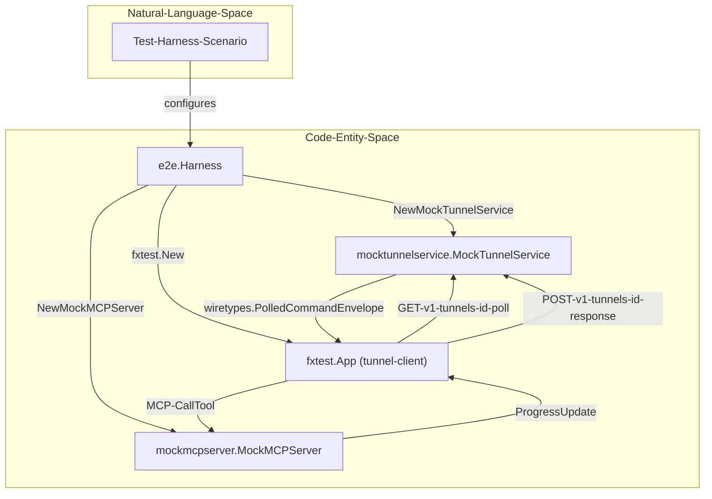
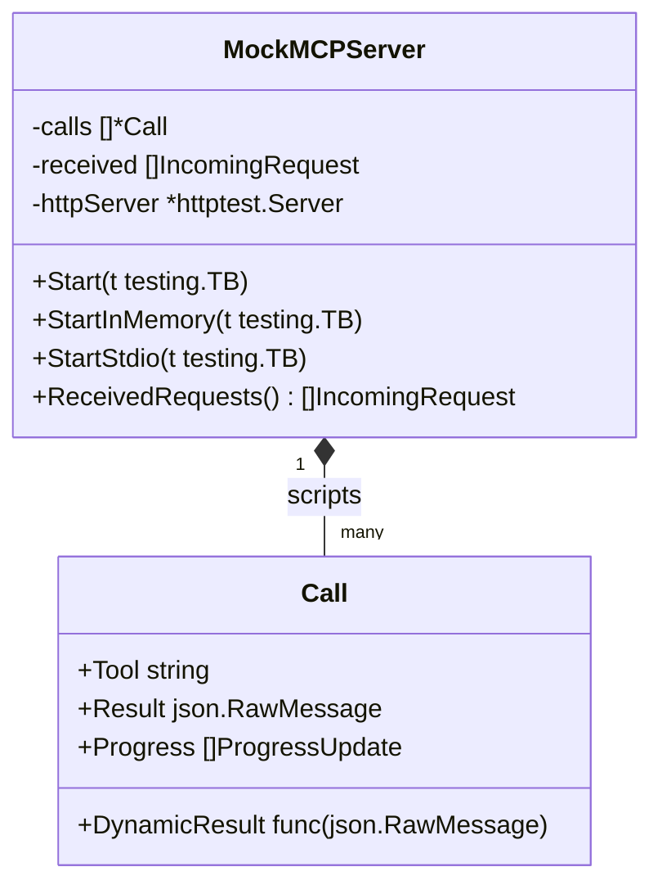
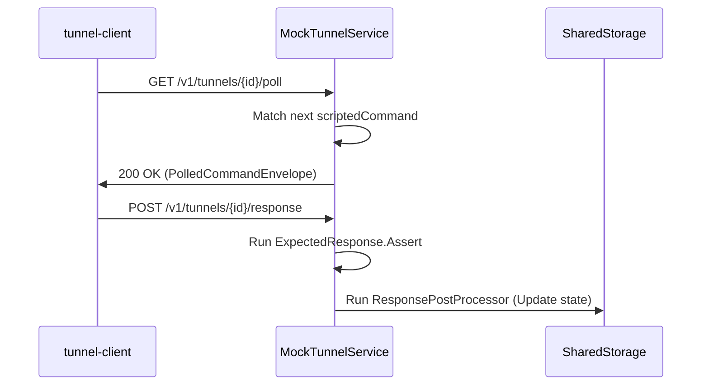

<!-- source: DeepWiki mcp.deepwiki.com · repo openai/tunnel-client · page 9.2 Mock Services: MockMCPServer and MockTunnelService · fetched 2026-10-26 -->

# Mock Services: MockMCPServer and MockTunnelService

Relevant source files

The following files were used as context for generating this wiki page:

- [e2e/redundant_pollers_e2e_test.go](e2e/redundant_pollers_e2e_test.go)
- [e2e/simple_tool_e2e_call_test.go](e2e/simple_tool_e2e_call_test.go)
- [pkg/controlplane/internal/command_parser.go](pkg/controlplane/internal/command_parser.go)
- [pkg/controlplane/internal/command_parser_test.go](pkg/controlplane/internal/command_parser_test.go)
- [pkg/controlplane/internal/command_types.go](pkg/controlplane/internal/command_types.go)
- [pkg/controlplane/polled_command.go](pkg/controlplane/polled_command.go)
- [pkg/controlplane/wiretypes/wire.go](pkg/controlplane/wiretypes/wire.go)
- [pkg/controlplane/wiretypes/wire_test.go](pkg/controlplane/wiretypes/wire_test.go)
- [testsupport/e2e/harness.go](testsupport/e2e/harness.go)
- [testsupport/mockmcpserver/doc.go](testsupport/mockmcpserver/doc.go)
- [testsupport/mockmcpserver/mock_mcp_server.go](testsupport/mockmcpserver/mock_mcp_server.go)
- [testsupport/mockmcpserver/mock_mcp_server_test.go](testsupport/mockmcpserver/mock_mcp_server_test.go)
- [testsupport/mockmcpserver/stdio_server.sh](testsupport/mockmcpserver/stdio_server.sh)
- [testsupport/mocktunnelservice/mock_tunnel_service.go](testsupport/mocktunnelservice/mock_tunnel_service.go)
- [testsupport/mocktunnelservice/mock_tunnel_service_test.go](testsupport/mocktunnelservice/mock_tunnel_service_test.go)

The `tunnel-client` testing infrastructure relies on two primary mock services to simulate the three-tier topology (OpenAI → Tunnel Service → Tunnel Client → MCP Server). These mocks allow for hermetic E2E and unit testing by scripting behaviors, asserting on received payloads, and simulating network conditions like OAuth challenges or SSE keepalives.

### Relationship Overview

The `Harness` struct in the `e2e` package wires these mocks together with a running instance of the client.

| Entity | Role | Code Entity |
| :--- | :--- | :--- |
| **Mock Control Plane** | Simulates the OpenAI Tunnel Service; provides commands via long-polling. | `mocktunnelservice.MockTunnelService` [testsupport/mocktunnelservice/mock_tunnel_service.go:220]() |
| **Mock MCP Server** | Simulates a customer's MCP server; executes scripted tool calls. | `mockmcpserver.MockMCPServer` [testsupport/mockmcpserver/mock_mcp_server.go:179]() |
| **Test Orchestrator** | Manages lifecycles, configures dependency injection, and executes scenarios. | `e2e.Harness` [testsupport/e2e/harness.go:192]() |

#### Data Flow: Natural Language to Code Entities

This diagram illustrates how a test scenario (Natural Language Space) translates into specific code entities and interactions (Code Entity Space).

**Test Execution Flow**

Sources: [testsupport/e2e/harness.go:192-212](), [testsupport/mockmcpserver/mock_mcp_server.go:224-232](), [testsupport/mocktunnelservice/mock_tunnel_service.go:243-252](), [testsupport/mocktunnelservice/mock_tunnel_service.go:80-86]()

---

## MockMCPServer

`MockMCPServer` hosts a Model Context Protocol (MCP) server. It is highly configurable via `Option` functions and supports multiple transport layers.

### Key Capabilities
*   **Scripted Tool Calls**: Pre-define responses for specific tool names using `Call` objects [testsupport/mockmcpserver/mock_mcp_server.go:35-42]().
*   **Dynamic Results**: Provide a function to generate responses based on incoming arguments via `DynamicResult` [testsupport/mockmcpserver/mock_mcp_server.go:38-38]().
*   **Progress Notifications**: Simulate long-running tasks by emitting `ProgressUpdate` events during a streaming response [testsupport/mockmcpserver/mock_mcp_server.go:49-53]().
*   **OAuth Protection**: Middleware to simulate `WWW-Authenticate` probes and protected resource metadata via `WithWWWAuthenticateProbe` and `WithProtectedResourceMetadata` [testsupport/mockmcpserver/mock_mcp_server.go:120-136]().
*   **Keepalive Pings**: Injects SSE keepalive ping events ahead of responses to test client connection stability [testsupport/mockmcpserver/mock_mcp_server.go:94-99]().

### Transport Modes
The mock can be started in three modes to test different `tunnel-client` transport implementations:
1.  **Streamable HTTP**: Standard mode using `httptest.Server` [testsupport/mockmcpserver/mock_mcp_server.go:235-263]().
2.  **In-Memory**: Uses `mcp.InMemoryTransport` for high-performance, local-process testing [testsupport/mockmcpserver/mock_mcp_server_test.go:185-196]().
3.  **Stdio**: Uses a helper to simulate a sub-process MCP server over standard input/output [testsupport/mockmcpserver/mock_mcp_server_test.go:223-232]().

**MockMCPServer Implementation Detail**

Sources: [testsupport/mockmcpserver/mock_mcp_server.go:179-213](), [testsupport/mockmcpserver/mock_mcp_server.go:35-42]()

---

## MockTunnelService

`MockTunnelService` simulates the OpenAI-side control plane. Its primary role is to manage the poll-response queue that the `tunnel-client` consumes.

### Command Scripting
Tests use `CommandResponse` to define what the client should receive when it polls, and what the mock expects back.

*   **Poll Queue**: Commands are queued as `scriptedCommand` objects and delivered to the client during its `GET /poll` loop [testsupport/mocktunnelservice/mock_tunnel_service.go:198-207]().
*   **Response Assertion**: Each `CommandResponse` includes an `ExpectedResponse` slice with an `Assert` function to validate the client's POSTed output [testsupport/mocktunnelservice/mock_tunnel_service.go:81-86]().
*   **Session Header Propagation**: Automatically propagates `Mcp-Session-Id` between responses and subsequent commands when enabled via `WithSessionHeaderPropagation` [testsupport/mocktunnelservice/mock_tunnel_service.go:58-64]().

### Wire Types and Parsing
The mock uses `wiretypes` to ensure the JSON structure matches the production control plane:
*   `PolledCommandEnvelope`: The top-level container for commands [pkg/controlplane/wiretypes/wire.go:135-137]().
*   `BaseRawPolledCommand`: Contains common fields like `request_id`, `shard_token`, and `created_at` [pkg/controlplane/wiretypes/wire.go:91-108]().
*   `ResponseTimeoutDuration`: Handles parsing of duration strings (e.g., "30s", "4500ms") for command lifecycles [pkg/controlplane/wiretypes/wire.go:42-56]().

**Command Life Cycle**

Sources: [testsupport/mocktunnelservice/mock_tunnel_service.go:187-196](), [testsupport/mocktunnelservice/mock_tunnel_service.go:109-112](), [pkg/controlplane/wiretypes/wire.go:79-86]()

---

## Stdio Helpers and Utilities

### Stdio Server Helper
The `stdio_server.sh` and associated helpers facilitate testing the `stdio` transport. It allows the Go-based `MockMCPServer` to be executed as a child process, bridging standard I/O to the mock's logic [testsupport/mockmcpserver/mock_mcp_server_test.go:232]().

### Test Context and Deadlines
To prevent tests from hanging indefinitely in CI, the harness respects timeouts. The `testDeadlineReserve` (5 seconds) is used to ensure there is room for failure state dumps and cleanup before the outer runner stops the test [testsupport/e2e/harness.go:36-36]().

| Function / Const | Purpose |
| :--- | :--- |
| `WithUnixSocketPath` | Configures mocks to serve over Unix-domain sockets instead of TCP [testsupport/mockmcpserver/mock_mcp_server.go:173-177](). |
| `WithPollWaitLimit` | Overrides the block time for `GET /poll` before returning an empty list [testsupport/mocktunnelservice/mock_tunnel_service.go:52-56](). |
| `SharedStorage` | Concurrency-safe map for passing state between command mutators and response processors [testsupport/mocktunnelservice/mock_tunnel_service.go:113-117](). |

Sources: [testsupport/mocktunnelservice/mock_tunnel_service.go:144-180](), [testsupport/e2e/harness.go:35-36]()

---

