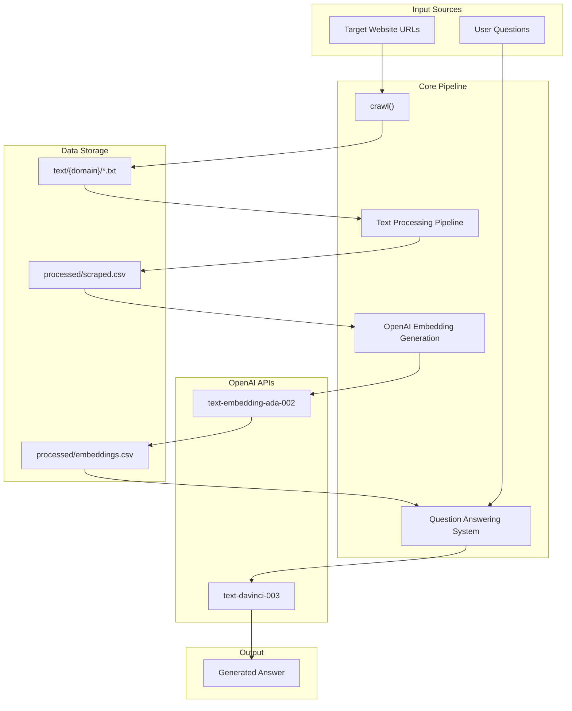
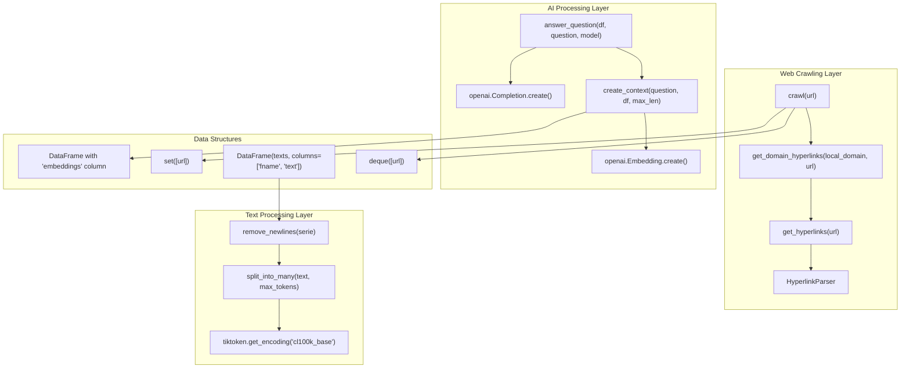

<!-- source: DeepWiki mcp.deepwiki.com · repo openai/web-crawl-q-and-a-example · page 1 Overview · fetched 2026-10-26 -->

# Overview

Relevant source files

The following files were used as context for generating this wiki page:

- [README.md](README.md)
- [requirements.txt](requirements.txt)
- [web-qa.py](web-qa.py)

## Purpose and Scope

This document provides a comprehensive overview of the web crawl Q&A system, a Retrieval-Augmented Generation (RAG) implementation that crawls websites and enables question-answering using OpenAI's embedding and completion APIs. The system extracts content from web pages, processes it into searchable chunks, and provides contextually relevant answers to user questions.

The system implements a complete pipeline from web crawling to question answering, demonstrating practical application of modern NLP techniques for building domain-specific knowledge bases. For detailed implementation specifics of individual components, see [Core Implementation](#2). For setup and configuration guidance, see [Setup and Configuration](#4).

## System Architecture

The web crawl Q&A system follows a sequential pipeline architecture that transforms raw web content into a searchable knowledge base capable of answering questions.

### High-Level Architecture

Sources: [web-qa.py:115-169](), [web-qa.py:175-206](), [web-qa.py:302-304](), [web-qa.py:352-391]()

## Core Components

The system is built around several key functions that handle different stages of the pipeline, from web content extraction to answer generation.

### Component Architecture with Code Entities

Sources: [web-qa.py:31-43](), [web-qa.py:50-71](), [web-qa.py:78-108](), [web-qa.py:115-169](), [web-qa.py:175-181](), [web-qa.py:231-267](), [web-qa.py:319-350](), [web-qa.py:352-391]()

## Data Flow Pipeline

The system processes data through four distinct stages, each producing intermediate outputs that feed into the next stage.

| Stage | Input | Process | Output | Key Functions |
|-------|-------|---------|--------|---------------|
| **Web Crawling** | Website URLs | HTML extraction, link discovery | `text/{domain}/*.txt` | `crawl()`, `get_hyperlinks()` |
| **Text Processing** | Raw text files | Cleaning, tokenization, chunking | `processed/scraped.csv` | `remove_newlines()`, `split_into_many()` |
| **Embedding Generation** | Processed text chunks | OpenAI API embedding creation | `processed/embeddings.csv` | `openai.Embedding.create()` |
| **Question Answering** | User question + embeddings | Context retrieval, answer generation | Text response | `create_context()`, `answer_question()` |

### Processing Flow Details

The `crawl()` function implements breadth-first traversal using a `deque` queue and `set` for tracking visited URLs [web-qa.py:115-169](). Text processing applies multiple cleaning steps through `remove_newlines()` and handles token limits via `split_into_many()` with a default `max_tokens = 500` [web-qa.py:228-267](). 

The embedding stage uses OpenAI's `text-embedding-ada-002` model to generate 1536-dimensional vectors for each text chunk [web-qa.py:302](). Question answering employs cosine similarity through `distances_from_embeddings()` to retrieve relevant context before generating responses with `text-davinci-003` [web-qa.py:327-391]().

Sources: [web-qa.py:115-169](), [web-qa.py:175-206](), [web-qa.py:228-304](), [web-qa.py:319-391]()

## Technology Stack

The system leverages a comprehensive set of Python libraries optimized for web scraping, data processing, and machine learning workflows.

### Core Dependencies

| Category | Libraries | Purpose |
|----------|-----------|---------|
| **Web Scraping** | `requests`, `beautifulsoup4`, `urllib` | HTTP requests, HTML parsing |
| **Data Processing** | `pandas`, `numpy` | DataFrames, numerical operations |
| **AI/ML** | `openai`, `tiktoken`, `scikit-learn` | OpenAI API, tokenization, similarity metrics |
| **Async Operations** | `aiohttp`, `asyncio` | Asynchronous HTTP handling |
| **Visualization** | `matplotlib`, `plotly` | Data analysis and plotting |

The system requires `openai==0.26.1` for API compatibility and `tiktoken==0.1.2` for tokenization that matches OpenAI's `text-embedding-ada-002` model [requirements.txt:39](), [requirements.txt:69](). The `cl100k_base` tokenizer encoding is specifically chosen to align with the ada-002 embedding model [web-qa.py:213]().

### Implementation Variants

The codebase provides two implementation approaches:
- **Script Implementation**: Production-ready `web-qa.py` for automated execution
- **Notebook Implementation**: Interactive `web-qa.ipynb` for experimentation and development

Both implementations share the same core functions and data processing pipeline, enabling users to choose the appropriate interface for their workflow. For detailed comparison of these variants, see [Implementation Variants](#3).

Sources: [requirements.txt:1-80](), [web-qa.py:5-18](), [web-qa.py:213](), [README.md:1-4]()

---

