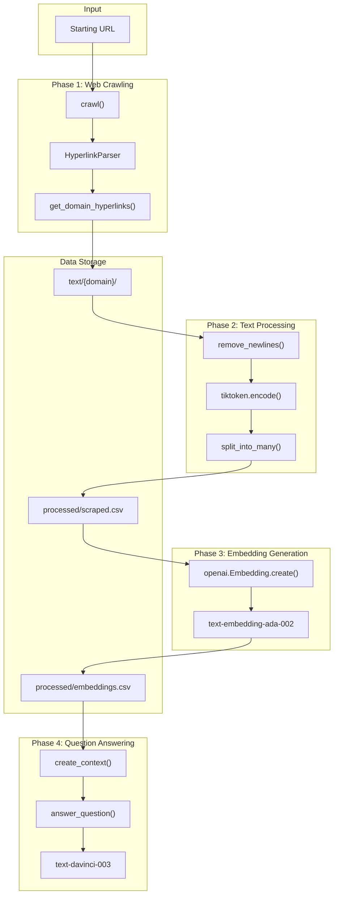
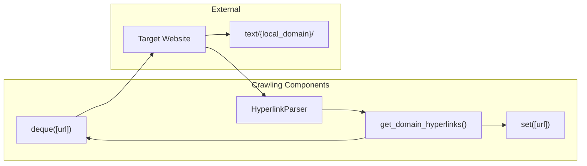
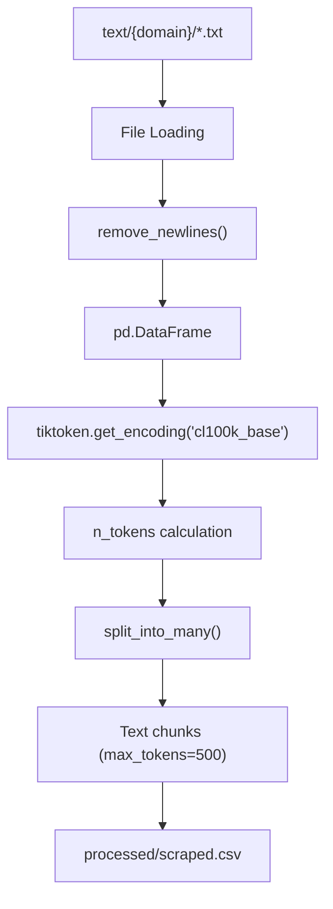
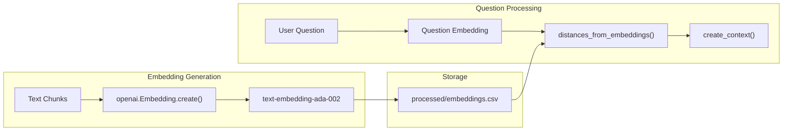
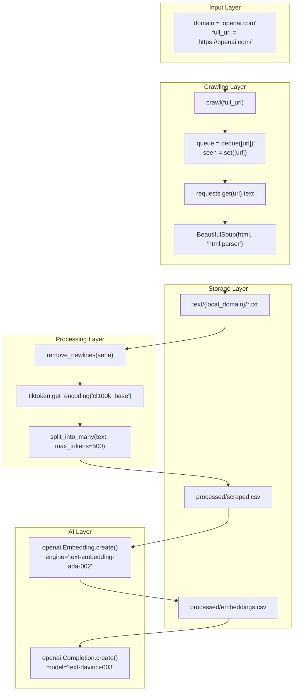
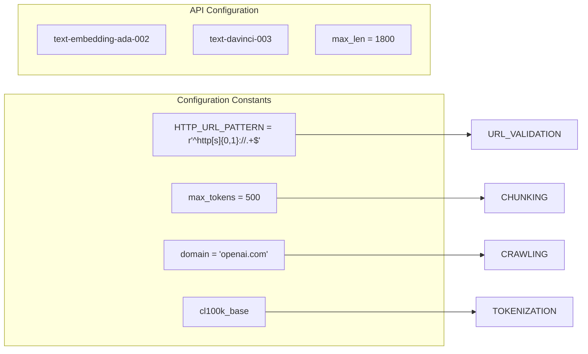

<!-- source: DeepWiki mcp.deepwiki.com · repo openai/web-crawl-q-and-a-example · page 1.1 System Architecture · fetched 2026-10-26 -->

# System Architecture

Relevant source files

The following files were used as context for generating this wiki page:

- [web-qa.ipynb](web-qa.ipynb)
- [web-qa.py](web-qa.py)

## Purpose and Scope

This document describes the system architecture of the web crawling and question-answering pipeline that implements a Retrieval-Augmented Generation (RAG) pattern. The system crawls websites, processes the content into embeddings, and provides question-answering capabilities using OpenAI's embedding and completion APIs.

For information about the specific implementation variants, see [Script Implementation](#3.1) and [Notebook Implementation](#3.2). For details about dependencies and setup, see [Dependencies and Requirements](#4.1).

## High-Level System Architecture

The system follows a linear pipeline architecture with four distinct phases: web crawling, text processing, embedding generation, and question answering.

**Sources:** [web-qa.py:1-400](), [web-qa.ipynb:1-1194]()

## Core Components

### Web Crawling System

The crawling system uses a breadth-first approach with domain filtering to systematically extract content from websites.

| Component | Function | Key Responsibilities |
|-----------|----------|---------------------|
| `HyperlinkParser` | HTML parsing | Extracts href attributes from anchor tags |
| `get_hyperlinks()` | Link extraction | Fetches and parses HTML content from URLs |
| `get_domain_hyperlinks()` | Domain filtering | Filters links to stay within target domain |
| `crawl()` | Orchestration | Manages queue, deduplication, and file storage |

**Sources:** [web-qa.py:31-169](), [web-qa.ipynb:535-653]()

### Text Processing Pipeline

The processing pipeline transforms raw HTML content into tokenized chunks suitable for embedding generation.

**Sources:** [web-qa.py:175-293](), [web-qa.ipynb:662-837]()

### Embedding and Context Retrieval System

The system uses OpenAI's embedding API to convert text chunks into vector representations for semantic similarity search.

**Sources:** [web-qa.py:302-350](), [web-qa.ipynb:928-1082]()

## Data Flow Architecture

The system processes data through a series of transformations, with each stage producing intermediate outputs that feed into the next stage.

**Sources:** [web-qa.py:27-28](), [web-qa.py:115-169](), [web-qa.py:187-304]()

## Implementation Patterns

### Error Handling and Robustness

The system implements several error handling patterns to ensure robustness during web crawling and API interactions:

| Pattern | Location | Purpose |
|---------|----------|---------|
| Try-catch in crawling | [web-qa.py:144-161]() | Handles network errors and parsing failures |
| Content-type validation | [web-qa.py:58-59]() | Ensures only HTML content is processed |
| JavaScript detection | [web-qa.py:155-156]() | Skips pages requiring JavaScript |
| API error handling | [web-qa.py:376-391]() | Graceful degradation for OpenAI API failures |

### Configuration and Constants

**Sources:** [web-qa.py:21](), [web-qa.py:228](), [web-qa.py:27](), [web-qa.py:213](), [web-qa.py:302](), [web-qa.py:354]()

### Directory Structure and File Management

The system creates a structured file hierarchy for organizing crawled content and processed data:

- `text/{domain}/` - Raw text files from crawled pages
- `processed/scraped.csv` - Cleaned and structured text data  
- `processed/embeddings.csv` - Text data with generated embeddings

**Sources:** [web-qa.py:126-134](), [web-qa.py:205](), [web-qa.py:303]()

---

