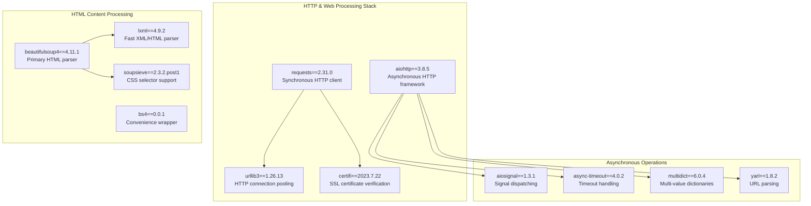
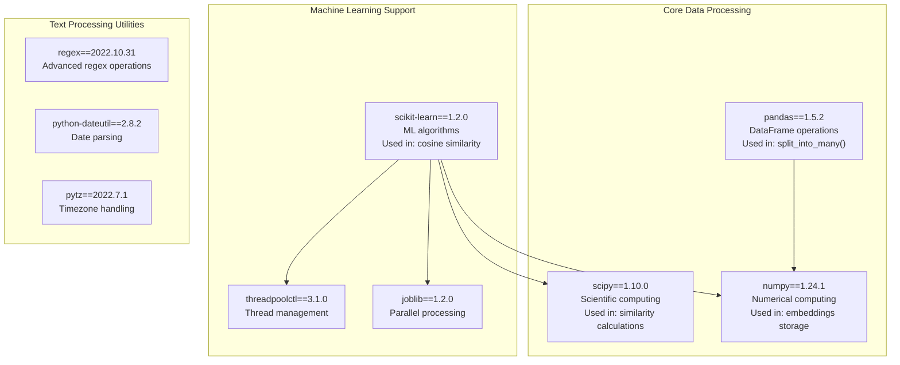
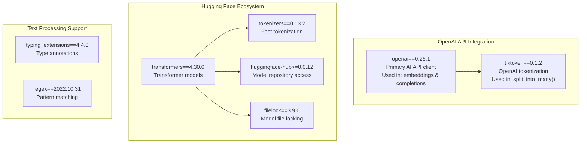
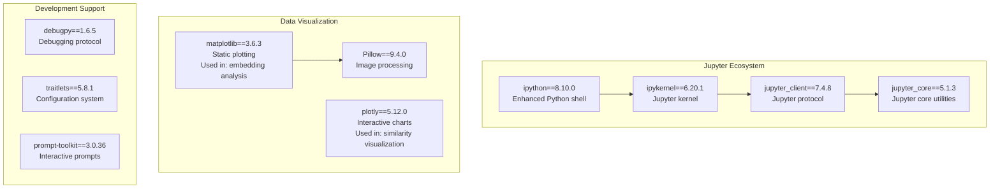
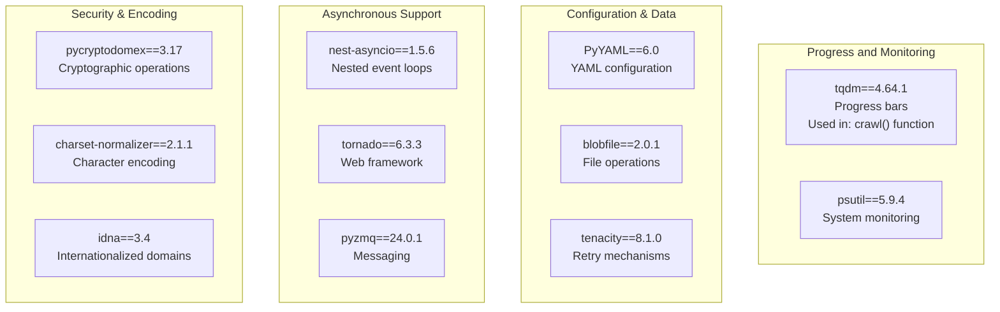
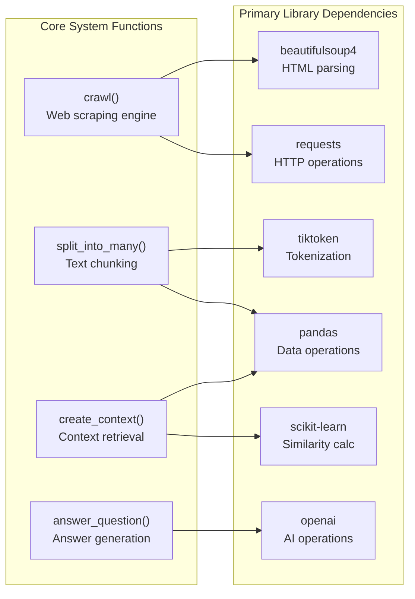

<!-- source: DeepWiki mcp.deepwiki.com · repo openai/web-crawl-q-and-a-example · page 1.2 Technology Stack · fetched 2026-10-26 -->

# Technology Stack

Relevant source files

The following files were used as context for generating this wiki page:

- [requirements.txt](requirements.txt)

This document details the comprehensive technology stack used in the web crawl Q&A system, explaining the dependencies and architectural choices that enable web scraping, text processing, embedding generation, and question answering functionality. For information about how these technologies are used in practice, see [Core Implementation](#2).

The system leverages a modern Python ecosystem that combines web scraping capabilities, data science tools, machine learning frameworks, and OpenAI's API services to implement a Retrieval-Augmented Generation (RAG) architecture.

## Technology Categories

The technology stack is organized into five primary categories, each serving specific system requirements:

| Category | Primary Purpose | Key Libraries |
|----------|----------------|---------------|
| Web & HTTP | Content retrieval and parsing | `requests`, `aiohttp`, `beautifulsoup4` |
| Data Science | Text processing and analysis | `pandas`, `numpy`, `scikit-learn` |
| Machine Learning & NLP | Embeddings and tokenization | `openai`, `tiktoken`, `transformers` |
| Development Environment | Interactive development | `jupyter`, `ipython`, `matplotlib` |
| System Utilities | Progress tracking and configuration | `tqdm`, `PyYAML`, `asyncio` |

## Web Scraping and HTTP Stack

### Core HTTP Libraries

The web scraping stack provides both synchronous and asynchronous HTTP capabilities. The `requests` library handles straightforward HTTP operations in the `crawl()` function, while `aiohttp` enables concurrent web scraping for improved performance. `beautifulsoup4` with `lxml` backend provides robust HTML parsing for content extraction.

*Sources: [requirements.txt:61](), [requirements.txt:1](), [requirements.txt:8](), [requirements.txt:33]()*

## Data Science and Processing Stack

### Data Manipulation Framework

The data science stack centers around `pandas` for structured data manipulation, particularly in the `split_into_many()` function for text chunking and CSV operations. `scikit-learn` provides cosine similarity calculations for the `create_context()` function, while `numpy` handles efficient numerical operations on embedding vectors.

*Sources: [requirements.txt:41](), [requirements.txt:38](), [requirements.txt:62](), [requirements.txt:63]()*

## Machine Learning and NLP Stack

### AI and Language Processing

The ML/NLP stack is anchored by the `openai` library, which interfaces with OpenAI's `text-embedding-ada-002` model for embedding generation and `text-davinci-003` for answer generation. `tiktoken` provides accurate token counting for the text chunking process, ensuring chunks fit within model context limits.

*Sources: [requirements.txt:39](), [requirements.txt:69](), [requirements.txt:74](), [requirements.txt:70]()*

## Development and Visualization Environment

### Interactive Development Stack

The development environment supports both script-based execution ([web-qa.py]()) and interactive notebook development ([web-qa.ipynb]()). `matplotlib` and `plotly` enable visualization of embedding similarities and system performance metrics during development and analysis phases.

*Sources: [requirements.txt:27](), [requirements.txt:26](), [requirements.txt:34](), [requirements.txt:48]()*

## System Utilities and Configuration

### Infrastructure Support Libraries

System utilities provide essential infrastructure support. `tqdm` delivers progress tracking during long-running crawl operations, while `PyYAML` enables configuration management. Security libraries handle character encoding normalization and cryptographic operations for robust web content processing.

*Sources: [requirements.txt:72](), [requirements.txt:58](), [requirements.txt:37](), [requirements.txt:53]()*

## Technology Integration Architecture

### Function-to-Library Mapping

This mapping demonstrates how core system functions depend on specific technology choices. Each major function leverages multiple libraries to achieve its functionality, creating a cohesive technology ecosystem that supports the RAG architecture.

*Sources: [requirements.txt:61](), [requirements.txt:8](), [requirements.txt:41](), [requirements.txt:69](), [requirements.txt:62](), [requirements.txt:39]()*

---

