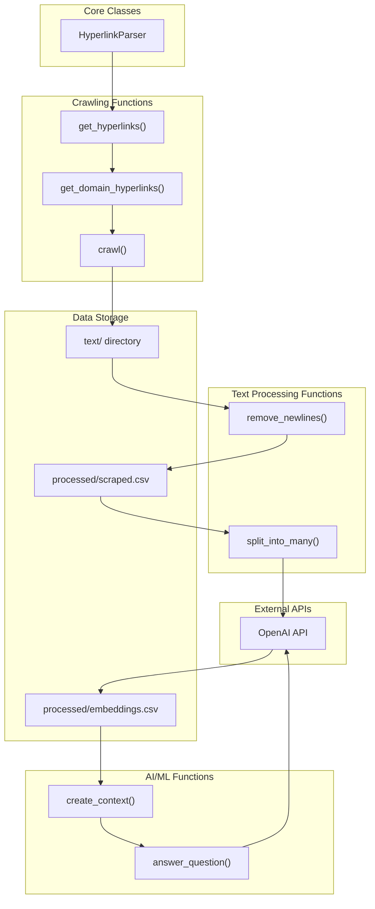
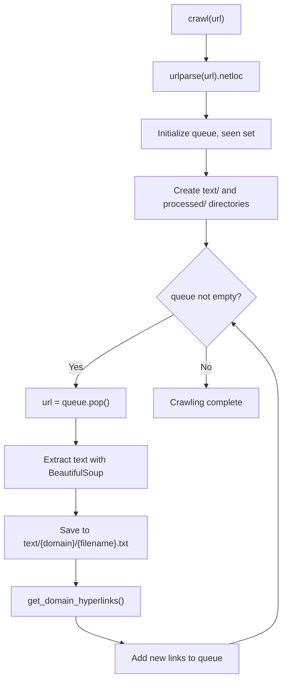
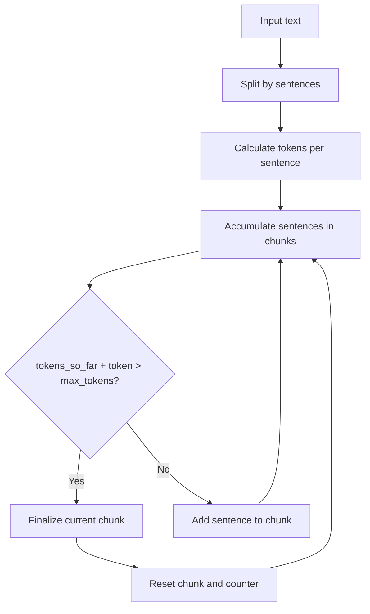
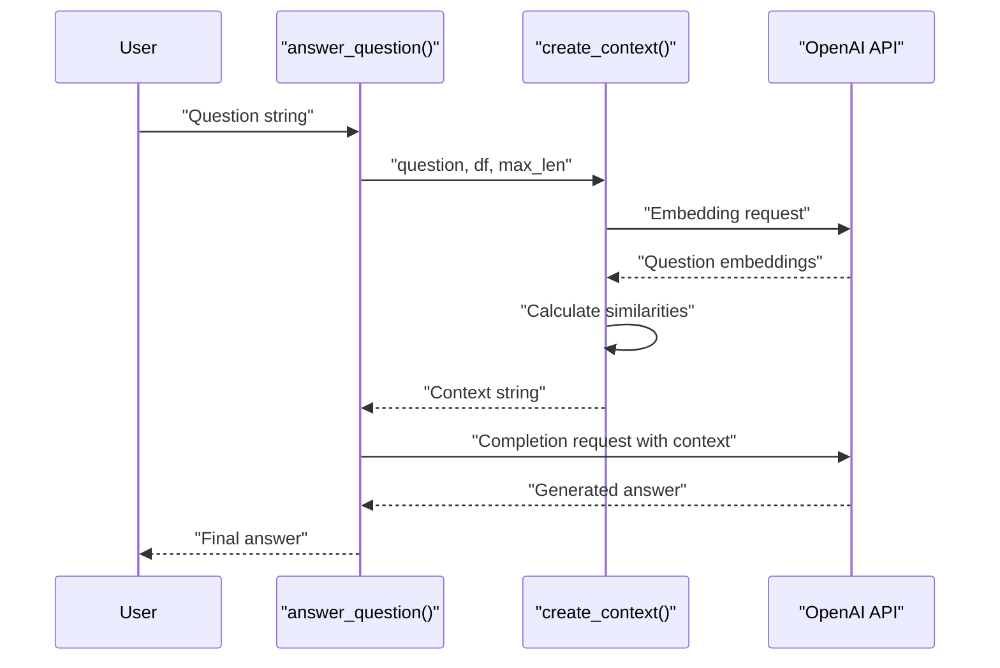

<!-- source: DeepWiki mcp.deepwiki.com · repo openai/web-crawl-q-and-a-example · page 2 Core Implementation · fetched 2026-10-26 -->

# Core Implementation

Relevant source files

The following files were used as context for generating this wiki page:

- [web-qa.ipynb](web-qa.ipynb)
- [web-qa.py](web-qa.py)

This document covers the core implementation components of the web crawl Q&A system, including the main classes, functions, and data processing pipeline that enable crawling websites and answering questions based on the extracted content. For information about setting up dependencies and running the system, see [Setup and Configuration](#4). For details about the different implementation variants, see [Implementation Variants](#3).

## System Overview

The core implementation consists of two functionally identical implementations: a production script ([web-qa.py]()) and an interactive notebook ([web-qa.ipynb]()). Both implementations follow the same Retrieval-Augmented Generation (RAG) architecture, combining web crawling, text processing, embedding generation, and question answering capabilities.

**Sources:** [web-qa.py:1-400](), [web-qa.ipynb:1-1194]()

## Web Crawling System

The web crawling functionality is built around the `HyperlinkParser` class and associated helper functions that extract and process web content systematically.

### HyperlinkParser Class

The `HyperlinkParser` class extends Python's `HTMLParser` to extract hyperlinks from HTML content.

| Component | Purpose | Key Methods |
|-----------|---------|-------------|
| `HyperlinkParser` | HTML parsing for link extraction | `handle_starttag()` |
| `hyperlinks` attribute | Stores extracted links | List accumulator |

The class overrides `handle_starttag()` to capture `href` attributes from anchor tags, building a list of discovered hyperlinks.

**Sources:** [web-qa.py:31-43](), [web-qa.ipynb:535-547]()

### Link Processing Functions

| Function | Parameters | Return Value | Purpose |
|----------|------------|--------------|---------|
| `get_hyperlinks()` | `url: str` | `List[str]` | Extract all hyperlinks from a webpage |
| `get_domain_hyperlinks()` | `local_domain: str, url: str` | `List[str]` | Filter links within the same domain |

The `get_hyperlinks()` function handles HTTP requests, content-type validation, and HTML parsing, while `get_domain_hyperlinks()` applies domain filtering and URL normalization.

**Sources:** [web-qa.py:49-108](), [web-qa.ipynb:549-600]()

### Crawling Engine

The `crawl()` function implements a breadth-first web crawling algorithm using a queue-based approach:

The crawler maintains a `seen` set to prevent duplicate processing and creates domain-specific directory structures for organizing extracted content.

**Sources:** [web-qa.py:115-169](), [web-qa.ipynb:603-653]()

## Text Processing Pipeline

The text processing pipeline transforms raw HTML content into structured, tokenized chunks suitable for embedding generation.

### Text Cleaning

The `remove_newlines()` function standardizes text formatting by removing various newline patterns and normalizing whitespace:

- Converts `\n` to spaces
- Converts `\\n` to spaces  
- Collapses multiple consecutive spaces

**Sources:** [web-qa.py:175-180](), [web-qa.ipynb:662-667]()

### Text Chunking

The `split_into_many()` function implements sentence-based text chunking with token-aware boundaries:

| Parameter | Type | Default | Purpose |
|-----------|------|---------|---------|
| `text` | `str` | - | Input text to chunk |
| `max_tokens` | `int` | `500` | Maximum tokens per chunk |

The algorithm splits text into sentences, calculates token counts using the `tiktoken` tokenizer, and groups sentences into chunks while respecting token limits.

**Sources:** [web-qa.py:231-267](), [web-qa.ipynb:751-787]()

## Embedding and Question Answering

The system uses OpenAI's embedding model to create vector representations of text chunks and implements similarity-based context retrieval for question answering.

### Context Creation

The `create_context()` function implements semantic search over the text corpus:

| Parameter | Type | Default | Purpose |
|-----------|------|---------|---------|
| `question` | `str` | - | User question |
| `df` | `DataFrame` | - | Text chunks with embeddings |
| `max_len` | `int` | `1800` | Maximum context length in tokens |
| `size` | `str` | `"ada"` | Embedding model size |

The function generates embeddings for the question, calculates cosine distances to all text chunks, and assembles the most relevant chunks into a context string.

**Sources:** [web-qa.py:319-350](), [web-qa.ipynb:1051-1082]()

### Answer Generation

The `answer_question()` function orchestrates the complete question-answering process:

The function constructs a prompt template that includes the retrieved context and the user question, then calls OpenAI's completion API to generate the final answer.

**Sources:** [web-qa.py:352-391](), [web-qa.ipynb:1084-1123]()

## Data Flow Architecture

The complete data processing pipeline transforms web content through multiple stages:

```mermaid
flowchart LR
    subgraph "Input Stage"
        URL["Target URL"]
    end
    
    subgraph "Crawling Stage"
        CRAWL_FN["crawl()"]
        PARSER["HyperlinkParser"]
        TEXT_FILES["text/{domain}/*.txt"]
    end
    
    subgraph "Processing Stage"
        CLEAN["remove_newlines()"]
        CHUNK["split_into_many()"]
        CSV1["processed/scraped.csv"]
    end
    
    subgraph "Embedding Stage"
        EMBED_API["OpenAI Embedding API"]
        CSV2["processed/embeddings.csv"]
    end
    
    subgraph "Query Stage"
        QUESTION["User Question"]
        CONTEXT_FN["create_context()"]
        ANSWER_FN["answer_question()"]
        COMPLETION_API["OpenAI Completion API"]
        RESULT["Generated Answer"]
    end
    
    URL --> CRAWL_FN
    CRAWL_FN --> PARSER
    PARSER --> TEXT_FILES
    TEXT_FILES --> CLEAN
    CLEAN --> CHUNK
    CHUNK --> CSV1
    CSV1 --> EMBED_API
    EMBED_API --> CSV2
    
    QUESTION --> CONTEXT_FN
    CSV2 --> CONTEXT_FN
    CONTEXT_FN --> ANSWER_FN
    ANSWER_FN --> COMPLETION_API
    COMPLETION_API --> RESULT
```

This architecture enables the system to process arbitrary websites and answer questions about their content using state-of-the-art language models and semantic search techniques.

**Sources:** [web-qa.py:1-400](), [web-qa.ipynb:1-1194]()

---

