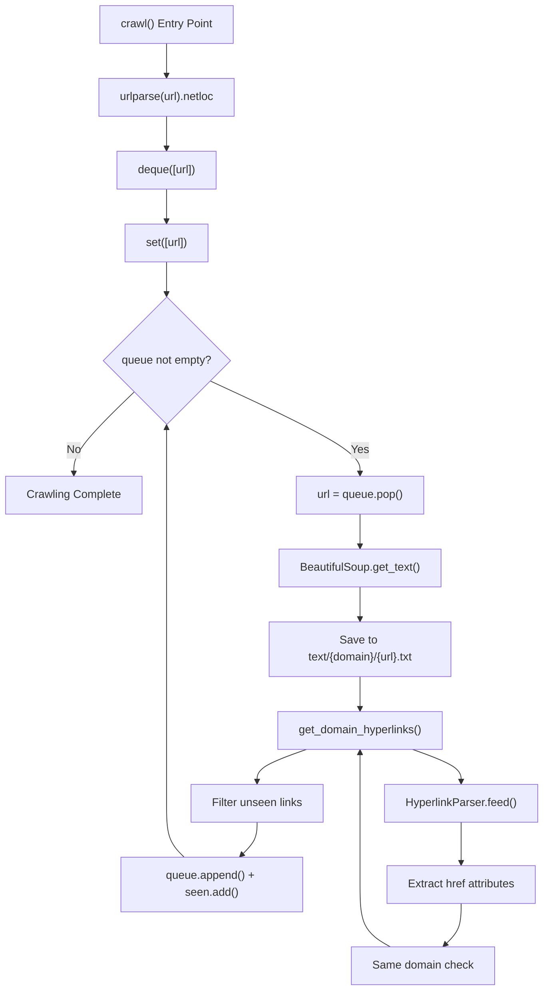
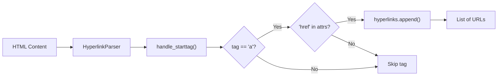
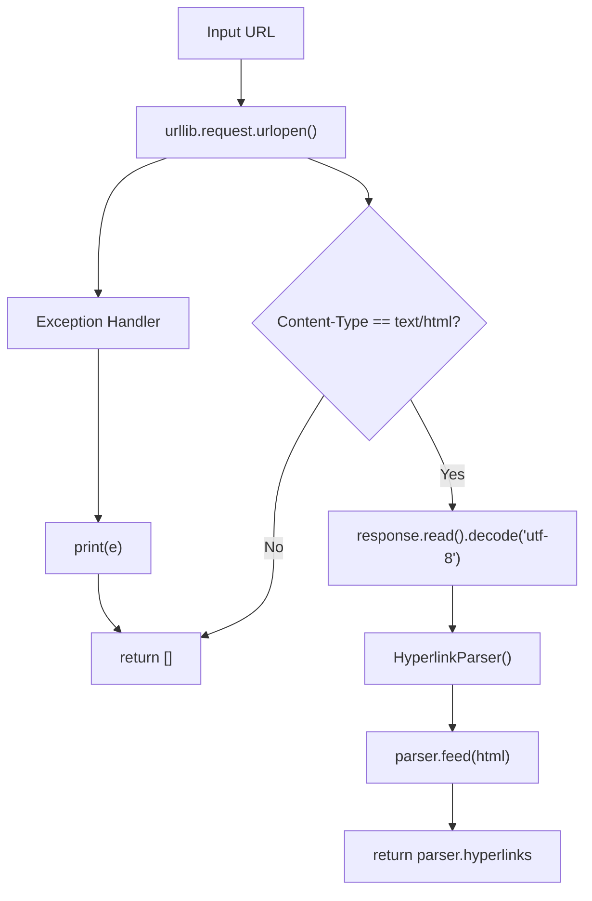
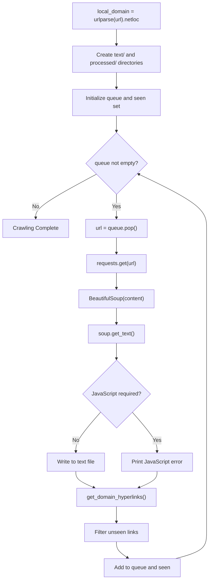
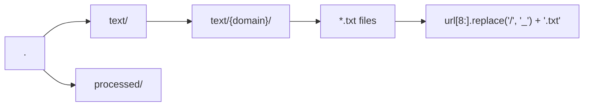
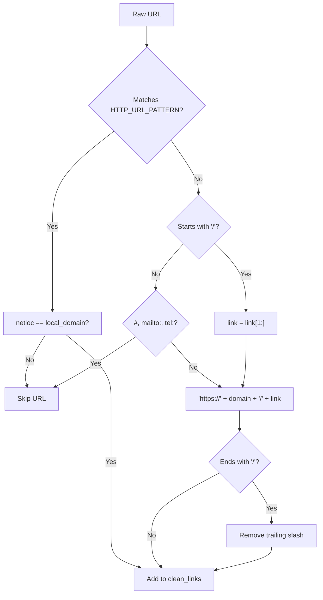

<!-- source: DeepWiki mcp.deepwiki.com · repo openai/web-crawl-q-and-a-example · page 2.1 Web Crawling System · fetched 2026-10-26 -->

# Web Crawling System

Relevant source files

The following files were used as context for generating this wiki page:

- [web-qa.ipynb](web-qa.ipynb)
- [web-qa.py](web-qa.py)

This document covers the web crawling component of the Q&A system, which systematically discovers and extracts text content from websites within a specified domain. The crawler serves as the data ingestion layer that feeds raw content into the subsequent text processing pipeline.

For information about text processing and cleaning of crawled content, see [Text Processing Pipeline](#2.2). For details about embedding generation and question answering functionality, see [Embedding and Question Answering](#2.3).

## Purpose and Architecture

The web crawling system implements a breadth-first traversal of a website's link structure, extracting textual content from HTML pages while respecting domain boundaries. The system operates as a single-threaded, synchronous crawler that maintains a queue of URLs to process and tracks visited pages to avoid infinite loops.

**Sources:** [web-qa.py:115-168](), [web-qa.ipynb:603-653]()

## Core Components

### HyperlinkParser Class

The `HyperlinkParser` extends Python's `HTMLParser` to extract hyperlinks from HTML content. It specifically targets anchor tags (`<a>`) and collects their `href` attributes.

| Method | Purpose | Implementation |
|--------|---------|---------------|
| `__init__()` | Initialize empty hyperlinks list | [web-qa.py:32-35]() |
| `handle_starttag()` | Process HTML tags and extract href attributes | [web-qa.py:38-43]() |

**Sources:** [web-qa.py:31-43](), [web-qa.ipynb:535-547]()

### URL Processing Functions

The system employs a two-stage URL processing approach: initial extraction followed by domain filtering.

#### get_hyperlinks Function

**Sources:** [web-qa.py:50-71](), [web-qa.ipynb:550-571]()

#### get_domain_hyperlinks Function

This function filters extracted links to ensure they belong to the target domain and converts relative URLs to absolute URLs.

| Link Type | Processing Logic | Example |
|-----------|------------------|---------|
| Absolute URL | Check if `netloc` matches target domain | `https://openai.com/blog` |
| Relative URL | Prepend domain and protocol | `/blog` → `https://openai.com/blog` |
| Fragment/mailto/tel | Skip processing | `#section`, `mailto:`, `tel:` |

**Sources:** [web-qa.py:78-108](), [web-qa.ipynb:574-600]()

## Crawling Engine

### Main Crawl Function

The `crawl()` function implements the core crawling logic using a breadth-first search pattern:

**Sources:** [web-qa.py:115-168](), [web-qa.ipynb:603-653]()

### File Organization

The crawler creates a structured directory layout for storing extracted content:

| Directory | Purpose | Example |
|-----------|---------|---------|
| `text/` | Root directory for raw content | Created by [web-qa.py:126-127]() |
| `text/{domain}/` | Domain-specific content storage | `text/openai.com/` |
| `processed/` | Directory for processed data | Created by [web-qa.py:133-134]() |

**Sources:** [web-qa.py:126-134](), [web-qa.ipynb:614-622]()

## Error Handling and Limitations

### Content Type Validation

The system includes safeguards to ensure only HTML content is processed:

- **MIME Type Check**: Verifies `Content-Type` starts with `text/html` [web-qa.py:58-59]()
- **JavaScript Detection**: Identifies pages requiring JavaScript rendering [web-qa.py:155-156]()
- **Exception Handling**: Catches and logs URL access failures [web-qa.py:160-161]()

### URL Sanitization

The domain filtering logic handles various URL formats:

**Sources:** [web-qa.py:78-108](), [web-qa.ipynb:574-600]()

The web crawling system provides a robust foundation for content extraction while maintaining domain boundaries and handling common web content scenarios. The extracted content feeds directly into the text processing pipeline for further refinement and preparation for embedding generation.

---

