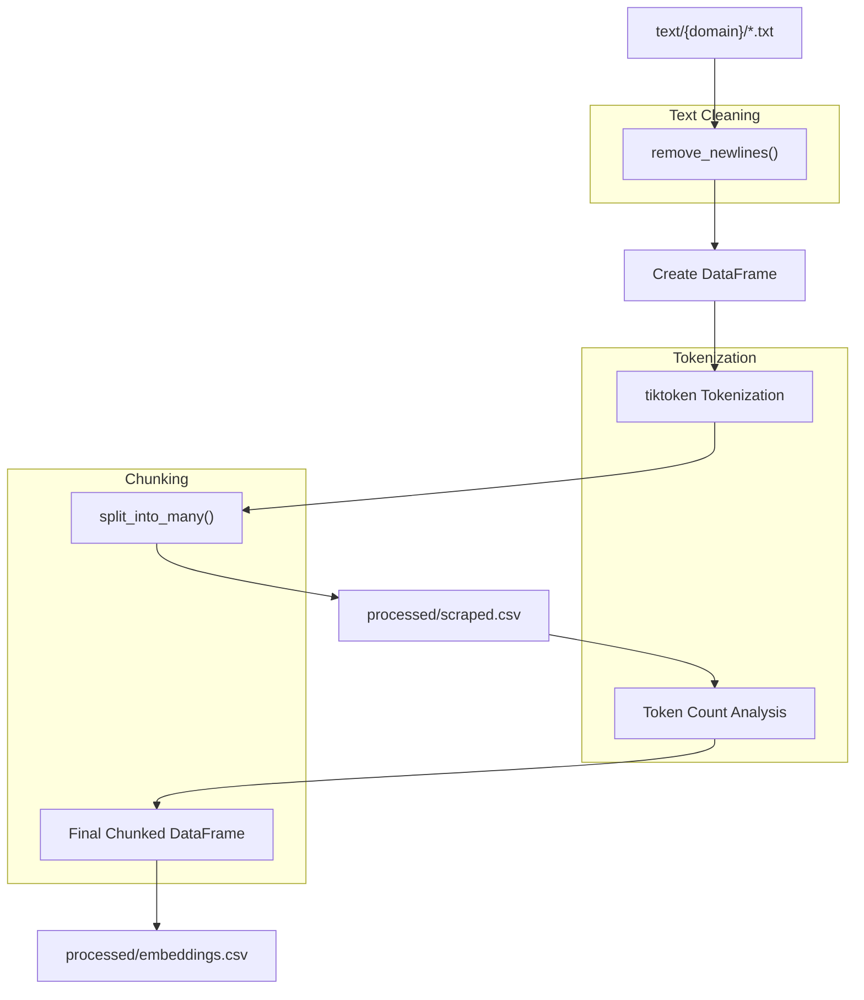
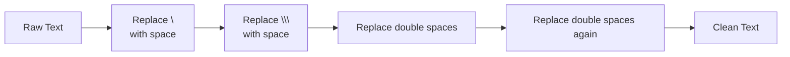
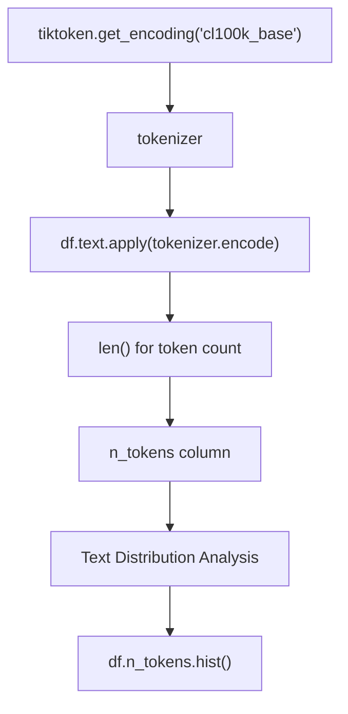
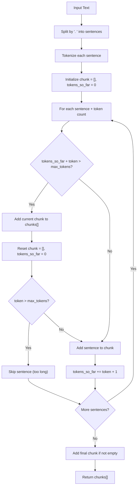
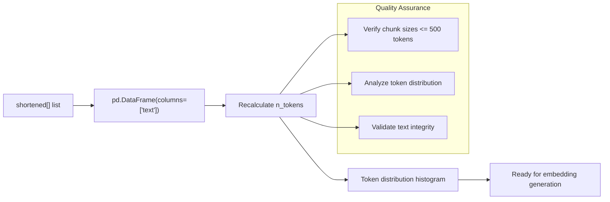

<!-- source: DeepWiki mcp.deepwiki.com · repo openai/web-crawl-q-and-a-example · page 2.2 Text Processing Pipeline · fetched 2026-10-26 -->

# Text Processing Pipeline

Relevant source files

The following files were used as context for generating this wiki page:

- [web-qa.ipynb](web-qa.ipynb)
- [web-qa.py](web-qa.py)

## Purpose and Scope

This document covers the text processing pipeline that transforms raw scraped web content into clean, tokenized chunks suitable for embedding generation. The pipeline handles text cleaning, tokenization, and intelligent chunking to prepare content for the OpenAI embedding API.

For information about the web crawling process that generates the raw text files, see [Web Crawling System](#2.1). For details about embedding generation and question answering, see [Embedding and Question Answering](#2.3).

## Overview

The text processing pipeline bridges the gap between raw HTML content extracted during web crawling and the structured text chunks required for embedding generation. This pipeline ensures that text is properly formatted, tokenized according to OpenAI's requirements, and split into appropriately-sized chunks that maximize the effectiveness of the embedding model.

**Text Processing Pipeline Flow**

Sources: [web-qa.py:175-294](), [web-qa.ipynb:662-838]()

## Text Cleaning

The first stage of the pipeline focuses on normalizing and cleaning the raw text extracted from web pages. The `remove_newlines()` function handles the systematic removal of line breaks and excess whitespace that can interfere with downstream processing.

### Newline Removal Function

The cleaning process uses a dedicated function that performs multiple passes to ensure thorough text normalization:

**Text Cleaning Process**

The function applies transformations in sequence to handle various newline representations and consolidate multiple spaces into single spaces. This ensures consistent formatting across all processed text.

Sources: [web-qa.py:175-180](), [web-qa.ipynb:662-667]()

### File Processing and DataFrame Creation

The pipeline processes all text files from the crawling stage and creates a structured pandas DataFrame. During this process, it also performs filename normalization and text combination:

| Processing Step | Description | Implementation |
|----------------|-------------|----------------|
| File Loading | Read all `.txt` files from `text/{domain}/` directory | `os.listdir()` iteration |
| Filename Processing | Remove protocol prefix and replace separators with spaces | String slicing and replacement |
| Text Combination | Combine filename and content with newline removal | DataFrame construction |
| CSV Export | Save to `processed/scraped.csv` | `df.to_csv()` |

The filename processing removes the first 11 characters (URL protocol) and last 4 characters (`.txt` extension), then replaces hyphens, underscores, and `#update` with spaces to create readable titles.

Sources: [web-qa.py:187-206](), [web-qa.ipynb:676-697]()

## Tokenization

The tokenization stage uses OpenAI's `tiktoken` library to ensure compatibility with the `text-embedding-ada-002` model. This process counts tokens accurately according to OpenAI's tokenization scheme.

### Tokenizer Configuration

The pipeline uses the `cl100k_base` encoding, which is specifically designed for the Ada-002 embedding model:

**Tokenization and Analysis Flow**

The tokenization process creates a new `n_tokens` column that stores the exact token count for each text segment. This information is crucial for the subsequent chunking process and for understanding the distribution of content lengths.

Sources: [web-qa.py:212-222](), [web-qa.ipynb:727-739]()

## Text Chunking

The chunking mechanism intelligently splits long texts into smaller segments while preserving semantic coherence. The `split_into_many()` function implements a sentence-aware chunking algorithm with a configurable maximum token limit.

### Chunking Algorithm

The chunking process operates on sentence boundaries to maintain semantic integrity:

**Sentence-Aware Chunking Algorithm**

### Configuration and Processing

The chunking system uses a default maximum of 500 tokens per chunk, with additional logic to handle edge cases:

| Parameter | Value | Purpose |
|-----------|--------|---------|
| `max_tokens` | 500 | Maximum tokens per chunk |
| Sentence splitting | `'. '` | Preserve sentence boundaries |
| Token padding | +1 per sentence | Account for sentence separators |
| Oversized handling | Skip | Ignore sentences exceeding max_tokens |

The processing loop applies chunking conditionally - texts under the token limit remain unchanged, while longer texts are split using the sentence-aware algorithm.

Sources: [web-qa.py:228-285](), [web-qa.ipynb:748-806]()

## Output Processing

The final stage creates a new DataFrame containing the processed chunks and recalculates token counts for the chunked text segments.

### Final DataFrame Structure

**Final Processing and Validation**

The output DataFrame maintains the same structure as the input but contains optimally-sized text chunks. Each chunk is re-tokenized to ensure accurate token counts, and the distribution is visualized to verify proper chunking.

This processed data serves as the input for the embedding generation stage, where each text chunk will be converted into a high-dimensional vector representation using OpenAI's embedding API.

Sources: [web-qa.py:287-294](), [web-qa.ipynb:809-838]()

## Integration Points

The text processing pipeline integrates with other system components through well-defined file-based interfaces:

- **Input**: Raw text files from `text/{domain}/` directory (from Web Crawling System)
- **Intermediate Output**: `processed/scraped.csv` with cleaned text and token counts
- **Final Output**: Processed DataFrame ready for embedding generation
- **Next Stage**: Embedding generation using `openai.Embedding.create()` API calls

The pipeline's modular design allows for easy modification of chunking parameters and cleaning rules while maintaining compatibility with the broader Q&A system architecture.

Sources: [web-qa.py:115-304](), [web-qa.ipynb:603-933]()

---

