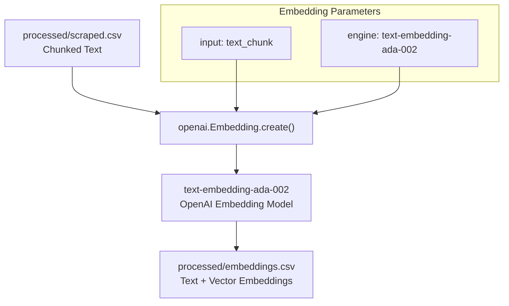
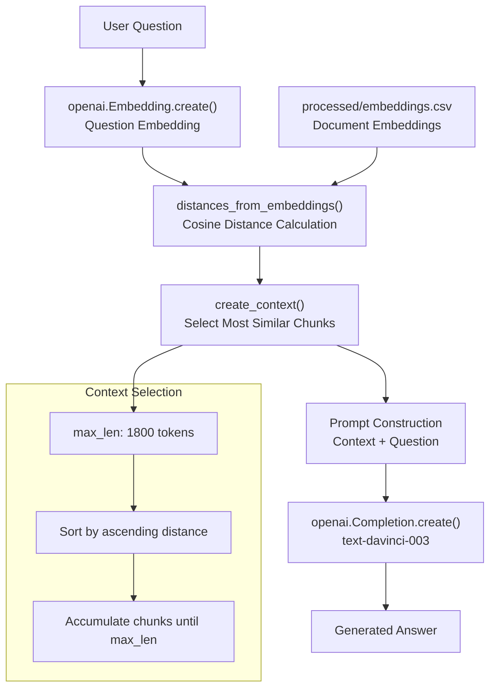
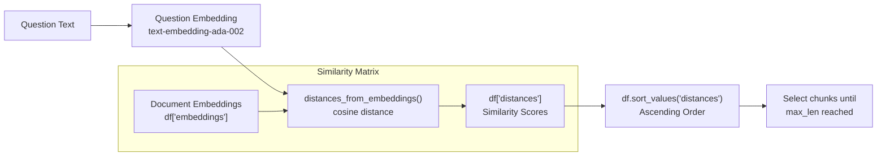
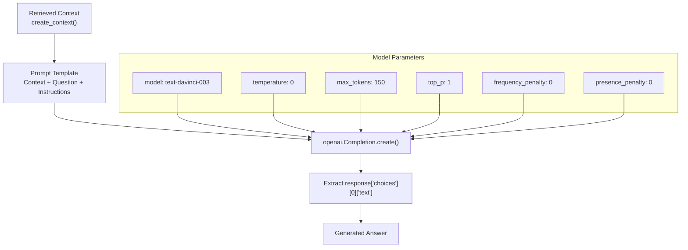

<!-- source: DeepWiki mcp.deepwiki.com · repo openai/web-crawl-q-and-a-example · page 2.3 Embedding and Question Answering · fetched 2026-10-26 -->

# Embedding and Question Answering

<details>
<summary>Relevant source files</summary>

The following files were used as context for generating this wiki page:

- [web-qa.ipynb](web-qa.ipynb)
- [web-qa.py](web-qa.py)

</details>


This document covers the final stages of the web crawl Q&A system: generating embeddings from processed text and implementing the question-answering functionality using retrieval-augmented generation (RAG). For information about web crawling and content extraction, see [2.1](#2.1). For details about text processing and chunking, see [2.2](#2.2).

The embedding and question answering system transforms chunked text into vector representations and enables semantic search to answer user questions by retrieving relevant context and generating responses using OpenAI's completion models.

## Embedding Generation Process

The system generates embeddings for all processed text chunks using OpenAI's `text-embedding-ada-002` model. This process converts textual content into high-dimensional vector representations that capture semantic meaning.



The embedding generation is implemented by applying the OpenAI embedding API to each text chunk in the dataframe:

| Parameter | Value | Purpose |
|-----------|-------|---------|
| `engine` | `text-embedding-ada-002` | OpenAI's most capable embedding model |
| `input` | Individual text chunks | Text content to be vectorized |
| Output dimension | 1536 | Vector size for semantic representation |

**Sources:** [web-qa.py:302](), [web-qa.ipynb:930]()

## Question Answering Workflow

The question answering system implements a two-stage process: context retrieval using semantic similarity and answer generation using a completion model.



**Sources:** [web-qa.py:319-391](), [web-qa.ipynb:1051-1123]()

## Context Retrieval Implementation

The `create_context()` function implements semantic similarity search to retrieve the most relevant text chunks for a given question.

### Similarity Calculation Process



The context retrieval algorithm follows these steps:

1. **Question Embedding**: Generate embedding for the input question using `text-embedding-ada-002`
2. **Distance Calculation**: Compute cosine distances between question and all document embeddings
3. **Ranking**: Sort chunks by ascending distance (most similar first)
4. **Context Assembly**: Accumulate chunks until `max_len` token limit is reached

### Context Parameters

| Parameter | Default | Purpose |
|-----------|---------|---------|
| `max_len` | 1800 | Maximum context length in tokens |
| `distance_metric` | `'cosine'` | Similarity calculation method |
| Separator | `\n\n###\n\n` | Delimiter between context chunks |

**Sources:** [web-qa.py:319-350](), [web-qa.ipynb:1051-1082]()

## Answer Generation Process

The `answer_question()` function orchestrates the complete question answering pipeline, from context retrieval to final answer generation.

### Completion Model Configuration



### Prompt Structure

The system constructs a structured prompt that includes:

```
Answer the question based on the context below, and if the question can't be answered based on the context, say "I don't know"

Context: {retrieved_context}

---

Question: {user_question}
Answer:
```

### Model Parameters

| Parameter | Value | Purpose |
|-----------|-------|---------|
| `model` | `text-davinci-003` | OpenAI's most capable completion model |
| `temperature` | 0 | Deterministic responses |
| `max_tokens` | 150 | Maximum response length |
| `top_p` | 1 | Nucleus sampling parameter |
| `frequency_penalty` | 0 | No repetition penalty |
| `presence_penalty` | 0 | No presence penalty |

**Sources:** [web-qa.py:352-391](), [web-qa.ipynb:1084-1123]()

## Data Flow and Storage

The embedding and question answering system operates on the following data structures:

### Input Data Format
- **Source**: `processed/scraped.csv` (from text processing pipeline)
- **Columns**: `title`, `text`, `n_tokens`
- **Processing**: Text chunks under 500 tokens each

### Output Data Format
- **Destination**: `processed/embeddings.csv`
- **Columns**: `text`, `n_tokens`, `embeddings`
- **Embedding Format**: 1536-dimensional vectors stored as string representations

### Runtime Data Structures
- **DataFrame Operations**: Pandas dataframes with embedding columns converted to NumPy arrays
- **Similarity Calculations**: Uses `openai.embeddings_utils.distances_from_embeddings()`
- **Vector Storage**: Embeddings loaded using `literal_eval()` and converted to `np.array`

**Sources:** [web-qa.py:302-313](), [web-qa.ipynb:928-1032]()

---

