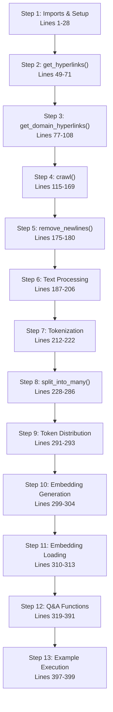
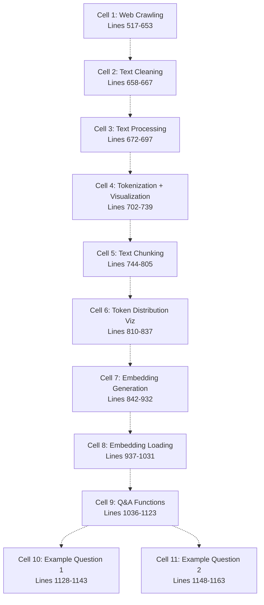
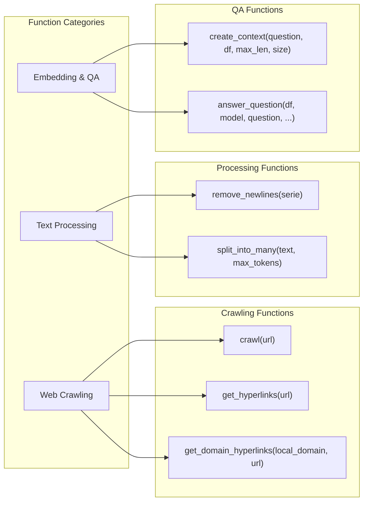

<!-- source: DeepWiki mcp.deepwiki.com · repo openai/web-crawl-q-and-a-example · page 3 Implementation Variants · fetched 2026-10-26 -->

# Implementation Variants

<details>
<summary>Relevant source files</summary>

The following files were used as context for generating this wiki page:

- [web-qa.ipynb](web-qa.ipynb)
- [web-qa.py](web-qa.py)

</details>


This document covers the two distinct implementation approaches provided for the web crawl Q&A system: a standalone Python script and an interactive Jupyter notebook. Both implementations share identical core functionality but differ in their execution model, user interaction patterns, and intended use cases.

For information about the underlying system architecture and data flow, see [System Architecture](#1.1). For details about the core functions and algorithms, see [Core Implementation](#2).

## Overview

The web crawl Q&A system is implemented in two variants that provide the same RAG (Retrieval-Augmented Generation) functionality through different interfaces:

| Implementation | File | Use Case | Execution Model |
|---|---|---|---|
| Script | `web-qa.py` | Production, automation | Linear execution |
| Notebook | `web-qa.ipynb` | Experimentation, education | Interactive cells |

Both implementations contain identical core functions and follow the same processing pipeline, but package them differently for distinct workflows.

**Implementation Relationship Diagram**

```mermaid
graph TB
    subgraph "Shared Core Functions"
        CRAWL["crawl()"]
        HYPERLINKS["get_hyperlinks()"]
        DOMAIN["get_domain_hyperlinks()"]
        CLEAN["remove_newlines()"]
        SPLIT["split_into_many()"]
        CONTEXT["create_context()"]
        ANSWER["answer_question()"]
    end
    
    subgraph "Script Implementation"
        SCRIPT["web-qa.py"]
        SCRIPT_EXEC["Linear Execution"]
        SCRIPT_OUTPUT["Minimal Output"]
    end
    
    subgraph "Notebook Implementation"
        NOTEBOOK["web-qa.ipynb"]
        NOTEBOOK_CELLS["Interactive Cells"]
        NOTEBOOK_VIZ["Visualizations"]
    end
    
    SCRIPT --> CRAWL
    SCRIPT --> HYPERLINKS
    SCRIPT --> DOMAIN
    SCRIPT --> CLEAN
    SCRIPT --> SPLIT
    SCRIPT --> CONTEXT
    SCRIPT --> ANSWER
    
    NOTEBOOK --> CRAWL
    NOTEBOOK --> HYPERLINKS
    NOTEBOOK --> DOMAIN
    NOTEBOOK --> CLEAN
    NOTEBOOK --> SPLIT
    NOTEBOOK --> CONTEXT
    NOTEBOOK --> ANSWER
    
    SCRIPT --> SCRIPT_EXEC
    SCRIPT --> SCRIPT_OUTPUT
    
    NOTEBOOK --> NOTEBOOK_CELLS
    NOTEBOOK --> NOTEBOOK_VIZ
```



Sources: [web-qa.py:1-400](), [web-qa.ipynb:1-1194]()

## Script Implementation Details

The script implementation in `web-qa.py` provides a production-ready, linear execution environment for the web crawling and question answering pipeline.

### Structure and Organization

The script is organized into 13 clearly marked steps, each implementing a specific phase of the pipeline:



Sources: [web-qa.py:1-28](), [web-qa.py:45-169](), [web-qa.py:393-399]()

### Key Characteristics

**Execution Model**: The script executes the web crawling automatically at [web-qa.py:169]() with `crawl(full_url)`, processing the entire target domain without user intervention.

**Configuration**: Domain and URL are hardcoded at [web-qa.py:27-28]():
```python
domain = "openai.com"
full_url = "https://openai.com/"
```

**Output Handling**: Minimal console output focused on crawling progress and final question answering results at [web-qa.py:397-399]().

**Error Handling**: Comprehensive exception handling in the `crawl()` function at [web-qa.py:160-161]() and `answer_question()` function at [web-qa.py:389-391]().

Sources: [web-qa.py:27-28](), [web-qa.py:169](), [web-qa.py:397-399](), [web-qa.py:160-161](), [web-qa.py:389-391]()

## Notebook Implementation Details

The notebook implementation in `web-qa.ipynb` provides an interactive environment optimized for experimentation, learning, and iterative development.

### Cell Structure and Execution Flow

The notebook is divided into executable cells that can be run independently:



Sources: [web-qa.ipynb:517-653](), [web-qa.ipynb:658-667](), [web-qa.ipynb:672-697](), [web-qa.ipynb:702-739]()

### Interactive Features

**Step-by-Step Execution**: Each processing stage can be executed independently, allowing for inspection of intermediate results.

**Data Visualization**: The notebook includes matplotlib histograms showing token distribution at [web-qa.ipynb:736-739]() and [web-qa.ipynb:834-837]().

**Output Display**: Rich output display including DataFrames, execution results, and visualizations. For example, the embedding generation cell at [web-qa.ipynb:927-932]() shows the resulting DataFrame structure.

**Iterative Development**: Functions can be redefined and tested without rerunning the entire pipeline.

Sources: [web-qa.ipynb:736-739](), [web-qa.ipynb:834-837](), [web-qa.ipynb:927-932]()

## Core Function Mapping

Both implementations share identical core functions with the same signatures and behavior:



Sources: [web-qa.py:115-168](), [web-qa.py:50-71](), [web-qa.py:78-108](), [web-qa.py:175-180](), [web-qa.py:231-267](), [web-qa.py:319-391]()

## Implementation Comparison

| Aspect | Script Implementation | Notebook Implementation |
|---|---|---|
| **Entry Point** | `crawl(full_url)` at line 169 | Interactive cell execution |
| **Configuration** | Hardcoded domain/URL | Can be modified per cell |
| **Debugging** | Print statements, exception handling | Cell output, variable inspection |
| **Visualization** | None | Token distribution histograms |
| **Output Format** | Console text | Rich HTML/DataFrame display |
| **Execution Control** | Linear, all-or-nothing | Selective cell execution |
| **Use Case** | Production automation | Experimentation, education |

### When to Use Each Implementation

**Use the Script (`web-qa.py`) for**:
- Production deployments and automation
- Batch processing of multiple domains
- Integration with other systems
- Scheduled or automated crawling tasks

**Use the Notebook (`web-qa.ipynb`) for**:
- Learning and understanding the system
- Experimenting with different parameters
- Debugging and troubleshooting
- Interactive data analysis and visualization
- Prototype development

Sources: [web-qa.py:169](), [web-qa.py:397-399](), [web-qa.ipynb:702-739](), [web-qa.ipynb:1128-1163]()

---

