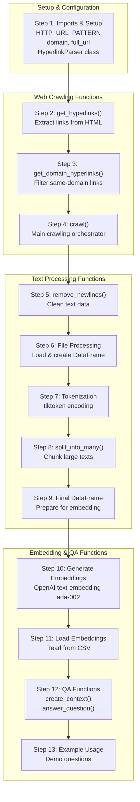
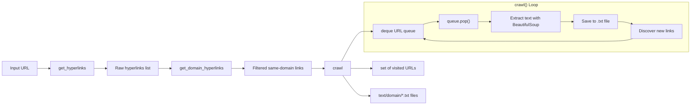
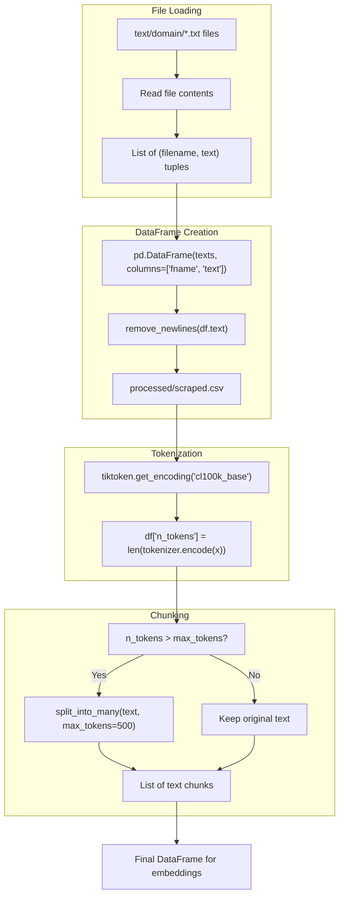
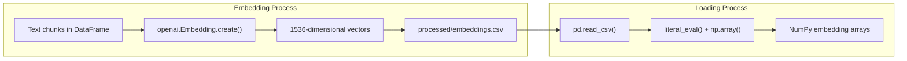
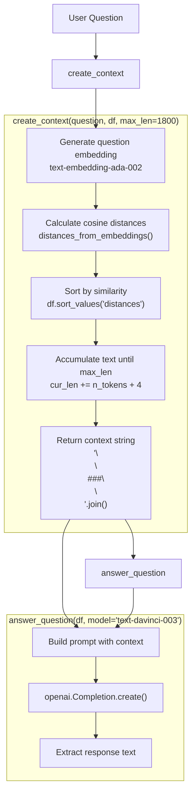
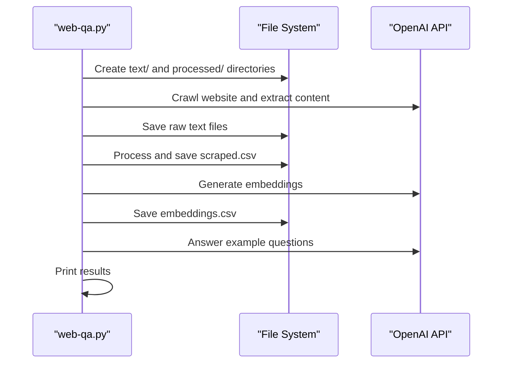

<!-- source: DeepWiki mcp.deepwiki.com · repo openai/web-crawl-q-and-a-example · page 3.1 Script Implementation (web-qa.py) · fetched 2026-10-26 -->

# Script Implementation (web-qa.py)

<details>
<summary>Relevant source files</summary>

The following files were used as context for generating this wiki page:

- [web-qa.py](web-qa.py)

</details>


This document covers the production script implementation of the web crawl Q&A system. The `web-qa.py` file provides a standalone, executable implementation that processes websites through the complete RAG pipeline from web crawling to question answering. For interactive experimentation and step-by-step exploration, see [Notebook Implementation (web-qa.ipynb)](#3.2). For the underlying architecture and component relationships, see [System Architecture](#1.1).

## Script Organization and Structure

The `web-qa.py` script is organized into 13 distinct steps that execute the complete pipeline sequentially. Each step represents a logical phase in the data processing workflow.

### Step-by-Step Architecture



**Sources:** [web-qa.py:1-400]()

### Core Classes and Functions

The script implements several key classes and functions that handle the complete pipeline:

| Component | Type | Purpose | Location |
|-----------|------|---------|----------|
| `HyperlinkParser` | Class | HTML parsing for link extraction | [web-qa.py:31-43]() |
| `get_hyperlinks()` | Function | Extract all links from URL | [web-qa.py:50-71]() |
| `get_domain_hyperlinks()` | Function | Filter same-domain links | [web-qa.py:78-108]() |
| `crawl()` | Function | Main crawling orchestrator | [web-qa.py:115-169]() |
| `remove_newlines()` | Function | Text cleaning utility | [web-qa.py:175-180]() |
| `split_into_many()` | Function | Text chunking for embeddings | [web-qa.py:231-267]() |
| `create_context()` | Function | Retrieve relevant context | [web-qa.py:319-350]() |
| `answer_question()` | Function | Generate answers using OpenAI | [web-qa.py:352-391]() |

**Sources:** [web-qa.py:31-400]()

## Web Crawling Implementation

### HyperlinkParser Class

The script uses a custom HTML parser that extends Python's `HTMLParser` to extract hyperlinks:

```mermaid
classDiagram
    class HTMLParser {
        +handle_starttag()
    }
    
    class HyperlinkParser {
        +hyperlinks: list
        +__init__()
        +handle_starttag(tag, attrs)
    }
    
    HTMLParser <|-- HyperlinkParser
    
    note for HyperlinkParser : "Extracts href attributes from anchor tags<br/>Stores in self.hyperlinks list"
```

The `HyperlinkParser` class overrides `handle_starttag()` to capture `href` attributes from anchor tags, building a list of discovered links.

**Sources:** [web-qa.py:31-43]()

### Crawling Function Chain

The crawling process uses three interconnected functions:



The `crawl()` function implements breadth-first traversal using a `deque` queue and a `set` for duplicate detection. It creates directory structures `text/domain/` and `processed/` for output files.

**Sources:** [web-qa.py:50-169]()

## Text Processing Pipeline

### Data Transformation Stages

The script processes raw HTML text through multiple transformation stages:



**Sources:** [web-qa.py:175-294]()

### Chunking Algorithm

The `split_into_many()` function implements sentence-boundary chunking with token limits:

| Parameter | Value | Purpose |
|-----------|-------|---------|
| `max_tokens` | 500 | Maximum tokens per chunk |
| Splitting method | Sentence boundaries (`. `) | Preserve semantic coherence |
| Token counting | `tiktoken.encode()` | Compatible with OpenAI models |
| Overlap handling | None | Clean chunk boundaries |

The algorithm processes sentences sequentially, accumulating them until the token limit is reached, ensuring chunks stay under the `max_tokens` threshold.

**Sources:** [web-qa.py:228-267]()

## Embedding and Question Answering

### Embedding Generation

The script generates embeddings using OpenAI's `text-embedding-ada-002` model:



The embeddings are stored in CSV format and later loaded using `literal_eval()` to convert string representations back to NumPy arrays.

**Sources:** [web-qa.py:302-313]()

### Question Answering Functions

The QA system uses two primary functions that work together:



The `create_context()` function retrieves the most semantically similar text chunks, while `answer_question()` uses this context to generate responses via OpenAI's completion API.

**Sources:** [web-qa.py:319-391]()

## Configuration and Usage

### Key Configuration Variables

The script uses several important configuration variables:

| Variable | Default Value | Purpose | Location |
|----------|---------------|---------|----------|
| `domain` | `"openai.com"` | Target domain for crawling | [web-qa.py:27]() |
| `full_url` | `"https://openai.com/"` | Starting URL | [web-qa.py:28]() |
| `max_tokens` | `500` | Chunk size limit | [web-qa.py:228]() |
| `HTTP_URL_PATTERN` | `r'^http[s]{0,1}://.+$'` | URL validation regex | [web-qa.py:21]() |

### Execution Flow

The script executes linearly through all steps when run directly:



The final step demonstrates usage with example questions: `"What day is it?"` and `"What is our newest embeddings model?"`.

**Sources:** [web-qa.py:169-400]()

---

