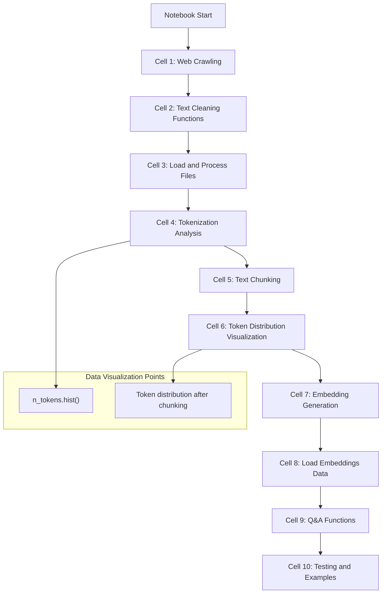
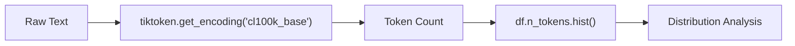
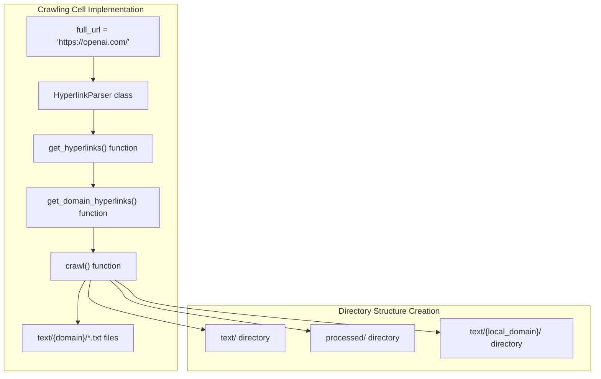
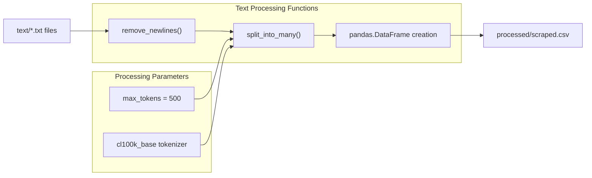
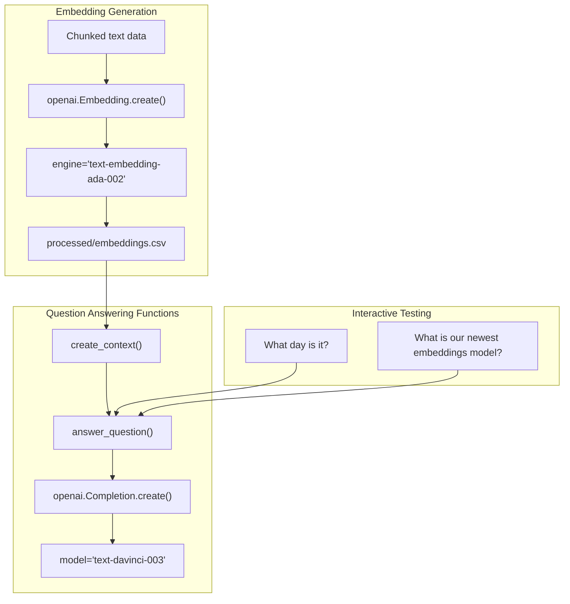
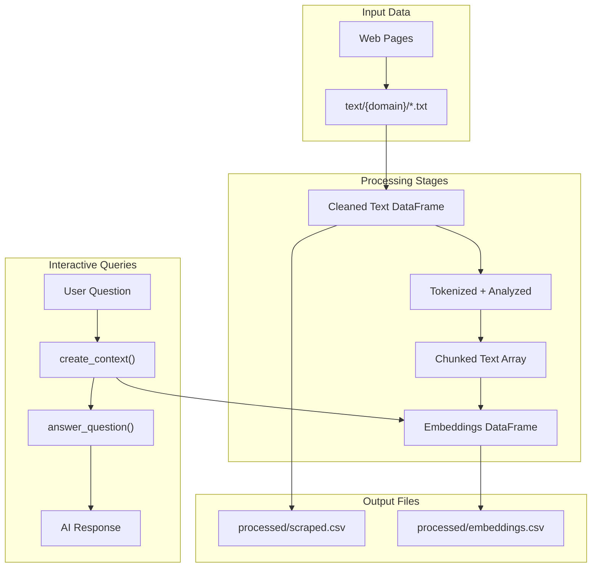

<!-- source: DeepWiki mcp.deepwiki.com · repo openai/web-crawl-q-and-a-example · page 3.2 Notebook Implementation (web-qa.ipynb) · fetched 2026-10-26 -->

# Notebook Implementation (web-qa.ipynb)

Relevant source files

The following files were used as context for generating this wiki page:

- [web-qa.ipynb](web-qa.ipynb)

## Purpose and Scope

This document covers the interactive Jupyter notebook implementation of the web crawl Q&A system. The notebook provides the same core functionality as the production script but in an exploratory, educational format that allows step-by-step execution and visualization of the data processing pipeline. For information about the production script version, see [Script Implementation](#3.1).

The notebook implementation is designed for experimentation, learning, and prototyping rather than production deployment. It includes visual feedback through histograms and allows users to inspect intermediate results at each stage of the pipeline.

## Notebook Structure and Execution Flow

The notebook is organized into logical execution cells that mirror the complete RAG (Retrieval-Augmented Generation) pipeline:

Sources: [web-qa.ipynb:1-1194]()

## Interactive Features and Visualizations

### Token Distribution Analysis

The notebook includes built-in visualization capabilities that provide immediate feedback on data characteristics:

| Visualization | Purpose | Location |
|---------------|---------|----------|
| Initial token histogram | Shows distribution of tokens per scraped page | Cell 4 |
| Post-chunking histogram | Validates chunking effectiveness | Cell 6 |
| Embedding generation progress | Real-time feedback during API calls | Cell 7 |

The tokenization analysis uses the `tiktoken` library to ensure compatibility with OpenAI's embedding models:

Sources: [web-qa.ipynb:726-739]()

## Core Function Implementation

### Web Crawling Implementation

The notebook implements the same crawling logic as the script version but with inline execution and debugging output:

Sources: [web-qa.ipynb:517-653]()

### Text Processing Pipeline

The notebook separates text processing into discrete, inspectable steps:

Sources: [web-qa.ipynb:661-667](), [web-qa.ipynb:747-806]()

### Embedding and Question Answering

The final sections implement the RAG functionality with interactive testing capabilities:

Sources: [web-qa.ipynb:927-932](), [web-qa.ipynb:1050-1123]()

## Key Differences from Script Implementation

| Aspect | Notebook Implementation | Script Implementation |
|--------|------------------------|----------------------|
| Execution Model | Cell-by-cell interactive | End-to-end automated |
| Debugging | Visual feedback and inspection | Print statements only |
| Data Exploration | Built-in histograms and analysis | No visualization |
| Modularity | Separated into logical cells | Single execution flow |
| Use Case | Experimentation and learning | Production deployment |

## Data Flow Visualization

The notebook's execution model allows for inspection at each stage of the data transformation:

Sources: [web-qa.ipynb:675-697](), [web-qa.ipynb:927-932]()

## Configuration and Parameters

The notebook uses the same configuration approach as the script but with explicit variable definitions:

| Parameter | Value | Purpose | Location |
|-----------|-------|---------|----------|
| `domain` | "openai.com" | Target crawling domain | Line 531 |
| `max_tokens` | 500 | Chunk size limit | Line 748 |
| `engine` | "text-embedding-ada-002" | OpenAI embedding model | Line 930 |
| `model` | "text-davinci-003" | OpenAI completion model | Line 1086 |
| `max_len` | 1800 | Context window size | Line 1052 |

Sources: [web-qa.ipynb:531](), [web-qa.ipynb:748](), [web-qa.ipynb:930](), [web-qa.ipynb:1086]()

## Usage Patterns and Educational Value

The notebook format excels in several scenarios:

- **Prototyping**: Testing different chunking strategies or embedding models
- **Learning**: Understanding each step of the RAG pipeline
- **Debugging**: Inspecting intermediate data transformations
- **Experimentation**: Trying different parameters and visualizing results

The interactive nature allows users to modify parameters in individual cells and observe the impact on subsequent processing stages without re-running the entire pipeline.

Sources: [web-qa.ipynb:1-1194]()

---

