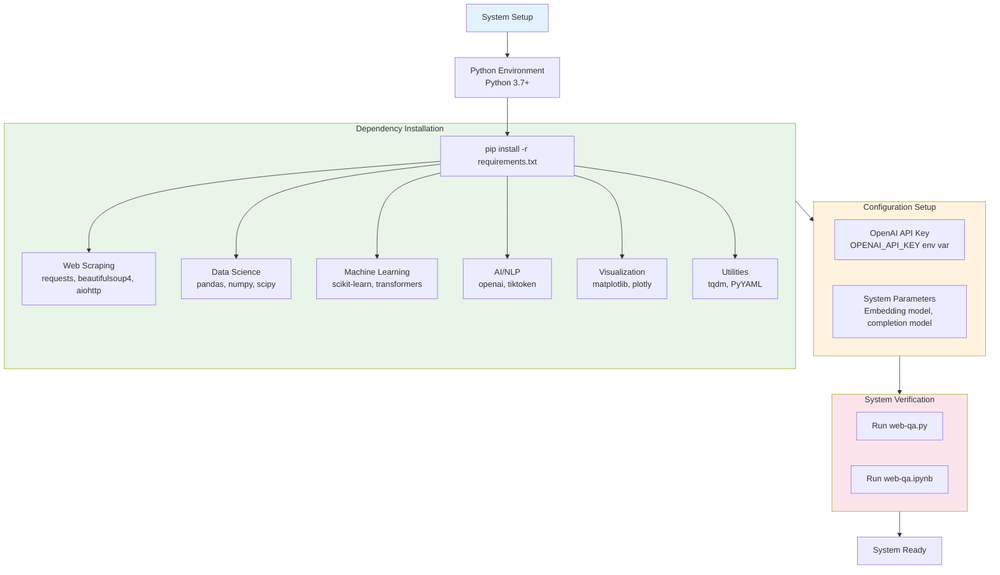
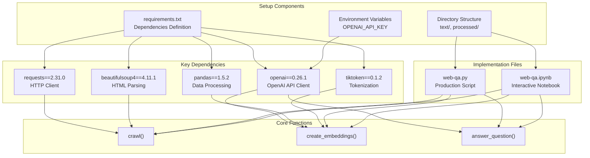

<!-- source: DeepWiki mcp.deepwiki.com · repo openai/web-crawl-q-and-a-example · page 4 Setup and Configuration · fetched 2026-10-26 -->

# Setup and Configuration

Relevant source files

The following files were used as context for generating this wiki page:

- [README.md](README.md)
- [requirements.txt](requirements.txt)

This page provides an overview of the setup and configuration process for the Web Crawl Q&A system, covering system requirements, dependency installation, and initial configuration steps required to run the question-answering pipeline.

For comprehensive dependency documentation, see [Dependencies and Requirements](#4.1). For detailed usage instructions and examples, see [Getting Started Guide](#4.2).

## Setup Process Overview

The Web Crawl Q&A system requires installation of numerous Python dependencies and configuration of OpenAI API credentials to function properly. The setup process involves preparing the Python environment, installing dependencies, and configuring external service access.

### Setup Flow Diagram

Sources: [requirements.txt:1-80](), [README.md:1-4]()

### Configuration Components and Code Integration

Sources: [requirements.txt:39-39](), [requirements.txt:61-61](), [requirements.txt:41-41](), [requirements.txt:69-69](), [requirements.txt:8-8]()

## System Requirements

The Web Crawl Q&A system has the following core requirements:

| Component | Requirement | Purpose |
|-----------|-------------|---------|
| Python Version | 3.7+ | Core runtime environment |
| OpenAI API Access | Valid API key | Embedding generation and text completion |
| Internet Access | Required | Web crawling and API communication |
| Storage Space | ~100MB+ | Dependencies and generated data files |

### Critical Dependencies

The system relies on several categories of dependencies as defined in `requirements.txt`:

| Category | Key Packages | Function |
|----------|--------------|----------|
| AI/NLP | `openai==0.26.1`, `tiktoken==0.1.2`, `transformers==4.30.0` | OpenAI API integration and tokenization |
| Web Scraping | `requests==2.31.0`, `beautifulsoup4==4.11.1`, `aiohttp==3.8.5` | HTTP requests and HTML parsing |
| Data Science | `pandas==1.5.2`, `numpy==1.24.1`, `scipy==1.10.0` | Data manipulation and numerical computing |
| Machine Learning | `scikit-learn==1.2.0` | Similarity calculations and clustering |
| Visualization | `matplotlib==3.6.3`, `plotly==5.12.0` | Data visualization and charts |

Sources: [requirements.txt:39-39](), [requirements.txt:69-69](), [requirements.txt:74-74](), [requirements.txt:61-61](), [requirements.txt:8-8](), [requirements.txt:1-1]()

## Installation Overview

The installation process follows a standard Python package installation workflow:

1. **Environment Preparation**: Ensure Python 3.7+ is installed
2. **Dependency Installation**: Install all required packages using `pip install -r requirements.txt`
3. **API Configuration**: Set up OpenAI API credentials
4. **Directory Structure**: Ensure proper directory structure for data storage
5. **Verification**: Test the installation with sample runs

### Key Configuration Files

The system uses the following configuration approach:

- **`requirements.txt`**: Defines all Python dependencies with exact version specifications
- **Environment Variables**: `OPENAI_API_KEY` for API authentication
- **Directory Structure**: Automatic creation of `text/` and `processed/` directories for data storage

The system does not use traditional configuration files (like `.yaml` or `.json`), instead relying on environment variables and hardcoded parameters within the implementation files.

Sources: [requirements.txt:1-80](), [README.md:3-3]()

## Next Steps

After reviewing this setup overview:

- For detailed information about each dependency and its role, see [Dependencies and Requirements](#4.1)
- For step-by-step installation and usage instructions, see [Getting Started Guide](#4.2)
- For understanding the core implementation, see [Core Implementation](#2)

The setup process is straightforward but requires careful attention to API configuration and dependency management to ensure all components function correctly together.

Sources: [README.md:1-4]()

---

