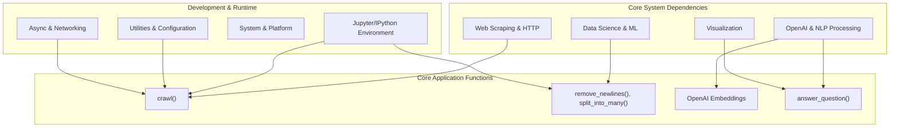
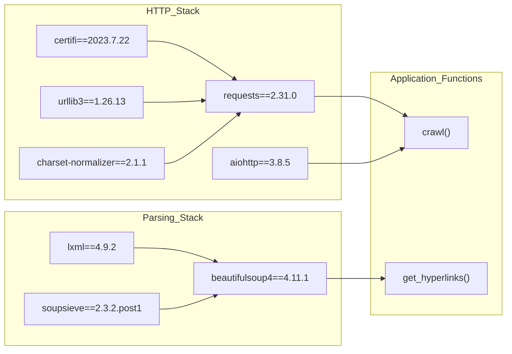
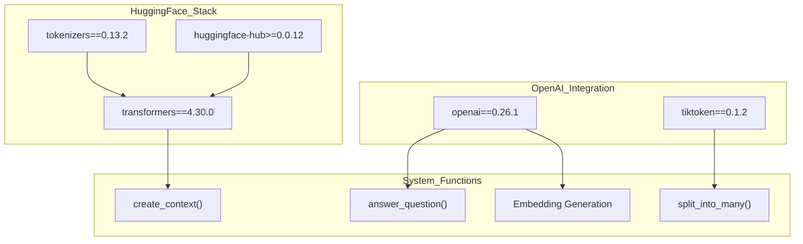
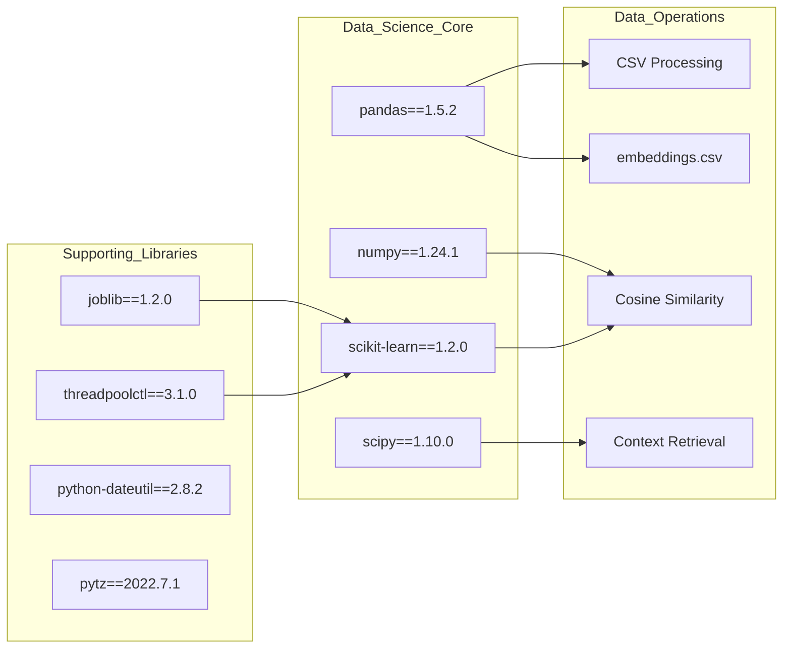
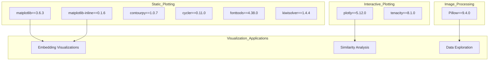
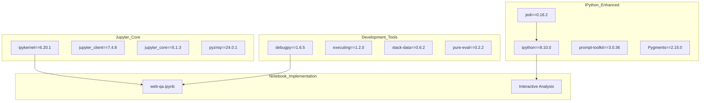
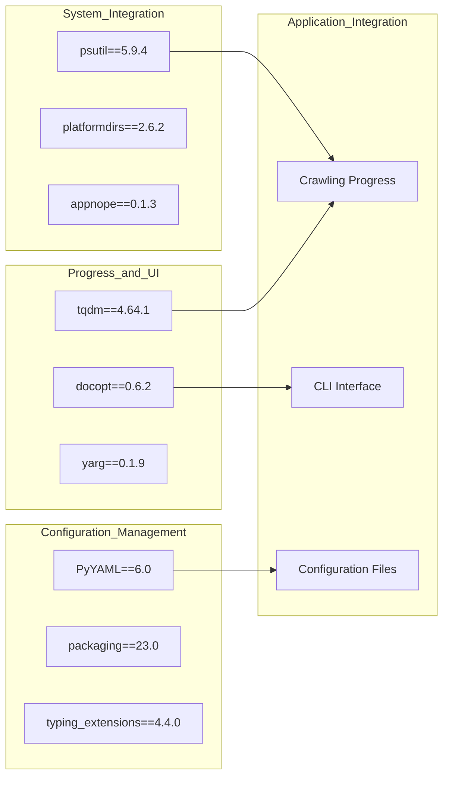
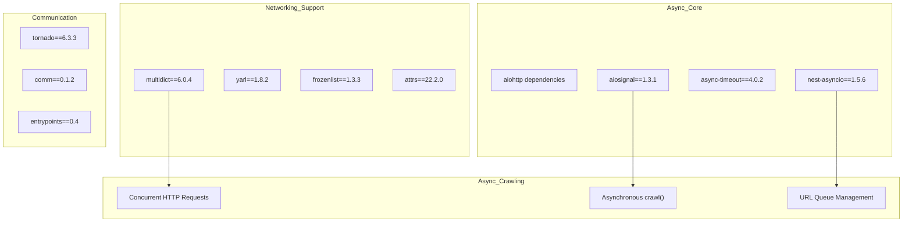

<!-- source: DeepWiki mcp.deepwiki.com · repo openai/web-crawl-q-and-a-example · page 4.1 Dependencies and Requirements · fetched 2026-10-26 -->

# Dependencies and Requirements

Relevant source files

The following files were used as context for generating this wiki page:

- [requirements.txt](requirements.txt)

This document provides a comprehensive overview of all Python dependencies required by the web crawl Q&A system, their specific versions, and their roles within the system architecture. The dependencies are defined in [requirements.txt:1-80]() and encompass web scraping, natural language processing, data science, visualization, and development tools.

For information about system setup and installation procedures, see [Getting Started Guide](#4.2). For details about the overall technology stack architecture, see [Technology Stack](#1.2).

## Dependency Categories Overview

The system requires 79 distinct Python packages that can be organized into several functional categories based on their roles in the web crawling and question-answering pipeline.

Sources: [requirements.txt:1-80]()

## Web Scraping and HTTP Dependencies

The web crawling functionality relies on both synchronous and asynchronous HTTP libraries for content retrieval and HTML parsing.

| Package | Version | Primary Function | Used By |
|---------|---------|------------------|---------|
| `aiohttp` | 3.8.5 | Asynchronous HTTP client/server | `crawl()` function |
| `requests` | 2.31.0 | Synchronous HTTP requests | Web content fetching |
| `beautifulsoup4` | 4.11.1 | HTML/XML parsing | Content extraction |
| `bs4` | 0.0.1 | BeautifulSoup wrapper | HTML parsing |
| `lxml` | 4.9.2 | Fast XML/HTML parser | BeautifulSoup backend |

### Supporting HTTP Infrastructure

Additional HTTP infrastructure packages include:
- `certifi==2023.7.22` - SSL certificate validation
- `urllib3==1.26.13` - HTTP library foundation
- `charset-normalizer==2.1.1` - Character encoding detection
- `idna==3.4` - Internationalized domain name support
- `soupsieve==2.3.2.post1` - CSS selector support for BeautifulSoup

Sources: [requirements.txt:1-11, 25, 61, 65, 76]()

## OpenAI and NLP Processing Dependencies

The system's core AI functionality depends on OpenAI's API and supporting NLP libraries for embedding generation and text completion.

### Core NLP Stack

| Package | Version | Function | Integration Point |
|---------|---------|----------|-------------------|
| `openai` | 0.26.1 | OpenAI API client | `answer_question()`, embedding generation |
| `tiktoken` | 0.1.2 | OpenAI tokenization | Token counting for `split_into_many()` |
| `transformers` | 4.30.0 | Hugging Face models | Additional NLP capabilities |
| `tokenizers` | 0.13.2 | Fast tokenization | Transformers backend |

The NLP pipeline uses:
- `regex==2022.10.31` for advanced text pattern matching
- `huggingface-hub>=0.0.12` for model repository access
- `filelock==3.9.0` for concurrent model access safety

Sources: [requirements.txt:24, 39, 60, 69-70, 74]()

## Data Science and Machine Learning Dependencies

The system employs a comprehensive data science stack for numerical computing, data manipulation, and similarity calculations.

### Core Data Science Libraries

| Package | Version | Role | Application |
|---------|---------|------|-------------|
| `pandas` | 1.5.2 | Data manipulation | DataFrame operations for embeddings |
| `numpy` | 1.24.1 | Numerical computing | Vector operations, similarity calculations |
| `scipy` | 1.10.0 | Scientific computing | Advanced mathematical functions |
| `scikit-learn` | 1.2.0 | Machine learning | Cosine similarity calculations |

Supporting packages include:
- `joblib==1.2.0` - Parallel processing for scikit-learn
- `threadpoolctl==3.1.0` - Thread pool management
- `python-dateutil==2.8.2` - Date/time parsing utilities
- `pytz==2022.7.1` - Timezone handling

Sources: [requirements.txt:29, 38, 41-42, 56-57, 62-63, 68]()

## Visualization and Analysis Dependencies

The system includes comprehensive visualization capabilities for data analysis and result presentation.

### Visualization Stack

Key visualization packages:
- `matplotlib==3.6.3` - Primary plotting library
- `plotly==5.12.0` - Interactive visualizations
- `Pillow==9.4.0` - Image processing capabilities

Sources: [requirements.txt:14-15, 22, 32, 34-35, 45, 48, 67]()

## Jupyter and Development Environment

The notebook implementation requires a complete Jupyter ecosystem with IPython integration.

### Jupyter Ecosystem

| Component | Package | Version | Function |
|-----------|---------|---------|----------|
| Kernel | `ipykernel` | 6.20.1 | Jupyter notebook kernel |
| Interactive Shell | `ipython` | 8.10.0 | Enhanced Python REPL |
| Client | `jupyter_client` | 7.4.8 | Jupyter protocol client |
| Core | `jupyter_core` | 5.1.3 | Jupyter base functionality |

Development and debugging support includes:
- `jedi==0.18.2` - Code completion and analysis
- `debugpy==1.6.5` - Python debugger protocol
- `prompt-toolkit==3.0.36` - Interactive command line interfaces
- `Pygments==2.15.0` - Syntax highlighting

Sources: [requirements.txt:3-4, 16-17, 26-28, 30-31, 42-44, 49, 52, 54, 59, 66, 71, 73, 77]()

## Utility and Configuration Dependencies

Supporting utilities handle configuration, progress tracking, and system integration.

### System Utilities

| Category | Packages | Primary Use |
|----------|----------|-------------|
| Progress Tracking | `tqdm==4.64.1` | Crawling progress bars |
| Configuration | `PyYAML==6.0` | Configuration file parsing |
| Command Line | `docopt==0.6.2`, `yarg==0.1.9` | CLI argument parsing |
| Platform Support | `appnope==0.1.3`, `platformdirs==2.6.2` | Cross-platform compatibility |

Additional utilities:
- `six==1.16.0` - Python 2/3 compatibility
- `wcwidth==0.2.5` - Terminal width calculations
- `filelock==3.9.0` - File locking for concurrent access

Sources: [requirements.txt:18, 40, 46, 47, 50-51, 58, 64, 72, 75, 78-79]()

## Asynchronous and Networking Infrastructure

The async web crawling capabilities require specialized networking and concurrency libraries.

### Async Infrastructure

The async infrastructure includes:
- `tornado==6.3.3` - Async web framework
- `nest-asyncio==1.5.6` - Nested event loop support
- `multidict==6.0.4` - Multi-value dictionary support
- `yarl==1.8.2` - URL parsing and manipulation

Sources: [requirements.txt:2, 5-6, 13, 19, 23, 36-37, 71, 79]()

## Security and Cryptography

Security-related dependencies handle encryption and secure file operations.

| Package | Version | Purpose |
|---------|---------|---------|
| `pycryptodomex` | 3.17 | Cryptographic operations |
| `blobfile` | 2.0.1 | Secure file operations |

Sources: [requirements.txt:9, 53]()

## Version Compatibility and Constraints

The dependency versions are carefully selected for compatibility and stability:

- **OpenAI API**: Version `0.26.1` provides stable access to embedding and completion models
- **Python Version**: Compatible with Python 3.8+ (inferred from dependency requirements)
- **Async Libraries**: Versions coordinated for `aiohttp` ecosystem compatibility
- **Data Science**: Numpy/Pandas/Scipy versions chosen for numerical stability
- **Jupyter**: Complete ecosystem with matching protocol versions

Critical version constraints include:
- `huggingface-hub>=0.0.12` - Minimum version for model hub access
- Exact version pins for core libraries to ensure reproducible builds
- Compatible matplotlib/plotly versions for visualization consistency

Sources: [requirements.txt:1-80]()

---

