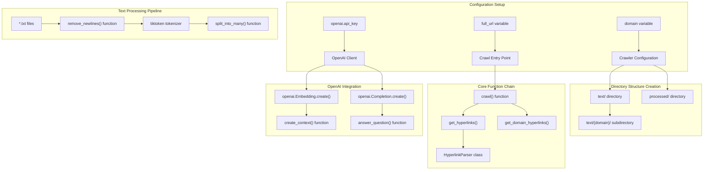
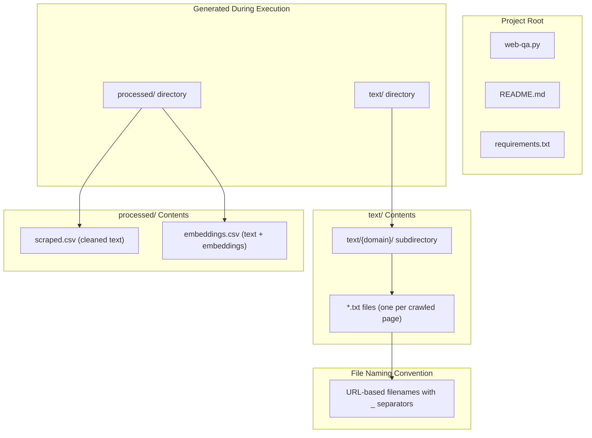

<!-- source: DeepWiki mcp.deepwiki.com · repo openai/web-crawl-q-and-a-example · page 4.2 Getting Started Guide · fetched 2026-10-26 -->

# Getting Started Guide

<details>
<summary>Relevant source files</summary>

The following files were used as context for generating this wiki page:

- [README.md](README.md)
- [web-qa.py](web-qa.py)

</details>


This guide provides step-by-step instructions for setting up and running the web crawl Q&A system. It covers initial configuration, basic usage patterns, and common troubleshooting steps to get you from zero to answering questions about crawled website content.

For detailed information about the system architecture and components, see [System Architecture](#1.1). For dependency explanations, see [Dependencies and Requirements](#4.1).

## Prerequisites and Setup

### OpenAI API Configuration

The system requires an OpenAI API key to generate embeddings and answer questions. Configure your API key by uncommenting and setting the value in the script:

```python
openai.api_key = '<Your API Key>'
```

**API Usage Requirements:**
- OpenAI API access with `text-embedding-ada-002` model availability
- OpenAI API access with `text-davinci-003` completion model availability
- Sufficient API credits for embedding generation (cost scales with content volume)

### Target Website Configuration

Specify the website domain and starting URL to crawl:

```python
domain = "openai.com"
full_url = "https://openai.com/"
```

**Important Rate Limiting Considerations:**
The embedding generation step may encounter rate limits depending on content volume. Review OpenAI's rate limit guidelines before processing large websites.

Sources: [web-qa.py:23-28]()

## Basic Execution Workflow

### Setup Phase - Code Entity Mapping



Sources: [web-qa.py:23-28](), [web-qa.py:115-135](), [web-qa.py:31-44]()

### Execution Steps

#### Step 1: Web Crawling Execution

Execute the crawling process by running the main crawl function:

```python
crawl(full_url)
```

**What happens during crawling:**
- Creates `text/` and `text/{domain}/` directories
- Creates `processed/` directory for output files
- Extracts HTML content using `BeautifulSoup`
- Saves content as `.txt` files in domain-specific subdirectory
- Maintains crawl queue using `deque` data structure
- Tracks visited URLs in `seen` set to prevent duplicates

**Output:** Individual `.txt` files for each crawled page in `text/{domain}/` directory.

Sources: [web-qa.py:115-169]()

#### Step 2: Text Processing and Chunking

The system automatically processes crawled content through several stages:

**Text Aggregation and Cleaning:**
- Loads all `.txt` files from crawled content
- Applies `remove_newlines()` function to normalize whitespace
- Creates initial DataFrame with filename and cleaned text
- Saves intermediate results to `processed/scraped.csv`

**Tokenization and Chunking:**
- Uses `tiktoken.get_encoding("cl100k_base")` tokenizer
- Applies `split_into_many()` function with 500 token maximum
- Splits long content into manageable chunks for embedding generation

Sources: [web-qa.py:175-206](), [web-qa.py:212-286]()

#### Step 3: Embedding Generation

Generate embeddings for all text chunks:

```python
df['embeddings'] = df.text.apply(lambda x: openai.Embedding.create(input=x, engine='text-embedding-ada-002')['data'][0]['embedding'])
```

**Process details:**
- Calls OpenAI's `text-embedding-ada-002` model for each text chunk
- Stores embeddings as arrays in DataFrame
- Saves complete dataset to `processed/embeddings.csv`
- **Rate limiting warning:** This step may require API rate limit management for large datasets

Sources: [web-qa.py:302-304]()

#### Step 4: Question Answering Usage

Query the system using the `answer_question()` function:

```python
answer_question(df, question="What is our newest embeddings model?")
```

**Question answering process:**
1. `create_context()` generates question embedding
2. Calculates cosine similarity against all stored embeddings
3. Retrieves most relevant text chunks within token limit
4. Constructs prompt with context and question
5. Calls OpenAI completion API for final answer

Sources: [web-qa.py:319-392](), [web-qa.py:397-400]()

## File Structure and Execution Results

### Generated Directory Structure



**File naming pattern:** URLs are converted to filenames by removing `https://` and replacing `/` with `_`. For example: `https://openai.com/about` becomes `openai.com_about.txt`.

Sources: [web-qa.py:126-135](), [web-qa.py:146-147](), [web-qa.py:205](), [web-qa.py:303]()

## Common Execution Patterns

### Basic Single-Domain Crawl

```python
# 1. Configure target
domain = "example.com"
full_url = "https://example.com/"

# 2. Execute crawl
crawl(full_url)

# 3. Load processed embeddings
df = pd.read_csv('processed/embeddings.csv', index_col=0)
df['embeddings'] = df['embeddings'].apply(literal_eval).apply(np.array)

# 4. Ask questions
answer = answer_question(df, question="Your question here")
print(answer)
```

### Debug Mode Usage

Enable debug mode to inspect context retrieval:

```python
answer_question(df, question="Your question", debug=True)
```

Debug mode prints the retrieved context before generating the final answer, useful for understanding which content chunks influence the response.

Sources: [web-qa.py:27-28](), [web-qa.py:169](), [web-qa.py:310-313](), [web-qa.py:371-374]()

## Troubleshooting Common Issues

### JavaScript-Required Pages

The crawler automatically detects and skips pages requiring JavaScript:

```
"Unable to parse page {url} due to JavaScript being required"
```

**Solution:** These pages are automatically skipped; no action required.

### Rate Limit Errors

Embedding generation may encounter OpenAI API rate limits.

**Solutions:**
- Implement delay between API calls
- Use batch processing with smaller chunks
- Review OpenAI rate limit documentation

### Memory Usage with Large Datasets

Large embedding datasets may consume significant memory.

**Solutions:**
- Process embeddings in batches
- Consider chunking strategy optimization
- Monitor system memory during execution

Sources: [web-qa.py:155-156](), [web-qa.py:299-301](), [web-qa.py:389-391]()

## Next Steps

After successful execution:

1. **Experiment with Questions:** Test various question types against your crawled content
2. **Tune Parameters:** Adjust `max_tokens` in `split_into_many()` and `max_len` in `create_context()` for your use case
3. **Scale Considerations:** Review [Data Processing Stages](#5.2) for optimization strategies
4. **Integration Options:** Explore [Implementation Variants](#3) for different deployment patterns

For production deployment considerations, see [Script Implementation](#3.1). For experimental and educational usage, see [Notebook Implementation](#3.2).

---

