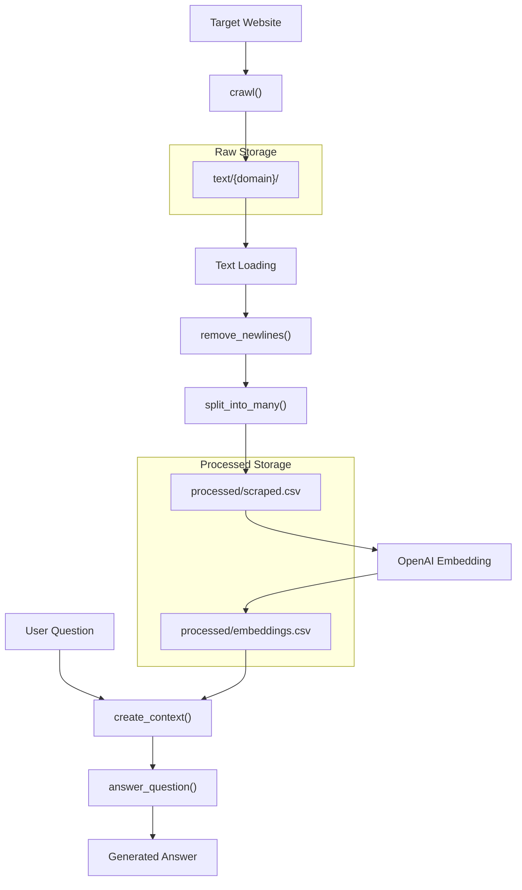
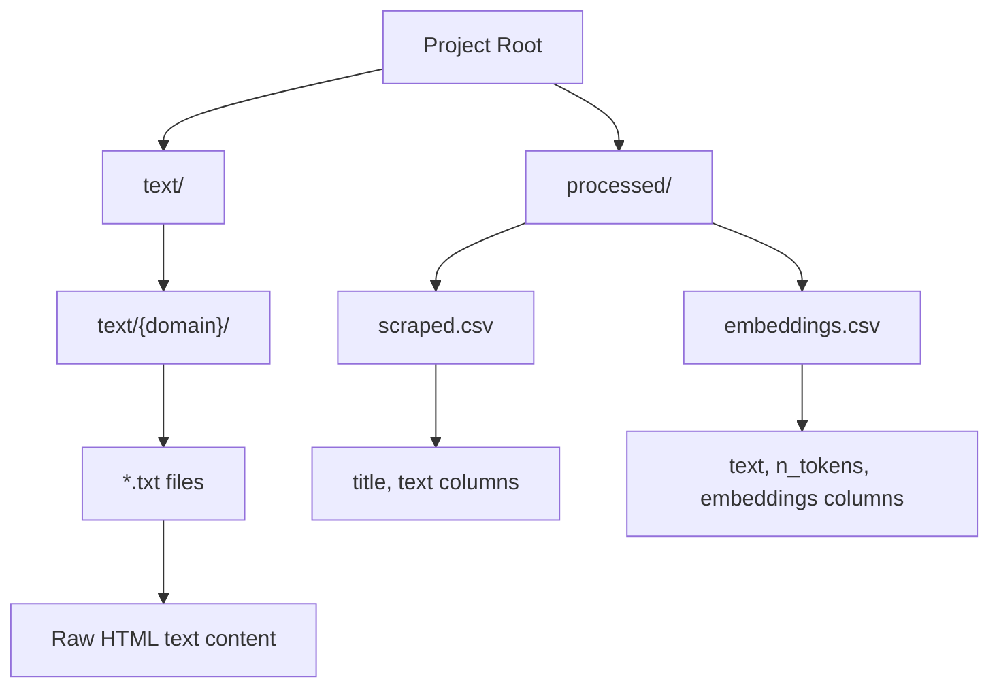
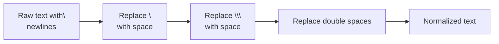
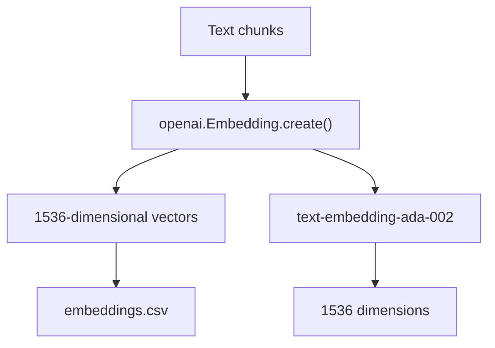
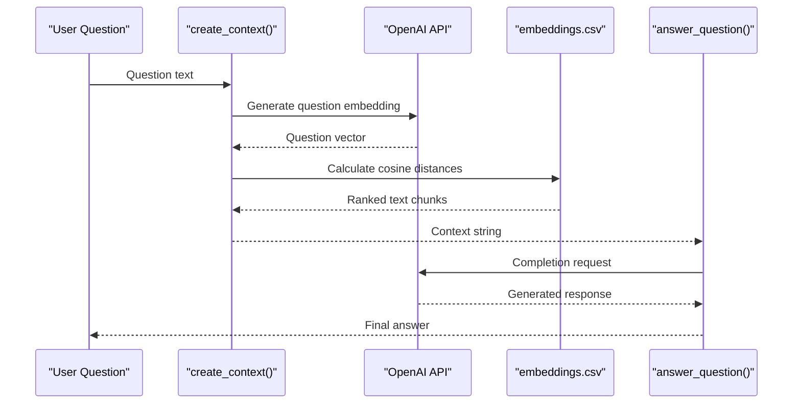

<!-- source: DeepWiki mcp.deepwiki.com · repo openai/web-crawl-q-and-a-example · page 5 Data Flow and Storage · fetched 2026-10-26 -->

# Data Flow and Storage

<details>
<summary>Relevant source files</summary>

The following files were used as context for generating this wiki page:

- [web-qa.ipynb](web-qa.ipynb)
- [web-qa.py](web-qa.py)

</details>


This document describes how data flows through the web crawl Q&A system and the various storage formats used at each stage of processing. It covers the complete pipeline from raw web content to vector embeddings and final question answering, including file structures, data transformations, and intermediate storage formats.

For information about the core implementation components that execute this data flow, see [Core Implementation](#2). For details about setting up the system and configuring storage directories, see [Setup and Configuration](#4).

## Data Pipeline Overview

The system implements a multi-stage data pipeline that transforms raw web content into a searchable knowledge base using OpenAI embeddings. The pipeline consists of distinct phases, each with specific input/output formats and storage requirements.



**Data Flow Pipeline with Code Functions**

Sources: [web-qa.py:115-169](), [web-qa.py:175-180](), [web-qa.py:231-267](), [web-qa.py:302](), [web-qa.py:319-350](), [web-qa.py:352-391]()

## Storage Structure

The system uses a hierarchical file structure to organize data at different processing stages. Raw content is stored in text files, while processed data is maintained in CSV format for efficient pandas operations.



**File System Organization**

The `crawl()` function creates the directory structure automatically, ensuring `text/` and `processed/` directories exist before data operations begin.

Sources: [web-qa.py:126-134](), [web-qa.py:146](), [web-qa.py:205](), [web-qa.py:303]()

## Data Processing Stages

### Stage 1: Web Crawling and Raw Storage

The `crawl()` function extracts content from web pages and stores raw text in individual files. Each URL is converted to a filename by removing the protocol and replacing path separators.

| Process | Input | Output | Function |
|---------|--------|---------|----------|
| URL Processing | Target website URL | Domain extraction | `urlparse(url).netloc` |
| Content Extraction | HTML pages | Plain text | `BeautifulSoup.get_text()` |
| File Storage | Text content | `{url}.txt` files | File I/O operations |

Raw files are stored as `text/{domain}/{url_without_protocol}.txt` where URL path separators are replaced with underscores.

Sources: [web-qa.py:115-169](), [web-qa.py:146](), [web-qa.py:149-159]()

### Stage 2: Text Cleaning and Normalization

The `remove_newlines()` function standardizes text formatting by eliminating various newline patterns and excessive whitespace.



**Text Cleaning Pipeline**

The cleaning process ensures consistent text formatting for tokenization and embedding generation.

Sources: [web-qa.py:175-180](), [web-qa.py:204]()

### Stage 3: Tokenization and Chunking

Text is tokenized using `tiktoken.get_encoding("cl100k_base")` and chunked into segments of maximum 500 tokens using the `split_into_many()` function.

| Parameter | Value | Purpose |
|-----------|--------|---------|
| `max_tokens` | 500 | Maximum tokens per chunk |
| Tokenizer | `cl100k_base` | Compatible with ada-002 model |
| Split Method | Sentence boundaries | Preserves semantic coherence |

The chunking algorithm respects sentence boundaries and accumulates sentences until the token limit is reached, ensuring contextual integrity.

Sources: [web-qa.py:213](), [web-qa.py:219](), [web-qa.py:231-267](), [web-qa.py:270-286]()

### Stage 4: Embedding Generation

Text chunks are converted to vector embeddings using OpenAI's `text-embedding-ada-002` model. The process applies embeddings to each text chunk individually.



**Embedding Generation Process**

Each embedding is a 1536-dimensional vector representing the semantic content of the text chunk.

Sources: [web-qa.py:302](), [web-qa.py:311]()

## Data Formats

### scraped.csv Format

The intermediate CSV file contains cleaned and processed text data:

| Column | Type | Description |
|--------|------|-------------|
| `title` | string | Processed filename identifier |
| `text` | string | Cleaned text content |

The title field combines the filename with cleaned text, created by `df.fname + ". " + remove_newlines(df.text)`.

Sources: [web-qa.py:201](), [web-qa.py:204-205]()

### embeddings.csv Format

The final CSV file contains text chunks with their corresponding vector embeddings:

| Column | Type | Description |
|--------|------|-------------|
| `text` | string | Text chunk content |
| `n_tokens` | integer | Token count for chunk |
| `embeddings` | string | Serialized vector array |

Embeddings are stored as string representations of Python lists and parsed using `literal_eval()` during loading.

Sources: [web-qa.py:292](), [web-qa.py:302-303](), [web-qa.py:311]()

## Question Answering Data Flow

The question answering process retrieves relevant context from stored embeddings and generates responses using OpenAI's completion API.



**Question Processing Sequence**

The `create_context()` function uses cosine similarity to find the most relevant text chunks, accumulating them until reaching the `max_len` token limit of 1800 tokens.

Sources: [web-qa.py:319-350](), [web-qa.py:352-391](), [web-qa.py:327](), [web-qa.py:330]()

## Storage Configuration

### Directory Creation

The system automatically creates required directories during the crawling phase:

```python
if not os.path.exists("text/"):
    os.mkdir("text/")
if not os.path.exists("text/"+local_domain+"/"):
    os.mkdir("text/" + local_domain + "/")
if not os.path.exists("processed"):
    os.mkdir("processed")
```

### File Naming Conventions

- Raw text files: `{url_without_protocol_and_slashes}.txt`
- Domain directories: `text/{domain}/`
- Processed files: `processed/scraped.csv`, `processed/embeddings.csv`

URL-to-filename conversion replaces path separators with underscores and removes the protocol prefix.

Sources: [web-qa.py:126-134](), [web-qa.py:146]()

---

