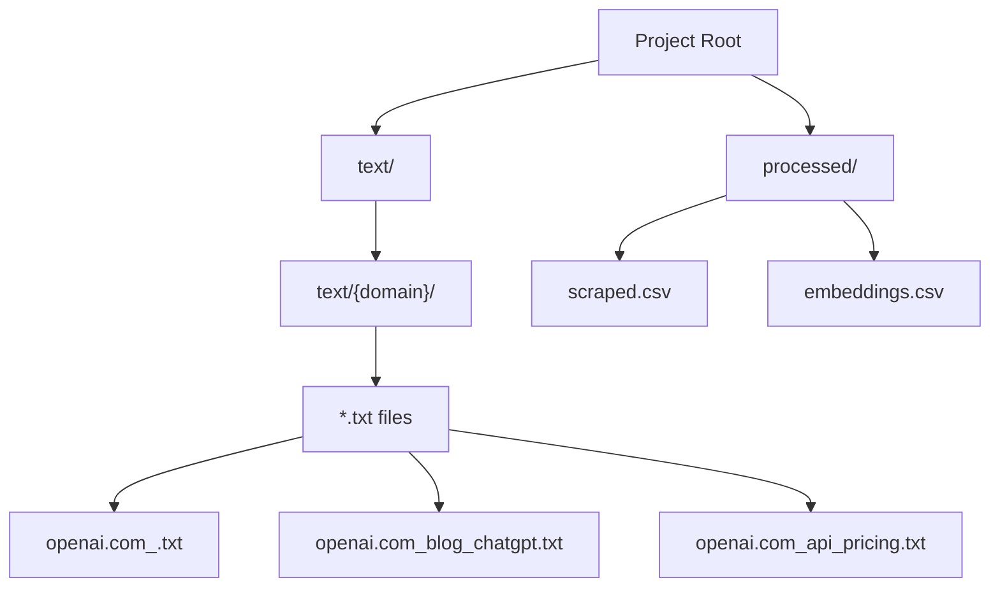
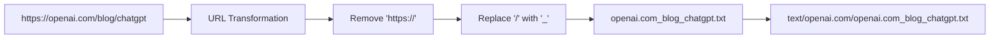
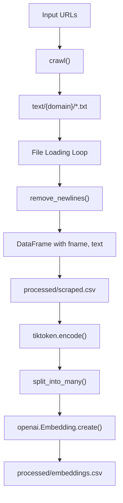
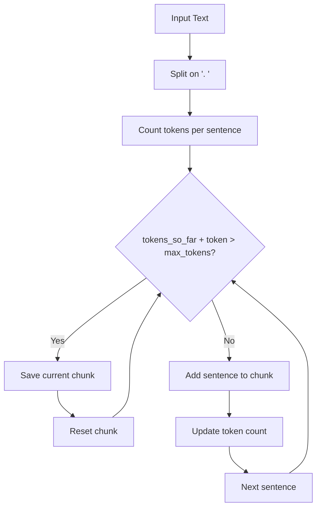
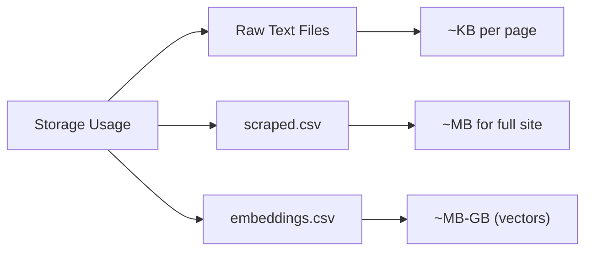

<!-- source: DeepWiki mcp.deepwiki.com · repo openai/web-crawl-q-and-a-example · page 5.1 File Structure and Outputs · fetched 2026-10-26 -->

# File Structure and Outputs

Relevant source files

The following files were used as context for generating this wiki page:

- [web-qa.ipynb](web-qa.ipynb)
- [web-qa.py](web-qa.py)

This document describes the directory structure, file naming conventions, and data formats produced by the web crawling and question-answering system during its execution. It covers the intermediate and final outputs generated throughout the data processing pipeline.

For information about the data processing stages themselves, see [Data Processing Stages](#5.2).

## Generated Directory Structure

The system creates a standardized directory structure to organize scraped content and processed data:

Sources: [web-qa.py:126-134](), [web-qa.py:146]()

## Text Directory Contents

### Directory Creation
The `crawl` function automatically creates the necessary directory structure:

| Directory | Purpose | Creation Logic |
|-----------|---------|----------------|
| `text/` | Root directory for all scraped content | Created if not exists |
| `text/{domain}/` | Domain-specific subdirectory | Created using `local_domain` from URL parsing |
| `processed/` | Directory for cleaned and processed data | Created for CSV outputs |

Sources: [web-qa.py:126-134]()

### File Naming Convention
Individual text files follow a specific naming pattern derived from their source URLs:

The transformation logic in `crawl()` function:
- Removes first 8 characters (`https://`)
- Replaces forward slashes with underscores
- Appends `.txt` extension

Sources: [web-qa.py:146]()

## Processed Data Files

### scraped.csv Structure
The first processing stage outputs `processed/scraped.csv` containing cleaned text data:

| Column | Type | Description |
|--------|------|-------------|
| `fname` | string | Processed filename (derived from URL) |
| `text` | string | Cleaned text content with newlines removed |

The file processing logic:
- Removes first 11 characters and last 4 characters from filename
- Replaces hyphens, underscores, and `#update` with spaces
- Combines filename and cleaned text content

Sources: [web-qa.py:191-206]()

### embeddings.csv Structure
The final processing stage outputs `processed/embeddings.csv` with embedding vectors:

| Column | Type | Description |
|--------|------|-------------|
| `text` | string | Text chunks (≤500 tokens each) |
| `n_tokens` | integer | Token count per chunk |
| `embeddings` | array | 1536-dimensional embedding vectors from `text-embedding-ada-002` |

Sources: [web-qa.py:302-304](), [web-qa.py:310-312]()

## Data Transformation Pipeline

Sources: [web-qa.py:115-169](), [web-qa.py:175-206](), [web-qa.py:231-286](), [web-qa.py:302-304]()

## Token Management and Chunking

### Token Limits
The system enforces a maximum token limit for processing:

- **Target chunk size**: 500 tokens (`max_tokens` variable)
- **Context window**: 1800 tokens for question answering
- **Tokenizer**: `cl100k_base` encoding compatible with `ada-002` model

### Chunking Strategy
The `split_into_many()` function implements sentence-based chunking:

Sources: [web-qa.py:231-267]()

## File Size and Storage Considerations

### Typical File Sizes
Based on the processing pipeline:

- **Text files**: Variable size, contains raw HTML-to-text conversion
- **scraped.csv**: Moderate size, one row per webpage
- **embeddings.csv**: Large file, contains 1536-dimensional vectors per text chunk

### Storage Pattern

The embeddings file becomes the largest artifact due to the 1536-dimensional float arrays stored per text chunk.

Sources: [web-qa.py:302-304]()

---

