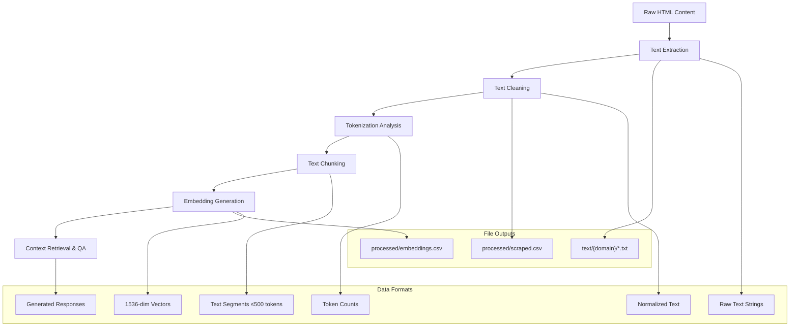
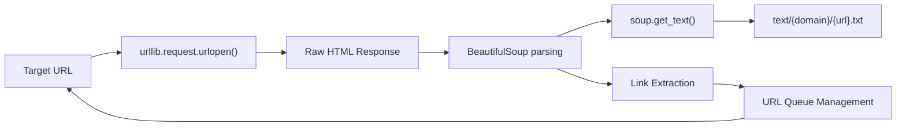
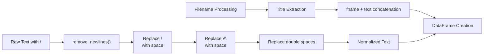
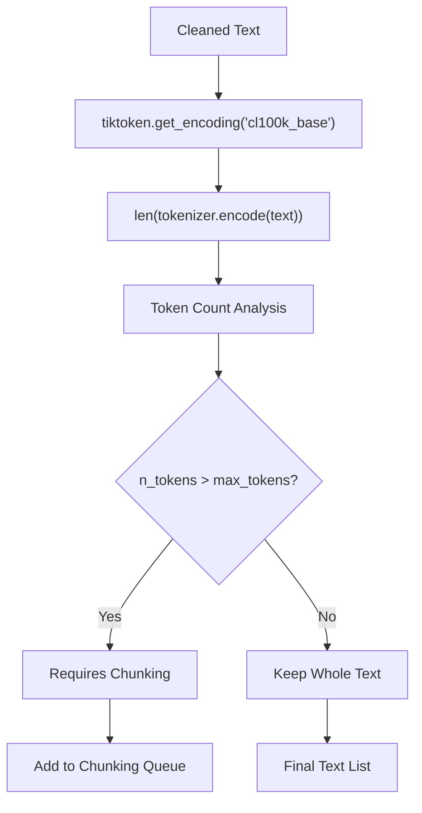
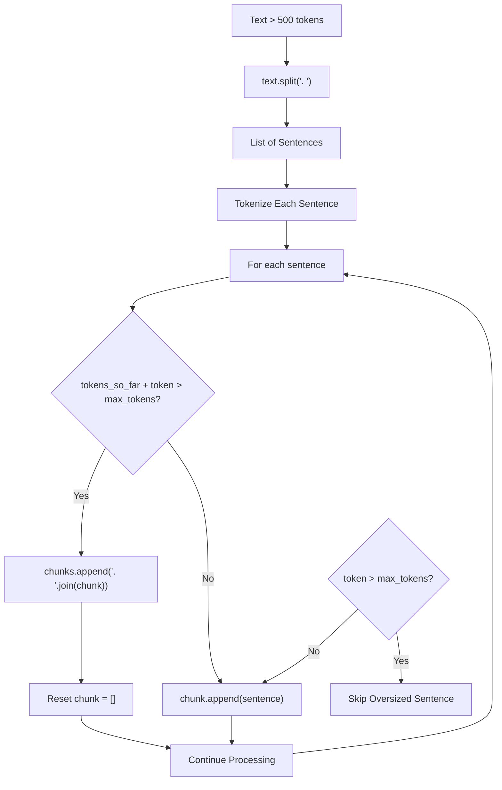
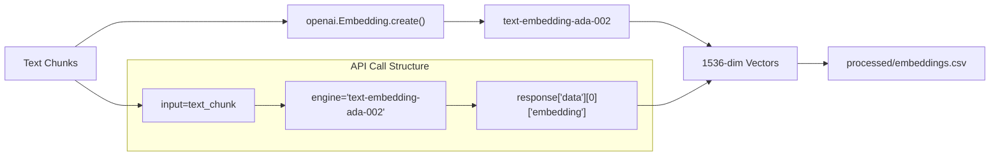
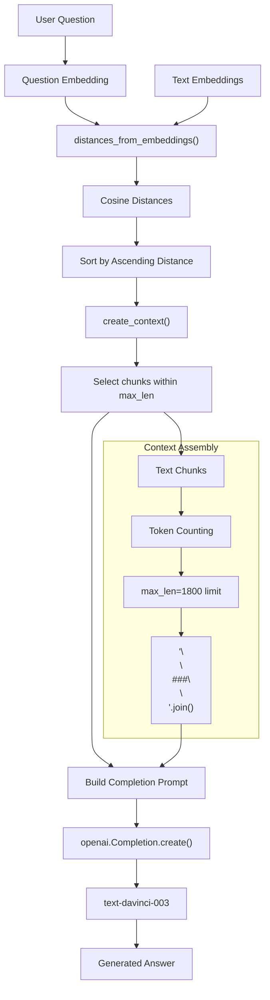

<!-- source: DeepWiki mcp.deepwiki.com · repo openai/web-crawl-q-and-a-example · page 5.2 Data Processing Stages · fetched 2026-10-26 -->

# Data Processing Stages

Relevant source files

The following files were used as context for generating this wiki page:

- [web-qa.ipynb](web-qa.ipynb)
- [web-qa.py](web-qa.py)

This document details the sequential data transformation stages that convert raw HTML content from crawled websites into vector embeddings and structured answers. The processing pipeline transforms unstructured web content through multiple stages of cleaning, tokenization, chunking, and embedding generation to enable semantic question answering.

For information about the overall system architecture, see [System Architecture](#1.1). For details about specific implementation variants, see [Implementation Variants](#3).

## Pipeline Overview

The data processing pipeline consists of six distinct stages, each producing intermediate outputs that feed into subsequent stages. The pipeline handles both text normalization and semantic preparation for the question-answering system.

**Sources:** [web-qa.py:115-400](), [web-qa.ipynb:603-1165]()

## Stage 1: Web Crawling and Raw Text Extraction

The initial stage extracts textual content from HTML pages using BeautifulSoup parsing. The `crawl()` function manages URL queuing and content extraction, saving raw text to individual files.

| Function | Purpose | Input | Output |
|----------|---------|--------|--------|
| `crawl()` | Main crawling orchestration | Starting URL | Text files in `text/{domain}/` |
| `get_hyperlinks()` | HTML link extraction | URL | List of href attributes |
| `get_domain_hyperlinks()` | Domain-filtered links | Local domain, URL | Filtered link list |

The extraction process handles JavaScript-dependent pages by detecting the "You need to enable JavaScript" message and skipping those pages. Files are named using URL patterns with domain prefixes for organization.

**Sources:** [web-qa.py:115-169](), [web-qa.ipynb:603-654]()

## Stage 2: Text Cleaning and Normalization

The `remove_newlines()` function performs text normalization by removing line breaks and reducing multiple spaces to single spaces. This stage also processes filenames to create title metadata.

The cleaning process applies multiple string replacements in sequence:
- `\n` → ` ` (newlines to spaces)
- `\\n` → ` ` (escaped newlines to spaces)  
- `  ` → ` ` (double spaces to single, applied twice)

**Sources:** [web-qa.py:175-206](), [web-qa.ipynb:662-698]()

## Stage 3: Tokenization and Chunk Analysis

Token counting uses the `tiktoken` library with the `cl100k_base` encoding, which is designed for compatibility with OpenAI's `text-embedding-ada-002` model. This stage identifies texts that exceed the maximum token limit.

The tokenization stage produces a histogram distribution of token counts across all text segments, helping identify the chunking requirements for the dataset.

**Sources:** [web-qa.py:212-222](), [web-qa.ipynb:727-740]()

## Stage 4: Text Chunking and Segmentation

The `split_into_many()` function implements sentence-based chunking with a maximum token limit of 500 tokens per chunk. The algorithm preserves sentence boundaries while staying within token constraints.

The chunking algorithm maintains these invariants:
- Each chunk contains complete sentences (preserves `. ` boundaries)
- No chunk exceeds 500 tokens
- Sentences longer than 500 tokens are skipped entirely
- Chunks are terminated with periods for grammatical completeness

**Sources:** [web-qa.py:231-267](), [web-qa.ipynb:750-805]()

## Stage 5: Embedding Generation

Vector embeddings are generated using OpenAI's `text-embedding-ada-002` model, producing 1536-dimensional vectors for each text chunk. The embeddings enable semantic similarity calculations for context retrieval.

The embedding process applies to each row in the DataFrame using a lambda function that calls the OpenAI API. Rate limiting considerations may require handling API throttling for large datasets.

**Sources:** [web-qa.py:302-304](), [web-qa.ipynb:928-933]()

## Stage 6: Context Retrieval and Answer Generation

The final stage implements semantic search using cosine similarity between question embeddings and text chunk embeddings. The `create_context()` function retrieves relevant text segments, while `answer_question()` generates responses using OpenAI's completion API.

The context retrieval algorithm:
1. Embeds the input question using the same `text-embedding-ada-002` model
2. Calculates cosine distances to all text chunk embeddings
3. Sorts chunks by similarity (ascending distance)
4. Accumulates chunks until reaching the 1800 token context limit
5. Joins selected chunks with `###` delimiters for prompt construction

**Sources:** [web-qa.py:319-391](), [web-qa.ipynb:1051-1124]()