# Page: Overview

# Overview

<details>
<summary>Relevant source files</summary>

The following files were used as context for generating this wiki page:

- [README.md](README.md)
- [requirements.txt](requirements.txt)
- [web-qa.py](web-qa.py)

</details>


## Purpose and Scope

This document provides a comprehensive overview of the web crawl Q&A system, a Retrieval-Augmented Generation (RAG) implementation that crawls websites and enables question-answering using OpenAI's embedding and completion APIs. The system extracts content from web pages, processes it into searchable chunks, and provides contextually relevant answers to user questions.

The system implements a complete pipeline from web crawling to question answering, demonstrating practical application of modern NLP techniques for building domain-specific knowledge bases. For detailed implementation specifics of individual components, see [Core Implementation](#2). For setup and configuration guidance, see [Setup and Configuration](#4).

## System Architecture

The web crawl Q&A system follows a sequential pipeline architecture that transforms raw web content into a searchable knowledge base capable of answering questions.

### High-Level Architecture

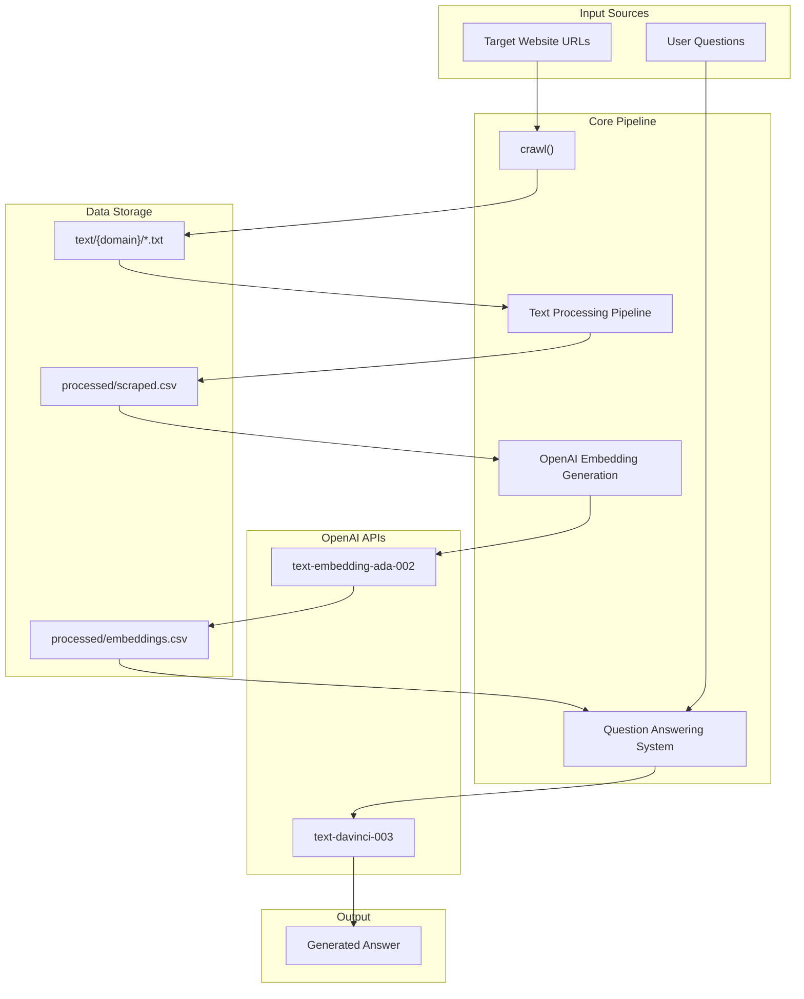

Sources: [web-qa.py:115-169](), [web-qa.py:175-206](), [web-qa.py:302-304](), [web-qa.py:352-391]()

## Core Components

The system is built around several key functions that handle different stages of the pipeline, from web content extraction to answer generation.

### Component Architecture with Code Entities

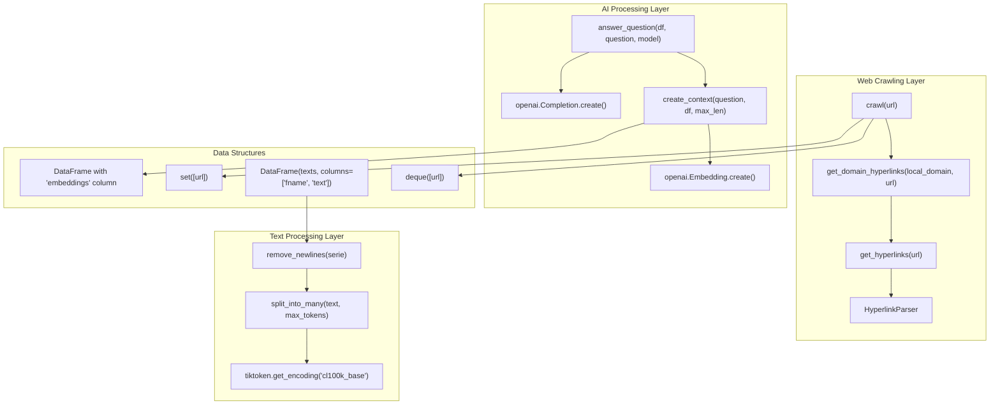

Sources: [web-qa.py:31-43](), [web-qa.py:50-71](), [web-qa.py:78-108](), [web-qa.py:115-169](), [web-qa.py:175-181](), [web-qa.py:231-267](), [web-qa.py:319-350](), [web-qa.py:352-391]()

## Data Flow Pipeline

The system processes data through four distinct stages, each producing intermediate outputs that feed into the next stage.

| Stage | Input | Process | Output | Key Functions |
|-------|-------|---------|--------|---------------|
| **Web Crawling** | Website URLs | HTML extraction, link discovery | `text/{domain}/*.txt` | `crawl()`, `get_hyperlinks()` |
| **Text Processing** | Raw text files | Cleaning, tokenization, chunking | `processed/scraped.csv` | `remove_newlines()`, `split_into_many()` |
| **Embedding Generation** | Processed text chunks | OpenAI API embedding creation | `processed/embeddings.csv` | `openai.Embedding.create()` |
| **Question Answering** | User question + embeddings | Context retrieval, answer generation | Text response | `create_context()`, `answer_question()` |

### Processing Flow Details

The `crawl()` function implements breadth-first traversal using a `deque` queue and `set` for tracking visited URLs [web-qa.py:115-169](). Text processing applies multiple cleaning steps through `remove_newlines()` and handles token limits via `split_into_many()` with a default `max_tokens = 500` [web-qa.py:228-267](). 

The embedding stage uses OpenAI's `text-embedding-ada-002` model to generate 1536-dimensional vectors for each text chunk [web-qa.py:302](). Question answering employs cosine similarity through `distances_from_embeddings()` to retrieve relevant context before generating responses with `text-davinci-003` [web-qa.py:327-391]().

Sources: [web-qa.py:115-169](), [web-qa.py:175-206](), [web-qa.py:228-304](), [web-qa.py:319-391]()

## Technology Stack

The system leverages a comprehensive set of Python libraries optimized for web scraping, data processing, and machine learning workflows.

### Core Dependencies

| Category | Libraries | Purpose |
|----------|-----------|---------|
| **Web Scraping** | `requests`, `beautifulsoup4`, `urllib` | HTTP requests, HTML parsing |
| **Data Processing** | `pandas`, `numpy` | DataFrames, numerical operations |
| **AI/ML** | `openai`, `tiktoken`, `scikit-learn` | OpenAI API, tokenization, similarity metrics |
| **Async Operations** | `aiohttp`, `asyncio` | Asynchronous HTTP handling |
| **Visualization** | `matplotlib`, `plotly` | Data analysis and plotting |

The system requires `openai==0.26.1` for API compatibility and `tiktoken==0.1.2` for tokenization that matches OpenAI's `text-embedding-ada-002` model [requirements.txt:39](), [requirements.txt:69](). The `cl100k_base` tokenizer encoding is specifically chosen to align with the ada-002 embedding model [web-qa.py:213]().

### Implementation Variants

The codebase provides two implementation approaches:
- **Script Implementation**: Production-ready `web-qa.py` for automated execution
- **Notebook Implementation**: Interactive `web-qa.ipynb` for experimentation and development

Both implementations share the same core functions and data processing pipeline, enabling users to choose the appropriate interface for their workflow. For detailed comparison of these variants, see [Implementation Variants](#3).

Sources: [requirements.txt:1-80](), [web-qa.py:5-18](), [web-qa.py:213](), [README.md:1-4]()

---

# Page: System Architecture

# System Architecture

<details>
<summary>Relevant source files</summary>

The following files were used as context for generating this wiki page:

- [web-qa.ipynb](web-qa.ipynb)
- [web-qa.py](web-qa.py)

</details>


## Purpose and Scope

This document describes the system architecture of the web crawling and question-answering pipeline that implements a Retrieval-Augmented Generation (RAG) pattern. The system crawls websites, processes the content into embeddings, and provides question-answering capabilities using OpenAI's embedding and completion APIs.

For information about the specific implementation variants, see [Script Implementation](#3.1) and [Notebook Implementation](#3.2). For details about dependencies and setup, see [Dependencies and Requirements](#4.1).

## High-Level System Architecture

The system follows a linear pipeline architecture with four distinct phases: web crawling, text processing, embedding generation, and question answering.

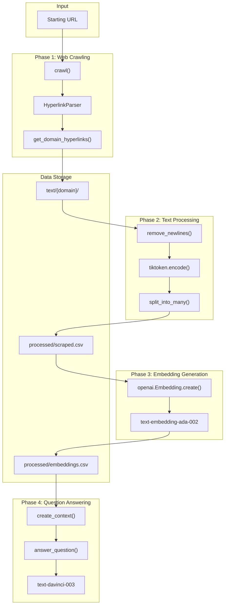

**Sources:** [web-qa.py:1-400](), [web-qa.ipynb:1-1194]()

## Core Components

### Web Crawling System

The crawling system uses a breadth-first approach with domain filtering to systematically extract content from websites.

| Component | Function | Key Responsibilities |
|-----------|----------|---------------------|
| `HyperlinkParser` | HTML parsing | Extracts href attributes from anchor tags |
| `get_hyperlinks()` | Link extraction | Fetches and parses HTML content from URLs |
| `get_domain_hyperlinks()` | Domain filtering | Filters links to stay within target domain |
| `crawl()` | Orchestration | Manages queue, deduplication, and file storage |

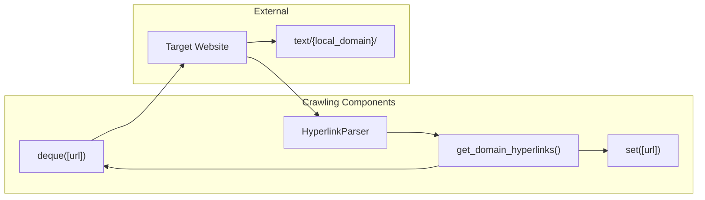

**Sources:** [web-qa.py:31-169](), [web-qa.ipynb:535-653]()

### Text Processing Pipeline

The processing pipeline transforms raw HTML content into tokenized chunks suitable for embedding generation.

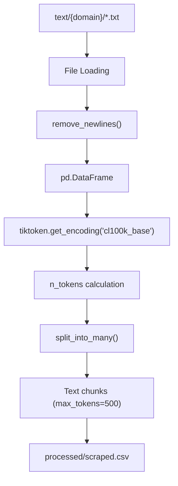

**Sources:** [web-qa.py:175-293](), [web-qa.ipynb:662-837]()

### Embedding and Context Retrieval System

The system uses OpenAI's embedding API to convert text chunks into vector representations for semantic similarity search.

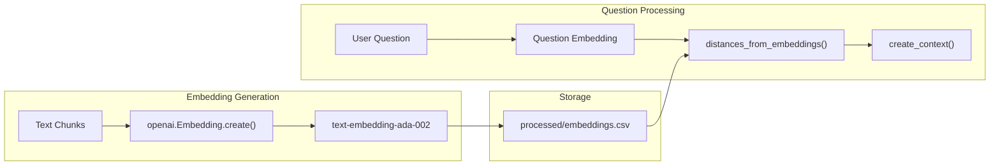

**Sources:** [web-qa.py:302-350](), [web-qa.ipynb:928-1082]()

## Data Flow Architecture

The system processes data through a series of transformations, with each stage producing intermediate outputs that feed into the next stage.

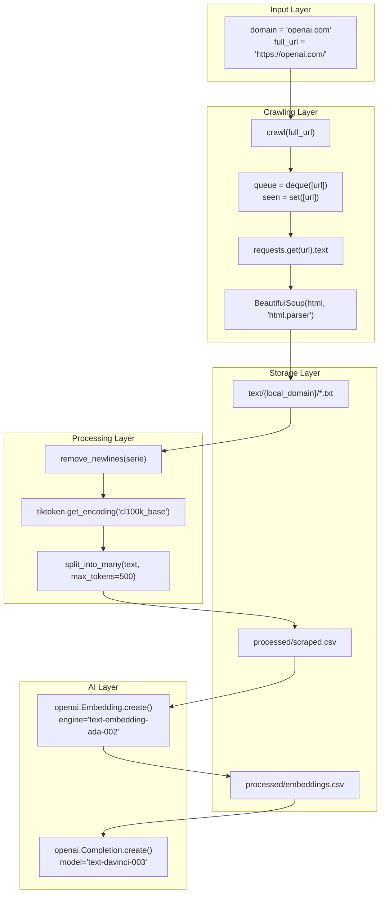

**Sources:** [web-qa.py:27-28](), [web-qa.py:115-169](), [web-qa.py:187-304]()

## Implementation Patterns

### Error Handling and Robustness

The system implements several error handling patterns to ensure robustness during web crawling and API interactions:

| Pattern | Location | Purpose |
|---------|----------|---------|
| Try-catch in crawling | [web-qa.py:144-161]() | Handles network errors and parsing failures |
| Content-type validation | [web-qa.py:58-59]() | Ensures only HTML content is processed |
| JavaScript detection | [web-qa.py:155-156]() | Skips pages requiring JavaScript |
| API error handling | [web-qa.py:376-391]() | Graceful degradation for OpenAI API failures |

### Configuration and Constants

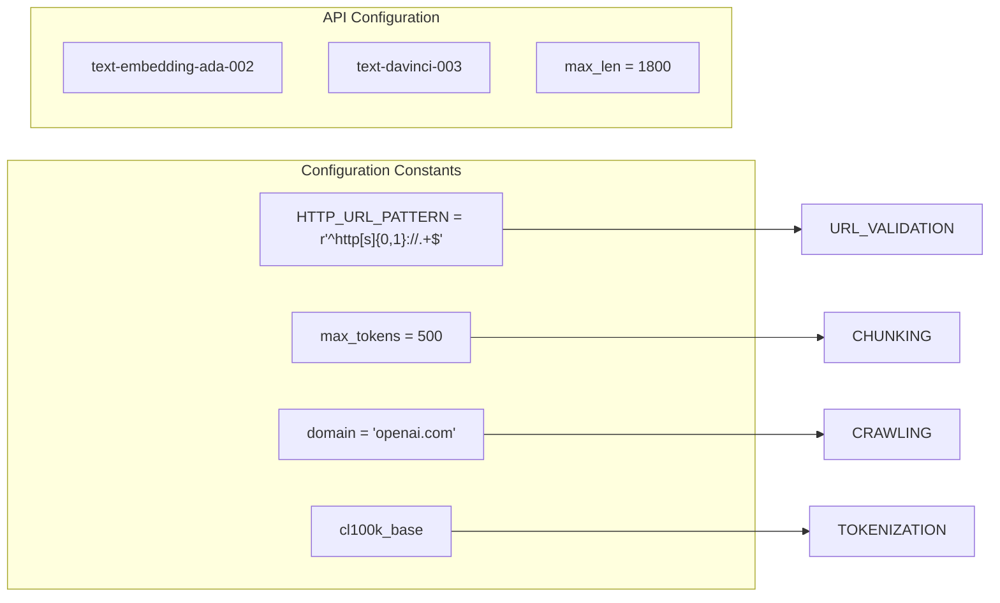

**Sources:** [web-qa.py:21](), [web-qa.py:228](), [web-qa.py:27](), [web-qa.py:213](), [web-qa.py:302](), [web-qa.py:354]()

### Directory Structure and File Management

The system creates a structured file hierarchy for organizing crawled content and processed data:

- `text/{domain}/` - Raw text files from crawled pages
- `processed/scraped.csv` - Cleaned and structured text data  
- `processed/embeddings.csv` - Text data with generated embeddings

**Sources:** [web-qa.py:126-134](), [web-qa.py:205](), [web-qa.py:303]()

---

# Page: Technology Stack

# Technology Stack

<details>
<summary>Relevant source files</summary>

The following files were used as context for generating this wiki page:

- [requirements.txt](requirements.txt)

</details>


This document details the comprehensive technology stack used in the web crawl Q&A system, explaining the dependencies and architectural choices that enable web scraping, text processing, embedding generation, and question answering functionality. For information about how these technologies are used in practice, see [Core Implementation](#2).

The system leverages a modern Python ecosystem that combines web scraping capabilities, data science tools, machine learning frameworks, and OpenAI's API services to implement a Retrieval-Augmented Generation (RAG) architecture.

## Technology Categories

The technology stack is organized into five primary categories, each serving specific system requirements:

| Category | Primary Purpose | Key Libraries |
|----------|----------------|---------------|
| Web & HTTP | Content retrieval and parsing | `requests`, `aiohttp`, `beautifulsoup4` |
| Data Science | Text processing and analysis | `pandas`, `numpy`, `scikit-learn` |
| Machine Learning & NLP | Embeddings and tokenization | `openai`, `tiktoken`, `transformers` |
| Development Environment | Interactive development | `jupyter`, `ipython`, `matplotlib` |
| System Utilities | Progress tracking and configuration | `tqdm`, `PyYAML`, `asyncio` |

## Web Scraping and HTTP Stack

### Core HTTP Libraries

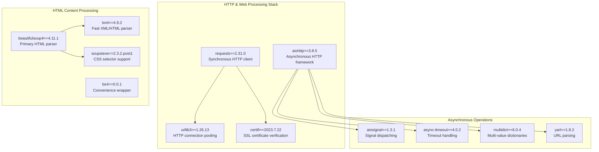

The web scraping stack provides both synchronous and asynchronous HTTP capabilities. The `requests` library handles straightforward HTTP operations in the `crawl()` function, while `aiohttp` enables concurrent web scraping for improved performance. `beautifulsoup4` with `lxml` backend provides robust HTML parsing for content extraction.

*Sources: [requirements.txt:61](), [requirements.txt:1](), [requirements.txt:8](), [requirements.txt:33]()*

## Data Science and Processing Stack

### Data Manipulation Framework

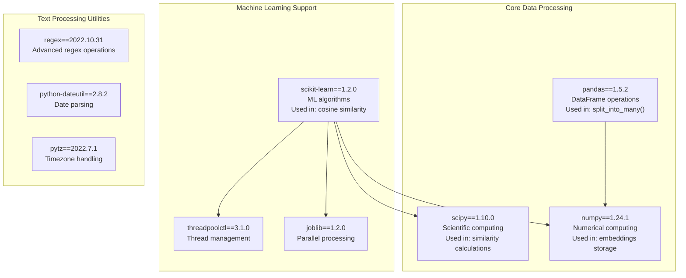

The data science stack centers around `pandas` for structured data manipulation, particularly in the `split_into_many()` function for text chunking and CSV operations. `scikit-learn` provides cosine similarity calculations for the `create_context()` function, while `numpy` handles efficient numerical operations on embedding vectors.

*Sources: [requirements.txt:41](), [requirements.txt:38](), [requirements.txt:62](), [requirements.txt:63]()*

## Machine Learning and NLP Stack

### AI and Language Processing

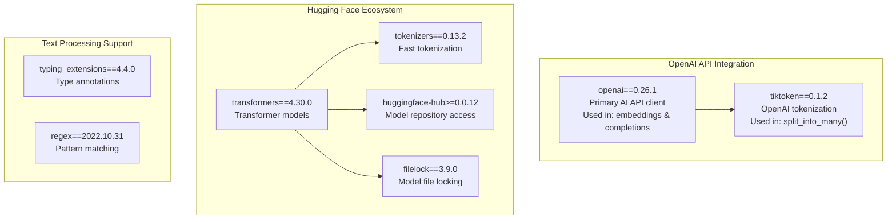

The ML/NLP stack is anchored by the `openai` library, which interfaces with OpenAI's `text-embedding-ada-002` model for embedding generation and `text-davinci-003` for answer generation. `tiktoken` provides accurate token counting for the text chunking process, ensuring chunks fit within model context limits.

*Sources: [requirements.txt:39](), [requirements.txt:69](), [requirements.txt:74](), [requirements.txt:70]()*

## Development and Visualization Environment

### Interactive Development Stack

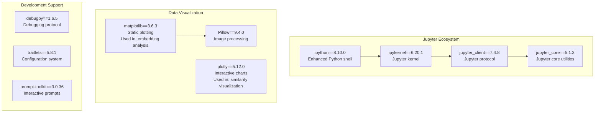

The development environment supports both script-based execution ([web-qa.py]()) and interactive notebook development ([web-qa.ipynb]()). `matplotlib` and `plotly` enable visualization of embedding similarities and system performance metrics during development and analysis phases.

*Sources: [requirements.txt:27](), [requirements.txt:26](), [requirements.txt:34](), [requirements.txt:48]()*

## System Utilities and Configuration

### Infrastructure Support Libraries

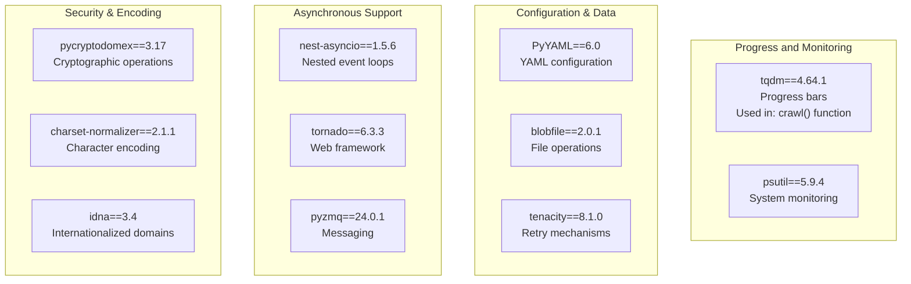

System utilities provide essential infrastructure support. `tqdm` delivers progress tracking during long-running crawl operations, while `PyYAML` enables configuration management. Security libraries handle character encoding normalization and cryptographic operations for robust web content processing.

*Sources: [requirements.txt:72](), [requirements.txt:58](), [requirements.txt:37](), [requirements.txt:53]()*

## Technology Integration Architecture

### Function-to-Library Mapping

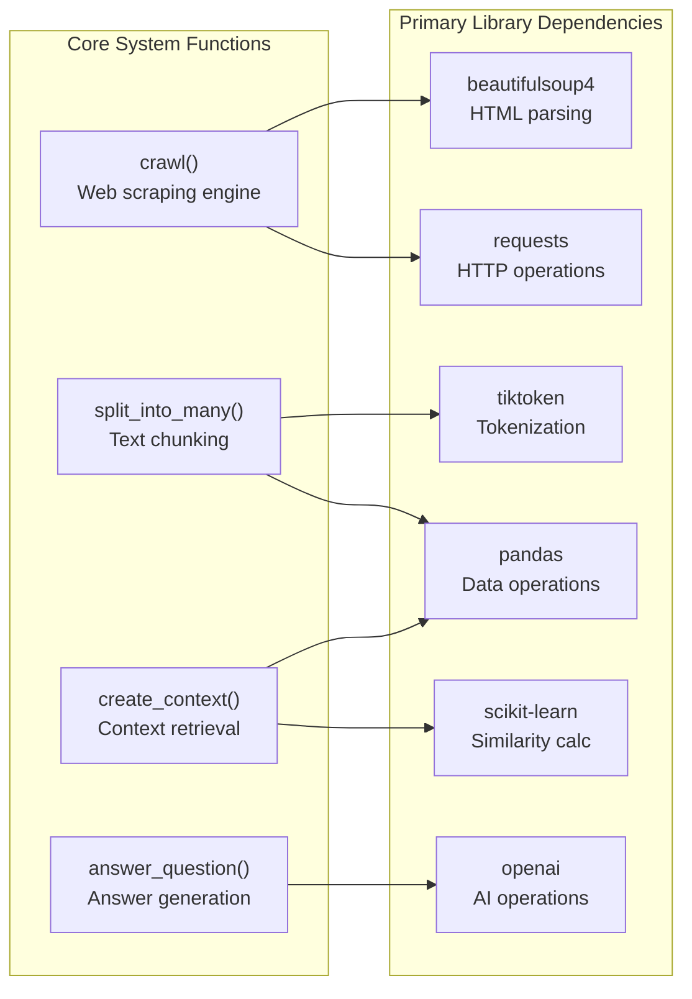

This mapping demonstrates how core system functions depend on specific technology choices. Each major function leverages multiple libraries to achieve its functionality, creating a cohesive technology ecosystem that supports the RAG architecture.

*Sources: [requirements.txt:61](), [requirements.txt:8](), [requirements.txt:41](), [requirements.txt:69](), [requirements.txt:62](), [requirements.txt:39]()*

---

# Page: Core Implementation

# Core Implementation

<details>
<summary>Relevant source files</summary>

The following files were used as context for generating this wiki page:

- [web-qa.ipynb](web-qa.ipynb)
- [web-qa.py](web-qa.py)

</details>


This document covers the core implementation components of the web crawl Q&A system, including the main classes, functions, and data processing pipeline that enable crawling websites and answering questions based on the extracted content. For information about setting up dependencies and running the system, see [Setup and Configuration](#4). For details about the different implementation variants, see [Implementation Variants](#3).

## System Overview

The core implementation consists of two functionally identical implementations: a production script ([web-qa.py]()) and an interactive notebook ([web-qa.ipynb]()). Both implementations follow the same Retrieval-Augmented Generation (RAG) architecture, combining web crawling, text processing, embedding generation, and question answering capabilities.

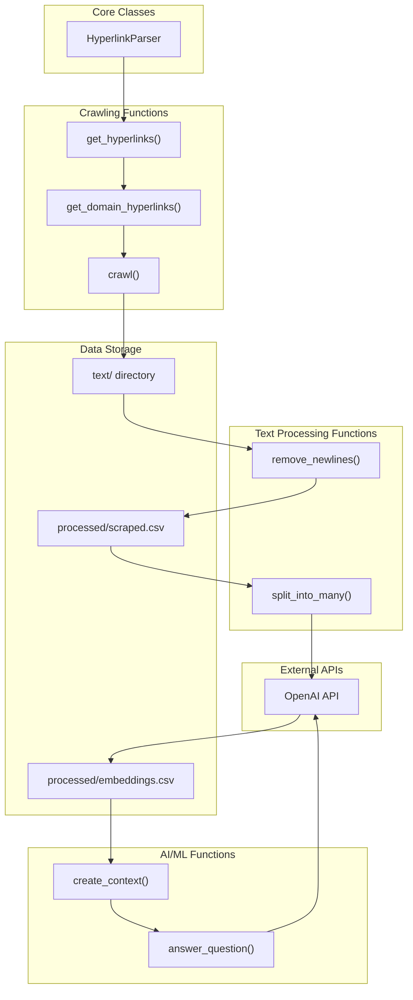

**Sources:** [web-qa.py:1-400](), [web-qa.ipynb:1-1194]()

## Web Crawling System

The web crawling functionality is built around the `HyperlinkParser` class and associated helper functions that extract and process web content systematically.

### HyperlinkParser Class

The `HyperlinkParser` class extends Python's `HTMLParser` to extract hyperlinks from HTML content.

| Component | Purpose | Key Methods |
|-----------|---------|-------------|
| `HyperlinkParser` | HTML parsing for link extraction | `handle_starttag()` |
| `hyperlinks` attribute | Stores extracted links | List accumulator |

The class overrides `handle_starttag()` to capture `href` attributes from anchor tags, building a list of discovered hyperlinks.

**Sources:** [web-qa.py:31-43](), [web-qa.ipynb:535-547]()

### Link Processing Functions

| Function | Parameters | Return Value | Purpose |
|----------|------------|--------------|---------|
| `get_hyperlinks()` | `url: str` | `List[str]` | Extract all hyperlinks from a webpage |
| `get_domain_hyperlinks()` | `local_domain: str, url: str` | `List[str]` | Filter links within the same domain |

The `get_hyperlinks()` function handles HTTP requests, content-type validation, and HTML parsing, while `get_domain_hyperlinks()` applies domain filtering and URL normalization.

**Sources:** [web-qa.py:49-108](), [web-qa.ipynb:549-600]()

### Crawling Engine

The `crawl()` function implements a breadth-first web crawling algorithm using a queue-based approach:

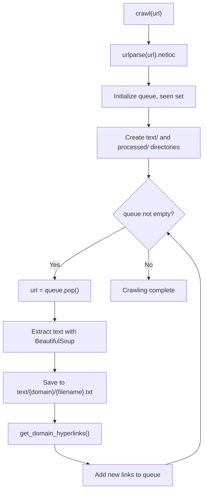

The crawler maintains a `seen` set to prevent duplicate processing and creates domain-specific directory structures for organizing extracted content.

**Sources:** [web-qa.py:115-169](), [web-qa.ipynb:603-653]()

## Text Processing Pipeline

The text processing pipeline transforms raw HTML content into structured, tokenized chunks suitable for embedding generation.

### Text Cleaning

The `remove_newlines()` function standardizes text formatting by removing various newline patterns and normalizing whitespace:

- Converts `\n` to spaces
- Converts `\\n` to spaces  
- Collapses multiple consecutive spaces

**Sources:** [web-qa.py:175-180](), [web-qa.ipynb:662-667]()

### Text Chunking

The `split_into_many()` function implements sentence-based text chunking with token-aware boundaries:

| Parameter | Type | Default | Purpose |
|-----------|------|---------|---------|
| `text` | `str` | - | Input text to chunk |
| `max_tokens` | `int` | `500` | Maximum tokens per chunk |

The algorithm splits text into sentences, calculates token counts using the `tiktoken` tokenizer, and groups sentences into chunks while respecting token limits.

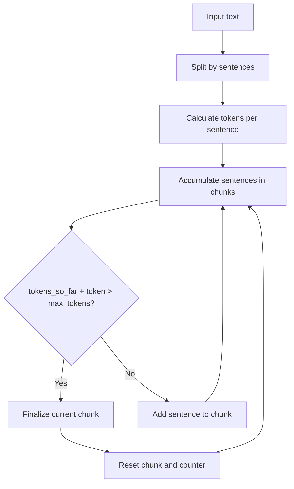

**Sources:** [web-qa.py:231-267](), [web-qa.ipynb:751-787]()

## Embedding and Question Answering

The system uses OpenAI's embedding model to create vector representations of text chunks and implements similarity-based context retrieval for question answering.

### Context Creation

The `create_context()` function implements semantic search over the text corpus:

| Parameter | Type | Default | Purpose |
|-----------|------|---------|---------|
| `question` | `str` | - | User question |
| `df` | `DataFrame` | - | Text chunks with embeddings |
| `max_len` | `int` | `1800` | Maximum context length in tokens |
| `size` | `str` | `"ada"` | Embedding model size |

The function generates embeddings for the question, calculates cosine distances to all text chunks, and assembles the most relevant chunks into a context string.

**Sources:** [web-qa.py:319-350](), [web-qa.ipynb:1051-1082]()

### Answer Generation

The `answer_question()` function orchestrates the complete question-answering process:

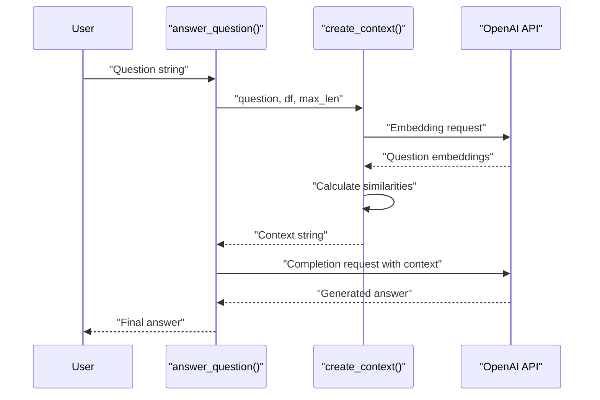

The function constructs a prompt template that includes the retrieved context and the user question, then calls OpenAI's completion API to generate the final answer.

**Sources:** [web-qa.py:352-391](), [web-qa.ipynb:1084-1123]()

## Data Flow Architecture

The complete data processing pipeline transforms web content through multiple stages:

```mermaid
flowchart LR
    subgraph "Input Stage"
        URL["Target URL"]
    end
    
    subgraph "Crawling Stage"
        CRAWL_FN["crawl()"]
        PARSER["HyperlinkParser"]
        TEXT_FILES["text/{domain}/*.txt"]
    end
    
    subgraph "Processing Stage"
        CLEAN["remove_newlines()"]
        CHUNK["split_into_many()"]
        CSV1["processed/scraped.csv"]
    end
    
    subgraph "Embedding Stage"
        EMBED_API["OpenAI Embedding API"]
        CSV2["processed/embeddings.csv"]
    end
    
    subgraph "Query Stage"
        QUESTION["User Question"]
        CONTEXT_FN["create_context()"]
        ANSWER_FN["answer_question()"]
        COMPLETION_API["OpenAI Completion API"]
        RESULT["Generated Answer"]
    end
    
    URL --> CRAWL_FN
    CRAWL_FN --> PARSER
    PARSER --> TEXT_FILES
    TEXT_FILES --> CLEAN
    CLEAN --> CHUNK
    CHUNK --> CSV1
    CSV1 --> EMBED_API
    EMBED_API --> CSV2
    
    QUESTION --> CONTEXT_FN
    CSV2 --> CONTEXT_FN
    CONTEXT_FN --> ANSWER_FN
    ANSWER_FN --> COMPLETION_API
    COMPLETION_API --> RESULT
```

This architecture enables the system to process arbitrary websites and answer questions about their content using state-of-the-art language models and semantic search techniques.

**Sources:** [web-qa.py:1-400](), [web-qa.ipynb:1-1194]()

---

# Page: Web Crawling System

# Web Crawling System

<details>
<summary>Relevant source files</summary>

The following files were used as context for generating this wiki page:

- [web-qa.ipynb](web-qa.ipynb)
- [web-qa.py](web-qa.py)

</details>


This document covers the web crawling component of the Q&A system, which systematically discovers and extracts text content from websites within a specified domain. The crawler serves as the data ingestion layer that feeds raw content into the subsequent text processing pipeline.

For information about text processing and cleaning of crawled content, see [Text Processing Pipeline](#2.2). For details about embedding generation and question answering functionality, see [Embedding and Question Answering](#2.3).

## Purpose and Architecture

The web crawling system implements a breadth-first traversal of a website's link structure, extracting textual content from HTML pages while respecting domain boundaries. The system operates as a single-threaded, synchronous crawler that maintains a queue of URLs to process and tracks visited pages to avoid infinite loops.

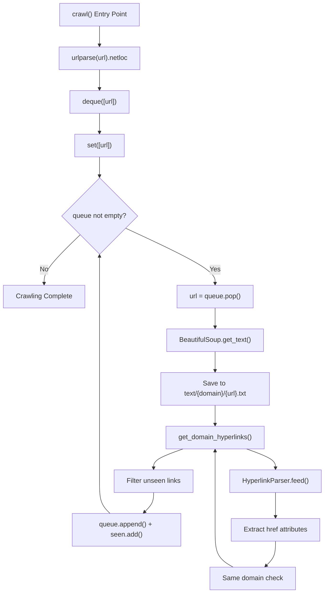

**Sources:** [web-qa.py:115-168](), [web-qa.ipynb:603-653]()

## Core Components

### HyperlinkParser Class

The `HyperlinkParser` extends Python's `HTMLParser` to extract hyperlinks from HTML content. It specifically targets anchor tags (`<a>`) and collects their `href` attributes.

```mermaid
graph LR
    HTML_INPUT["HTML Content"] --> PARSER["HyperlinkParser"]
    PARSER --> HANDLE_TAG["handle_starttag()"]
    HANDLE_TAG --> CHECK_ANCHOR{"tag == 'a'?"}
    CHECK_ANCHOR -->|Yes| CHECK_HREF{"'href' in attrs?"}
    CHECK_HREF -->|Yes| APPEND["hyperlinks.append()"]
    APPEND --> HYPERLINKS_LIST["List of URLs"]
    CHECK_ANCHOR -->|No| SKIP["Skip tag"]
    CHECK_HREF -->|No| SKIP
```

| Method | Purpose | Implementation |
|--------|---------|---------------|
| `__init__()` | Initialize empty hyperlinks list | [web-qa.py:32-35]() |
| `handle_starttag()` | Process HTML tags and extract href attributes | [web-qa.py:38-43]() |

**Sources:** [web-qa.py:31-43](), [web-qa.ipynb:535-547]()

### URL Processing Functions

The system employs a two-stage URL processing approach: initial extraction followed by domain filtering.

#### get_hyperlinks Function

```mermaid
graph TB
    URL_INPUT["Input URL"] --> OPEN_URL["urllib.request.urlopen()"]
    OPEN_URL --> CHECK_CONTENT{"Content-Type == text/html?"}
    CHECK_CONTENT -->|No| RETURN_EMPTY["return []"]
    CHECK_CONTENT -->|Yes| DECODE["response.read().decode('utf-8')"]
    DECODE --> CREATE_PARSER["HyperlinkParser()"]
    CREATE_PARSER --> FEED_HTML["parser.feed(html)"]
    FEED_HTML --> RETURN_LINKS["return parser.hyperlinks"]
    
    OPEN_URL --> ERROR_CATCH["Exception Handler"]
    ERROR_CATCH --> PRINT_ERROR["print(e)"]
    PRINT_ERROR --> RETURN_EMPTY
```

**Sources:** [web-qa.py:50-71](), [web-qa.ipynb:550-571]()

#### get_domain_hyperlinks Function

This function filters extracted links to ensure they belong to the target domain and converts relative URLs to absolute URLs.

| Link Type | Processing Logic | Example |
|-----------|------------------|---------|
| Absolute URL | Check if `netloc` matches target domain | `https://openai.com/blog` |
| Relative URL | Prepend domain and protocol | `/blog` → `https://openai.com/blog` |
| Fragment/mailto/tel | Skip processing | `#section`, `mailto:`, `tel:` |

**Sources:** [web-qa.py:78-108](), [web-qa.ipynb:574-600]()

## Crawling Engine

### Main Crawl Function

The `crawl()` function implements the core crawling logic using a breadth-first search pattern:

```mermaid
graph TD
    DOMAIN_PARSE["local_domain = urlparse(url).netloc"] --> CREATE_DIRS["Create text/ and processed/ directories"]
    CREATE_DIRS --> INIT_STRUCTURES["Initialize queue and seen set"]
    
    INIT_STRUCTURES --> LOOP_START{"queue not empty?"}
    LOOP_START -->|No| COMPLETE["Crawling Complete"]
    LOOP_START -->|Yes| GET_URL["url = queue.pop()"]
    
    GET_URL --> FETCH_CONTENT["requests.get(url)"]
    FETCH_CONTENT --> PARSE_HTML["BeautifulSoup(content)"]
    PARSE_HTML --> EXTRACT_TEXT["soup.get_text()"]
    
    EXTRACT_TEXT --> CHECK_JS{"JavaScript required?"}
    CHECK_JS -->|Yes| LOG_ERROR["Print JavaScript error"]
    CHECK_JS -->|No| WRITE_FILE["Write to text file"]
    
    WRITE_FILE --> GET_NEW_LINKS["get_domain_hyperlinks()"]
    GET_NEW_LINKS --> FILTER_NEW["Filter unseen links"]
    FILTER_NEW --> ADD_TO_QUEUE["Add to queue and seen"]
    ADD_TO_QUEUE --> LOOP_START
    
    LOG_ERROR --> GET_NEW_LINKS
```

**Sources:** [web-qa.py:115-168](), [web-qa.ipynb:603-653]()

### File Organization

The crawler creates a structured directory layout for storing extracted content:

```mermaid
graph LR
    ROOT["."] --> TEXT_DIR["text/"]
    TEXT_DIR --> DOMAIN_DIR["text/{domain}/"]
    DOMAIN_DIR --> TEXT_FILES["*.txt files"]
    
    ROOT --> PROCESSED_DIR["processed/"]
    
    TEXT_FILES --> FILE_NAMING["url[8:].replace('/', '_') + '.txt'"]
```

| Directory | Purpose | Example |
|-----------|---------|---------|
| `text/` | Root directory for raw content | Created by [web-qa.py:126-127]() |
| `text/{domain}/` | Domain-specific content storage | `text/openai.com/` |
| `processed/` | Directory for processed data | Created by [web-qa.py:133-134]() |

**Sources:** [web-qa.py:126-134](), [web-qa.ipynb:614-622]()

## Error Handling and Limitations

### Content Type Validation

The system includes safeguards to ensure only HTML content is processed:

- **MIME Type Check**: Verifies `Content-Type` starts with `text/html` [web-qa.py:58-59]()
- **JavaScript Detection**: Identifies pages requiring JavaScript rendering [web-qa.py:155-156]()
- **Exception Handling**: Catches and logs URL access failures [web-qa.py:160-161]()

### URL Sanitization

The domain filtering logic handles various URL formats:

```mermaid
graph TB
    URL_INPUT["Raw URL"] --> REGEX_CHECK{"Matches HTTP_URL_PATTERN?"}
    REGEX_CHECK -->|Yes| DOMAIN_CHECK["netloc == local_domain?"]
    REGEX_CHECK -->|No| RELATIVE_CHECK{"Starts with '/'?"}
    
    DOMAIN_CHECK -->|Yes| CLEAN_URL["Add to clean_links"]
    DOMAIN_CHECK -->|No| SKIP_URL["Skip URL"]
    
    RELATIVE_CHECK -->|Yes| REMOVE_SLASH["link = link[1:]"]
    RELATIVE_CHECK -->|No| SPECIAL_CHECK{"#, mailto:, tel:?"}
    
    SPECIAL_CHECK -->|Yes| SKIP_URL
    SPECIAL_CHECK -->|No| BUILD_ABSOLUTE["'https://' + domain + '/' + link"]
    
    REMOVE_SLASH --> BUILD_ABSOLUTE
    BUILD_ABSOLUTE --> TRAILING_SLASH{"Ends with '/'?"}
    TRAILING_SLASH -->|Yes| REMOVE_TRAILING["Remove trailing slash"]
    TRAILING_SLASH -->|No| CLEAN_URL
    REMOVE_TRAILING --> CLEAN_URL
```

**Sources:** [web-qa.py:78-108](), [web-qa.ipynb:574-600]()

The web crawling system provides a robust foundation for content extraction while maintaining domain boundaries and handling common web content scenarios. The extracted content feeds directly into the text processing pipeline for further refinement and preparation for embedding generation.

---

# Page: Text Processing Pipeline

# Text Processing Pipeline

<details>
<summary>Relevant source files</summary>

The following files were used as context for generating this wiki page:

- [web-qa.ipynb](web-qa.ipynb)
- [web-qa.py](web-qa.py)

</details>


## Purpose and Scope

This document covers the text processing pipeline that transforms raw scraped web content into clean, tokenized chunks suitable for embedding generation. The pipeline handles text cleaning, tokenization, and intelligent chunking to prepare content for the OpenAI embedding API.

For information about the web crawling process that generates the raw text files, see [Web Crawling System](#2.1). For details about embedding generation and question answering, see [Embedding and Question Answering](#2.3).

## Overview

The text processing pipeline bridges the gap between raw HTML content extracted during web crawling and the structured text chunks required for embedding generation. This pipeline ensures that text is properly formatted, tokenized according to OpenAI's requirements, and split into appropriately-sized chunks that maximize the effectiveness of the embedding model.

```mermaid
flowchart TD
    A["text/{domain}/*.txt"] --> B["remove_newlines()"]
    B --> C["Create DataFrame"]
    C --> D["tiktoken Tokenization"]
    D --> E["split_into_many()"]
    E --> F["processed/scraped.csv"]
    F --> G["Token Count Analysis"]
    G --> H["Final Chunked DataFrame"]
    H --> I["processed/embeddings.csv"]
    
    subgraph "Text Cleaning"
        B
    end
    
    subgraph "Tokenization"
        D
        G
    end
    
    subgraph "Chunking"
        E
        H
    end
```

**Text Processing Pipeline Flow**

Sources: [web-qa.py:175-294](), [web-qa.ipynb:662-838]()

## Text Cleaning

The first stage of the pipeline focuses on normalizing and cleaning the raw text extracted from web pages. The `remove_newlines()` function handles the systematic removal of line breaks and excess whitespace that can interfere with downstream processing.

### Newline Removal Function

The cleaning process uses a dedicated function that performs multiple passes to ensure thorough text normalization:

```mermaid
flowchart LR
    A["Raw Text"] --> B["Replace \\n with space"]
    B --> C["Replace \\\\n with space"]
    C --> D["Replace double spaces"]
    D --> E["Replace double spaces again"]
    E --> F["Clean Text"]
```

**Text Cleaning Process**

The function applies transformations in sequence to handle various newline representations and consolidate multiple spaces into single spaces. This ensures consistent formatting across all processed text.

Sources: [web-qa.py:175-180](), [web-qa.ipynb:662-667]()

### File Processing and DataFrame Creation

The pipeline processes all text files from the crawling stage and creates a structured pandas DataFrame. During this process, it also performs filename normalization and text combination:

| Processing Step | Description | Implementation |
|----------------|-------------|----------------|
| File Loading | Read all `.txt` files from `text/{domain}/` directory | `os.listdir()` iteration |
| Filename Processing | Remove protocol prefix and replace separators with spaces | String slicing and replacement |
| Text Combination | Combine filename and content with newline removal | DataFrame construction |
| CSV Export | Save to `processed/scraped.csv` | `df.to_csv()` |

The filename processing removes the first 11 characters (URL protocol) and last 4 characters (`.txt` extension), then replaces hyphens, underscores, and `#update` with spaces to create readable titles.

Sources: [web-qa.py:187-206](), [web-qa.ipynb:676-697]()

## Tokenization

The tokenization stage uses OpenAI's `tiktoken` library to ensure compatibility with the `text-embedding-ada-002` model. This process counts tokens accurately according to OpenAI's tokenization scheme.

### Tokenizer Configuration

The pipeline uses the `cl100k_base` encoding, which is specifically designed for the Ada-002 embedding model:

```mermaid
flowchart TD
    A["tiktoken.get_encoding('cl100k_base')"] --> B["tokenizer"]
    B --> C["df.text.apply(tokenizer.encode)"]
    C --> D["len() for token count"]
    D --> E["n_tokens column"]
    
    F["Text Distribution Analysis"] --> G["df.n_tokens.hist()"]
    E --> F
```

**Tokenization and Analysis Flow**

The tokenization process creates a new `n_tokens` column that stores the exact token count for each text segment. This information is crucial for the subsequent chunking process and for understanding the distribution of content lengths.

Sources: [web-qa.py:212-222](), [web-qa.ipynb:727-739]()

## Text Chunking

The chunking mechanism intelligently splits long texts into smaller segments while preserving semantic coherence. The `split_into_many()` function implements a sentence-aware chunking algorithm with a configurable maximum token limit.

### Chunking Algorithm

The chunking process operates on sentence boundaries to maintain semantic integrity:

```mermaid
flowchart TD
    A["Input Text"] --> B["Split by '. ' into sentences"]
    B --> C["Tokenize each sentence"]
    C --> D["Initialize chunk = [], tokens_so_far = 0"]
    D --> E["For each sentence + token count"]
    E --> F{"tokens_so_far + token > max_tokens?"}
    F -->|Yes| G["Add current chunk to chunks[]"]
    G --> H["Reset chunk = [], tokens_so_far = 0"]
    H --> I{"token > max_tokens?"}
    I -->|Yes| J["Skip sentence (too long)"]
    I -->|No| K["Add sentence to chunk"]
    F -->|No| K
    K --> L["tokens_so_far += token + 1"]
    L --> M{"More sentences?"}
    M -->|Yes| E
    M -->|No| N["Add final chunk if not empty"]
    J --> M
    N --> O["Return chunks[]"]
```

**Sentence-Aware Chunking Algorithm**

### Configuration and Processing

The chunking system uses a default maximum of 500 tokens per chunk, with additional logic to handle edge cases:

| Parameter | Value | Purpose |
|-----------|--------|---------|
| `max_tokens` | 500 | Maximum tokens per chunk |
| Sentence splitting | `'. '` | Preserve sentence boundaries |
| Token padding | +1 per sentence | Account for sentence separators |
| Oversized handling | Skip | Ignore sentences exceeding max_tokens |

The processing loop applies chunking conditionally - texts under the token limit remain unchanged, while longer texts are split using the sentence-aware algorithm.

Sources: [web-qa.py:228-285](), [web-qa.ipynb:748-806]()

## Output Processing

The final stage creates a new DataFrame containing the processed chunks and recalculates token counts for the chunked text segments.

### Final DataFrame Structure

```mermaid
flowchart LR
    A["shortened[] list"] --> B["pd.DataFrame(columns=['text'])"]
    B --> C["Recalculate n_tokens"]
    C --> D["Token distribution histogram"]
    D --> E["Ready for embedding generation"]
    
    subgraph "Quality Assurance"
        F["Verify chunk sizes <= 500 tokens"]
        G["Analyze token distribution"]
        H["Validate text integrity"]
    end
    
    C --> F
    C --> G
    C --> H
```

**Final Processing and Validation**

The output DataFrame maintains the same structure as the input but contains optimally-sized text chunks. Each chunk is re-tokenized to ensure accurate token counts, and the distribution is visualized to verify proper chunking.

This processed data serves as the input for the embedding generation stage, where each text chunk will be converted into a high-dimensional vector representation using OpenAI's embedding API.

Sources: [web-qa.py:287-294](), [web-qa.ipynb:809-838]()

## Integration Points

The text processing pipeline integrates with other system components through well-defined file-based interfaces:

- **Input**: Raw text files from `text/{domain}/` directory (from Web Crawling System)
- **Intermediate Output**: `processed/scraped.csv` with cleaned text and token counts
- **Final Output**: Processed DataFrame ready for embedding generation
- **Next Stage**: Embedding generation using `openai.Embedding.create()` API calls

The pipeline's modular design allows for easy modification of chunking parameters and cleaning rules while maintaining compatibility with the broader Q&A system architecture.

Sources: [web-qa.py:115-304](), [web-qa.ipynb:603-933]()

---

# Page: Embedding and Question Answering

# Embedding and Question Answering

<details>
<summary>Relevant source files</summary>

The following files were used as context for generating this wiki page:

- [web-qa.ipynb](web-qa.ipynb)
- [web-qa.py](web-qa.py)

</details>


This document covers the final stages of the web crawl Q&A system: generating embeddings from processed text and implementing the question-answering functionality using retrieval-augmented generation (RAG). For information about web crawling and content extraction, see [2.1](#2.1). For details about text processing and chunking, see [2.2](#2.2).

The embedding and question answering system transforms chunked text into vector representations and enables semantic search to answer user questions by retrieving relevant context and generating responses using OpenAI's completion models.

## Embedding Generation Process

The system generates embeddings for all processed text chunks using OpenAI's `text-embedding-ada-002` model. This process converts textual content into high-dimensional vector representations that capture semantic meaning.

```mermaid
flowchart TD
    ProcessedText["processed/scraped.csv<br/>Chunked Text"] --> EmbedGeneration["openai.Embedding.create()"]
    EmbedGeneration --> EmbedModel["text-embedding-ada-002<br/>OpenAI Embedding Model"]
    EmbedModel --> VectorStorage["processed/embeddings.csv<br/>Text + Vector Embeddings"]
    
    subgraph "Embedding Parameters"
        InputText["input: text_chunk"]
        Engine["engine: text-embedding-ada-002"]
    end
    
    InputText --> EmbedGeneration
    Engine --> EmbedGeneration
```

The embedding generation is implemented by applying the OpenAI embedding API to each text chunk in the dataframe:

| Parameter | Value | Purpose |
|-----------|-------|---------|
| `engine` | `text-embedding-ada-002` | OpenAI's most capable embedding model |
| `input` | Individual text chunks | Text content to be vectorized |
| Output dimension | 1536 | Vector size for semantic representation |

**Sources:** [web-qa.py:302](), [web-qa.ipynb:930]()

## Question Answering Workflow

The question answering system implements a two-stage process: context retrieval using semantic similarity and answer generation using a completion model.

```mermaid
flowchart TD
    UserQuestion["User Question"] --> QuestionEmbed["openai.Embedding.create()<br/>Question Embedding"]
    QuestionEmbed --> SimilarityCalc["distances_from_embeddings()<br/>Cosine Distance Calculation"]
    
    EmbeddingsDB["processed/embeddings.csv<br/>Document Embeddings"] --> SimilarityCalc
    
    SimilarityCalc --> ContextSelect["create_context()<br/>Select Most Similar Chunks"]
    ContextSelect --> PromptConstruct["Prompt Construction<br/>Context + Question"]
    PromptConstruct --> CompletionAPI["openai.Completion.create()<br/>text-davinci-003"]
    CompletionAPI --> FinalAnswer["Generated Answer"]
    
    subgraph "Context Selection"
        MaxLen["max_len: 1800 tokens"]
        SortByDistance["Sort by ascending distance"]
        AccumulateChunks["Accumulate chunks until max_len"]
    end
    
    ContextSelect --> MaxLen
    MaxLen --> SortByDistance
    SortByDistance --> AccumulateChunks
```

**Sources:** [web-qa.py:319-391](), [web-qa.ipynb:1051-1123]()

## Context Retrieval Implementation

The `create_context()` function implements semantic similarity search to retrieve the most relevant text chunks for a given question.

### Similarity Calculation Process

```mermaid
flowchart LR
    Question["Question Text"] --> QEmbed["Question Embedding<br/>text-embedding-ada-002"]
    
    subgraph "Similarity Matrix"
        DocEmbed["Document Embeddings<br/>df['embeddings']"]
        CosineCalc["distances_from_embeddings()<br/>cosine distance"]
        DistanceCol["df['distances']<br/>Similarity Scores"]
    end
    
    QEmbed --> CosineCalc
    DocEmbed --> CosineCalc
    CosineCalc --> DistanceCol
    
    DistanceCol --> Sorting["df.sort_values('distances')<br/>Ascending Order"]
    Sorting --> Selection["Select chunks until<br/>max_len reached"]
```

The context retrieval algorithm follows these steps:

1. **Question Embedding**: Generate embedding for the input question using `text-embedding-ada-002`
2. **Distance Calculation**: Compute cosine distances between question and all document embeddings
3. **Ranking**: Sort chunks by ascending distance (most similar first)
4. **Context Assembly**: Accumulate chunks until `max_len` token limit is reached

### Context Parameters

| Parameter | Default | Purpose |
|-----------|---------|---------|
| `max_len` | 1800 | Maximum context length in tokens |
| `distance_metric` | `'cosine'` | Similarity calculation method |
| Separator | `\n\n###\n\n` | Delimiter between context chunks |

**Sources:** [web-qa.py:319-350](), [web-qa.ipynb:1051-1082]()

## Answer Generation Process

The `answer_question()` function orchestrates the complete question answering pipeline, from context retrieval to final answer generation.

### Completion Model Configuration

```mermaid
flowchart TD
    Context["Retrieved Context<br/>create_context()"] --> PromptTemplate["Prompt Template<br/>Context + Question + Instructions"]
    PromptTemplate --> CompletionCall["openai.Completion.create()"]
    
    subgraph "Model Parameters"
        Model["model: text-davinci-003"]
        Temperature["temperature: 0"]
        MaxTokens["max_tokens: 150"]
        TopP["top_p: 1"]
        FreqPenalty["frequency_penalty: 0"]
        PresPenalty["presence_penalty: 0"]
    end
    
    Model --> CompletionCall
    Temperature --> CompletionCall
    MaxTokens --> CompletionCall
    TopP --> CompletionCall
    FreqPenalty --> CompletionCall
    PresPenalty --> CompletionCall
    
    CompletionCall --> ResponseParsing["Extract response['choices'][0]['text']"]
    ResponseParsing --> FinalAnswer["Generated Answer"]
```

### Prompt Structure

The system constructs a structured prompt that includes:

```
Answer the question based on the context below, and if the question can't be answered based on the context, say "I don't know"

Context: {retrieved_context}

---

Question: {user_question}
Answer:
```

### Model Parameters

| Parameter | Value | Purpose |
|-----------|-------|---------|
| `model` | `text-davinci-003` | OpenAI's most capable completion model |
| `temperature` | 0 | Deterministic responses |
| `max_tokens` | 150 | Maximum response length |
| `top_p` | 1 | Nucleus sampling parameter |
| `frequency_penalty` | 0 | No repetition penalty |
| `presence_penalty` | 0 | No presence penalty |

**Sources:** [web-qa.py:352-391](), [web-qa.ipynb:1084-1123]()

## Data Flow and Storage

The embedding and question answering system operates on the following data structures:

### Input Data Format
- **Source**: `processed/scraped.csv` (from text processing pipeline)
- **Columns**: `title`, `text`, `n_tokens`
- **Processing**: Text chunks under 500 tokens each

### Output Data Format
- **Destination**: `processed/embeddings.csv`
- **Columns**: `text`, `n_tokens`, `embeddings`
- **Embedding Format**: 1536-dimensional vectors stored as string representations

### Runtime Data Structures
- **DataFrame Operations**: Pandas dataframes with embedding columns converted to NumPy arrays
- **Similarity Calculations**: Uses `openai.embeddings_utils.distances_from_embeddings()`
- **Vector Storage**: Embeddings loaded using `literal_eval()` and converted to `np.array`

**Sources:** [web-qa.py:302-313](), [web-qa.ipynb:928-1032]()

---

# Page: Implementation Variants

# Implementation Variants

<details>
<summary>Relevant source files</summary>

The following files were used as context for generating this wiki page:

- [web-qa.ipynb](web-qa.ipynb)
- [web-qa.py](web-qa.py)

</details>


This document covers the two distinct implementation approaches provided for the web crawl Q&A system: a standalone Python script and an interactive Jupyter notebook. Both implementations share identical core functionality but differ in their execution model, user interaction patterns, and intended use cases.

For information about the underlying system architecture and data flow, see [System Architecture](#1.1). For details about the core functions and algorithms, see [Core Implementation](#2).

## Overview

The web crawl Q&A system is implemented in two variants that provide the same RAG (Retrieval-Augmented Generation) functionality through different interfaces:

| Implementation | File | Use Case | Execution Model |
|---|---|---|---|
| Script | `web-qa.py` | Production, automation | Linear execution |
| Notebook | `web-qa.ipynb` | Experimentation, education | Interactive cells |

Both implementations contain identical core functions and follow the same processing pipeline, but package them differently for distinct workflows.

**Implementation Relationship Diagram**

```mermaid
graph TB
    subgraph "Shared Core Functions"
        CRAWL["crawl()"]
        HYPERLINKS["get_hyperlinks()"]
        DOMAIN["get_domain_hyperlinks()"]
        CLEAN["remove_newlines()"]
        SPLIT["split_into_many()"]
        CONTEXT["create_context()"]
        ANSWER["answer_question()"]
    end
    
    subgraph "Script Implementation"
        SCRIPT["web-qa.py"]
        SCRIPT_EXEC["Linear Execution"]
        SCRIPT_OUTPUT["Minimal Output"]
    end
    
    subgraph "Notebook Implementation"
        NOTEBOOK["web-qa.ipynb"]
        NOTEBOOK_CELLS["Interactive Cells"]
        NOTEBOOK_VIZ["Visualizations"]
    end
    
    SCRIPT --> CRAWL
    SCRIPT --> HYPERLINKS
    SCRIPT --> DOMAIN
    SCRIPT --> CLEAN
    SCRIPT --> SPLIT
    SCRIPT --> CONTEXT
    SCRIPT --> ANSWER
    
    NOTEBOOK --> CRAWL
    NOTEBOOK --> HYPERLINKS
    NOTEBOOK --> DOMAIN
    NOTEBOOK --> CLEAN
    NOTEBOOK --> SPLIT
    NOTEBOOK --> CONTEXT
    NOTEBOOK --> ANSWER
    
    SCRIPT --> SCRIPT_EXEC
    SCRIPT --> SCRIPT_OUTPUT
    
    NOTEBOOK --> NOTEBOOK_CELLS
    NOTEBOOK --> NOTEBOOK_VIZ
```

Sources: [web-qa.py:1-400](), [web-qa.ipynb:1-1194]()

## Script Implementation Details

The script implementation in `web-qa.py` provides a production-ready, linear execution environment for the web crawling and question answering pipeline.

### Structure and Organization

The script is organized into 13 clearly marked steps, each implementing a specific phase of the pipeline:

```mermaid
graph TD
    STEP1["Step 1: Imports & Setup<br/>Lines 1-28"]
    STEP2["Step 2: get_hyperlinks()<br/>Lines 49-71"]
    STEP3["Step 3: get_domain_hyperlinks()<br/>Lines 77-108"]
    STEP4["Step 4: crawl()<br/>Lines 115-169"]
    STEP5["Step 5: remove_newlines()<br/>Lines 175-180"]
    STEP6["Step 6: Text Processing<br/>Lines 187-206"]
    STEP7["Step 7: Tokenization<br/>Lines 212-222"]
    STEP8["Step 8: split_into_many()<br/>Lines 228-286"]
    STEP9["Step 9: Token Distribution<br/>Lines 291-293"]
    STEP10["Step 10: Embedding Generation<br/>Lines 299-304"]
    STEP11["Step 11: Embedding Loading<br/>Lines 310-313"]
    STEP12["Step 12: Q&A Functions<br/>Lines 319-391"]
    STEP13["Step 13: Example Execution<br/>Lines 397-399"]
    
    STEP1 --> STEP2
    STEP2 --> STEP3
    STEP3 --> STEP4
    STEP4 --> STEP5
    STEP5 --> STEP6
    STEP6 --> STEP7
    STEP7 --> STEP8
    STEP8 --> STEP9
    STEP9 --> STEP10
    STEP10 --> STEP11
    STEP11 --> STEP12
    STEP12 --> STEP13
```

Sources: [web-qa.py:1-28](), [web-qa.py:45-169](), [web-qa.py:393-399]()

### Key Characteristics

**Execution Model**: The script executes the web crawling automatically at [web-qa.py:169]() with `crawl(full_url)`, processing the entire target domain without user intervention.

**Configuration**: Domain and URL are hardcoded at [web-qa.py:27-28]():
```python
domain = "openai.com"
full_url = "https://openai.com/"
```

**Output Handling**: Minimal console output focused on crawling progress and final question answering results at [web-qa.py:397-399]().

**Error Handling**: Comprehensive exception handling in the `crawl()` function at [web-qa.py:160-161]() and `answer_question()` function at [web-qa.py:389-391]().

Sources: [web-qa.py:27-28](), [web-qa.py:169](), [web-qa.py:397-399](), [web-qa.py:160-161](), [web-qa.py:389-391]()

## Notebook Implementation Details

The notebook implementation in `web-qa.ipynb` provides an interactive environment optimized for experimentation, learning, and iterative development.

### Cell Structure and Execution Flow

The notebook is divided into executable cells that can be run independently:

```mermaid
graph TD
    CELL1["Cell 1: Web Crawling<br/>Lines 517-653"]
    CELL2["Cell 2: Text Cleaning<br/>Lines 658-667"]
    CELL3["Cell 3: Text Processing<br/>Lines 672-697"]
    CELL4["Cell 4: Tokenization + Visualization<br/>Lines 702-739"]
    CELL5["Cell 5: Text Chunking<br/>Lines 744-805"]
    CELL6["Cell 6: Token Distribution Viz<br/>Lines 810-837"]
    CELL7["Cell 7: Embedding Generation<br/>Lines 842-932"]
    CELL8["Cell 8: Embedding Loading<br/>Lines 937-1031"]
    CELL9["Cell 9: Q&A Functions<br/>Lines 1036-1123"]
    CELL10["Cell 10: Example Question 1<br/>Lines 1128-1143"]
    CELL11["Cell 11: Example Question 2<br/>Lines 1148-1163"]
    
    CELL1 -.-> CELL2
    CELL2 -.-> CELL3
    CELL3 -.-> CELL4
    CELL4 -.-> CELL5
    CELL5 -.-> CELL6
    CELL6 -.-> CELL7
    CELL7 -.-> CELL8
    CELL8 -.-> CELL9
    CELL9 -.-> CELL10
    CELL9 -.-> CELL11
```

Sources: [web-qa.ipynb:517-653](), [web-qa.ipynb:658-667](), [web-qa.ipynb:672-697](), [web-qa.ipynb:702-739]()

### Interactive Features

**Step-by-Step Execution**: Each processing stage can be executed independently, allowing for inspection of intermediate results.

**Data Visualization**: The notebook includes matplotlib histograms showing token distribution at [web-qa.ipynb:736-739]() and [web-qa.ipynb:834-837]().

**Output Display**: Rich output display including DataFrames, execution results, and visualizations. For example, the embedding generation cell at [web-qa.ipynb:927-932]() shows the resulting DataFrame structure.

**Iterative Development**: Functions can be redefined and tested without rerunning the entire pipeline.

Sources: [web-qa.ipynb:736-739](), [web-qa.ipynb:834-837](), [web-qa.ipynb:927-932]()

## Core Function Mapping

Both implementations share identical core functions with the same signatures and behavior:

```mermaid
graph LR
    subgraph "Function Categories"
        CRAWLING["Web Crawling"]
        PROCESSING["Text Processing"]
        EMBEDDING["Embedding & QA"]
    end
    
    subgraph "Crawling Functions"
        CRAWL_FUNC["crawl(url)"]
        GET_LINKS["get_hyperlinks(url)"]
        GET_DOMAIN["get_domain_hyperlinks(local_domain, url)"]
    end
    
    subgraph "Processing Functions"
        CLEAN_FUNC["remove_newlines(serie)"]
        SPLIT_FUNC["split_into_many(text, max_tokens)"]
    end
    
    subgraph "QA Functions"
        CONTEXT_FUNC["create_context(question, df, max_len, size)"]
        ANSWER_FUNC["answer_question(df, model, question, ...)"]
    end
    
    CRAWLING --> CRAWL_FUNC
    CRAWLING --> GET_LINKS
    CRAWLING --> GET_DOMAIN
    
    PROCESSING --> CLEAN_FUNC
    PROCESSING --> SPLIT_FUNC
    
    EMBEDDING --> CONTEXT_FUNC
    EMBEDDING --> ANSWER_FUNC
```

Sources: [web-qa.py:115-168](), [web-qa.py:50-71](), [web-qa.py:78-108](), [web-qa.py:175-180](), [web-qa.py:231-267](), [web-qa.py:319-391]()

## Implementation Comparison

| Aspect | Script Implementation | Notebook Implementation |
|---|---|---|
| **Entry Point** | `crawl(full_url)` at line 169 | Interactive cell execution |
| **Configuration** | Hardcoded domain/URL | Can be modified per cell |
| **Debugging** | Print statements, exception handling | Cell output, variable inspection |
| **Visualization** | None | Token distribution histograms |
| **Output Format** | Console text | Rich HTML/DataFrame display |
| **Execution Control** | Linear, all-or-nothing | Selective cell execution |
| **Use Case** | Production automation | Experimentation, education |

### When to Use Each Implementation

**Use the Script (`web-qa.py`) for**:
- Production deployments and automation
- Batch processing of multiple domains
- Integration with other systems
- Scheduled or automated crawling tasks

**Use the Notebook (`web-qa.ipynb`) for**:
- Learning and understanding the system
- Experimenting with different parameters
- Debugging and troubleshooting
- Interactive data analysis and visualization
- Prototype development

Sources: [web-qa.py:169](), [web-qa.py:397-399](), [web-qa.ipynb:702-739](), [web-qa.ipynb:1128-1163]()

---

# Page: Script Implementation (web-qa.py)

# Script Implementation (web-qa.py)

<details>
<summary>Relevant source files</summary>

The following files were used as context for generating this wiki page:

- [web-qa.py](web-qa.py)

</details>


This document covers the production script implementation of the web crawl Q&A system. The `web-qa.py` file provides a standalone, executable implementation that processes websites through the complete RAG pipeline from web crawling to question answering. For interactive experimentation and step-by-step exploration, see [Notebook Implementation (web-qa.ipynb)](#3.2). For the underlying architecture and component relationships, see [System Architecture](#1.1).

## Script Organization and Structure

The `web-qa.py` script is organized into 13 distinct steps that execute the complete pipeline sequentially. Each step represents a logical phase in the data processing workflow.

### Step-by-Step Architecture

```mermaid
flowchart TD
    subgraph "Setup & Configuration"
        STEP1["Step 1: Imports & Setup<br/>HTTP_URL_PATTERN<br/>domain, full_url<br/>HyperlinkParser class"]
    end
    
    subgraph "Web Crawling Functions"
        STEP2["Step 2: get_hyperlinks()<br/>Extract links from HTML"]
        STEP3["Step 3: get_domain_hyperlinks()<br/>Filter same-domain links"]
        STEP4["Step 4: crawl()<br/>Main crawling orchestrator"]
    end
    
    subgraph "Text Processing Functions"
        STEP5["Step 5: remove_newlines()<br/>Clean text data"]
        STEP6["Step 6: File Processing<br/>Load & create DataFrame"]
        STEP7["Step 7: Tokenization<br/>tiktoken encoding"]
        STEP8["Step 8: split_into_many()<br/>Chunk large texts"]
        STEP9["Step 9: Final DataFrame<br/>Prepare for embedding"]
    end
    
    subgraph "Embedding & QA Functions"
        STEP10["Step 10: Generate Embeddings<br/>OpenAI text-embedding-ada-002"]
        STEP11["Step 11: Load Embeddings<br/>Read from CSV"]
        STEP12["Step 12: QA Functions<br/>create_context()<br/>answer_question()"]
        STEP13["Step 13: Example Usage<br/>Demo questions"]
    end
    
    STEP1 --> STEP2
    STEP2 --> STEP3
    STEP3 --> STEP4
    STEP4 --> STEP5
    STEP5 --> STEP6
    STEP6 --> STEP7
    STEP7 --> STEP8
    STEP8 --> STEP9
    STEP9 --> STEP10
    STEP10 --> STEP11
    STEP11 --> STEP12
    STEP12 --> STEP13
```

**Sources:** [web-qa.py:1-400]()

### Core Classes and Functions

The script implements several key classes and functions that handle the complete pipeline:

| Component | Type | Purpose | Location |
|-----------|------|---------|----------|
| `HyperlinkParser` | Class | HTML parsing for link extraction | [web-qa.py:31-43]() |
| `get_hyperlinks()` | Function | Extract all links from URL | [web-qa.py:50-71]() |
| `get_domain_hyperlinks()` | Function | Filter same-domain links | [web-qa.py:78-108]() |
| `crawl()` | Function | Main crawling orchestrator | [web-qa.py:115-169]() |
| `remove_newlines()` | Function | Text cleaning utility | [web-qa.py:175-180]() |
| `split_into_many()` | Function | Text chunking for embeddings | [web-qa.py:231-267]() |
| `create_context()` | Function | Retrieve relevant context | [web-qa.py:319-350]() |
| `answer_question()` | Function | Generate answers using OpenAI | [web-qa.py:352-391]() |

**Sources:** [web-qa.py:31-400]()

## Web Crawling Implementation

### HyperlinkParser Class

The script uses a custom HTML parser that extends Python's `HTMLParser` to extract hyperlinks:

```mermaid
classDiagram
    class HTMLParser {
        +handle_starttag()
    }
    
    class HyperlinkParser {
        +hyperlinks: list
        +__init__()
        +handle_starttag(tag, attrs)
    }
    
    HTMLParser <|-- HyperlinkParser
    
    note for HyperlinkParser : "Extracts href attributes from anchor tags<br/>Stores in self.hyperlinks list"
```

The `HyperlinkParser` class overrides `handle_starttag()` to capture `href` attributes from anchor tags, building a list of discovered links.

**Sources:** [web-qa.py:31-43]()

### Crawling Function Chain

The crawling process uses three interconnected functions:

```mermaid
flowchart LR
    URL["Input URL"] --> get_hyperlinks
    get_hyperlinks --> RAW_LINKS["Raw hyperlinks list"]
    RAW_LINKS --> get_domain_hyperlinks
    get_domain_hyperlinks --> CLEAN_LINKS["Filtered same-domain links"]
    CLEAN_LINKS --> crawl
    crawl --> QUEUE["deque URL queue"]
    crawl --> SEEN["set of visited URLs"]
    crawl --> TEXT_FILES["text/domain/*.txt files"]
    
    subgraph "crawl() Loop"
        QUEUE --> POP["queue.pop()"]
        POP --> EXTRACT["Extract text with BeautifulSoup"]
        EXTRACT --> SAVE["Save to .txt file"]
        SAVE --> DISCOVER["Discover new links"]
        DISCOVER --> QUEUE
    end
```

The `crawl()` function implements breadth-first traversal using a `deque` queue and a `set` for duplicate detection. It creates directory structures `text/domain/` and `processed/` for output files.

**Sources:** [web-qa.py:50-169]()

## Text Processing Pipeline

### Data Transformation Stages

The script processes raw HTML text through multiple transformation stages:

```mermaid
flowchart TD
    subgraph "File Loading"
        TXT_FILES["text/domain/*.txt files"] --> READ_FILES["Read file contents"]
        READ_FILES --> TUPLE_LIST["List of (filename, text) tuples"]
    end
    
    subgraph "DataFrame Creation"
        TUPLE_LIST --> PANDAS_DF["pd.DataFrame(texts, columns=['fname', 'text'])"]
        PANDAS_DF --> CLEAN_TEXT["remove_newlines(df.text)"]
        CLEAN_TEXT --> SCRAPED_CSV["processed/scraped.csv"]
    end
    
    subgraph "Tokenization"
        SCRAPED_CSV --> TIKTOKEN["tiktoken.get_encoding('cl100k_base')"]
        TIKTOKEN --> TOKEN_COUNT["df['n_tokens'] = len(tokenizer.encode(x))"]
    end
    
    subgraph "Chunking"
        TOKEN_COUNT --> SPLIT_CHECK["n_tokens > max_tokens?"]
        SPLIT_CHECK -->|Yes| SPLIT_FUNC["split_into_many(text, max_tokens=500)"]
        SPLIT_CHECK -->|No| KEEP_ORIG["Keep original text"]
        SPLIT_FUNC --> CHUNKS["List of text chunks"]
        KEEP_ORIG --> CHUNKS
    end
    
    CHUNKS --> FINAL_DF["Final DataFrame for embeddings"]
```

**Sources:** [web-qa.py:175-294]()

### Chunking Algorithm

The `split_into_many()` function implements sentence-boundary chunking with token limits:

| Parameter | Value | Purpose |
|-----------|-------|---------|
| `max_tokens` | 500 | Maximum tokens per chunk |
| Splitting method | Sentence boundaries (`. `) | Preserve semantic coherence |
| Token counting | `tiktoken.encode()` | Compatible with OpenAI models |
| Overlap handling | None | Clean chunk boundaries |

The algorithm processes sentences sequentially, accumulating them until the token limit is reached, ensuring chunks stay under the `max_tokens` threshold.

**Sources:** [web-qa.py:228-267]()

## Embedding and Question Answering

### Embedding Generation

The script generates embeddings using OpenAI's `text-embedding-ada-002` model:

```mermaid
flowchart LR
    subgraph "Embedding Process"
        TEXT_CHUNKS["Text chunks in DataFrame"] --> OPENAI_API["openai.Embedding.create()"]
        OPENAI_API --> EMBEDDING_VECTORS["1536-dimensional vectors"]
        EMBEDDING_VECTORS --> EMBEDDINGS_CSV["processed/embeddings.csv"]
    end
    
    subgraph "Loading Process" 
        EMBEDDINGS_CSV --> READ_CSV["pd.read_csv()"]
        READ_CSV --> LITERAL_EVAL["literal_eval() + np.array()"]
        LITERAL_EVAL --> NUMPY_ARRAYS["NumPy embedding arrays"]
    end
```

The embeddings are stored in CSV format and later loaded using `literal_eval()` to convert string representations back to NumPy arrays.

**Sources:** [web-qa.py:302-313]()

### Question Answering Functions

The QA system uses two primary functions that work together:

```mermaid
graph TD
    QUESTION["User Question"] --> create_context
    
    subgraph "create_context(question, df, max_len=1800)"
        Q_EMBED["Generate question embedding<br/>text-embedding-ada-002"]
        DISTANCES["Calculate cosine distances<br/>distances_from_embeddings()"]
        SORT["Sort by similarity<br/>df.sort_values('distances')"]
        ACCUMULATE["Accumulate text until max_len<br/>cur_len += n_tokens + 4"]
        CONTEXT_STR["Return context string<br/>'\\n\\n###\\n\\n'.join()"]
    end
    
    subgraph "answer_question(df, model='text-davinci-003')"
        CONTEXT_STR --> PROMPT["Build prompt with context"]
        PROMPT --> COMPLETION["openai.Completion.create()"]
        COMPLETION --> ANSWER["Extract response text"]
    end
    
    create_context --> Q_EMBED
    Q_EMBED --> DISTANCES
    DISTANCES --> SORT
    SORT --> ACCUMULATE
    ACCUMULATE --> CONTEXT_STR
    
    CONTEXT_STR --> answer_question
    answer_question --> PROMPT
```

The `create_context()` function retrieves the most semantically similar text chunks, while `answer_question()` uses this context to generate responses via OpenAI's completion API.

**Sources:** [web-qa.py:319-391]()

## Configuration and Usage

### Key Configuration Variables

The script uses several important configuration variables:

| Variable | Default Value | Purpose | Location |
|----------|---------------|---------|----------|
| `domain` | `"openai.com"` | Target domain for crawling | [web-qa.py:27]() |
| `full_url` | `"https://openai.com/"` | Starting URL | [web-qa.py:28]() |
| `max_tokens` | `500` | Chunk size limit | [web-qa.py:228]() |
| `HTTP_URL_PATTERN` | `r'^http[s]{0,1}://.+$'` | URL validation regex | [web-qa.py:21]() |

### Execution Flow

The script executes linearly through all steps when run directly:

```mermaid
sequenceDiagram
    participant Script as "web-qa.py"
    participant FS as "File System"
    participant OpenAI as "OpenAI API"
    
    Script->>FS: Create text/ and processed/ directories
    Script->>OpenAI: Crawl website and extract content
    Script->>FS: Save raw text files
    Script->>FS: Process and save scraped.csv
    Script->>OpenAI: Generate embeddings
    Script->>FS: Save embeddings.csv
    Script->>OpenAI: Answer example questions
    Script->>Script: Print results
```

The final step demonstrates usage with example questions: `"What day is it?"` and `"What is our newest embeddings model?"`.

**Sources:** [web-qa.py:169-400]()

---

# Page: Notebook Implementation (web-qa.ipynb)

# Notebook Implementation (web-qa.ipynb)

<details>
<summary>Relevant source files</summary>

The following files were used as context for generating this wiki page:

- [web-qa.ipynb](web-qa.ipynb)

</details>


## Purpose and Scope

This document covers the interactive Jupyter notebook implementation of the web crawl Q&A system. The notebook provides the same core functionality as the production script but in an exploratory, educational format that allows step-by-step execution and visualization of the data processing pipeline. For information about the production script version, see [Script Implementation](#3.1).

The notebook implementation is designed for experimentation, learning, and prototyping rather than production deployment. It includes visual feedback through histograms and allows users to inspect intermediate results at each stage of the pipeline.

## Notebook Structure and Execution Flow

The notebook is organized into logical execution cells that mirror the complete RAG (Retrieval-Augmented Generation) pipeline:

```mermaid
flowchart TD
    START["Notebook Start"] --> CRAWL_CELL["Cell 1: Web Crawling"]
    CRAWL_CELL --> CLEAN_CELL["Cell 2: Text Cleaning Functions"]
    CLEAN_CELL --> LOAD_CELL["Cell 3: Load and Process Files"]
    LOAD_CELL --> TOKEN_CELL["Cell 4: Tokenization Analysis"]
    TOKEN_CELL --> CHUNK_CELL["Cell 5: Text Chunking"]
    CHUNK_CELL --> VIS_CELL["Cell 6: Token Distribution Visualization"]
    VIS_CELL --> EMBED_CELL["Cell 7: Embedding Generation"]
    EMBED_CELL --> RELOAD_CELL["Cell 8: Load Embeddings Data"]
    RELOAD_CELL --> QA_CELL["Cell 9: Q&A Functions"]
    QA_CELL --> TEST_CELL["Cell 10: Testing and Examples"]

    subgraph "Data Visualization Points"
        TOKEN_VIS["n_tokens.hist()"]
        CHUNK_VIS["Token distribution after chunking"]
    end

    TOKEN_CELL --> TOKEN_VIS
    VIS_CELL --> CHUNK_VIS
```

Sources: [web-qa.ipynb:1-1194]()

## Interactive Features and Visualizations

### Token Distribution Analysis

The notebook includes built-in visualization capabilities that provide immediate feedback on data characteristics:

| Visualization | Purpose | Location |
|---------------|---------|----------|
| Initial token histogram | Shows distribution of tokens per scraped page | Cell 4 |
| Post-chunking histogram | Validates chunking effectiveness | Cell 6 |
| Embedding generation progress | Real-time feedback during API calls | Cell 7 |

The tokenization analysis uses the `tiktoken` library to ensure compatibility with OpenAI's embedding models:

```mermaid
graph LR
    TEXT["Raw Text"] --> TOKENIZER["tiktoken.get_encoding('cl100k_base')"]
    TOKENIZER --> TOKENS["Token Count"]
    TOKENS --> HISTOGRAM["df.n_tokens.hist()"]
    HISTOGRAM --> ANALYSIS["Distribution Analysis"]
```

Sources: [web-qa.ipynb:726-739]()

## Core Function Implementation

### Web Crawling Implementation

The notebook implements the same crawling logic as the script version but with inline execution and debugging output:

```mermaid
graph TB
    subgraph "Crawling Cell Implementation"
        START_URL["full_url = 'https://openai.com/'"] --> PARSER["HyperlinkParser class"]
        PARSER --> GET_LINKS["get_hyperlinks() function"]
        GET_LINKS --> DOMAIN_FILTER["get_domain_hyperlinks() function"]
        DOMAIN_FILTER --> CRAWL_FUNC["crawl() function"]
        CRAWL_FUNC --> OUTPUT_FILES["text/{domain}/*.txt files"]
    end

    subgraph "Directory Structure Creation"
        TEXT_DIR["text/ directory"]
        PROCESSED_DIR["processed/ directory"]
        DOMAIN_DIR["text/{local_domain}/ directory"]
    end

    CRAWL_FUNC --> TEXT_DIR
    CRAWL_FUNC --> PROCESSED_DIR
    CRAWL_FUNC --> DOMAIN_DIR
```

Sources: [web-qa.ipynb:517-653]()

### Text Processing Pipeline

The notebook separates text processing into discrete, inspectable steps:

```mermaid
flowchart LR
    subgraph "Text Processing Functions"
        REMOVE_NL["remove_newlines()"] --> SPLIT_FUNC["split_into_many()"]
        SPLIT_FUNC --> DATAFRAME["pandas.DataFrame creation"]
    end

    subgraph "Processing Parameters"
        MAX_TOKENS["max_tokens = 500"] --> SPLIT_FUNC
        TOKENIZER_ENGINE["cl100k_base tokenizer"] --> SPLIT_FUNC
    end

    FILES["text/*.txt files"] --> REMOVE_NL
    DATAFRAME --> CSV_OUTPUT["processed/scraped.csv"]
```

Sources: [web-qa.ipynb:661-667](), [web-qa.ipynb:747-806]()

### Embedding and Question Answering

The final sections implement the RAG functionality with interactive testing capabilities:

```mermaid
graph TB
    subgraph "Embedding Generation"
        CHUNK_DATA["Chunked text data"] --> OPENAI_EMBED["openai.Embedding.create()"]
        OPENAI_EMBED --> ENGINE["engine='text-embedding-ada-002'"]
        ENGINE --> EMBED_CSV["processed/embeddings.csv"]
    end

    subgraph "Question Answering Functions"
        CREATE_CONTEXT["create_context()"] --> ANSWER_QUESTION["answer_question()"]
        ANSWER_QUESTION --> COMPLETIONS["openai.Completion.create()"]
        COMPLETIONS --> MODEL["model='text-davinci-003'"]
    end

    subgraph "Interactive Testing"
        TEST_Q1["What day is it?"] --> ANSWER_QUESTION
        TEST_Q2["What is our newest embeddings model?"] --> ANSWER_QUESTION
    end

    EMBED_CSV --> CREATE_CONTEXT
```

Sources: [web-qa.ipynb:927-932](), [web-qa.ipynb:1050-1123]()

## Key Differences from Script Implementation

| Aspect | Notebook Implementation | Script Implementation |
|--------|------------------------|----------------------|
| Execution Model | Cell-by-cell interactive | End-to-end automated |
| Debugging | Visual feedback and inspection | Print statements only |
| Data Exploration | Built-in histograms and analysis | No visualization |
| Modularity | Separated into logical cells | Single execution flow |
| Use Case | Experimentation and learning | Production deployment |

## Data Flow Visualization

The notebook's execution model allows for inspection at each stage of the data transformation:

```mermaid
flowchart TD
    subgraph "Input Data"
        WEB_CONTENT["Web Pages"] --> RAW_TEXT["text/{domain}/*.txt"]
    end

    subgraph "Processing Stages"
        RAW_TEXT --> CLEANED["Cleaned Text DataFrame"]
        CLEANED --> TOKENIZED["Tokenized + Analyzed"]
        TOKENIZED --> CHUNKED["Chunked Text Array"]
        CHUNKED --> EMBEDDED["Embeddings DataFrame"]
    end

    subgraph "Output Files"
        SCRAPED_CSV["processed/scraped.csv"]
        EMBEDDINGS_CSV["processed/embeddings.csv"]
    end

    subgraph "Interactive Queries"
        USER_QUESTION["User Question"] --> CONTEXT_SEARCH["create_context()"]
        CONTEXT_SEARCH --> EMBEDDED
        CONTEXT_SEARCH --> COMPLETION["answer_question()"]
        COMPLETION --> RESPONSE["AI Response"]
    end

    CLEANED --> SCRAPED_CSV
    EMBEDDED --> EMBEDDINGS_CSV
```

Sources: [web-qa.ipynb:675-697](), [web-qa.ipynb:927-932]()

## Configuration and Parameters

The notebook uses the same configuration approach as the script but with explicit variable definitions:

| Parameter | Value | Purpose | Location |
|-----------|-------|---------|----------|
| `domain` | "openai.com" | Target crawling domain | Line 531 |
| `max_tokens` | 500 | Chunk size limit | Line 748 |
| `engine` | "text-embedding-ada-002" | OpenAI embedding model | Line 930 |
| `model` | "text-davinci-003" | OpenAI completion model | Line 1086 |
| `max_len` | 1800 | Context window size | Line 1052 |

Sources: [web-qa.ipynb:531](), [web-qa.ipynb:748](), [web-qa.ipynb:930](), [web-qa.ipynb:1086]()

## Usage Patterns and Educational Value

The notebook format excels in several scenarios:

- **Prototyping**: Testing different chunking strategies or embedding models
- **Learning**: Understanding each step of the RAG pipeline
- **Debugging**: Inspecting intermediate data transformations
- **Experimentation**: Trying different parameters and visualizing results

The interactive nature allows users to modify parameters in individual cells and observe the impact on subsequent processing stages without re-running the entire pipeline.

Sources: [web-qa.ipynb:1-1194]()

---

# Page: Setup and Configuration

# Setup and Configuration

<details>
<summary>Relevant source files</summary>

The following files were used as context for generating this wiki page:

- [README.md](README.md)
- [requirements.txt](requirements.txt)

</details>


This page provides an overview of the setup and configuration process for the Web Crawl Q&A system, covering system requirements, dependency installation, and initial configuration steps required to run the question-answering pipeline.

For comprehensive dependency documentation, see [Dependencies and Requirements](#4.1). For detailed usage instructions and examples, see [Getting Started Guide](#4.2).

## Setup Process Overview

The Web Crawl Q&A system requires installation of numerous Python dependencies and configuration of OpenAI API credentials to function properly. The setup process involves preparing the Python environment, installing dependencies, and configuring external service access.

### Setup Flow Diagram

```mermaid
flowchart TD
    START["System Setup"] --> PYTHON["Python Environment<br/>Python 3.7+"]
    PYTHON --> INSTALL["pip install -r requirements.txt"]
    
    subgraph DEPS["Dependency Installation"]
        INSTALL --> WEB["Web Scraping<br/>requests, beautifulsoup4, aiohttp"]
        INSTALL --> DS["Data Science<br/>pandas, numpy, scipy"]
        INSTALL --> ML["Machine Learning<br/>scikit-learn, transformers"]
        INSTALL --> AI["AI/NLP<br/>openai, tiktoken"]
        INSTALL --> VIZ["Visualization<br/>matplotlib, plotly"]
        INSTALL --> UTILS["Utilities<br/>tqdm, PyYAML"]
    end
    
    DEPS --> CONFIG["Configuration Setup"]
    
    subgraph CONFIG["Configuration Setup"]
        APIKEY["OpenAI API Key<br/>OPENAI_API_KEY env var"]
        PARAMS["System Parameters<br/>Embedding model, completion model"]
    end
    
    CONFIG --> VERIFY["Verification"]
    
    subgraph VERIFY["System Verification"]
        SCRIPT["Run web-qa.py"]
        NOTEBOOK["Run web-qa.ipynb"]
    end
    
    VERIFY --> READY["System Ready"]
    
    style START fill:#e3f2fd
    style DEPS fill:#e8f5e8
    style CONFIG fill:#fff3e0
    style VERIFY fill:#fce4ec
```

Sources: [requirements.txt:1-80](), [README.md:1-4]()

### Configuration Components and Code Integration

```mermaid
graph TB
    subgraph SETUP["Setup Components"]
        REQ["requirements.txt<br/>Dependencies Definition"]
        ENV["Environment Variables<br/>OPENAI_API_KEY"]
        DIRS["Directory Structure<br/>text/, processed/"]
    end
    
    subgraph IMPL["Implementation Files"]
        SCRIPT["web-qa.py<br/>Production Script"]
        NOTEBOOK["web-qa.ipynb<br/>Interactive Notebook"]
    end
    
    subgraph DEPS["Key Dependencies"]
        OPENAI_PKG["openai==0.26.1<br/>OpenAI API Client"]
        REQUESTS["requests==2.31.0<br/>HTTP Client"]
        PANDAS["pandas==1.5.2<br/>Data Processing"]
        TIKTOKEN["tiktoken==0.1.2<br/>Tokenization"]
        BS4["beautifulsoup4==4.11.1<br/>HTML Parsing"]
    end
    
    subgraph FUNCTIONS["Core Functions"]
        CRAWL_FUNC["crawl()"]
        EMBED_FUNC["create_embeddings()"]
        QA_FUNC["answer_question()"]
    end
    
    REQ --> OPENAI_PKG
    REQ --> REQUESTS  
    REQ --> PANDAS
    REQ --> TIKTOKEN
    REQ --> BS4
    
    ENV --> OPENAI_PKG
    DIRS --> SCRIPT
    DIRS --> NOTEBOOK
    
    OPENAI_PKG --> EMBED_FUNC
    OPENAI_PKG --> QA_FUNC
    REQUESTS --> CRAWL_FUNC
    BS4 --> CRAWL_FUNC
    PANDAS --> EMBED_FUNC
    TIKTOKEN --> EMBED_FUNC
    
    SCRIPT --> CRAWL_FUNC
    SCRIPT --> EMBED_FUNC
    SCRIPT --> QA_FUNC
    
    NOTEBOOK --> CRAWL_FUNC
    NOTEBOOK --> EMBED_FUNC
    NOTEBOOK --> QA_FUNC
```

Sources: [requirements.txt:39-39](), [requirements.txt:61-61](), [requirements.txt:41-41](), [requirements.txt:69-69](), [requirements.txt:8-8]()

## System Requirements

The Web Crawl Q&A system has the following core requirements:

| Component | Requirement | Purpose |
|-----------|-------------|---------|
| Python Version | 3.7+ | Core runtime environment |
| OpenAI API Access | Valid API key | Embedding generation and text completion |
| Internet Access | Required | Web crawling and API communication |
| Storage Space | ~100MB+ | Dependencies and generated data files |

### Critical Dependencies

The system relies on several categories of dependencies as defined in `requirements.txt`:

| Category | Key Packages | Function |
|----------|--------------|----------|
| AI/NLP | `openai==0.26.1`, `tiktoken==0.1.2`, `transformers==4.30.0` | OpenAI API integration and tokenization |
| Web Scraping | `requests==2.31.0`, `beautifulsoup4==4.11.1`, `aiohttp==3.8.5` | HTTP requests and HTML parsing |
| Data Science | `pandas==1.5.2`, `numpy==1.24.1`, `scipy==1.10.0` | Data manipulation and numerical computing |
| Machine Learning | `scikit-learn==1.2.0` | Similarity calculations and clustering |
| Visualization | `matplotlib==3.6.3`, `plotly==5.12.0` | Data visualization and charts |

Sources: [requirements.txt:39-39](), [requirements.txt:69-69](), [requirements.txt:74-74](), [requirements.txt:61-61](), [requirements.txt:8-8](), [requirements.txt:1-1]()

## Installation Overview

The installation process follows a standard Python package installation workflow:

1. **Environment Preparation**: Ensure Python 3.7+ is installed
2. **Dependency Installation**: Install all required packages using `pip install -r requirements.txt`
3. **API Configuration**: Set up OpenAI API credentials
4. **Directory Structure**: Ensure proper directory structure for data storage
5. **Verification**: Test the installation with sample runs

### Key Configuration Files

The system uses the following configuration approach:

- **`requirements.txt`**: Defines all Python dependencies with exact version specifications
- **Environment Variables**: `OPENAI_API_KEY` for API authentication
- **Directory Structure**: Automatic creation of `text/` and `processed/` directories for data storage

The system does not use traditional configuration files (like `.yaml` or `.json`), instead relying on environment variables and hardcoded parameters within the implementation files.

Sources: [requirements.txt:1-80](), [README.md:3-3]()

## Next Steps

After reviewing this setup overview:

- For detailed information about each dependency and its role, see [Dependencies and Requirements](#4.1)
- For step-by-step installation and usage instructions, see [Getting Started Guide](#4.2)
- For understanding the core implementation, see [Core Implementation](#2)

The setup process is straightforward but requires careful attention to API configuration and dependency management to ensure all components function correctly together.

Sources: [README.md:1-4]()

---

# Page: Dependencies and Requirements

# Dependencies and Requirements

<details>
<summary>Relevant source files</summary>

The following files were used as context for generating this wiki page:

- [requirements.txt](requirements.txt)

</details>


This document provides a comprehensive overview of all Python dependencies required by the web crawl Q&A system, their specific versions, and their roles within the system architecture. The dependencies are defined in [requirements.txt:1-80]() and encompass web scraping, natural language processing, data science, visualization, and development tools.

For information about system setup and installation procedures, see [Getting Started Guide](#4.2). For details about the overall technology stack architecture, see [Technology Stack](#1.2).

## Dependency Categories Overview

The system requires 79 distinct Python packages that can be organized into several functional categories based on their roles in the web crawling and question-answering pipeline.

```mermaid
graph TB
    subgraph "Core System Dependencies"
        WEB["Web Scraping & HTTP"]
        NLP["OpenAI & NLP Processing"]
        DATA["Data Science & ML"]
        VIZ["Visualization"]
    end
    
    subgraph "Development & Runtime"
        JUPYTER["Jupyter/IPython Environment"]
        UTILS["Utilities & Configuration"]
        SYS["System & Platform"]
        ASYNC["Async & Networking"]
    end
    
    subgraph "Core Application Functions"
        CRAWL["crawl()"]
        PROCESS["remove_newlines(), split_into_many()"]
        EMBED["OpenAI Embeddings"]
        QA["answer_question()"]
    end
    
    WEB --> CRAWL
    NLP --> EMBED
    NLP --> QA
    DATA --> PROCESS
    VIZ --> QA
    JUPYTER --> CRAWL
    JUPYTER --> PROCESS
    UTILS --> CRAWL
    ASYNC --> CRAWL
```

Sources: [requirements.txt:1-80]()

## Web Scraping and HTTP Dependencies

The web crawling functionality relies on both synchronous and asynchronous HTTP libraries for content retrieval and HTML parsing.

| Package | Version | Primary Function | Used By |
|---------|---------|------------------|---------|
| `aiohttp` | 3.8.5 | Asynchronous HTTP client/server | `crawl()` function |
| `requests` | 2.31.0 | Synchronous HTTP requests | Web content fetching |
| `beautifulsoup4` | 4.11.1 | HTML/XML parsing | Content extraction |
| `bs4` | 0.0.1 | BeautifulSoup wrapper | HTML parsing |
| `lxml` | 4.9.2 | Fast XML/HTML parser | BeautifulSoup backend |

### Supporting HTTP Infrastructure

```mermaid
graph LR
    subgraph "HTTP_Stack"
        AIOHTTP["aiohttp==3.8.5"]
        REQUESTS["requests==2.31.0"]
        CERTIFI["certifi==2023.7.22"]
        URLLIB3["urllib3==1.26.13"]
        CHARSET["charset-normalizer==2.1.1"]
    end
    
    subgraph "Parsing_Stack" 
        BS4["beautifulsoup4==4.11.1"]
        LXML["lxml==4.9.2"]
        SOUPSIEVE["soupsieve==2.3.2.post1"]
    end
    
    subgraph "Application_Functions"
        CRAWL["crawl()"]
        HYPERLINKS["get_hyperlinks()"]
    end
    
    REQUESTS --> CRAWL
    AIOHTTP --> CRAWL
    BS4 --> HYPERLINKS
    LXML --> BS4
    CERTIFI --> REQUESTS
    URLLIB3 --> REQUESTS
    CHARSET --> REQUESTS
    SOUPSIEVE --> BS4
```

Additional HTTP infrastructure packages include:
- `certifi==2023.7.22` - SSL certificate validation
- `urllib3==1.26.13` - HTTP library foundation
- `charset-normalizer==2.1.1` - Character encoding detection
- `idna==3.4` - Internationalized domain name support
- `soupsieve==2.3.2.post1` - CSS selector support for BeautifulSoup

Sources: [requirements.txt:1-11, 25, 61, 65, 76]()

## OpenAI and NLP Processing Dependencies

The system's core AI functionality depends on OpenAI's API and supporting NLP libraries for embedding generation and text completion.

### Core NLP Stack

| Package | Version | Function | Integration Point |
|---------|---------|----------|-------------------|
| `openai` | 0.26.1 | OpenAI API client | `answer_question()`, embedding generation |
| `tiktoken` | 0.1.2 | OpenAI tokenization | Token counting for `split_into_many()` |
| `transformers` | 4.30.0 | Hugging Face models | Additional NLP capabilities |
| `tokenizers` | 0.13.2 | Fast tokenization | Transformers backend |

```mermaid
graph TB
    subgraph "OpenAI_Integration"
        OPENAI_PKG["openai==0.26.1"]
        TIKTOKEN["tiktoken==0.1.2"]
    end
    
    subgraph "HuggingFace_Stack"
        TRANSFORMERS["transformers==4.30.0"]
        TOKENIZERS["tokenizers==0.13.2"]
        HF_HUB["huggingface-hub>=0.0.12"]
    end
    
    subgraph "System_Functions"
        CREATE_CONTEXT["create_context()"]
        ANSWER_QUESTION["answer_question()"] 
        SPLIT_MANY["split_into_many()"]
        EMBEDDINGS["Embedding Generation"]
    end
    
    OPENAI_PKG --> ANSWER_QUESTION
    OPENAI_PKG --> EMBEDDINGS
    TIKTOKEN --> SPLIT_MANY
    TRANSFORMERS --> CREATE_CONTEXT
    TOKENIZERS --> TRANSFORMERS
    HF_HUB --> TRANSFORMERS
```

The NLP pipeline uses:
- `regex==2022.10.31` for advanced text pattern matching
- `huggingface-hub>=0.0.12` for model repository access
- `filelock==3.9.0` for concurrent model access safety

Sources: [requirements.txt:24, 39, 60, 69-70, 74]()

## Data Science and Machine Learning Dependencies

The system employs a comprehensive data science stack for numerical computing, data manipulation, and similarity calculations.

### Core Data Science Libraries

| Package | Version | Role | Application |
|---------|---------|------|-------------|
| `pandas` | 1.5.2 | Data manipulation | DataFrame operations for embeddings |
| `numpy` | 1.24.1 | Numerical computing | Vector operations, similarity calculations |
| `scipy` | 1.10.0 | Scientific computing | Advanced mathematical functions |
| `scikit-learn` | 1.2.0 | Machine learning | Cosine similarity calculations |

```mermaid
graph LR
    subgraph "Data_Science_Core"
        PANDAS["pandas==1.5.2"]
        NUMPY["numpy==1.24.1"] 
        SCIPY["scipy==1.10.0"]
        SKLEARN["scikit-learn==1.2.0"]
    end
    
    subgraph "Supporting_Libraries"
        JOBLIB["joblib==1.2.0"]
        THREADPOOL["threadpoolctl==3.1.0"]
        DATEUTIL["python-dateutil==2.8.2"]
        PYTZ["pytz==2022.7.1"]
    end
    
    subgraph "Data_Operations"
        CSV_PROCESSING["CSV Processing"]
        EMBEDDINGS_STORAGE["embeddings.csv"]
        SIMILARITY_CALC["Cosine Similarity"]
        CONTEXT_RETRIEVAL["Context Retrieval"]
    end
    
    PANDAS --> CSV_PROCESSING
    PANDAS --> EMBEDDINGS_STORAGE
    NUMPY --> SIMILARITY_CALC
    SKLEARN --> SIMILARITY_CALC
    SCIPY --> CONTEXT_RETRIEVAL
    JOBLIB --> SKLEARN
    THREADPOOL --> SKLEARN
```

Supporting packages include:
- `joblib==1.2.0` - Parallel processing for scikit-learn
- `threadpoolctl==3.1.0` - Thread pool management
- `python-dateutil==2.8.2` - Date/time parsing utilities
- `pytz==2022.7.1` - Timezone handling

Sources: [requirements.txt:29, 38, 41-42, 56-57, 62-63, 68]()

## Visualization and Analysis Dependencies

The system includes comprehensive visualization capabilities for data analysis and result presentation.

### Visualization Stack

```mermaid
graph TB
    subgraph "Static_Plotting"
        MPL["matplotlib==3.6.3"]
        MPL_INLINE["matplotlib-inline==0.1.6"]
        CONTOUR["contourpy==1.0.7"]
        CYCLER["cycler==0.11.0"]
        FONTS["fonttools==4.38.0"]
        KIWI["kiwisolver==1.4.4"]
    end
    
    subgraph "Interactive_Plotting"
        PLOTLY["plotly==5.12.0"]
        TENACITY["tenacity==8.1.0"]
    end
    
    subgraph "Image_Processing"
        PILLOW["Pillow==9.4.0"]
    end
    
    subgraph "Visualization_Applications"
        EMBEDDING_PLOTS["Embedding Visualizations"]
        SIMILARITY_CHARTS["Similarity Analysis"]
        DATA_EXPLORATION["Data Exploration"]
    end
    
    MPL --> EMBEDDING_PLOTS
    PLOTLY --> SIMILARITY_CHARTS
    PILLOW --> DATA_EXPLORATION
    MPL_INLINE --> EMBEDDING_PLOTS
```

Key visualization packages:
- `matplotlib==3.6.3` - Primary plotting library
- `plotly==5.12.0` - Interactive visualizations
- `Pillow==9.4.0` - Image processing capabilities

Sources: [requirements.txt:14-15, 22, 32, 34-35, 45, 48, 67]()

## Jupyter and Development Environment

The notebook implementation requires a complete Jupyter ecosystem with IPython integration.

### Jupyter Ecosystem

| Component | Package | Version | Function |
|-----------|---------|---------|----------|
| Kernel | `ipykernel` | 6.20.1 | Jupyter notebook kernel |
| Interactive Shell | `ipython` | 8.10.0 | Enhanced Python REPL |
| Client | `jupyter_client` | 7.4.8 | Jupyter protocol client |
| Core | `jupyter_core` | 5.1.3 | Jupyter base functionality |

```mermaid
graph TB
    subgraph "Jupyter_Core"
        KERNEL["ipykernel==6.20.1"]
        CLIENT["jupyter_client==7.4.8"]
        CORE["jupyter_core==5.1.3"]
        ZMQ["pyzmq==24.0.1"]
    end
    
    subgraph "IPython_Enhanced"
        IPYTHON["ipython==8.10.0"]
        JEDI["jedi==0.18.2"]
        PROMPT["prompt-toolkit==3.0.36"]
        PYGMENTS["Pygments==2.15.0"]
    end
    
    subgraph "Development_Tools"
        DEBUGPY["debugpy==1.6.5"]
        EXECUTING["executing==1.2.0"]
        STACK_DATA["stack-data==0.6.2"]
        PURE_EVAL["pure-eval==0.2.2"]
    end
    
    subgraph "Notebook_Implementation"
        WEB_QA_IPYNB["web-qa.ipynb"]
        INTERACTIVE_ANALYSIS["Interactive Analysis"]
    end
    
    KERNEL --> WEB_QA_IPYNB
    IPYTHON --> INTERACTIVE_ANALYSIS
    JEDI --> IPYTHON
    DEBUGPY --> WEB_QA_IPYNB
```

Development and debugging support includes:
- `jedi==0.18.2` - Code completion and analysis
- `debugpy==1.6.5` - Python debugger protocol
- `prompt-toolkit==3.0.36` - Interactive command line interfaces
- `Pygments==2.15.0` - Syntax highlighting

Sources: [requirements.txt:3-4, 16-17, 26-28, 30-31, 42-44, 49, 52, 54, 59, 66, 71, 73, 77]()

## Utility and Configuration Dependencies

Supporting utilities handle configuration, progress tracking, and system integration.

### System Utilities

| Category | Packages | Primary Use |
|----------|----------|-------------|
| Progress Tracking | `tqdm==4.64.1` | Crawling progress bars |
| Configuration | `PyYAML==6.0` | Configuration file parsing |
| Command Line | `docopt==0.6.2`, `yarg==0.1.9` | CLI argument parsing |
| Platform Support | `appnope==0.1.3`, `platformdirs==2.6.2` | Cross-platform compatibility |

```mermaid
graph LR
    subgraph "Configuration_Management"
        YAML["PyYAML==6.0"]
        PACKAGING["packaging==23.0"]
        TYPING["typing_extensions==4.4.0"]
    end
    
    subgraph "Progress_and_UI"
        TQDM["tqdm==4.64.1"]
        DOCOPT["docopt==0.6.2"]
        YARG["yarg==0.1.9"]
    end
    
    subgraph "System_Integration"
        PSUTIL["psutil==5.9.4"]
        PLATFORMDIRS["platformdirs==2.6.2"]
        APPNOPE["appnope==0.1.3"]
    end
    
    subgraph "Application_Integration"
        CRAWL_PROGRESS["Crawling Progress"]
        CONFIG_FILES["Configuration Files"]
        CLI_INTERFACE["CLI Interface"]
    end
    
    TQDM --> CRAWL_PROGRESS
    YAML --> CONFIG_FILES
    DOCOPT --> CLI_INTERFACE
    PSUTIL --> CRAWL_PROGRESS
```

Additional utilities:
- `six==1.16.0` - Python 2/3 compatibility
- `wcwidth==0.2.5` - Terminal width calculations
- `filelock==3.9.0` - File locking for concurrent access

Sources: [requirements.txt:18, 40, 46, 47, 50-51, 58, 64, 72, 75, 78-79]()

## Asynchronous and Networking Infrastructure

The async web crawling capabilities require specialized networking and concurrency libraries.

### Async Infrastructure

```mermaid
graph TB
    subgraph "Async_Core"
        AIOHTTP_DEPS["aiohttp dependencies"]
        AIOSIGNAL["aiosignal==1.3.1"]
        ASYNC_TIMEOUT["async-timeout==4.0.2"]
        NEST_ASYNCIO["nest-asyncio==1.5.6"]
    end
    
    subgraph "Networking_Support"
        MULTIDICT["multidict==6.0.4"]
        YARL["yarl==1.8.2"]
        FROZENLIST["frozenlist==1.3.3"]
        ATTRS["attrs==22.2.0"]
    end
    
    subgraph "Communication"
        TORNADO["tornado==6.3.3"]
        COMM["comm==0.1.2"]
        ENTRYPOINTS["entrypoints==0.4"]
    end
    
    subgraph "Async_Crawling"
        ASYNC_CRAWL["Asynchronous crawl()"]
        CONCURRENT_REQUESTS["Concurrent HTTP Requests"]
        URL_QUEUE["URL Queue Management"]
    end
    
    AIOSIGNAL --> ASYNC_CRAWL
    MULTIDICT --> CONCURRENT_REQUESTS
    NEST_ASYNCIO --> URL_QUEUE
```

The async infrastructure includes:
- `tornado==6.3.3` - Async web framework
- `nest-asyncio==1.5.6` - Nested event loop support
- `multidict==6.0.4` - Multi-value dictionary support
- `yarl==1.8.2` - URL parsing and manipulation

Sources: [requirements.txt:2, 5-6, 13, 19, 23, 36-37, 71, 79]()

## Security and Cryptography

Security-related dependencies handle encryption and secure file operations.

| Package | Version | Purpose |
|---------|---------|---------|
| `pycryptodomex` | 3.17 | Cryptographic operations |
| `blobfile` | 2.0.1 | Secure file operations |

Sources: [requirements.txt:9, 53]()

## Version Compatibility and Constraints

The dependency versions are carefully selected for compatibility and stability:

- **OpenAI API**: Version `0.26.1` provides stable access to embedding and completion models
- **Python Version**: Compatible with Python 3.8+ (inferred from dependency requirements)
- **Async Libraries**: Versions coordinated for `aiohttp` ecosystem compatibility
- **Data Science**: Numpy/Pandas/Scipy versions chosen for numerical stability
- **Jupyter**: Complete ecosystem with matching protocol versions

Critical version constraints include:
- `huggingface-hub>=0.0.12` - Minimum version for model hub access
- Exact version pins for core libraries to ensure reproducible builds
- Compatible matplotlib/plotly versions for visualization consistency

Sources: [requirements.txt:1-80]()

---

# Page: Getting Started Guide

# Getting Started Guide

<details>
<summary>Relevant source files</summary>

The following files were used as context for generating this wiki page:

- [README.md](README.md)
- [web-qa.py](web-qa.py)

</details>


This guide provides step-by-step instructions for setting up and running the web crawl Q&A system. It covers initial configuration, basic usage patterns, and common troubleshooting steps to get you from zero to answering questions about crawled website content.

For detailed information about the system architecture and components, see [System Architecture](#1.1). For dependency explanations, see [Dependencies and Requirements](#4.1).

## Prerequisites and Setup

### OpenAI API Configuration

The system requires an OpenAI API key to generate embeddings and answer questions. Configure your API key by uncommenting and setting the value in the script:

```python
openai.api_key = '<Your API Key>'
```

**API Usage Requirements:**
- OpenAI API access with `text-embedding-ada-002` model availability
- OpenAI API access with `text-davinci-003` completion model availability
- Sufficient API credits for embedding generation (cost scales with content volume)

### Target Website Configuration

Specify the website domain and starting URL to crawl:

```python
domain = "openai.com"
full_url = "https://openai.com/"
```

**Important Rate Limiting Considerations:**
The embedding generation step may encounter rate limits depending on content volume. Review OpenAI's rate limit guidelines before processing large websites.

Sources: [web-qa.py:23-28]()

## Basic Execution Workflow

### Setup Phase - Code Entity Mapping

```mermaid
flowchart TD
    subgraph "Configuration Setup"
        API_KEY["openai.api_key"] --> OPENAI_CLIENT["OpenAI Client"]
        DOMAIN_VAR["domain variable"] --> CRAWLER_CONFIG["Crawler Configuration"]
        FULL_URL["full_url variable"] --> ENTRY_POINT["Crawl Entry Point"]
    end
    
    subgraph "Directory Structure Creation"
        CRAWLER_CONFIG --> TEXT_DIR["text/ directory"]
        CRAWLER_CONFIG --> PROCESSED_DIR["processed/ directory"]
        TEXT_DIR --> DOMAIN_SUBDIR["text/{domain}/ subdirectory"]
    end
    
    subgraph "Core Function Chain"
        ENTRY_POINT --> CRAWL_FUNC["crawl() function"]
        CRAWL_FUNC --> GET_HYPERLINKS["get_hyperlinks()"]
        CRAWL_FUNC --> GET_DOMAIN_HYPERLINKS["get_domain_hyperlinks()"]
        GET_HYPERLINKS --> HYPERLINK_PARSER["HyperlinkParser class"]
    end
    
    subgraph "Text Processing Pipeline"
        TEXT_FILES["*.txt files"] --> REMOVE_NEWLINES["remove_newlines() function"]
        REMOVE_NEWLINES --> TOKENIZER["tiktoken tokenizer"]
        TOKENIZER --> SPLIT_INTO_MANY["split_into_many() function"]
    end
    
    subgraph "OpenAI Integration"
        OPENAI_CLIENT --> EMBEDDING_CREATE["openai.Embedding.create()"]
        OPENAI_CLIENT --> COMPLETION_CREATE["openai.Completion.create()"]
        EMBEDDING_CREATE --> CREATE_CONTEXT["create_context() function"]
        COMPLETION_CREATE --> ANSWER_QUESTION["answer_question() function"]
    end
```

Sources: [web-qa.py:23-28](), [web-qa.py:115-135](), [web-qa.py:31-44]()

### Execution Steps

#### Step 1: Web Crawling Execution

Execute the crawling process by running the main crawl function:

```python
crawl(full_url)
```

**What happens during crawling:**
- Creates `text/` and `text/{domain}/` directories
- Creates `processed/` directory for output files
- Extracts HTML content using `BeautifulSoup`
- Saves content as `.txt` files in domain-specific subdirectory
- Maintains crawl queue using `deque` data structure
- Tracks visited URLs in `seen` set to prevent duplicates

**Output:** Individual `.txt` files for each crawled page in `text/{domain}/` directory.

Sources: [web-qa.py:115-169]()

#### Step 2: Text Processing and Chunking

The system automatically processes crawled content through several stages:

**Text Aggregation and Cleaning:**
- Loads all `.txt` files from crawled content
- Applies `remove_newlines()` function to normalize whitespace
- Creates initial DataFrame with filename and cleaned text
- Saves intermediate results to `processed/scraped.csv`

**Tokenization and Chunking:**
- Uses `tiktoken.get_encoding("cl100k_base")` tokenizer
- Applies `split_into_many()` function with 500 token maximum
- Splits long content into manageable chunks for embedding generation

Sources: [web-qa.py:175-206](), [web-qa.py:212-286]()

#### Step 3: Embedding Generation

Generate embeddings for all text chunks:

```python
df['embeddings'] = df.text.apply(lambda x: openai.Embedding.create(input=x, engine='text-embedding-ada-002')['data'][0]['embedding'])
```

**Process details:**
- Calls OpenAI's `text-embedding-ada-002` model for each text chunk
- Stores embeddings as arrays in DataFrame
- Saves complete dataset to `processed/embeddings.csv`
- **Rate limiting warning:** This step may require API rate limit management for large datasets

Sources: [web-qa.py:302-304]()

#### Step 4: Question Answering Usage

Query the system using the `answer_question()` function:

```python
answer_question(df, question="What is our newest embeddings model?")
```

**Question answering process:**
1. `create_context()` generates question embedding
2. Calculates cosine similarity against all stored embeddings
3. Retrieves most relevant text chunks within token limit
4. Constructs prompt with context and question
5. Calls OpenAI completion API for final answer

Sources: [web-qa.py:319-392](), [web-qa.py:397-400]()

## File Structure and Execution Results

### Generated Directory Structure

```mermaid
graph TD
    subgraph "Project Root"
        SCRIPT["web-qa.py"]
        README["README.md"]
        REQUIREMENTS["requirements.txt"]
    end
    
    subgraph "Generated During Execution"
        TEXT_DIR["text/ directory"]
        PROCESSED_DIR["processed/ directory"]
    end
    
    subgraph "text/ Contents"
        TEXT_DIR --> DOMAIN_DIR["text/{domain}/ subdirectory"]
        DOMAIN_DIR --> TXT_FILES["*.txt files (one per crawled page)"]
    end
    
    subgraph "processed/ Contents"
        PROCESSED_DIR --> SCRAPED_CSV["scraped.csv (cleaned text)"]
        PROCESSED_DIR --> EMBEDDINGS_CSV["embeddings.csv (text + embeddings)"]
    end
    
    subgraph "File Naming Convention"
        TXT_FILES --> NAMING_PATTERN["URL-based filenames with _ separators"]
    end
```

**File naming pattern:** URLs are converted to filenames by removing `https://` and replacing `/` with `_`. For example: `https://openai.com/about` becomes `openai.com_about.txt`.

Sources: [web-qa.py:126-135](), [web-qa.py:146-147](), [web-qa.py:205](), [web-qa.py:303]()

## Common Execution Patterns

### Basic Single-Domain Crawl

```python
# 1. Configure target
domain = "example.com"
full_url = "https://example.com/"

# 2. Execute crawl
crawl(full_url)

# 3. Load processed embeddings
df = pd.read_csv('processed/embeddings.csv', index_col=0)
df['embeddings'] = df['embeddings'].apply(literal_eval).apply(np.array)

# 4. Ask questions
answer = answer_question(df, question="Your question here")
print(answer)
```

### Debug Mode Usage

Enable debug mode to inspect context retrieval:

```python
answer_question(df, question="Your question", debug=True)
```

Debug mode prints the retrieved context before generating the final answer, useful for understanding which content chunks influence the response.

Sources: [web-qa.py:27-28](), [web-qa.py:169](), [web-qa.py:310-313](), [web-qa.py:371-374]()

## Troubleshooting Common Issues

### JavaScript-Required Pages

The crawler automatically detects and skips pages requiring JavaScript:

```
"Unable to parse page {url} due to JavaScript being required"
```

**Solution:** These pages are automatically skipped; no action required.

### Rate Limit Errors

Embedding generation may encounter OpenAI API rate limits.

**Solutions:**
- Implement delay between API calls
- Use batch processing with smaller chunks
- Review OpenAI rate limit documentation

### Memory Usage with Large Datasets

Large embedding datasets may consume significant memory.

**Solutions:**
- Process embeddings in batches
- Consider chunking strategy optimization
- Monitor system memory during execution

Sources: [web-qa.py:155-156](), [web-qa.py:299-301](), [web-qa.py:389-391]()

## Next Steps

After successful execution:

1. **Experiment with Questions:** Test various question types against your crawled content
2. **Tune Parameters:** Adjust `max_tokens` in `split_into_many()` and `max_len` in `create_context()` for your use case
3. **Scale Considerations:** Review [Data Processing Stages](#5.2) for optimization strategies
4. **Integration Options:** Explore [Implementation Variants](#3) for different deployment patterns

For production deployment considerations, see [Script Implementation](#3.1). For experimental and educational usage, see [Notebook Implementation](#3.2).

---

# Page: Data Flow and Storage

# Data Flow and Storage

<details>
<summary>Relevant source files</summary>

The following files were used as context for generating this wiki page:

- [web-qa.ipynb](web-qa.ipynb)
- [web-qa.py](web-qa.py)

</details>


This document describes how data flows through the web crawl Q&A system and the various storage formats used at each stage of processing. It covers the complete pipeline from raw web content to vector embeddings and final question answering, including file structures, data transformations, and intermediate storage formats.

For information about the core implementation components that execute this data flow, see [Core Implementation](#2). For details about setting up the system and configuring storage directories, see [Setup and Configuration](#4).

## Data Pipeline Overview

The system implements a multi-stage data pipeline that transforms raw web content into a searchable knowledge base using OpenAI embeddings. The pipeline consists of distinct phases, each with specific input/output formats and storage requirements.

```mermaid
flowchart TD
    WEB["Target Website"] --> CRAWL["crawl()"]
    CRAWL --> TXTDIR["text/{domain}/"]
    TXTDIR --> LOAD["Text Loading"]
    LOAD --> CLEAN["remove_newlines()"]
    CLEAN --> CHUNK["split_into_many()"]
    CHUNK --> SCRAPED["processed/scraped.csv"]
    SCRAPED --> EMBED["OpenAI Embedding"]
    EMBED --> FINAL["processed/embeddings.csv"]
    
    QUESTION["User Question"] --> CONTEXT["create_context()"]
    FINAL --> CONTEXT
    CONTEXT --> ANSWER["answer_question()"]
    ANSWER --> RESPONSE["Generated Answer"]
    
    subgraph "Raw Storage"
        TXTDIR
    end
    
    subgraph "Processed Storage"
        SCRAPED
        FINAL
    end
```

**Data Flow Pipeline with Code Functions**

Sources: [web-qa.py:115-169](), [web-qa.py:175-180](), [web-qa.py:231-267](), [web-qa.py:302](), [web-qa.py:319-350](), [web-qa.py:352-391]()

## Storage Structure

The system uses a hierarchical file structure to organize data at different processing stages. Raw content is stored in text files, while processed data is maintained in CSV format for efficient pandas operations.

```mermaid
graph TD
    ROOT["Project Root"] --> TEXTDIR["text/"]
    ROOT --> PROCDIR["processed/"]
    
    TEXTDIR --> DOMAIN["text/{domain}/"]
    DOMAIN --> TXTFILES["*.txt files"]
    
    PROCDIR --> SCRAPED["scraped.csv"]
    PROCDIR --> EMBEDDINGS["embeddings.csv"]
    
    TXTFILES --> RAWCONTENT["Raw HTML text content"]
    SCRAPED --> CLEANTEXT["title, text columns"]
    EMBEDDINGS --> VECTORS["text, n_tokens, embeddings columns"]
```

**File System Organization**

The `crawl()` function creates the directory structure automatically, ensuring `text/` and `processed/` directories exist before data operations begin.

Sources: [web-qa.py:126-134](), [web-qa.py:146](), [web-qa.py:205](), [web-qa.py:303]()

## Data Processing Stages

### Stage 1: Web Crawling and Raw Storage

The `crawl()` function extracts content from web pages and stores raw text in individual files. Each URL is converted to a filename by removing the protocol and replacing path separators.

| Process | Input | Output | Function |
|---------|--------|---------|----------|
| URL Processing | Target website URL | Domain extraction | `urlparse(url).netloc` |
| Content Extraction | HTML pages | Plain text | `BeautifulSoup.get_text()` |
| File Storage | Text content | `{url}.txt` files | File I/O operations |

Raw files are stored as `text/{domain}/{url_without_protocol}.txt` where URL path separators are replaced with underscores.

Sources: [web-qa.py:115-169](), [web-qa.py:146](), [web-qa.py:149-159]()

### Stage 2: Text Cleaning and Normalization

The `remove_newlines()` function standardizes text formatting by eliminating various newline patterns and excessive whitespace.

```mermaid
flowchart LR
    INPUT["Raw text with\\nnewlines"] --> CLEAN1["Replace \\n with space"]
    CLEAN1 --> CLEAN2["Replace \\\\n with space"]
    CLEAN2 --> CLEAN3["Replace double spaces"]
    CLEAN3 --> OUTPUT["Normalized text"]
```

**Text Cleaning Pipeline**

The cleaning process ensures consistent text formatting for tokenization and embedding generation.

Sources: [web-qa.py:175-180](), [web-qa.py:204]()

### Stage 3: Tokenization and Chunking

Text is tokenized using `tiktoken.get_encoding("cl100k_base")` and chunked into segments of maximum 500 tokens using the `split_into_many()` function.

| Parameter | Value | Purpose |
|-----------|--------|---------|
| `max_tokens` | 500 | Maximum tokens per chunk |
| Tokenizer | `cl100k_base` | Compatible with ada-002 model |
| Split Method | Sentence boundaries | Preserves semantic coherence |

The chunking algorithm respects sentence boundaries and accumulates sentences until the token limit is reached, ensuring contextual integrity.

Sources: [web-qa.py:213](), [web-qa.py:219](), [web-qa.py:231-267](), [web-qa.py:270-286]()

### Stage 4: Embedding Generation

Text chunks are converted to vector embeddings using OpenAI's `text-embedding-ada-002` model. The process applies embeddings to each text chunk individually.

```mermaid
flowchart TD
    CHUNKS["Text chunks"] --> OPENAI["openai.Embedding.create()"]
    OPENAI --> VECTORS["1536-dimensional vectors"]
    VECTORS --> STORAGE["embeddings.csv"]
    
    OPENAI --> ENGINE["text-embedding-ada-002"]
    ENGINE --> DIMENSIONS["1536 dimensions"]
```

**Embedding Generation Process**

Each embedding is a 1536-dimensional vector representing the semantic content of the text chunk.

Sources: [web-qa.py:302](), [web-qa.py:311]()

## Data Formats

### scraped.csv Format

The intermediate CSV file contains cleaned and processed text data:

| Column | Type | Description |
|--------|------|-------------|
| `title` | string | Processed filename identifier |
| `text` | string | Cleaned text content |

The title field combines the filename with cleaned text, created by `df.fname + ". " + remove_newlines(df.text)`.

Sources: [web-qa.py:201](), [web-qa.py:204-205]()

### embeddings.csv Format

The final CSV file contains text chunks with their corresponding vector embeddings:

| Column | Type | Description |
|--------|------|-------------|
| `text` | string | Text chunk content |
| `n_tokens` | integer | Token count for chunk |
| `embeddings` | string | Serialized vector array |

Embeddings are stored as string representations of Python lists and parsed using `literal_eval()` during loading.

Sources: [web-qa.py:292](), [web-qa.py:302-303](), [web-qa.py:311]()

## Question Answering Data Flow

The question answering process retrieves relevant context from stored embeddings and generates responses using OpenAI's completion API.

```mermaid
sequenceDiagram
    participant USER as "User Question"
    participant EMBED as "create_context()"
    participant OPENAI as "OpenAI API"
    participant CSV as "embeddings.csv"
    participant ANSWER as "answer_question()"
    
    USER->>EMBED: Question text
    EMBED->>OPENAI: Generate question embedding
    OPENAI-->>EMBED: Question vector
    EMBED->>CSV: Calculate cosine distances
    CSV-->>EMBED: Ranked text chunks
    EMBED-->>ANSWER: Context string
    ANSWER->>OPENAI: Completion request
    OPENAI-->>ANSWER: Generated response
    ANSWER-->>USER: Final answer
```

**Question Processing Sequence**

The `create_context()` function uses cosine similarity to find the most relevant text chunks, accumulating them until reaching the `max_len` token limit of 1800 tokens.

Sources: [web-qa.py:319-350](), [web-qa.py:352-391](), [web-qa.py:327](), [web-qa.py:330]()

## Storage Configuration

### Directory Creation

The system automatically creates required directories during the crawling phase:

```python
if not os.path.exists("text/"):
    os.mkdir("text/")
if not os.path.exists("text/"+local_domain+"/"):
    os.mkdir("text/" + local_domain + "/")
if not os.path.exists("processed"):
    os.mkdir("processed")
```

### File Naming Conventions

- Raw text files: `{url_without_protocol_and_slashes}.txt`
- Domain directories: `text/{domain}/`
- Processed files: `processed/scraped.csv`, `processed/embeddings.csv`

URL-to-filename conversion replaces path separators with underscores and removes the protocol prefix.

Sources: [web-qa.py:126-134](), [web-qa.py:146]()

---

# Page: File Structure and Outputs

# File Structure and Outputs

<details>
<summary>Relevant source files</summary>

The following files were used as context for generating this wiki page:

- [web-qa.ipynb](web-qa.ipynb)
- [web-qa.py](web-qa.py)

</details>


This document describes the directory structure, file naming conventions, and data formats produced by the web crawling and question-answering system during its execution. It covers the intermediate and final outputs generated throughout the data processing pipeline.

For information about the data processing stages themselves, see [Data Processing Stages](#5.2).

## Generated Directory Structure

The system creates a standardized directory structure to organize scraped content and processed data:

```mermaid
graph TD
    ROOT["Project Root"] --> TEXT["text/"]
    ROOT --> PROCESSED["processed/"]
    TEXT --> DOMAIN["text/{domain}/"]
    DOMAIN --> TXTFILES["*.txt files"]
    PROCESSED --> SCRAPED["scraped.csv"]
    PROCESSED --> EMBEDDINGS["embeddings.csv"]
    
    TXTFILES --> EXAMPLE1["openai.com_.txt"]
    TXTFILES --> EXAMPLE2["openai.com_blog_chatgpt.txt"]
    TXTFILES --> EXAMPLE3["openai.com_api_pricing.txt"]
```

Sources: [web-qa.py:126-134](), [web-qa.py:146]()

## Text Directory Contents

### Directory Creation
The `crawl` function automatically creates the necessary directory structure:

| Directory | Purpose | Creation Logic |
|-----------|---------|----------------|
| `text/` | Root directory for all scraped content | Created if not exists |
| `text/{domain}/` | Domain-specific subdirectory | Created using `local_domain` from URL parsing |
| `processed/` | Directory for cleaned and processed data | Created for CSV outputs |

Sources: [web-qa.py:126-134]()

### File Naming Convention
Individual text files follow a specific naming pattern derived from their source URLs:

```mermaid
graph LR
    URL["https://openai.com/blog/chatgpt"] --> TRANSFORM["URL Transformation"]
    TRANSFORM --> REMOVE["Remove 'https://'"]
    REMOVE --> REPLACE["Replace '/' with '_'"]
    REPLACE --> FILENAME["openai.com_blog_chatgpt.txt"]
    
    FILENAME --> FILEPATH["text/openai.com/openai.com_blog_chatgpt.txt"]
```

The transformation logic in `crawl()` function:
- Removes first 8 characters (`https://`)
- Replaces forward slashes with underscores
- Appends `.txt` extension

Sources: [web-qa.py:146]()

## Processed Data Files

### scraped.csv Structure
The first processing stage outputs `processed/scraped.csv` containing cleaned text data:

| Column | Type | Description |
|--------|------|-------------|
| `fname` | string | Processed filename (derived from URL) |
| `text` | string | Cleaned text content with newlines removed |

The file processing logic:
- Removes first 11 characters and last 4 characters from filename
- Replaces hyphens, underscores, and `#update` with spaces
- Combines filename and cleaned text content

Sources: [web-qa.py:191-206]()

### embeddings.csv Structure
The final processing stage outputs `processed/embeddings.csv` with embedding vectors:

| Column | Type | Description |
|--------|------|-------------|
| `text` | string | Text chunks (≤500 tokens each) |
| `n_tokens` | integer | Token count per chunk |
| `embeddings` | array | 1536-dimensional embedding vectors from `text-embedding-ada-002` |

Sources: [web-qa.py:302-304](), [web-qa.py:310-312]()

## Data Transformation Pipeline

```mermaid
graph TD
    URLS["Input URLs"] --> CRAWL["crawl()"]
    CRAWL --> TXTFILES["text/{domain}/*.txt"]
    
    TXTFILES --> LOAD["File Loading Loop"]
    LOAD --> CLEAN["remove_newlines()"]
    CLEAN --> DF1["DataFrame with fname, text"]
    DF1 --> SCRAPED["processed/scraped.csv"]
    
    SCRAPED --> TOKENIZE["tiktoken.encode()"]
    TOKENIZE --> CHUNK["split_into_many()"]
    CHUNK --> EMBED["openai.Embedding.create()"]
    EMBED --> FINAL["processed/embeddings.csv"]
```

Sources: [web-qa.py:115-169](), [web-qa.py:175-206](), [web-qa.py:231-286](), [web-qa.py:302-304]()

## Token Management and Chunking

### Token Limits
The system enforces a maximum token limit for processing:

- **Target chunk size**: 500 tokens (`max_tokens` variable)
- **Context window**: 1800 tokens for question answering
- **Tokenizer**: `cl100k_base` encoding compatible with `ada-002` model

### Chunking Strategy
The `split_into_many()` function implements sentence-based chunking:

```mermaid
graph TD
    INPUT["Input Text"] --> SPLIT["Split on '. '"]
    SPLIT --> COUNT["Count tokens per sentence"]
    COUNT --> CHECK{"tokens_so_far + token > max_tokens?"}
    CHECK -->|Yes| SAVE["Save current chunk"]
    SAVE --> RESET["Reset chunk"]
    CHECK -->|No| ADD["Add sentence to chunk"]
    ADD --> UPDATE["Update token count"]
    UPDATE --> NEXT["Next sentence"]
    NEXT --> CHECK
    RESET --> CHECK
```

Sources: [web-qa.py:231-267]()

## File Size and Storage Considerations

### Typical File Sizes
Based on the processing pipeline:

- **Text files**: Variable size, contains raw HTML-to-text conversion
- **scraped.csv**: Moderate size, one row per webpage
- **embeddings.csv**: Large file, contains 1536-dimensional vectors per text chunk

### Storage Pattern
```mermaid
graph LR
    STORAGE["Storage Usage"] --> RAW["Raw Text Files"]
    STORAGE --> INTERMEDIATE["scraped.csv"]
    STORAGE --> FINAL["embeddings.csv"]
    
    RAW --> SIZE1["~KB per page"]
    INTERMEDIATE --> SIZE2["~MB for full site"]
    FINAL --> SIZE3["~MB-GB (vectors)"]
```

The embeddings file becomes the largest artifact due to the 1536-dimensional float arrays stored per text chunk.

Sources: [web-qa.py:302-304]()

---

# Page: Data Processing Stages

# Data Processing Stages

<details>
<summary>Relevant source files</summary>

The following files were used as context for generating this wiki page:

- [web-qa.ipynb](web-qa.ipynb)
- [web-qa.py](web-qa.py)

</details>


This document details the sequential data transformation stages that convert raw HTML content from crawled websites into vector embeddings and structured answers. The processing pipeline transforms unstructured web content through multiple stages of cleaning, tokenization, chunking, and embedding generation to enable semantic question answering.

For information about the overall system architecture, see [System Architecture](#1.1). For details about specific implementation variants, see [Implementation Variants](#3).

## Pipeline Overview

The data processing pipeline consists of six distinct stages, each producing intermediate outputs that feed into subsequent stages. The pipeline handles both text normalization and semantic preparation for the question-answering system.

```mermaid
flowchart TD
    HTML["Raw HTML Content"] --> EXTRACT["Text Extraction"]
    EXTRACT --> CLEAN["Text Cleaning"]
    CLEAN --> TOKEN["Tokenization Analysis"] 
    TOKEN --> CHUNK["Text Chunking"]
    CHUNK --> EMBED["Embedding Generation"]
    EMBED --> QA["Context Retrieval & QA"]
    
    subgraph "File Outputs"
        TEXTFILES["text/{domain}/*.txt"]
        CSVRAW["processed/scraped.csv"] 
        CSVEMBED["processed/embeddings.csv"]
    end
    
    EXTRACT --> TEXTFILES
    CLEAN --> CSVRAW
    EMBED --> CSVEMBED
    
    subgraph "Data Formats"
        RAW["Raw Text Strings"]
        CLEANED["Normalized Text"]
        TOKENS["Token Counts"]
        CHUNKS["Text Segments ≤500 tokens"]
        VECTORS["1536-dim Vectors"]
        ANSWERS["Generated Responses"]
    end
    
    EXTRACT --> RAW
    CLEAN --> CLEANED
    TOKEN --> TOKENS
    CHUNK --> CHUNKS
    EMBED --> VECTORS
    QA --> ANSWERS
```

**Sources:** [web-qa.py:115-400](), [web-qa.ipynb:603-1165]()

## Stage 1: Web Crawling and Raw Text Extraction

The initial stage extracts textual content from HTML pages using BeautifulSoup parsing. The `crawl()` function manages URL queuing and content extraction, saving raw text to individual files.

| Function | Purpose | Input | Output |
|----------|---------|--------|--------|
| `crawl()` | Main crawling orchestration | Starting URL | Text files in `text/{domain}/` |
| `get_hyperlinks()` | HTML link extraction | URL | List of href attributes |
| `get_domain_hyperlinks()` | Domain-filtered links | Local domain, URL | Filtered link list |

```mermaid
flowchart LR
    URL["Target URL"] --> FETCH["urllib.request.urlopen()"]
    FETCH --> HTML["Raw HTML Response"]
    HTML --> SOUP["BeautifulSoup parsing"]
    SOUP --> TEXT["soup.get_text()"]
    TEXT --> FILE["text/{domain}/{url}.txt"]
    
    SOUP --> LINKS["Link Extraction"]
    LINKS --> QUEUE["URL Queue Management"]
    QUEUE --> URL
```

The extraction process handles JavaScript-dependent pages by detecting the "You need to enable JavaScript" message and skipping those pages. Files are named using URL patterns with domain prefixes for organization.

**Sources:** [web-qa.py:115-169](), [web-qa.ipynb:603-654]()

## Stage 2: Text Cleaning and Normalization

The `remove_newlines()` function performs text normalization by removing line breaks and reducing multiple spaces to single spaces. This stage also processes filenames to create title metadata.

```mermaid
flowchart LR
    RAWTEXT["Raw Text with \\n"] --> REMOVE["remove_newlines()"]
    REMOVE --> NORM1["Replace \\n with space"]
    NORM1 --> NORM2["Replace \\\\n with space"] 
    NORM2 --> NORM3["Replace double spaces"]
    NORM3 --> CLEAN["Normalized Text"]
    
    FILENAME["Filename Processing"] --> TITLE["Title Extraction"]
    TITLE --> COMBINE["fname + text concatenation"]
    COMBINE --> DF["DataFrame Creation"]
    CLEAN --> DF
```

The cleaning process applies multiple string replacements in sequence:
- `\n` → ` ` (newlines to spaces)
- `\\n` → ` ` (escaped newlines to spaces)  
- `  ` → ` ` (double spaces to single, applied twice)

**Sources:** [web-qa.py:175-206](), [web-qa.ipynb:662-698]()

## Stage 3: Tokenization and Chunk Analysis

Token counting uses the `tiktoken` library with the `cl100k_base` encoding, which is designed for compatibility with OpenAI's `text-embedding-ada-002` model. This stage identifies texts that exceed the maximum token limit.

```mermaid
flowchart TD
    TEXT["Cleaned Text"] --> TOKENIZER["tiktoken.get_encoding('cl100k_base')"]
    TOKENIZER --> COUNT["len(tokenizer.encode(text))"]
    COUNT --> ANALYSIS["Token Count Analysis"]
    
    ANALYSIS --> CHECK{"n_tokens > max_tokens?"}
    CHECK -->|Yes| NEEDSCHUNK["Requires Chunking"]
    CHECK -->|No| KEEPWHOLE["Keep Whole Text"]
    
    NEEDSCHUNK --> CHUNKQUEUE["Add to Chunking Queue"]
    KEEPWHOLE --> FINALLIST["Final Text List"]
```

The tokenization stage produces a histogram distribution of token counts across all text segments, helping identify the chunking requirements for the dataset.

**Sources:** [web-qa.py:212-222](), [web-qa.ipynb:727-740]()

## Stage 4: Text Chunking and Segmentation

The `split_into_many()` function implements sentence-based chunking with a maximum token limit of 500 tokens per chunk. The algorithm preserves sentence boundaries while staying within token constraints.

```mermaid
flowchart TD
    LONGTEXT["Text > 500 tokens"] --> SPLIT["text.split('. ')"]
    SPLIT --> SENTENCES["List of Sentences"]
    SENTENCES --> TOKENIZE["Tokenize Each Sentence"]
    
    TOKENIZE --> LOOP["For each sentence"]
    LOOP --> CHECK{"tokens_so_far + token > max_tokens?"}
    CHECK -->|Yes| FINALIZE["chunks.append('. '.join(chunk))"]
    CHECK -->|No| ADD["chunk.append(sentence)"]
    
    FINALIZE --> RESET["Reset chunk = []"]
    RESET --> CONTINUE["Continue Processing"]
    ADD --> CONTINUE
    CONTINUE --> LOOP
    
    CHECK2{"token > max_tokens?"}
    CHECK2 -->|Yes| SKIP["Skip Oversized Sentence"]
    CHECK2 -->|No| ADD
```

The chunking algorithm maintains these invariants:
- Each chunk contains complete sentences (preserves `. ` boundaries)
- No chunk exceeds 500 tokens
- Sentences longer than 500 tokens are skipped entirely
- Chunks are terminated with periods for grammatical completeness

**Sources:** [web-qa.py:231-267](), [web-qa.ipynb:750-805]()

## Stage 5: Embedding Generation

Vector embeddings are generated using OpenAI's `text-embedding-ada-002` model, producing 1536-dimensional vectors for each text chunk. The embeddings enable semantic similarity calculations for context retrieval.

```mermaid
flowchart LR
    CHUNKS["Text Chunks"] --> OPENAI["openai.Embedding.create()"]
    OPENAI --> ENGINE["text-embedding-ada-002"]
    ENGINE --> VECTORS["1536-dim Vectors"]
    VECTORS --> CSV["processed/embeddings.csv"]
    
    subgraph "API Call Structure"
        INPUT["input=text_chunk"]
        MODEL["engine='text-embedding-ada-002'"]
        RESPONSE["response['data'][0]['embedding']"]
    end
    
    CHUNKS --> INPUT
    INPUT --> MODEL
    MODEL --> RESPONSE
    RESPONSE --> VECTORS
```

The embedding process applies to each row in the DataFrame using a lambda function that calls the OpenAI API. Rate limiting considerations may require handling API throttling for large datasets.

**Sources:** [web-qa.py:302-304](), [web-qa.ipynb:928-933]()

## Stage 6: Context Retrieval and Answer Generation

The final stage implements semantic search using cosine similarity between question embeddings and text chunk embeddings. The `create_context()` function retrieves relevant text segments, while `answer_question()` generates responses using OpenAI's completion API.

```mermaid
flowchart TD
    QUESTION["User Question"] --> QEMBED["Question Embedding"]
    QEMBED --> SIMILARITY["distances_from_embeddings()"]
    
    EMBEDDINGS["Text Embeddings"] --> SIMILARITY
    SIMILARITY --> DISTANCES["Cosine Distances"]
    DISTANCES --> SORT["Sort by Ascending Distance"]
    
    SORT --> CONTEXT["create_context()"]
    CONTEXT --> SELECTION["Select chunks within max_len"]
    SELECTION --> PROMPT["Build Completion Prompt"]
    
    PROMPT --> COMPLETION["openai.Completion.create()"]
    COMPLETION --> MODEL["text-davinci-003"]
    MODEL --> ANSWER["Generated Answer"]
    
    subgraph "Context Assembly"
        CHUNKS["Text Chunks"]
        TOKENS["Token Counting"]
        LIMIT["max_len=1800 limit"]
        JOIN["'\\n\\n###\\n\\n'.join()"]
    end
    
    SELECTION --> CHUNKS
    CHUNKS --> TOKENS
    TOKENS --> LIMIT
    LIMIT --> JOIN
    JOIN --> PROMPT
```

The context retrieval algorithm:
1. Embeds the input question using the same `text-embedding-ada-002` model
2. Calculates cosine distances to all text chunk embeddings
3. Sorts chunks by similarity (ascending distance)
4. Accumulates chunks until reaching the 1800 token context limit
5. Joins selected chunks with `###` delimiters for prompt construction

**Sources:** [web-qa.py:319-391](), [web-qa.ipynb:1051-1124]()