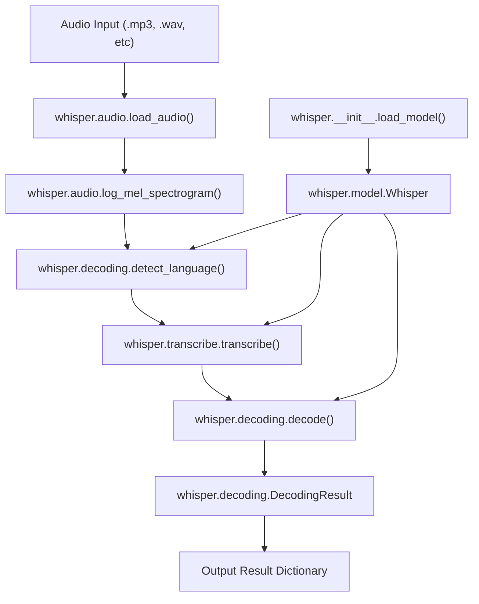
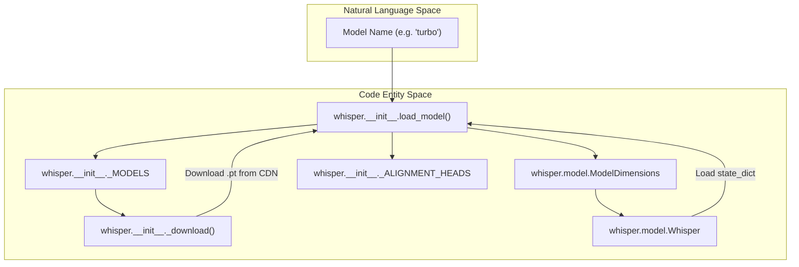

<!-- source: DeepWiki mcp.deepwiki.com · repo openai/whisper · page 1 Overview · fetched 2026-10-26 -->

# Overview

<details>
<summary>Relevant source files</summary>

The following files were used as context for generating this wiki page:

- [README.md](README.md)
- [language-breakdown.svg](language-breakdown.svg)
- [model-card.md](model-card.md)

</details>


## Purpose and Scope

This document provides a comprehensive overview of the Whisper speech recognition system, including its core capabilities, architecture, and key components. It serves as an entry point for understanding how the various subsystems work together to perform speech-to-text transcription and translation.

Whisper is a general-purpose speech recognition model developed by OpenAI that performs multilingual speech recognition, speech translation, and language identification. It uses a Transformer sequence-to-sequence architecture trained on 680,000 hours of diverse audio data from the internet [README.md:1-15](), [model-card.md:1-10]().

## Core Capabilities

Whisper is a multitasking model that jointly represents various speech processing tasks as a sequence of tokens to be predicted by the decoder [README.md:15-15]().

| Capability | Description | Task Specifier |
|------------|-------------|----------------|
| **Speech Recognition** | Transcribe audio to text in the original language | `transcribe` |
| **Speech Translation** | Translate non-English speech directly to English text | `translate` |
| **Language Identification** | Detect the spoken language in audio | Language Detection |

The system supports 98 different languages [model-card.md:51-51](). Performance is directly correlated with the amount of training data in a given language, with English representing 65% of the training set [model-card.md:51-53]().

**Sources:** [README.md:8-15](), [model-card.md:49-53]()

## Available Models

Whisper provides six model sizes with different parameter counts and performance characteristics. The `.en` models are specialized for English-only applications [README.md:73-73]().

| Model Size | Parameters | English-only | Multilingual | VRAM Required | Relative Speed |
|------------|------------|--------------|--------------|---------------|----------------|
| `tiny` | 39M | `tiny.en` | `tiny` | ~1 GB | ~10x |
| `base` | 74M | `base.en` | `base` | ~1 GB | ~7x |
| `small` | 244M | `small.en` | `small` | ~2 GB | ~4x |
| `medium` | 769M | `medium.en` | `medium` | ~5 GB | ~2x |
| `large` | 1550M | N/A | `large` | ~10 GB | 1x |
| `turbo` | 809M | N/A | `turbo` | ~6 GB | ~8x |

The `turbo` model is an optimized version of `large-v3` (specifically `large-v3-turbo`) designed for faster inference [model-card.md:21-22](), [README.md:74-74](). Note that the `turbo` model is not trained for translation tasks [README.md:88-88]().

**Sources:** [README.md:58-74](), [model-card.md:10-22]()

## High-Level System Architecture

### Core Processing Pipeline

The pipeline transitions from raw audio input to structured text output through several functional stages.


**Sources:** [README.md:113-151]()

### Model Loading and Weight Management

The `load_model` function manages the acquisition of model checkpoints and the instantiation of the `Whisper` class.


**Sources:** [README.md:113-121]()

## Key Components

### Audio Processing System
- **`load_audio`**: Uses FFmpeg to read audio files and resample to 16,000 Hz.
- **`pad_or_trim`**: Ensures the audio input matches the expected 30-second window (480,000 samples).
- **`log_mel_spectrogram`**: Computes the log-Mel spectrogram with 80 or 128 bins depending on the model version.

### Model Architecture (`whisper.model.Whisper`)
The model is an encoder-decoder Transformer [README.md:15-15]().
- **`AudioEncoder`**: A convolutional stem followed by Transformer blocks that processes the Mel spectrogram.
- **`TextDecoder`**: An autoregressive Transformer decoder that predicts text tokens, conditioned on the encoder's hidden states.
- **`ModelDimensions`**: A dataclass defining the architecture hyperparameters (layers, heads, etc.).

### Decoding and Transcription
- **`transcribe()`**: The high-level entry point that handles the sliding 30-second window logic and temperature fallback strategies [README.md:125-125]().
- **`decode()`**: A lower-level interface for running a single pass of the model on a 30-second Mel spectrogram.
- **`DecodingOptions`**: Configuration for the decoding process, such as beam size and task.

**Sources:** [README.md:125-125]()

## Usage Patterns

### High-Level API
The `transcribe()` method is recommended for most use cases as it handles long-form audio by processing it in segments.

```python
import whisper
model = whisper.load_model("turbo")
result = model.transcribe("audio.mp3")
print(result["text"])
```
**Sources:** [README.md:117-123]()

### Low-Level API
The `decode()` function provides granular control over a single 30-second audio segment.

```python
import whisper

model = whisper.load_model("turbo")
audio = whisper.load_audio("audio.mp3")
audio = whisper.pad_or_trim(audio)

mel = whisper.log_mel_spectrogram(audio).to(model.device)
_, probs = model.detect_language(mel)
options = whisper.DecodingOptions()
result = whisper.decode(model, mel, options)
```
**Sources:** [README.md:130-145]()

## System Dependencies
Whisper relies on several key external libraries for performance and functionality:
- **PyTorch**: Core neural network framework [README.md:20-20]().
- **tiktoken**: Fast BPE tokenization [README.md:20-20]().
- **FFmpeg**: Audio decoding and resampling [README.md:32-32]().
- **Numba/Triton**: Performance optimizations for specific kernels like DTW.

**Sources:** [README.md:18-56]()

---

