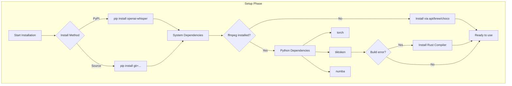
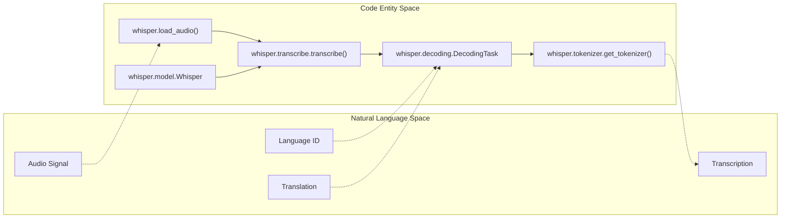

<!-- source: DeepWiki mcp.deepwiki.com · repo openai/whisper · page 2 Getting Started · fetched 2026-10-26 -->

# Getting Started

<details>
<summary>Relevant source files</summary>

The following files were used as context for generating this wiki page:

- [README.md](README.md)

</details>


This page provides a comprehensive guide to setting up and using the Whisper automatic speech recognition (ASR) system. This document covers installation, model selection, and basic usage through both command-line and Python interfaces.

## Installation

Whisper can be installed using `pip`, which downloads the latest stable release. The package is named `openai-whisper` on PyPI [pyproject.toml:7-7]().

```bash
pip install -U openai-whisper
```

Alternatively, you can install the latest version directly from GitHub:

```bash
pip install git+https://github.com/openai/whisper.git
```

For detailed requirements and platform-specific instructions, see [Installation](#2.1).

### Dependencies

Whisper requires several core libraries to function:

1.  **Python**: Compatible with versions 3.8 through 3.13 [pyproject.toml:13-22]().
2.  **PyTorch**: Required for model execution [requirements.txt:3-3]().
3.  **tiktoken**: OpenAI's fast BPE tokenizer [requirements.txt:6-6]().
4.  **FFmpeg**: External command-line tool required for audio processing [README.md:32-33]().
5.  **Triton**: Used for GPU acceleration on Linux x86_64 systems [requirements.txt:7-7]().

### Installation Workflow

The following diagram illustrates the setup process and dependency checks.



Sources: [README.md:18-55](), [requirements.txt:1-7](), [pyproject.toml:24-32]()

## Available Models

Whisper offers six model sizes with varying performance characteristics. Smaller models like `tiny` and `base` offer high speed, while `large` and `turbo` provide higher accuracy [README.md:64-71]().

| Size | Parameters | English-only model | Multilingual model | Required VRAM | Relative speed |
| :--- | :--- | :--- | :--- | :--- | :--- |
| **tiny** | 39 M | `tiny.en` | `tiny` | ~1 GB | ~10x |
| **base** | 74 M | `base.en` | `base` | ~1 GB | ~7x |
| **small** | 244 M | `small.en` | `small` | ~2 GB | ~4x |
| **medium** | 769 M | `medium.en` | `medium` | ~5 GB | ~2x |
| **large** | 1550 M | N/A | `large` | ~10 GB | 1x |
| **turbo** | 809 M | N/A | `turbo` | ~6 GB | ~8x |

The `turbo` model is an optimized version of `large-v3` [README.md:74-74](). English-only models (`.en`) generally perform better for English-specific tasks [README.md:73-73]().

Sources: [README.md:58-75]()

## Basic Usage

Whisper can be operated via the command line or integrated into Python applications. For a deep dive into options, see [Basic Usage](#2.2).

### Command-line Interface (CLI)

The CLI entry point is defined in `whisper.transcribe:cli` [pyproject.toml:35-35]().

```bash
# Basic transcription
whisper audio.mp3 --model turbo

# Transcription with language specification
whisper japanese.wav --language Japanese

# Translation to English
whisper japanese.wav --model medium --task translate
```

### Python API

The high-level `transcribe()` method manages the sliding 30-second window logic [README.md:125-125]().

```python
import whisper

# Load model into memory
model = whisper.load_model("turbo")

# Run the transcription pipeline
result = model.transcribe("audio.mp3")
print(result["text"])
```

Sources: [README.md:80-123](), [pyproject.toml:35-35]()

## System Architecture Bridge

This diagram maps the logical concepts of the speech pipeline to the specific code entities that implement them.



Sources: [whisper/tokenizer.py:3-3](), [whisper/transcribe.py:77-77](), [whisper/model.py:200-200](), [whisper/decoding.py:700-700]()

## Resource Navigation

- **[Installation](#2.1)**: Detailed environment setup, including `ffmpeg` and `rust` troubleshooting.
- **[Basic Usage](#2.2)**: Comprehensive guide to CLI flags and the `transcribe()` method parameters.
- **[Examples and Tutorials](#2.3)**: Links to Jupyter notebooks for LibriSpeech evaluation and multilingual ASR.
- **[API Reference](#2.4)**: Technical documentation for `load_model()`, `DecodingOptions`, and result dictionaries.

For the internal mechanics of how these components work, refer to the [Architecture](#3) section.

---

