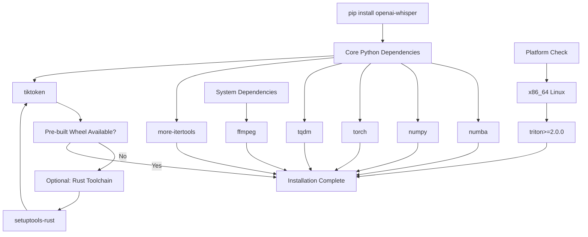
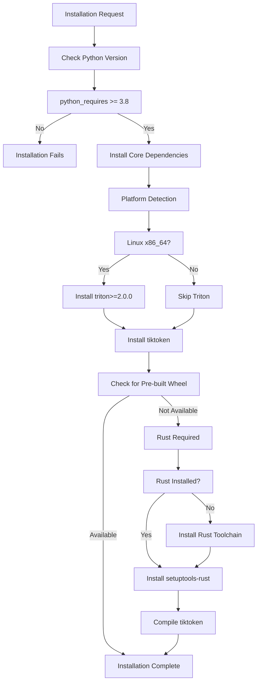

<!-- source: DeepWiki mcp.deepwiki.com · repo openai/whisper · page 2.1 Installation · fetched 2026-10-26 -->

# Installation

<details>
<summary>Relevant source files</summary>

The following files were used as context for generating this wiki page:

- [.flake8](.flake8)
- [MANIFEST.in](MANIFEST.in)
- [README.md](README.md)
- [pyproject.toml](pyproject.toml)
- [requirements.txt](requirements.txt)
- [tests/test_tokenizer.py](tests/test_tokenizer.py)

</details>


This document covers the installation requirements, dependencies, and setup procedures for the Whisper speech recognition system. It provides detailed instructions for installing Whisper on various platforms and resolving common installation issues.

For information about basic usage after installation, see [Basic Usage](#2.2). For advanced configuration and API reference, see [API Reference](#2.4).

## System Requirements

Whisper requires Python 3.8 or higher and is compatible with recent PyTorch versions. The system was developed and tested with Python 3.9.9 and PyTorch 1.10.1, but maintains compatibility across a broader range of versions including Python 3.13.

### Python Version Compatibility

| Python Version | Support Status |
|---------------|----------------|
| 3.8           | Supported      |
| 3.9           | Supported      |
| 3.10          | Supported      |
| 3.11          | Supported      |
| 3.12          | Supported      |
| 3.13          | Supported      |

### Hardware Requirements

Whisper can run on both CPU and GPU. GPU acceleration is recommended for better performance, especially for larger models. The system supports CUDA-enabled GPUs with Triton acceleration on Linux x86_64 systems. Approximate VRAM requirements range from ~1 GB for `tiny` models to ~10 GB for `large` models.

Sources: [README.md:20-21](), [README.md:64-71](), [pyproject.toml:13-22]()

## Installation Methods

### Method 1: Install from PyPI (Recommended)

The simplest installation method uses the official PyPI package:

```bash
pip install -U openai-whisper
```

This command installs the latest stable release with all required dependencies.

### Method 2: Install from Git Repository

For the latest development version, install directly from the GitHub repository:

```bash
pip install git+https://github.com/openai/whisper.git
```

### Method 3: Update from Git Repository

To update an existing installation to the latest development version:

```bash
pip install --upgrade --no-deps --force-reinstall git+https://github.com/openai/whisper.git
```

## Installation Dependency Flow



Sources: [README.md:22-30](), [requirements.txt:1-7](), [pyproject.toml:24-32]()

## Core Dependencies

### Python Package Dependencies

The following Python packages are automatically installed with Whisper as defined in the project configuration:

| Package | Purpose | Platform Notes |
|---------|---------|----------------|
| `numba` | JIT compilation for performance | All platforms |
| `numpy` | Numerical computing | All platforms |
| `torch` | Deep learning framework | All platforms |
| `tqdm` | Progress bars | All platforms |
| `more-itertools` | Extended iteration utilities | All platforms |
| `tiktoken` | Fast tokenization | May require Rust for compilation |
| `triton` | GPU acceleration | Linux x86_64 only |

### System Dependencies

#### FFmpeg Installation

Whisper requires the `ffmpeg` command-line tool for audio processing. Internally, the `whisper.load_audio` function relies on `ffmpeg` to decode and resample audio files to 16,000 Hz. Install it using your system's package manager:

```bash
# Ubuntu/Debian
sudo apt update && sudo apt install ffmpeg

# Arch Linux
sudo pacman -S ffmpeg

# macOS (Homebrew)
brew install ffmpeg

# Windows (Chocolatey)
choco install ffmpeg

# Windows (Scoop)
scoop install ffmpeg
```

Sources: [README.md:32-49](), [requirements.txt:1-7](), [pyproject.toml:24-32]()

## Platform-Specific Installation

### Linux x86_64

Linux x86_64 systems receive additional GPU acceleration through Triton. The dependency is specifically scoped to this platform in the configuration.

```bash
# Triton is automatically installed on supported platforms
pip install openai-whisper
```

The `triton>=2.0.0` package is conditionally installed based on platform detection in `pyproject.toml`.

### Other Platforms

For non-x86_64 Linux systems (e.g., Windows, macOS, or ARM Linux), Triton is excluded from installation but core functionality remains available via CPU or standard PyTorch CUDA kernels.

```bash
pip install openai-whisper
# Triton will be skipped automatically
```

Sources: [requirements.txt:7](), [pyproject.toml:31]()

## Dependency Resolution Flow

The following diagram maps the installation logic to the specific requirements and platform constraints defined in the codebase.



Sources: [requirements.txt:7](), [pyproject.toml:13](), [pyproject.toml:31]()

## Troubleshooting Common Issues

### Rust Installation Required

If you encounter errors related to `tiktoken` installation, it is likely because a pre-built wheel is not available for your platform, requiring a Rust compiler to build from source.

```bash
# Install Rust (follow instructions at https://rustup.rs/)
curl --proto '=https' --tlsv1.2 -sSf https://sh.rustup.rs | sh

# Configure PATH
export PATH="$HOME/.cargo/bin:$PATH"

# Install setuptools-rust if needed
pip install setuptools-rust
```

### Missing setuptools_rust

If installation fails with `No module named 'setuptools_rust'`, you must manually install the bridge between Python and Rust:

```bash
pip install setuptools-rust
```

### FFmpeg Not Found

Ensure `ffmpeg` is properly installed and available in your system PATH. Whisper's audio loading logic will fail if the binary cannot be executed.

```bash
# Test FFmpeg installation
ffmpeg -version
```

Sources: [README.md:51-55]()

## Development Dependencies

For development, testing, and contributing to the repository, additional packages are required. These are defined as optional `dev` dependencies in `pyproject.toml`.

```bash
pip install openai-whisper[dev]
```

This installs additional tools including:
- `black` - Code formatting
- `flake8` - Code linting  
- `isort` - Import sorting
- `pytest` - Testing framework (used for `tests/test_tokenizer.py` etc.)
- `scipy` - Scientific computing

Sources: [pyproject.toml:33](), [MANIFEST.in:1-5]()

## Verification

After installation, verify that Whisper is correctly installed by checking the CLI entry point defined in `pyproject.toml`.

```bash
# Check command-line interface (points to whisper.transcribe:cli)
whisper --help

# Test Python import
python -c "import whisper; print('Whisper installed successfully')"
```

The installation process is now complete. You can proceed to [Basic Usage](#2.2) to begin using Whisper for speech recognition tasks.

Sources: [README.md:104-108](), [pyproject.toml:35]()

---

