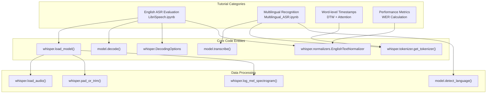
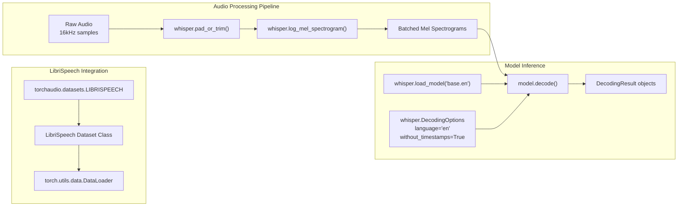
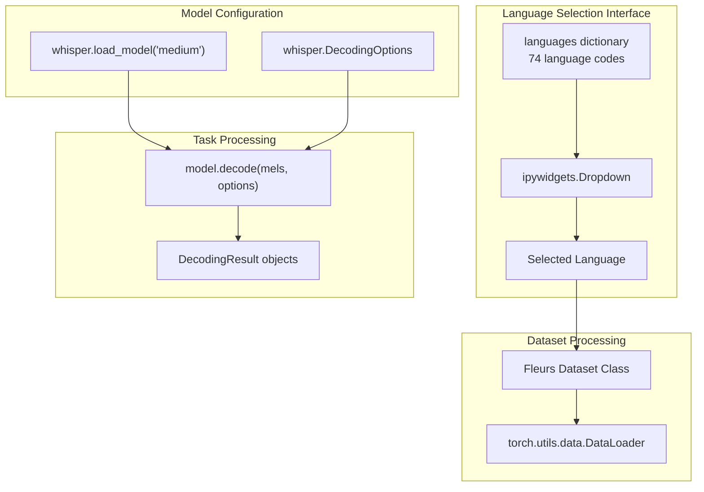

<!-- source: DeepWiki mcp.deepwiki.com · repo openai/whisper · page 2.3 Examples and Tutorials · fetched 2026-10-26 -->

# Examples and Tutorials

Relevant source files

The following files were used as context for generating this wiki page:

- [notebooks/LibriSpeech.ipynb](notebooks/LibriSpeech.ipynb)
- [notebooks/Multilingual_ASR.ipynb](notebooks/Multilingual_ASR.ipynb)

This page provides comprehensive examples and interactive tutorials demonstrating Whisper's capabilities for speech recognition, translation, and analysis. The tutorials cover both English-only and multilingual scenarios, with practical code examples for common use cases including performance evaluation and word-level timing extraction.

For basic API usage without detailed examples, see [Basic Usage](). For complete API documentation, see [API Reference]().

## Tutorial Overview

The Whisper repository includes several Jupyter notebooks that demonstrate key functionality through hands-on examples. These tutorials are designed to be run in Google Colab or local Jupyter environments and provide practical implementations of common speech recognition workflows.

**Sources:** [notebooks/LibriSpeech.ipynb:1-240](), [notebooks/Multilingual_ASR.ipynb:1-161]()

## English Speech Recognition Tutorial

The LibriSpeech tutorial demonstrates systematic evaluation of Whisper models on the standard LibriSpeech test-clean dataset. This example shows how to process audio in batches and calculate word error rates (WER) for performance assessment.

### Dataset Integration and Preprocessing

The tutorial implements a custom dataset wrapper `LibriSpeech` [notebooks/LibriSpeech.ipynb:72-95]() that handles the LibriSpeech format and ensures consistent 30-second audio segments through `whisper.pad_or_trim()` [notebooks/LibriSpeech.ipynb:91-91](). The preprocessing converts audio to mel spectrograms using `whisper.log_mel_spectrogram()` [notebooks/LibriSpeech.ipynb:92-92]() before batch inference.

**Sources:** [notebooks/LibriSpeech.ipynb:72-95](), [notebooks/LibriSpeech.ipynb:140-155]()

### Performance Evaluation with Text Normalization

The evaluation pipeline demonstrates proper text normalization for accurate WER calculation:

| Processing Step | Code Entity | Purpose |
|----------------|-------------|---------|
| Model Loading | `whisper.load_model("base.en")` | Load English-only model [notebooks/LibriSpeech.ipynb:140-140]() |
| Decoding Options | `whisper.DecodingOptions(language="en", without_timestamps=True)` | Configure inference parameters [notebooks/LibriSpeech.ipynb:154-154]() |
| Batch Inference | `model.decode(mels, options)` | Process batched spectrograms [notebooks/LibriSpeech.ipynb:202-202]() |
| Evaluation Metric | `jiwer.wer()` | Compute word error rate [notebooks/LibriSpeech.ipynb:23-23]() |

**Sources:** [notebooks/LibriSpeech.ipynb:140-155](), [notebooks/LibriSpeech.ipynb:198-204]()

## Multilingual Recognition and Translation

The multilingual tutorial showcases Whisper's ability to handle diverse languages using the FLEURS dataset. This example demonstrates both transcription and translation capabilities with interactive language selection.

### Language-Specific Processing Workflow

The tutorial handles 74 different languages [notebooks/Multilingual_ASR.ipynb:104-104]() with automatic dataset downloading and processing via a custom `Fleurs` class [notebooks/Multilingual_ASR.ipynb:162-166](). The `download` function [notebooks/Multilingual_ASR.ipynb:150-160]() is used to fetch the dataset files.

**Sources:** [notebooks/Multilingual_ASR.ipynb:102-113](), [notebooks/Multilingual_ASR.ipynb:150-160](), [notebooks/Multilingual_ASR.ipynb:162-170]()

## Benchmark Data Reference

The repository provides details on various datasets used for evaluation to ensure reproducibility.

| Dataset Category | Datasets Included | Source |
|------------------|-------------------|--------|
| Short-form English | LibriSpeech, TED-LIUM 3, Common Voice 5.1, Artie, WSJ, CORAAL, CHiME-6, AMI | [data/README.md:3-50]() |
| Long-form English | TED-LIUM 3 (sliced), Meanwhile, Rev16, Kincaid46, Earnings-21/22 | [data/README.md:51-97]() |
| Multilingual | Multilingual LibriSpeech (MLS), Fleurs, VoxPopuli, Common Voice 9, CoVOST 2 | [data/README.md:98-118]() |

The `meanwhile.json` file provides specific metadata for the "Meanwhile" dataset, including YouTube video IDs and precise `begin`/`end` timestamps for evaluation segments [data/meanwhile.json:1-30]().

**Sources:** [data/README.md:1-118](), [data/meanwhile.json:1-30]()

---

