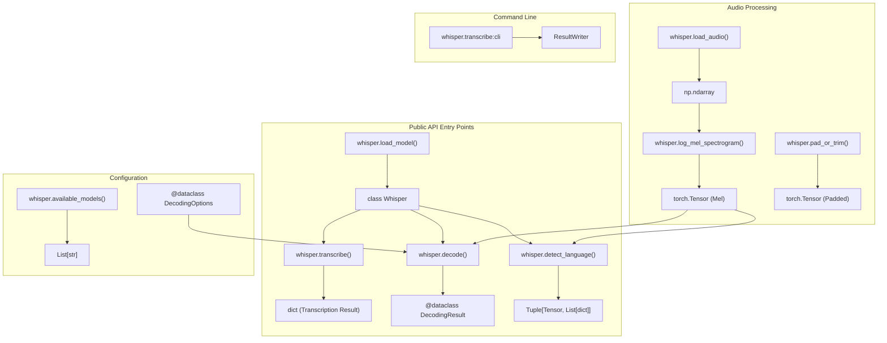
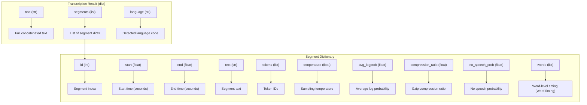
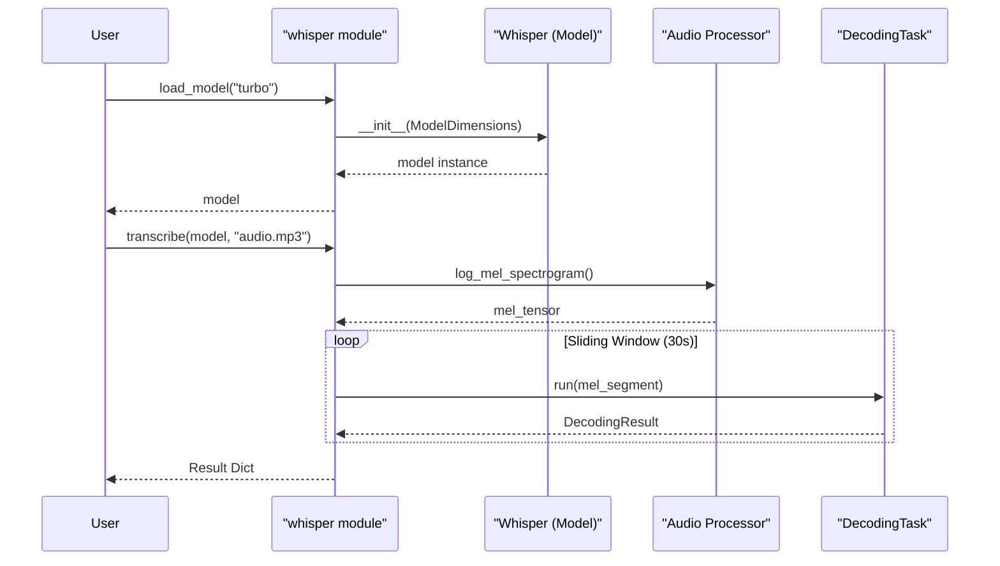

<!-- source: DeepWiki mcp.deepwiki.com · repo openai/whisper · page 2.4 API Reference · fetched 2026-10-26 -->

# API Reference

<details>
<summary>Relevant source files</summary>

The following files were used as context for generating this wiki page:

- [whisper/__init__.py](whisper/__init__.py)
- [whisper/decoding.py](whisper/decoding.py)

</details>


This document provides comprehensive reference documentation for Whisper's public Python API and command-line interface. It covers all functions, classes, and configuration options available for speech recognition and transcription tasks.

For installation instructions, see [Installation](#2.1). For basic usage examples, see [Basic Usage](#2.2). For detailed implementation information, see [Architecture](#3).

## API Overview

The Whisper API is organized into several functional areas: model management, audio processing, transcription, and decoding. All public functions are accessible through the main `whisper` module.

Whisper API Entry Points


Sources: [whisper/__init__.py:1-15]()

## Model Loading

### `whisper.load_model()`

Loads a Whisper ASR model instance from either a pre-trained model name or a checkpoint file.

```python
def load_model(
    name: str,
    device: Optional[Union[str, torch.device]] = None,
    download_root: str = None,
    in_memory: bool = False,
) -> Whisper
```

**Parameters:**
- `name`: Model name from `available_models()` or path to checkpoint file [whisper/__init__.py:114-116]().
- `device`: PyTorch device (`"cuda"`, `"cpu"`, or `torch.device`). Defaults to CUDA if available [whisper/__init__.py:130-131]().
- `download_root`: Directory to cache downloaded models (default: `~/.cache/whisper`) [whisper/__init__.py:132-134]().
- `in_memory`: Whether to load model weights into memory instead of disk [whisper/__init__.py:122]().

**Returns:** `Whisper` model instance ready for inference [whisper/__init__.py:126-127]().

**Example:**
```python
import whisper
model = whisper.load_model("turbo")
model_on_cpu = whisper.load_model("base", device="cpu")
```

### `whisper.available_models()`

Returns the list of available pre-trained model names.

```python
def available_models() -> List[str]
```

**Returns:** List of model names: `["tiny.en", "tiny", "base.en", "base", "small.en", "small", "medium.en", "medium", "large-v1", "large-v2", "large-v3", "large", "large-v3-turbo", "turbo"]` [whisper/__init__.py:17-32](), [whisper/__init__.py:98-100]().

Sources: [whisper/__init__.py:17-51](), [whisper/__init__.py:103-161]()

## Transcription API

### `whisper.transcribe()`

The main transcription function that processes audio files or arrays and returns transcribed text with optional word-level timestamps. It handles long-form audio by sliding a 30-second window [whisper/transcribe.py:38-56]().

```python
def transcribe(
    model: "Whisper",
    audio: Union[str, np.ndarray, torch.Tensor],
    *,
    verbose: Optional[bool] = None,
    temperature: Union[float, Tuple[float, ...]] = (0.0, 0.2, 0.4, 0.6, 0.8, 1.0),
    compression_ratio_threshold: Optional[float] = 2.4,
    logprob_threshold: Optional[float] = -1.0,
    no_speech_threshold: Optional[float] = 0.6,
    condition_on_previous_text: bool = True,
    initial_prompt: Optional[str] = None,
    carry_initial_prompt: bool = False,
    word_timestamps: bool = False,
    prepend_punctuations: str = "\"'"¿([{-",
    append_punctuations: str = "\"'.。,，!！?？:：")]}、",
    clip_timestamps: Union[str, List[float]] = "0",
    hallucination_silence_threshold: Optional[float] = None,
    **decode_options,
) -> dict
```

**Core Parameters:**
- `model`: `Whisper` model instance [whisper/transcribe.py:62-63]().
- `audio`: Audio file path, numpy array, or torch tensor [whisper/transcribe.py:65-66]().
- `verbose`: Controls progress display (`True`, `False`, or `None`) [whisper/transcribe.py:68-70]().
- `temperature`: Sampling temperature(s) for fallback strategy [whisper/transcribe.py:72-74]().
- `word_timestamps`: Extract word-level timing information using cross-attention patterns [whisper/transcribe.py:91-93]().

**Quality Control:**
- `compression_ratio_threshold`: Detect repetitive output (default: 2.4) [whisper/transcribe.py:76-77]().
- `logprob_threshold`: Detect low-confidence output (default: -1.0) [whisper/transcribe.py:79-80]().
- `no_speech_threshold`: Detect silent segments (default: 0.6) [whisper/transcribe.py:82-85]().
- `hallucination_silence_threshold`: Skip silent periods in word timestamps [whisper/transcribe.py:118-120]().

**Text Processing:**
- `condition_on_previous_text`: Use previous output as context [whisper/transcribe.py:86-89]().
- `initial_prompt`: Custom vocabulary or context prompt [whisper/transcribe.py:101-104]().
- `carry_initial_prompt`: Prepend initial prompt to each segment [whisper/transcribe.py:106-110]().

**Segmentation:**
- `clip_timestamps`: Process specific time ranges [whisper/transcribe.py:114-116]().

**Returns:** Dictionary containing `"text"`, `"segments"`, and detected `"language"` [whisper/transcribe.py:122-126]().

Sources: [whisper/transcribe.py:38-126]()

### Transcription Result Format

Transcription Data Structure


Sources: [whisper/transcribe.py:246-261](), [whisper/transcribe.py:510-514]()

## Audio Processing API

### `whisper.load_audio()`
Loads audio from various file formats and converts to a numpy array at the required 16kHz sample rate [whisper/audio.py]().

### `whisper.log_mel_spectrogram()`
Converts audio to log-mel spectrogram for model input [whisper/audio.py]().
- `n_mels`: Number of mel filter banks (default 80, or 128 for large-v3) [whisper/audio.py]().

### `whisper.pad_or_trim()`
Pads or trims audio to exactly 30 seconds (480,000 samples) [whisper/audio.py]().

Sources: [whisper/__init__.py:11](), [whisper/audio.py]()

## Decoding API

### `whisper.decode()`
Low-level decoding function for single 30-second audio segments [whisper/decoding.py]().

```python
def decode(model: "Whisper", mel: torch.Tensor, options: DecodingOptions) -> DecodingResult
```

### `whisper.detect_language()`
Detects the spoken language in an audio segment by inspecting the first token logits [whisper/decoding.py:19-33]().

```python
def detect_language(
    model: "Whisper", mel: Tensor, tokenizer: Tokenizer = None
) -> Tuple[Tensor, List[dict]]
```

**Returns:** Tuple of `language_tokens` (most probable ID) and `language_probs` (full distribution) [whisper/decoding.py:27-33]().

Sources: [whisper/__init__.py:12](), [whisper/decoding.py:19-77]()

## Configuration Objects

### `DecodingOptions`
Configuration for the decoding process [whisper/decoding.py:80-115]().

| Field | Type | Description |
| :--- | :--- | :--- |
| `task` | `str` | `"transcribe"` or `"translate"` [whisper/decoding.py:83]() |
| `language` | `Optional[str]` | Language code (e.g., `"en"`, `"jp"`) [whisper/decoding.py:86]() |
| `temperature` | `float` | Sampling temperature [whisper/decoding.py:89]() |
| `sample_len` | `Optional[int]` | Max tokens to sample [whisper/decoding.py:90]() |
| `beam_size` | `Optional[int]` | Number of beams for beam search [whisper/decoding.py:92]() |
| `prompt` | `Optional[Union[str, List[int]]]` | Previous context [whisper/decoding.py:101]() |
| `prefix` | `Optional[Union[str, List[int]]]` | Current context prefix [whisper/decoding.py:102]() |
| `suppress_blank` | `bool` | Suppress empty output [whisper/decoding.py:107]() |
| `without_timestamps` | `bool` | Use `<|notimestamps|>` token [whisper/decoding.py:110]() |

### `DecodingResult`
Result object returned by the `decode` function [whisper/decoding.py:117-128]().

**Fields:** `audio_features`, `language`, `language_probs`, `tokens`, `text`, `avg_logprob`, `no_speech_prob`, `temperature`, `compression_ratio`.

Sources: [whisper/decoding.py:80-128]()

## Command Line Interface

### `whisper` Command
The CLI entry point provides access to the transcription pipeline [whisper/transcribe.py:517-623]().

**Example Usage:**
```bash
# Basic transcription using the turbo model
whisper audio.mp3 --model turbo

# Translation to English
whisper spanish.wav --task translate --model medium

# Outputting word-level timestamps to JSON
whisper audio.wav --word_timestamps True --output_format json
```

Sources: [whisper/transcribe.py:517-623]()

## API Usage Patterns

### Basic Transcription Flow



Sources: [whisper/transcribe.py:138-244](), [whisper/decoding.py:218-240]()

---

