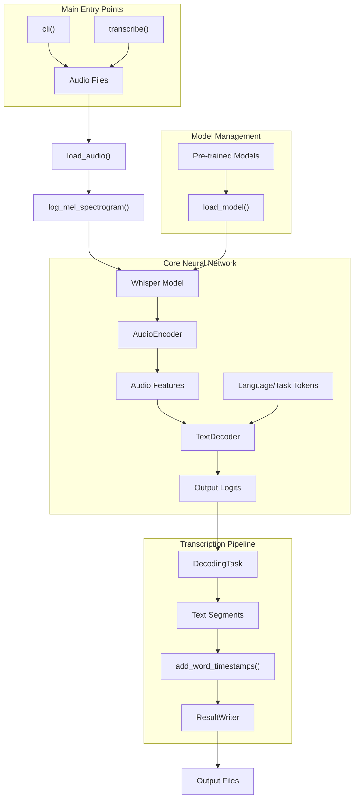
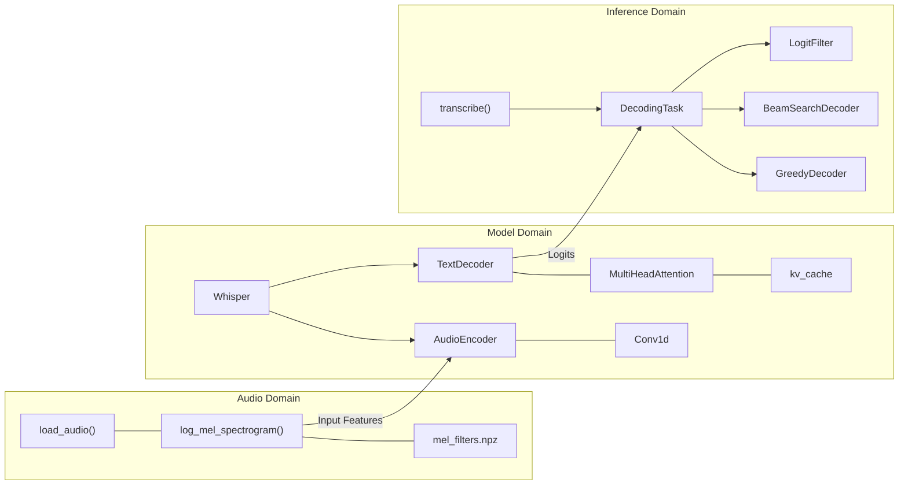

<!-- source: DeepWiki mcp.deepwiki.com · repo openai/whisper · page 3 Architecture · fetched 2026-10-26 -->

# Architecture

Relevant source files

The following files were used as context for generating this wiki page:

- [whisper/model.py](whisper/model.py)

This page provides a high-level overview of Whisper's internal architecture and core components. Whisper is an encoder-decoder Transformer designed for robust speech recognition and translation, trained on a diverse dataset of 680,000 hours of multilingual and multitask supervised data.

## Complete System Architecture

Whisper implements a comprehensive speech-to-text system with a transformer-based encoder-decoder neural network at its core. The architecture consists of multiple interconnected subsystems that handle audio processing, model inference, tokenization, decoding, and output generation.

### High-Level System Flow

Sources: [whisper/model.py:252-307](), [whisper/audio.py:25-62](), [whisper/transcribe.py:38-305](), [whisper/decoding.py:596-646](), [whisper/tokenizer.py:114-159](), [whisper/timing.py:246-302](), [whisper/utils.py:136-160](), [whisper/__init__.py:140-161]()

## Core Components

The following sections summarize the primary architectural pillars of the repository.

### Model Architecture
The neural network is a standard Transformer encoder-decoder. The `AudioEncoder` (`[whisper/model.py:181-196]()`) processes mel spectrograms through a convolutional stem followed by `ResidualAttentionBlock` layers (`[whisper/model.py:149-179]()`). The `TextDecoder` is an autoregressive Transformer that attends to the encoder's output using cross-attention. Configuration is managed via the `ModelDimensions` dataclass (`[whisper/model.py:25-37]()`).
For details, see [Model Architecture](#3.1).

Sources: [whisper/model.py:25-37](), [whisper/model.py:81-147](), [whisper/model.py:149-179](), [whisper/model.py:181-196]()

### Audio Processing
Whisper operates on 16kHz mono audio. The pipeline involves loading audio via FFmpeg, padding or trimming to 30-second chunks (`N_SAMPLES`), and computing an 80 or 128-channel log-mel spectrogram using a pre-computed filterbank asset (`mel_filters.npz`).
For details, see [Audio Processing](#3.2).

Sources: [whisper/audio.py:12-23](), [whisper/audio.py:65-88](), [whisper/audio.py:110-157]()

### Tokenization
Whisper uses Byte-Pair Encoding (BPE) via `tiktoken` for text representation. It supports both English-only and multilingual tokenizers initialized through `get_tokenizer()`. The vocabulary includes special tokens for task control (transcribe/translate), language identification, and timestamp boundaries.
For details, see [Tokenization](#3.3).

Sources: [whisper/tokenizer.py:114-159](), [whisper/tokenizer.py:252-273]()

### Decoding System
The decoding system orchestrates the generation of text from audio features. It supports greedy decoding and beam search, managed by the `DecodingTask` class (`[whisper/decoding.py:596-646]()`). It includes sophisticated logit filters like `SuppressBlank` and `ApplyTimestampRules` to ensure high-quality output.
For details, see [Decoding System](#3.4).

Sources: [whisper/decoding.py:81-115](), [whisper/decoding.py:236-258](), [whisper/decoding.py:596-646]()

### Word Timestamps
Whisper can provide word-level timing by analyzing cross-attention weights between the audio and text via `find_alignment()` and `add_word_timestamps()`. It uses Dynamic Time Warping (DTW) to align the generated tokens with the audio frames, even in the presence of non-linear speech rates.
For details, see [Word Timestamps](#3.5).

Sources: [whisper/timing.py:73-138](), [whisper/timing.py:246-302]()

## Code Entity Map

The following diagram maps the high-level conceptual components to their specific implementations in the codebase.

Sources: [whisper/model.py:252-307](), [whisper/audio.py:110-157](), [whisper/decoding.py:596-646](), [whisper/transcribe.py:38-305]()

---

