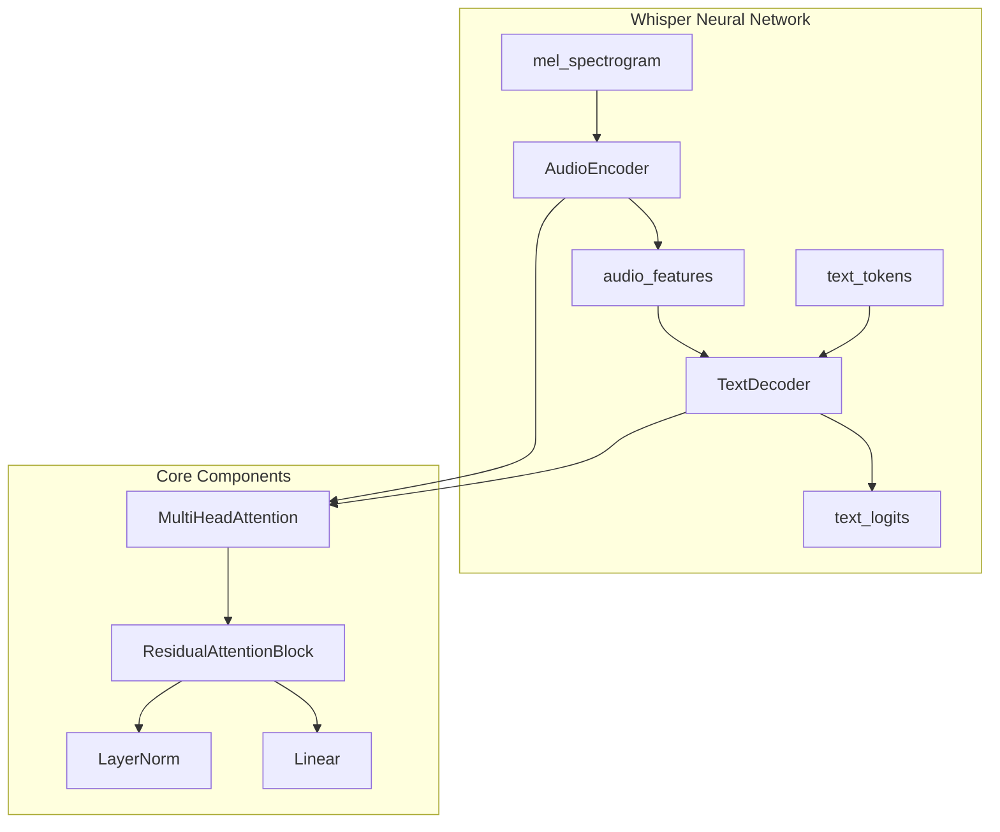
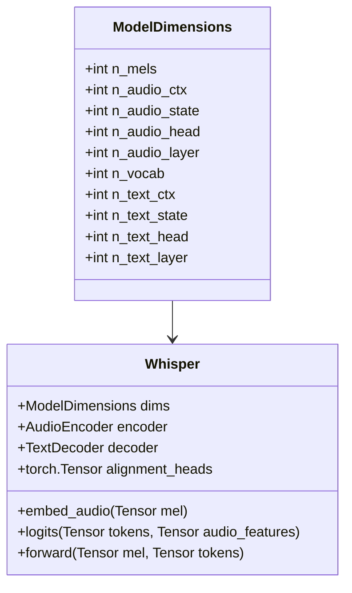
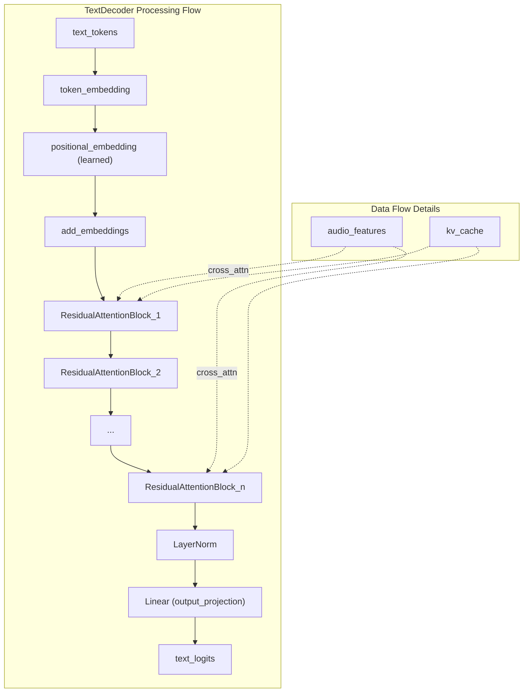
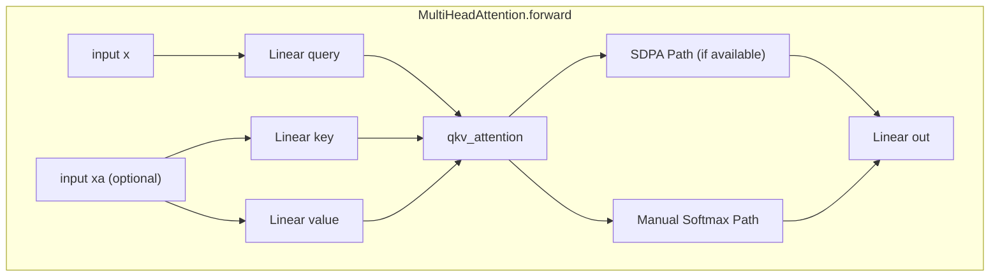
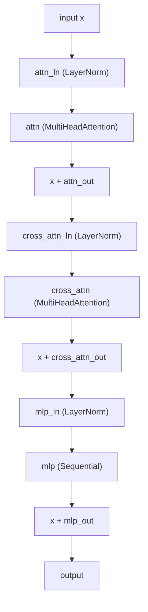

<!-- source: DeepWiki mcp.deepwiki.com · repo openai/whisper · page 3.1 Model Architecture · fetched 2026-10-26 -->

# Model Architecture

Relevant source files

The following files were used as context for generating this wiki page:

- [whisper/model.py](whisper/model.py)

This document provides a detailed technical overview of the Whisper neural network architecture, including the core components, data flow, and implementation details of the sequence-to-sequence transformer model used for speech recognition and translation.

For information about the audio preprocessing pipeline that feeds into this model, see [Audio Processing](#3.2). For details on the token generation process that uses this model, see [Decoding System](#3.4).

## Overview

The Whisper model implements a sequence-to-sequence transformer architecture consisting of an audio encoder and a text decoder. The encoder processes mel spectrogram representations of audio into feature vectors, while the decoder generates text tokens using cross-attention to the encoded audio features.

Sources: [whisper/model.py:252-346]()

## Model Dimensions and Configuration

The `ModelDimensions` dataclass defines the architectural parameters for different model sizes. These dimensions govern the width, depth, and attention head counts for both the encoder and decoder.

| Component | Description |
|-----------|-------------|
| `n_mels` | Number of Mel frequency bins in input spectrograms |
| `n_audio_ctx` | Maximum audio context length (time steps) |
| `n_audio_state` | Hidden state dimension of the audio encoder |
| `n_audio_head` | Number of attention heads in the audio encoder |
| `n_audio_layer` | Number of transformer layers in the audio encoder |
| `n_vocab` | Vocabulary size of the text decoder |
| `n_text_ctx` | Maximum text context length (tokens) |
| `n_text_state` | Hidden state dimension of the text decoder |
| `n_text_head` | Number of attention heads in the text decoder |
| `n_text_layer` | Number of transformer layers in the text decoder |

Sources: [whisper/model.py:25-37](), [whisper/model.py:252-270]()

## Audio Encoder Architecture

The `AudioEncoder` class implements the acoustic model. It consists of a convolutional stem followed by a series of transformer blocks. It uses sinusoidal positional embeddings to provide temporal information.

```mermaid
graph TB
    subgraph "AudioEncoder Processing Flow"
        A["mel_spectrogram (batch, n_mels, n_ctx)"] --> B["Conv1d (k=3, p=1)"]
        B --> C["GELU"]
        C --> D["Conv1d (k=3, s=2, p=1)"]
        D --> E["GELU"]
        E --> F["transpose(1, 2)"]
        F --> G["add positional_embedding"]
        G --> H["ResidualAttentionBlock_1"]
        H --> I["ResidualAttentionBlock_2"]
        I --> J["..."]
        J --> K["ResidualAttentionBlock_n"]
        K --> L["LayerNorm"]
        L --> M["audio_features"]
    end
    
    subgraph "Code Entities"
        B["whisper.model.Conv1d"]
        G["whisper.model.sinusoids"]
        H["whisper.model.ResidualAttentionBlock"]
    end
```

The encoder implementation includes:
- **Convolutional stem**: Two 1D convolution layers. The second layer uses a stride of 2, effectively downsampling the temporal dimension by half [whisper/model.py:186-187]().
- **Positional encoding**: Fixed sinusoidal embeddings generated by `sinusoids()` and registered as a buffer [whisper/model.py:62-68](), [whisper/model.py:188-188]().
- **Transformer blocks**: A sequence of `ResidualAttentionBlock` instances [whisper/model.py:190-192]().
- **Normalization**: A final `LayerNorm` is applied to the output of the transformer stack [whisper/model.py:193-193]().

Sources: [whisper/model.py:181-205](), [whisper/model.py:62-68]()

## Text Decoder Architecture

The `TextDecoder` class generates text tokens autoregressively. It utilizes learned token and positional embeddings and attends to the encoder's output via cross-attention.

Key decoder features:
- **Embeddings**: Uses standard `nn.Embedding` for tokens and a learned `nn.Parameter` for positional embeddings [whisper/model.py:213-214]().
- **Cross-attention**: Each `ResidualAttentionBlock` in the decoder includes a `cross_attn` module to process the encoder's `audio_features` [whisper/model.py:149-160]().
- **Inference Optimization**: Supports `kv_cache` to avoid recomputing keys and values for previously generated tokens during autoregressive decoding [whisper/model.py:97-110](), [whisper/model.py:172-176]().

Sources: [whisper/model.py:207-249](), [whisper/model.py:149-178]()

## Attention Mechanisms and SDPA

Whisper's `MultiHeadAttention` implementation supports modern hardware acceleration via PyTorch's `scaled_dot_product_attention` (SDPA).

- **SDPA Support**: If `torch.nn.functional.scaled_dot_product_attention` is available and `MultiHeadAttention.use_sdpa` is True, Whisper uses the optimized kernel [whisper/model.py:123-134]().
- **Causal Masking**: For self-attention in the decoder, a mask is applied to ensure tokens only attend to previous positions [whisper/model.py:131-133]().
- **KV Caching Logic**: If a `kv_cache` dictionary is provided, the model stores and retrieves key/value tensors to accelerate inference [whisper/model.py:101-110]().

Sources: [whisper/model.py:81-147](), [whisper/model.py:16-22]()

## Residual Attention Blocks

The `ResidualAttentionBlock` is the fundamental building block of both the encoder and decoder. It follows the Pre-LN transformer variant where layer normalization is applied before the attention and MLP sub-layers.

| Sub-layer | Description |
|-----------|-------------|
| `attn` | Multi-head self-attention [whisper/model.py:153-153]() |
| `cross_attn` | Multi-head cross-attention (decoder only) [whisper/model.py:156-159]() |
| `mlp` | Feed-forward network: Linear (4x) -> GELU -> Linear [whisper/model.py:161-164]() |

Sources: [whisper/model.py:149-178](), [whisper/model.py:39-51]()

## Model Integration

The `Whisper` class provides the high-level API for interacting with the model.

- **`embed_audio(mel)`**: Runs the encoder to produce audio features [whisper/model.py:287-296]().
- **`logits(tokens, audio_features)`**: Runs the decoder for a given set of tokens and audio features [whisper/model.py:302-308]().
- **`forward(mel, tokens)`**: A full pass used primarily for training or single-step logit calculation [whisper/model.py:310-313]().
- **`install_kv_cache_hooks()`**: A utility to setup the model for efficient incremental decoding by attaching hooks that manage the `kv_cache` [whisper/model.py:321-346]().

Sources: [whisper/model.py:252-346]()

---

