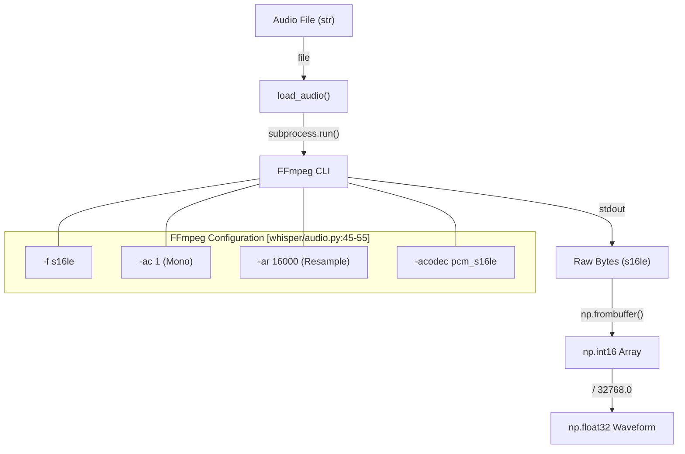
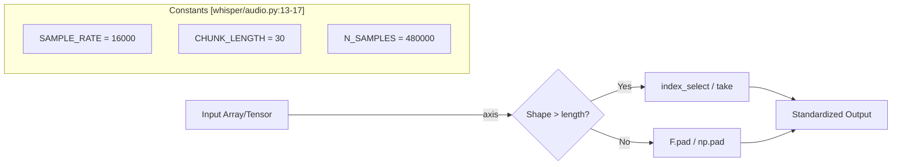
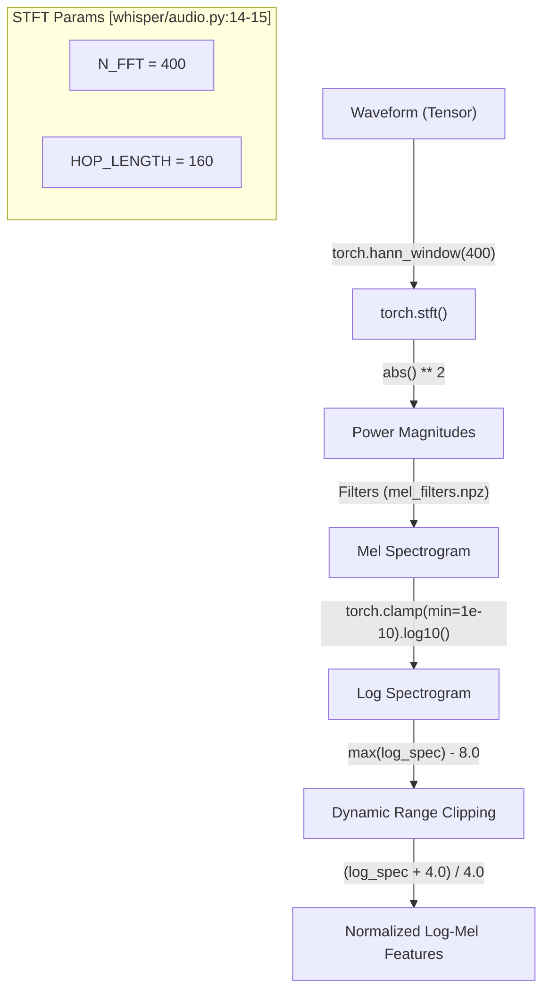

<!-- source: DeepWiki mcp.deepwiki.com · repo openai/whisper · page 3.2 Audio Processing · fetched 2026-10-26 -->

# Audio Processing

Relevant source files

The following files were used as context for generating this wiki page:

- [tests/test_audio.py](tests/test_audio.py)
- [whisper/__main__.py](whisper/__main__.py)
- [whisper/assets/mel_filters.npz](whisper/assets/mel_filters.npz)
- [whisper/audio.py](whisper/audio.py)
- [whisper/normalizers/__init__.py](whisper/normalizers/__init__.py)

This document covers the audio preprocessing pipeline in Whisper, which transforms raw audio files into mel spectrograms suitable for neural network processing. The audio processing system handles audio loading, format conversion, resampling, and feature extraction through mel spectrogram computation.

For information about the neural network model architecture that processes these audio features, see [Model Architecture](#3.1). For details about the complete transcription pipeline, see [4.1. Transcription Pipeline]().

## Audio Loading Pipeline

The audio loading system uses FFmpeg to handle various audio formats and convert them to a standardized format. The `load_audio` function [whisper/audio.py:25]() serves as the primary entry point for audio file processing.

### Audio Loading Data Flow

The `load_audio` function [whisper/audio.py:25-62]() launches an FFmpeg subprocess with specific parameters:
- `-nostdin`: Prevents FFmpeg from reading from stdin [whisper/audio.py:47]().
- `-threads 0`: Uses optimal number of threads [whisper/audio.py:48]().
- `-ac 1`: Down-mixes audio to a single channel (mono) [whisper/audio.py:51]().
- `-acodec pcm_s16le`: Uses 16-bit PCM encoding [whisper/audio.py:52]().
- `-ar str(sr)`: Resamples to the target sample rate (default 16kHz) [whisper/audio.py:53]().

The resulting buffer is converted to a NumPy array and normalized to the range `[-1.0, 1.0]` by dividing the 16-bit integers by 32768.0 [whisper/audio.py:62]().

**Sources:** [whisper/audio.py:25-62]()

## Audio Preprocessing

Audio preprocessing standardizes the input length to match the encoder's expected input size. The `pad_or_trim` function [whisper/audio.py:65]() ensures all audio segments are exactly `N_SAMPLES` (480,000 samples for 30 seconds at 16kHz).

### Standardizing Input Length

The function handles both PyTorch tensors and NumPy arrays [whisper/audio.py:69-86](). Padding is applied to the right (end) of the audio with zeros, while trimming removes samples from the end of the array to reach the target length [whisper/audio.py:71-86]().

**Sources:** [whisper/audio.py:13-17](), [whisper/audio.py:65-88]()

## Mel Spectrogram Generation

The core audio feature extraction is performed by `log_mel_spectrogram` [whisper/audio.py:110](), which converts time-domain audio into frequency-domain log-mel spectrograms.

### Feature Extraction Pipeline

The process involves:
1.  **STFT**: Computed using a Hann window of 400 samples and a hop length of 160 [whisper/audio.py:147-148]().
2.  **Mel Projection**: The squared magnitudes are multiplied by mel filterbank matrices [whisper/audio.py:151-152]().
3.  **Log Scaling**: Values are clamped to `1e-10` before taking the base-10 logarithm [whisper/audio.py:154]().
4.  **Normalization**: The spectrogram is clipped to an 8.0 dB dynamic range from its maximum value and then shifted/scaled to a range roughly around `[-1, 1]` [whisper/audio.py:155-156]().

**Sources:** [whisper/audio.py:110-157]()

## Mel Filterbank Matrices

The mel filterbanks are pre-computed matrices stored in an asset file. The `mel_filters` function [whisper/audio.py:92]() loads these matrices and uses an LRU cache for performance [whisper/audio.py:91]().

| Asset File | Content | Source |
|-----------|---------|--------|
| `whisper/assets/mel_filters.npz` | Compressed NumPy arrays for 80 and 128 mel bins | [whisper/assets/mel_filters.npz:1-16]() |

The filters were generated using `librosa.filters.mel` with a sample rate of 16,000 and `n_fft=400` [whisper/audio.py:97-101](). Whisper supports two configurations: 80 bins (standard) and 128 bins (used in v3 models) [whisper/audio.py:103]().

**Sources:** [whisper/audio.py:91-107](), [whisper/assets/mel_filters.npz:1-16]()

## Audio Hyperparameters

The audio processing system uses hard-coded constants to define temporal and spectral resolution:

| Constant | Value | Description |
|-----------|-------|-------------|
| `SAMPLE_RATE` | 16000 | 16 kHz audio frequency [whisper/audio.py:13]() |
| `N_FFT` | 400 | Window size for STFT [whisper/audio.py:14]() |
| `HOP_LENGTH` | 160 | Stride between STFT windows [whisper/audio.py:15]() |
| `CHUNK_LENGTH` | 30 | Fixed duration of audio segments in seconds [whisper/audio.py:16]() |
| `N_SAMPLES` | 480000 | Total samples in a 30s chunk [whisper/audio.py:17]() |
| `N_FRAMES` | 3000 | Total spectrogram frames in a 30s chunk [whisper/audio.py:18]() |
| `FRAMES_PER_SECOND` | 100 | 10ms temporal resolution per frame [whisper/audio.py:21]() |
| `TOKENS_PER_SECOND` | 50 | 20ms resolution per model token (due to stride 2) [whisper/audio.py:22]()

**Sources:** [whisper/audio.py:12-22]()

---

