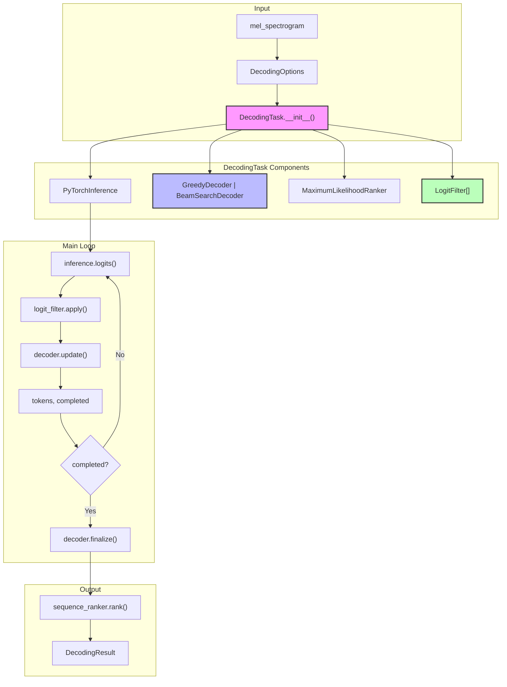
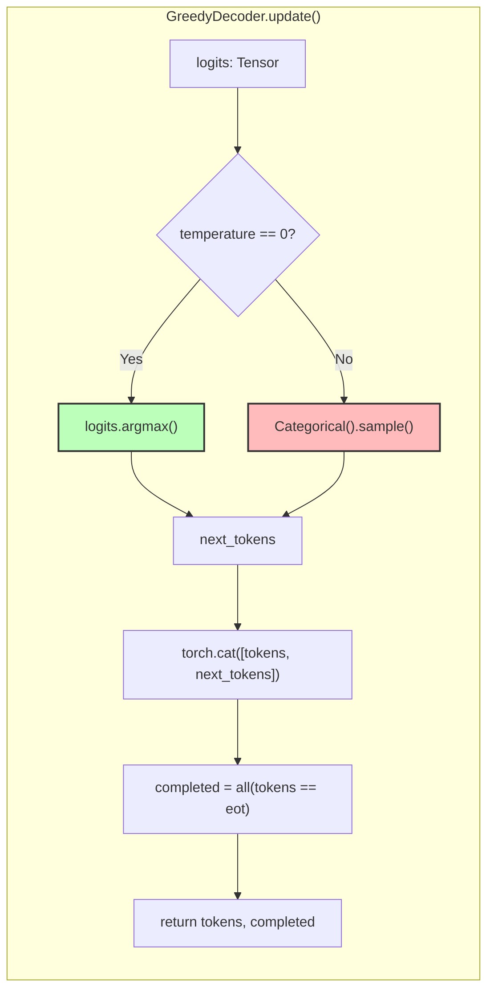
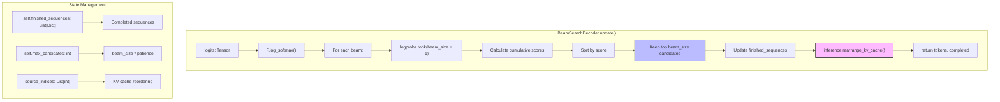
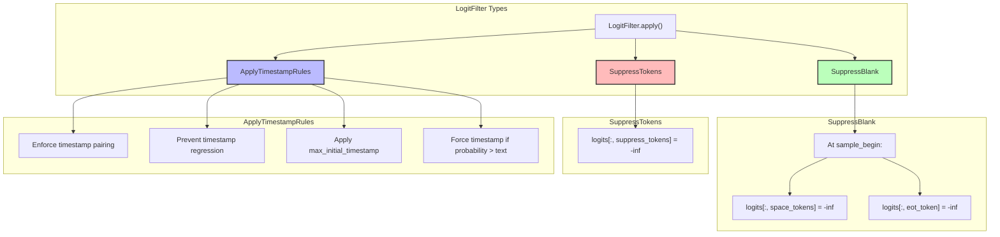
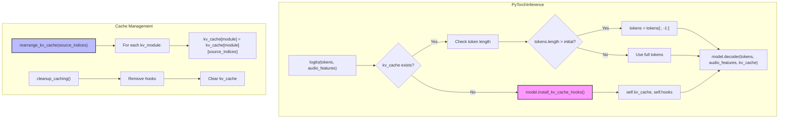
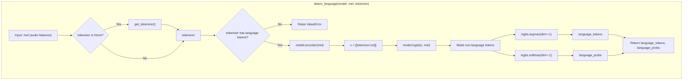
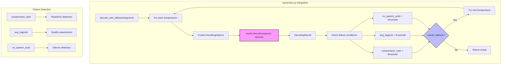

<!-- source: DeepWiki mcp.deepwiki.com · repo openai/whisper · page 3.4 Decoding System · fetched 2026-10-26 -->

# Decoding System

<details>
<summary>Relevant source files</summary>

The following files were used as context for generating this wiki page:

- [whisper/decoding.py](whisper/decoding.py)

</details>


The decoding system handles token generation from the Whisper model's logits, implementing multiple decoding strategies including greedy decoding and beam search. This system takes audio features and produces text tokens through controlled sampling with various constraints and filters.

For information about the complete transcription pipeline, see [Transcription Pipeline](#4.1). For details about the neural network architecture that produces the logits, see [Model Architecture](#3.1).

## Core Components Overview

The decoding system consists of several coordinated components that work together to generate tokens from model logits:



**Sources:** [whisper/decoding.py:508-789]()

## DecodingOptions and DecodingResult

The decoding system uses two main data structures to configure and return results:

### DecodingOptions

`DecodingOptions` is a frozen dataclass that configures the decoding behavior [whisper/decoding.py:80-115]():

| Parameter | Type | Default | Description |
|-----------|------|---------|-------------|
| `task` | `str` | `"transcribe"` | Task type: "transcribe" or "translate" [whisper/decoding.py:83]() |
| `language` | `Optional[str]` | `None` | Target language, auto-detected if None [whisper/decoding.py:86]() |
| `temperature` | `float` | `0.0` | Sampling temperature (0.0 = greedy) [whisper/decoding.py:89]() |
| `beam_size` | `Optional[int]` | `None` | Number of beams for beam search [whisper/decoding.py:92]() |
| `best_of` | `Optional[int]` | `None` | Number of candidates for sampling [whisper/decoding.py:91]() |
| `suppress_tokens` | `Optional[Union[str, Iterable[int]]]` | `"-1"` | Tokens to suppress during sampling [whisper/decoding.py:106]() |
| `without_timestamps` | `bool` | `False` | Whether to generate timestamps [whisper/decoding.py:110]() |

### DecodingResult

`DecodingResult` contains the output of the decoding process [whisper/decoding.py:117-128]():

```python
@dataclass(frozen=True)
class DecodingResult:
    audio_features: Tensor
    language: str
    language_probs: Optional[Dict[str, float]] = None
    tokens: List[int] = field(default_factory=list)
    text: str = ""
    avg_logprob: float = np.nan
    no_speech_prob: float = np.nan
    temperature: float = np.nan
    compression_ratio: float = np.nan
```

**Sources:** [whisper/decoding.py:80-128]()

## DecodingTask Architecture

The `DecodingTask` class orchestrates the entire decoding process. It is instantiated via `model.decode()` and manages the lifecycle of token generation [whisper/decoding.py:508-510]().

```mermaid
graph TD
    subgraph "DecodingTask Initialization"
        A["DecodingTask.__init__()"] --> B["get_tokenizer()"]
        A --> C["_verify_options()"]
        A --> D["_get_initial_tokens()"]
        A --> E["_get_suppress_tokens()"]
        
        B --> F["self.tokenizer: Tokenizer"]
        C --> G["self.options: DecodingOptions"]
        D --> H["self.initial_tokens: Tuple[int]"]
        E --> I["self.sot_sequence: Tuple[int]"]
    end
    
    subgraph "Component Creation"
        A --> J["PyTorchInference"]
        A --> K["MaximumLikelihoodRanker"]
        A --> L["GreedyDecoder | BeamSearchDecoder"]
        A --> M["LogitFilter[]"]
        
        J --> N["self.inference"]
        K --> O["self.sequence_ranker"]
        L --> P["self.decoder"]
        M --> Q["self.logit_filters"]
    end
    
    subgraph "Execution"
        R["DecodingTask.run()"] --> S["_get_audio_features()"]
        S --> T["_detect_language()"]
        T --> U["_main_loop()"]
        U --> V["decoder.finalize()"]
        V --> W["sequence_ranker.rank()"]
        W --> X["DecodingResult[]"]
    end
    
    style A fill:#f9f,stroke:#333,stroke-width:2px
    style R fill:#bbf,stroke:#333,stroke-width:2px
```



The task initialization process configures:
- **Tokenizer**: Language-specific tokenization based on model type [whisper/decoding.py:516-521]().
- **Sequence Setup**: Start-of-transcript tokens and initial prompt handling [whisper/decoding.py:644-675]().
- **Decoding Strategy**: `GreedyDecoder` is used if `beam_size` is None, otherwise `BeamSearchDecoder` [whisper/decoding.py:568-575]().
- **Logit Filters**: Constraints for token generation such as `SuppressBlank` and `ApplyTimestampRules` [whisper/decoding.py:577-584]().

**Sources:** [whisper/decoding.py:508-789]()

## Token Decoders

The system implements two main decoding strategies through the `TokenDecoder` interface:

### GreedyDecoder

`GreedyDecoder` implements deterministic token selection (if temperature is 0) or random sampling [whisper/decoding.py:272-302]():



### BeamSearchDecoder

`BeamSearchDecoder` maintains multiple candidate sequences to find the path with the highest cumulative probability [whisper/decoding.py:305-404]():



**Sources:** [whisper/decoding.py:272-404]()

## Logit Filters

Logit filters apply constraints to token generation by modifying logits in-place before sampling [whisper/decoding.py:407-410]():



The `ApplyTimestampRules` filter implements complex logic to ensure valid timestamp sequences [whisper/decoding.py:438-506]():
- **Monotonicity**: Ensures timestamps never decrease [whisper/decoding.py:476-478]().
- **Pairing**: Ensures timestamps are generated in pairs (start and end) [whisper/decoding.py:466-471]().
- **Initial Constraint**: `max_initial_timestamp` limits how late the first timestamp can appear [whisper/decoding.py:480-484]().
- **Thresholding**: If the sum of timestamp probabilities exceeds text token probabilities, it forces a timestamp [whisper/decoding.py:494-504]().

**Sources:** [whisper/decoding.py:407-506]()

## Inference and Caching

The `PyTorchInference` class handles model forward passes and manages the key-value (KV) cache to avoid redundant computation [whisper/decoding.py:144-178]():



Key-value caching optimizes inference by:
- Storing attention keys and values from previous tokens [whisper/decoding.py:148-153]().
- Only computing logits for the last token in subsequent passes [whisper/decoding.py:159-161]().
- Reordering cache entries for beam search candidate tracking via `rearrange_kv_cache` [whisper/decoding.py:172-177]().

**Sources:** [whisper/decoding.py:144-177]()

## Language Detection

The `detect_language` function identifies the spoken language in an audio segment [whisper/decoding.py:19-77](). This is performed outside the main decode loop to prevent interference with KV-caching [whisper/decoding.py:22-26]().



The process involves:
1.  **Tokenizer Initialization**: Ensures a tokenizer capable of language identification is available [whisper/decoding.py:34-44]().
2.  **Encoder Pass**: Processes the audio features through the model's encoder [whisper/decoding.py:51-52]().
3.  **Single Token Forward Pass**: Uses only the `startoftranscript` token to get initial logits [whisper/decoding.py:55-57]().
4.  **Logit Masking**: Suppresses all non-language tokens in the logits to focus on language prediction [whisper/decoding.py:60-62]().
5.  **Language Prediction**: Determines the most probable language token and its probability distribution [whisper/decoding.py:63-71]().

**Sources:** [whisper/decoding.py:19-77]()

## Integration with Transcription Pipeline

The decoding system is utilized by the higher-level transcription pipeline, specifically within the `decode_with_fallback` function which handles quality-based retries [whisper/transcribe.py:184-224]():



The fallback mechanism iterates through temperature values to find acceptable results:
- **Temperature 0.0**: Deterministic greedy decoding.
- **Higher temperatures**: Increasing randomness for difficult segments.
- **Quality checks**: Results are validated using `compression_ratio` (to detect repetitive loops) and `avg_logprob` (to detect low-confidence hallucinations) [whisper/transcribe.py:198-212]().

**Sources:** [whisper/transcribe.py:184-224]()

---

