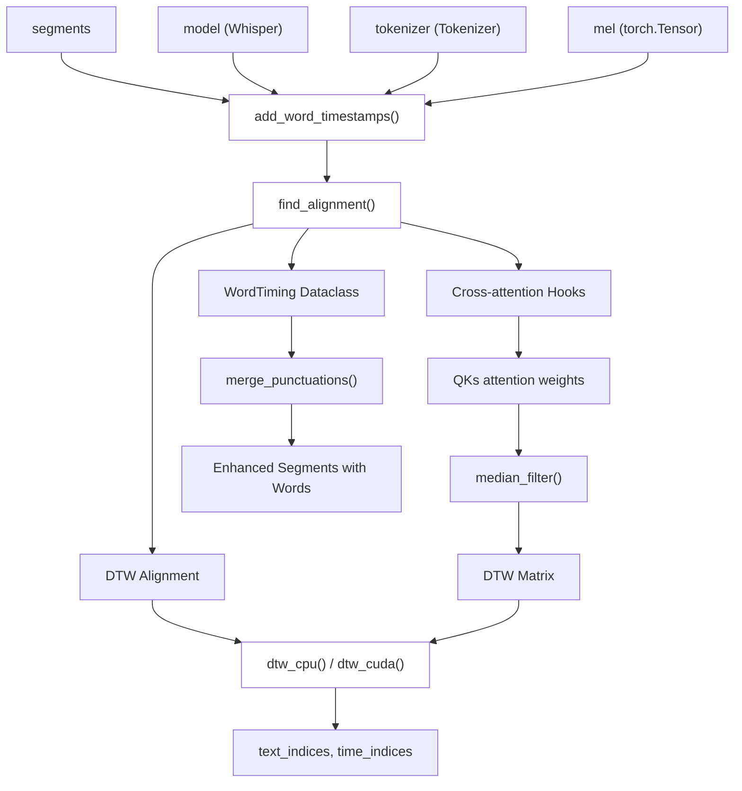
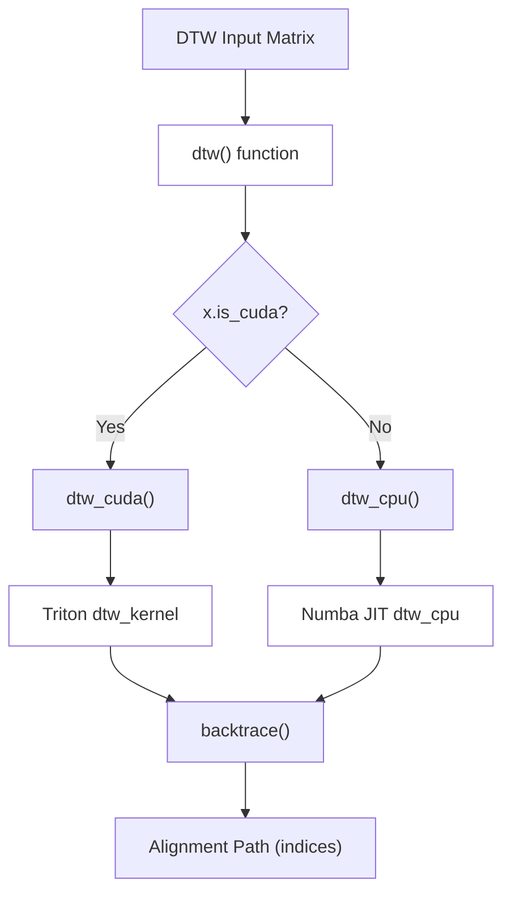
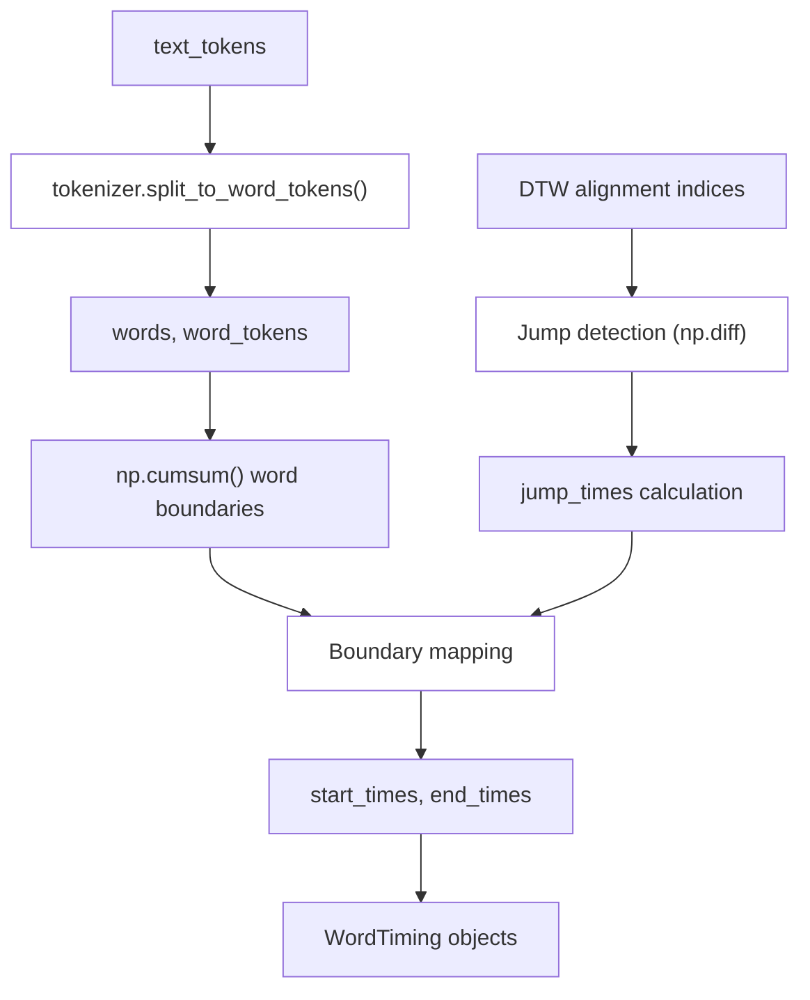

<!-- source: DeepWiki mcp.deepwiki.com · repo openai/whisper · page 3.5 Word Timestamps · fetched 2026-10-26 -->

# Word Timestamps

Relevant source files

The following files were used as context for generating this wiki page:

- [whisper/timing.py](whisper/timing.py)

## Purpose and Scope

This document covers the word-level timestamp extraction system in Whisper, which provides precise timing information for individual words in transcribed audio. The system uses Dynamic Time Warping (DTW) and cross-attention weights to align text tokens with audio frames, enabling applications like subtitle generation and precise audio-text synchronization.

The implementation resides primarily in `whisper/timing.py`, with GPU-accelerated kernels defined in `whisper/triton_ops.py`.

## System Overview

The word timestamps system operates as a post-processing step after initial transcription, adding precise timing information to each word in the transcript. The system leverages the Whisper model's cross-attention mechanism to determine how text tokens align with audio frames.

### Core Word Timestamp Pipeline

Sources: [whisper/timing.py:279-388](), [whisper/timing.py:163-242]()

## Core Components

### WordTiming Dataclass

The `WordTiming` class is a data structure that stores the metadata for a single word alignment.

| Attribute | Type | Description |
|-----------|------|-------------|
| `word` | `str` | The text string of the word |
| `tokens` | `List[int]` | The integer token IDs composing the word |
| `start` | `float` | Start time in seconds |
| `end` | `float` | End time in seconds |
| `probability` | `float` | Confidence score based on token probabilities |

Sources: [whisper/timing.py:154-161]()

### Alignment Process

The `find_alignment()` function performs the core alignment between text tokens and audio frames. It installs hooks on `model.decoder.blocks[i].cross_attn` to capture attention maps.

| Step | Component | Description |
|------|-----------|-------------|
| 1 | **Cross-attention Hooks** | Extract attention weights from decoder layers using `register_forward_hook` [whisper/timing.py:188-192](). |
| 2 | **Weight Processing** | Normalize weights and apply `median_filter` to smooth the attention map [whisper/timing.py:210-212](). |
| 3 | **DTW Alignment** | Compute optimal alignment path using the negative mean attention matrix [whisper/timing.py:214-216](). |
| 4 | **Word Boundary Detection** | Map tokens to word boundaries using `tokenizer.split_to_word_tokens()` [whisper/timing.py:218-226](). |
| 5 | **Timing Calculation** | Convert frame indices to timestamps using `TOKENS_PER_SECOND` [whisper/timing.py:229-231](). |

Sources: [whisper/timing.py:163-242]()

## Dynamic Time Warping Implementation

The DTW algorithm finds the optimal alignment path between text tokens and audio frames by minimizing cumulative distance. Whisper provides both a Numba-accelerated CPU version and a Triton-accelerated GPU version.

### DTW Implementation Flow

Sources: [whisper/timing.py:141-151](), [whisper/timing.py:82-105](), [whisper/timing.py:108-138]()

### DTW Cost Matrix Computation

The DTW algorithm uses a dynamic programming approach. In `dtw_cpu`, the cost matrix is initialized with infinity and filled iteratively.

| Transition | Direction | Cost Update Logic |
|------------|-----------|-------------------|
| Diagonal | `(i-1, j-1)` | Preferred for simultaneous token/time progression |
| Vertical | `(i-1, j)` | Token progresses, time stays (e.g., fast speech) |
| Horizontal | `(i, j-1)` | Time progresses, token stays (e.g., silence/prolongation) |

Sources: [whisper/timing.py:88-103]()

## Performance Optimizations

### CUDA Acceleration via Triton

For performance-critical operations, Whisper utilizes Triton kernels in `whisper/triton_ops.py`.

*   **`dtw_kernel`**: Implements the DTW cost calculation in parallel across blocks, utilizing `tl.load` and `tl.store` for efficient memory access [whisper/triton_ops.py:14-41]().
*   **`median_filter_cuda`**: Wraps a dynamically generated `median_kernel`. The kernel is specialized for a specific `filter_width` by unrolling a bubble sort algorithm in the Triton IR [whisper/triton_ops.py:43-103]().

### Median Filtering

The `median_filter()` function in `whisper/timing.py` acts as a dispatcher. If the input tensor is on a CUDA device, it attempts to use `median_filter_cuda`. If Triton is unavailable or the device is CPU, it falls back to a `torch.sort()` based implementation [whisper/timing.py:36-50]().

Sources: [whisper/timing.py:19-54](), [whisper/triton_ops.py:1-117]()

## Word Boundary Processing

### Token-to-Word Mapping

The system maps token-level alignments to word boundaries using the tokenizer's word segmentation logic.

Sources: [whisper/timing.py:218-241]()

### Punctuation Merging

The `merge_punctuations()` function ensures that punctuation marks are logically grouped with their respective words rather than standing as independent "words" with their own timestamps.

*   **Prepended Punctuation**: Characters like `"` or `(` are merged into the following word [whisper/timing.py:255-263]().
*   **Appended Punctuation**: Characters like `.` or `!` are merged into the preceding word [whisper/timing.py:265-273]().

Sources: [whisper/timing.py:245-277]()

## Integration with Transcription Pipeline

### Segment Enhancement

The `add_word_timestamps()` function is the primary entry point for the transcription pipeline to add timing data. It processes segments produced by the decoder and populates them with a `words` key containing a list of dictionaries [whisper/timing.py:388]().

### Timing Adjustments and Heuristics

The system applies several heuristics to refine the raw DTW output:
1.  **Standard Deviation Scaling**: Attention weights are standardized before DTW [whisper/timing.py:210-211]().
2.  **Duration Constraints**: Words that are excessively long (relative to the median) are truncated to avoid artifacts [whisper/timing.py:328-333]().
3.  **Segment Boundary Clipping**: Word timestamps are clipped to ensure they do not exceed the parent segment's boundaries [whisper/timing.py:368-372]().

Sources: [whisper/timing.py:279-388]()

## Testing and Validation

The timing system includes tests in `tests/test_timing.py` to ensure consistency between CPU and GPU implementations.

*   **`test_dtw`**: Validates the `dtw_cpu` implementation against a known random path [tests/test_timing.py:22-53]().
*   **`test_dtw_cuda_equivalence`**: Ensures that `dtw_cuda` produces the same results as `dtw_cpu` [tests/test_timing.py:55-64]().
*   **`test_median_filter`**: Compares the custom median filter implementation against `scipy.ndimage.median_filter` [tests/test_timing.py:67-84]().

Sources: [tests/test_timing.py:1-96]()

---

