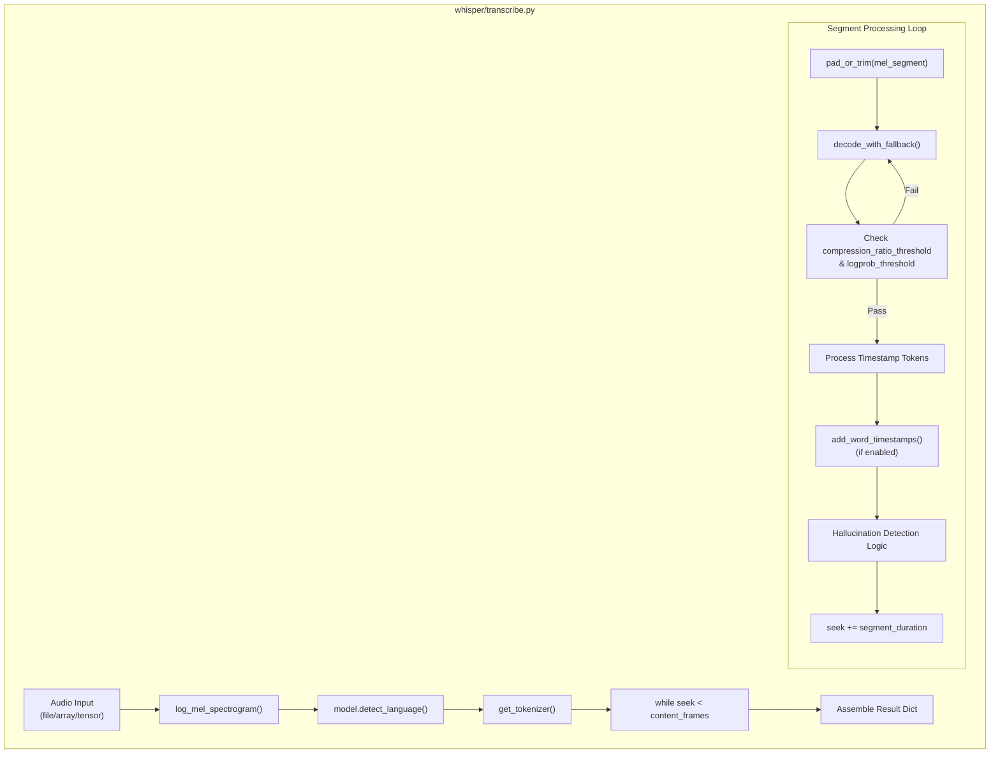
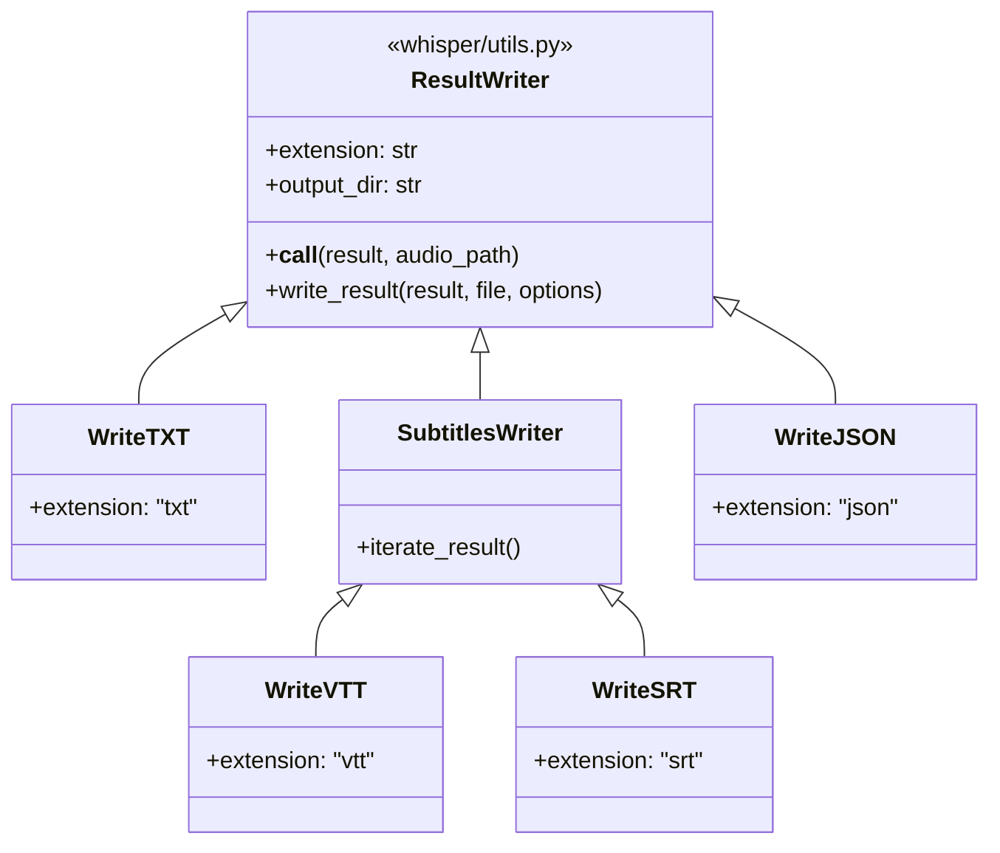
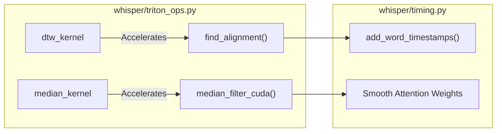

<!-- source: DeepWiki mcp.deepwiki.com · repo openai/whisper · page 4 Implementation Details · fetched 2026-10-26 -->

# Implementation Details

Relevant source files

The following files were used as context for generating this wiki page:

- [whisper/transcribe.py](whisper/transcribe.py)

This document provides deeper technical information on the key components and internal mechanisms that power the Whisper automatic speech recognition system. It focuses on the implementation specifics rather than high-level architecture. For a broader architectural overview, see [Architecture](#3).

## Core Transcription Pipeline

The transcription process is implemented through the `transcribe()` function in `transcribe.py`, which orchestrates the entire workflow from audio input to formatted text output. It manages a sliding 30-second window, handles language detection, and manages the state of the transcription across segments.

Sources: [whisper/transcribe.py:38-514]()

### Temperature Fallback Mechanism

The `decode_with_fallback()` function implements a mechanism to handle uncertain transcriptions by trying multiple temperature values sequentially. If the output fails quality thresholds (e.g., repetitive text or low confidence), the system retries with a higher temperature to introduce more randomness.

For details, see [Transcription Pipeline](#4.1).

| Criterion | Parameter | Default | Description |
|-----------|-----------|---------|-------------|
| Compression Ratio | `compression_ratio_threshold` | 2.4 | Indicates repetitive text via zlib compression |
| Log Probability | `logprob_threshold` | -1.0 | Average confidence of sampled tokens |
| No Speech Probability | `no_speech_threshold` | 0.6 | Threshold to consider a segment as silent |

Sources: [whisper/transcribe.py:73-85](), [whisper/transcribe.py:184-224]()

## Result Formatting System

Whisper provides a flexible result formatting system via the `ResultWriter` class hierarchy. This system supports various output formats including plain text, subtitles (SRT/VTT), and structured data (JSON/TSV).

Sources: [whisper/utils.py:85-318]()

The `get_writer()` factory function is used to instantiate the appropriate formatter based on the desired output format string.

For details, see [Result Formatting](#4.2).

## CUDA Acceleration

Whisper utilizes custom Triton kernels to accelerate performance-critical operations on NVIDIA GPUs. These optimizations primarily target the alignment and filtering stages used in word-level timestamp generation.

Sources: [whisper/triton_ops.py:14-117](), [whisper/timing.py:6-7]()

Key accelerated components include:
*   **DTW Kernel**: A Triton-based Dynamic Time Warping implementation for aligning tokens to audio frames.
*   **Median Filter**: A GPU-accelerated median filter used to smooth cross-attention weights before alignment.
*   **CPU Fallbacks**: The system provides Numba JIT-compiled versions (`dtw_cpu`) for environments without CUDA support.

For details, see [CUDA Acceleration](#4.3).

## Text Normalization

To ensure consistent evaluation and readable output, Whisper includes a text normalization system. The `EnglishTextNormalizer` handles complex English-specific transformations like expanding contractions and standardizing numbers, while the `BasicTextNormalizer` provides general-purpose cleaning (removing punctuation, lowercasing).

Sources: [whisper/normalizers/english.py:15-18](), [whisper/normalizers/basic.py:6-10]()

For details on normalization rules and usage, see [Result Formatting](#4.2).

---

