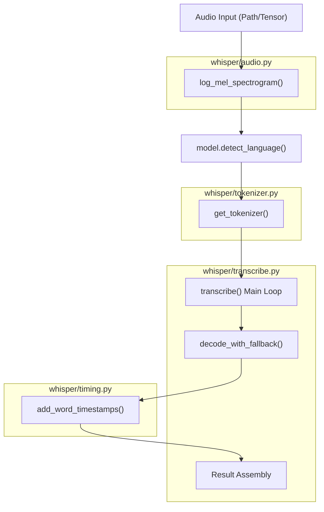
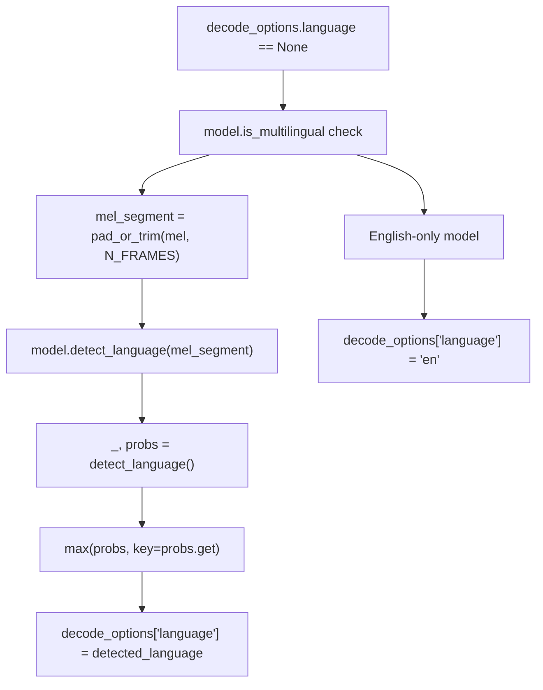
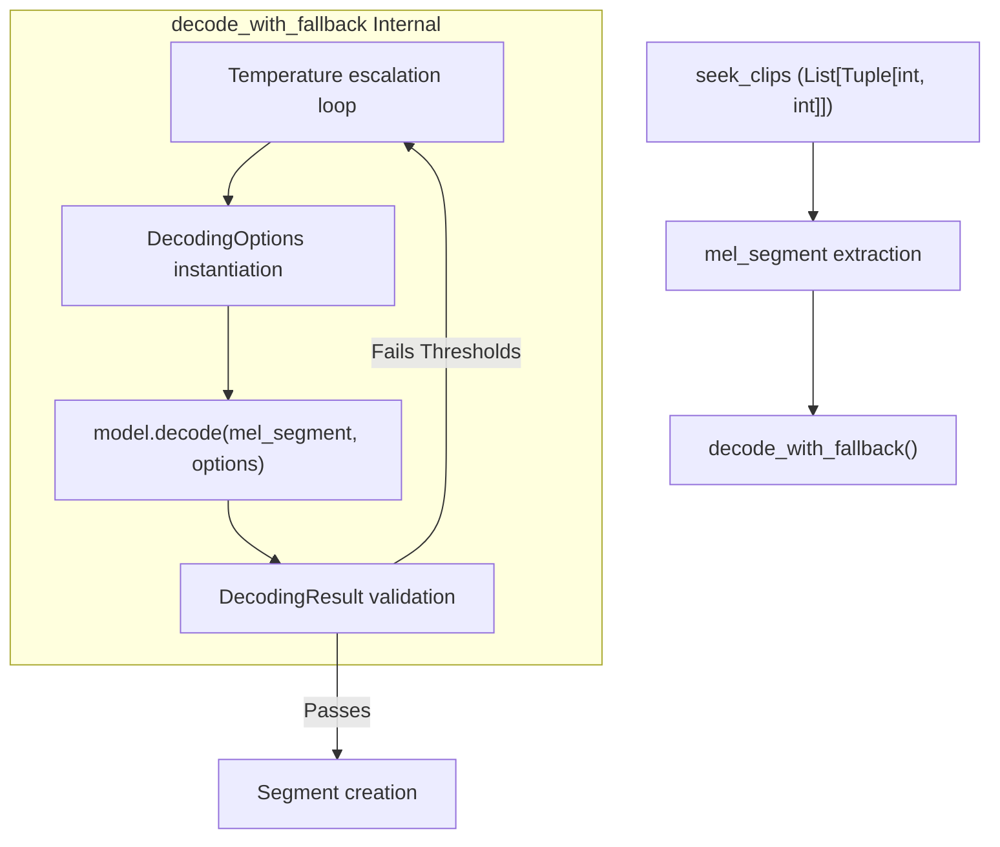

<!-- source: DeepWiki mcp.deepwiki.com · repo openai/whisper · page 4.1 Transcription Pipeline · fetched 2026-10-26 -->

# Transcription Pipeline

<details>
<summary>Relevant source files</summary>

The following files were used as context for generating this wiki page:

- [whisper/transcribe.py](whisper/transcribe.py)

</details>


This document covers the complete transcription pipeline that processes audio input and generates text output with optional word-level timestamps. The pipeline handles audio preprocessing, language detection, windowed decoding, and quality control mechanisms.

For information about the underlying neural network model architecture, see [Model Architecture](3.1). For details about audio preprocessing components, see [Audio Processing](3.2). For output formatting and writer systems, see [Result Formatting](4.2).

## Overview

The transcription pipeline is the main orchestrator that coordinates all components to transform audio input into structured text output. The core pipeline is implemented in the `transcribe()` function [whisper/transcribe.py:38-126](), which processes audio through multiple stages including preprocessing, language detection, windowed decoding, and post-processing.

### Transcription Flow (Natural Language to Code)

This diagram maps the high-level transcription stages to the specific functions and classes in the codebase.



Sources: [whisper/transcribe.py:38-514](), [whisper/audio.py:11-19](), [whisper/tokenizer.py:161-166](), [whisper/timing.py:21-21]()

## Audio Preprocessing

The pipeline begins by converting the input audio into a mel spectrogram representation. The `log_mel_spectrogram()` function processes the audio and adds padding to ensure proper windowing.

| Component | Function | Purpose |
|-----------|----------|---------|
| Mel Spectrogram Generation | `log_mel_spectrogram()` | Converts audio to model input format [whisper/audio.py:92-132]() |
| Padding | `N_SAMPLES` padding | Adds 30 seconds of silence for slicing [whisper/transcribe.py:139-139]() |
| Frame Calculation | `content_frames` | Determines total processing duration [whisper/transcribe.py:140-141]() |

Sources: [whisper/transcribe.py:139-141](), [whisper/audio.py:12-18]()

## Language Detection

When no language is specified, the pipeline performs automatic language detection using the first 30 seconds of audio. The detection process uses the model's language classification capabilities [whisper/transcribe.py:143-158]().



Sources: [whisper/transcribe.py:143-157](), [whisper/decoding.py:19-77]()

## Main Processing Loop

The core processing loop handles the audio in overlapping 30-second windows. Each window is processed through the decoding pipeline with fallback mechanisms for quality control [whisper/transcribe.py:272-400]().

### Window Processing (Code Entity Space)

This diagram shows how the loop iterates through `seek_clips` and uses the `DecodingTask` (via `model.decode`) to process audio chunks.



Sources: [whisper/transcribe.py:184-224](), [whisper/transcribe.py:272-280]()

### Segment Creation and Timestamp Handling

The pipeline processes decoder output tokens to create segments. It handles both consecutive timestamp tokens and single timestamp patterns [whisper/transcribe.py:339-399]().

*   **Timestamp Tokens**: Tokens greater than or equal to `tokenizer.timestamp_begin` [whisper/transcribe.py:340-340]().
*   **Consecutive Timestamps**: Used to identify specific slices within the 30-second window [whisper/transcribe.py:343-346]().
*   **Seek Update**: The `seek` pointer is updated based on the last timestamp token found in the segment [whisper/transcribe.py:392-399]().

Sources: [whisper/transcribe.py:339-399](), [whisper/transcribe.py:246-261]()

## Word Timestamp Extraction

When `word_timestamps=True`, the pipeline extracts word-level timing information using cross-attention weights and Dynamic Time Warping (DTW) alignment [whisper/transcribe.py:401-411]().

1.  **Alignment**: `find_alignment()` extracts cross-attention QK weights and uses DTW to align tokens to audio frames [whisper/timing.py:163-242]().
2.  **Punctuation Merging**: `merge_punctuations()` combines isolated punctuation tokens with adjacent words based on `prepend_punctuations` and `append_punctuations` [whisper/timing.py:388]().
3.  **Refinement**: The system validates word durations and adjusts segment boundaries to match word timings [whisper/timing.py:340-388]().

Sources: [whisper/transcribe.py:401-411](), [whisper/timing.py:163-242](), [whisper/timing.py:388]()

## Quality Control Mechanisms

### Fallback Temperature System

The `decode_with_fallback` function implements temperature escalation [whisper/transcribe.py:184-224](). If the initial greedy decoding (temp 0.0) fails quality thresholds, the system retries with higher temperatures (e.g., 0.2, 0.4) to introduce randomness and escape failure loops.

*   **Compression Ratio**: Detects repetitive "stuck" text via `compression_ratio_threshold` [whisper/transcribe.py:206-207]().
*   **Log Probability**: Detects low-confidence transcriptions via `logprob_threshold` [whisper/transcribe.py:208-209]().
*   **No Speech Probability**: Skips segments if `no_speech_threshold` is met [whisper/transcribe.py:211-218]().

Sources: [whisper/transcribe.py:184-224]()

### Hallucination Detection

The pipeline includes hallucination detection that analyzes word anomalies and silence patterns when word timestamps are enabled [whisper/transcribe.py:422-472]().

*   **Anomaly Scoring**: `is_segment_anomaly()` calculates a score based on low word probabilities and unusual durations [whisper/transcribe.py:316-337]().
*   **Silence Threshold**: If a segment is flagged as an anomaly and is surrounded by silence (exceeding `hallucination_silence_threshold`), it is treated as a hallucination and discarded [whisper/transcribe.py:461-472]().

Sources: [whisper/transcribe.py:316-472]()

## Result Assembly

The final phase assembles all processed segments into a structured dictionary [whisper/transcribe.py:491-514]().

```python
# Result structure example
{
    "text": "Full transcription text...",
    "segments": [
        {
            "id": 0,
            "seek": 0,
            "start": 0.0,
            "end": 5.0,
            "text": " Hello world.",
            "tokens": [...],
            "temperature": 0.0,
            "avg_logprob": -0.12,
            "compression_ratio": 0.8,
            "no_speech_prob": 0.01,
            "words": [...] # if word_timestamps=True
        }
    ],
    "language": "en"
}
```

Sources: [whisper/transcribe.py:491-514]()

---

