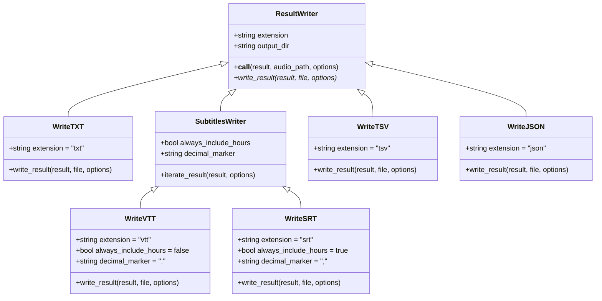
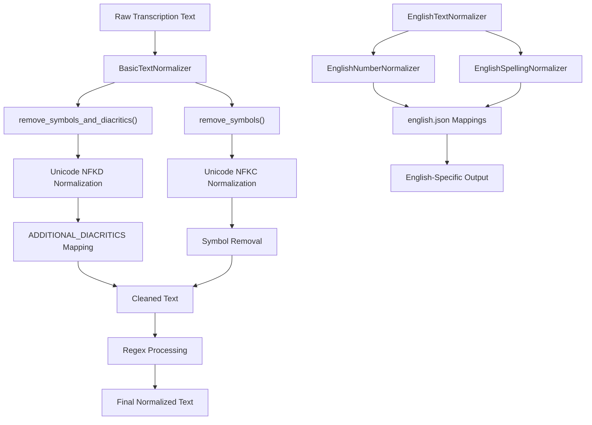
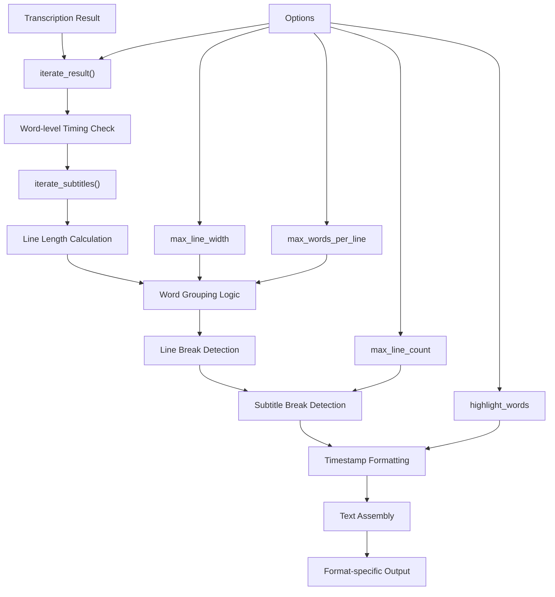
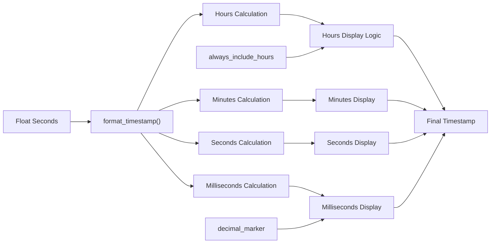
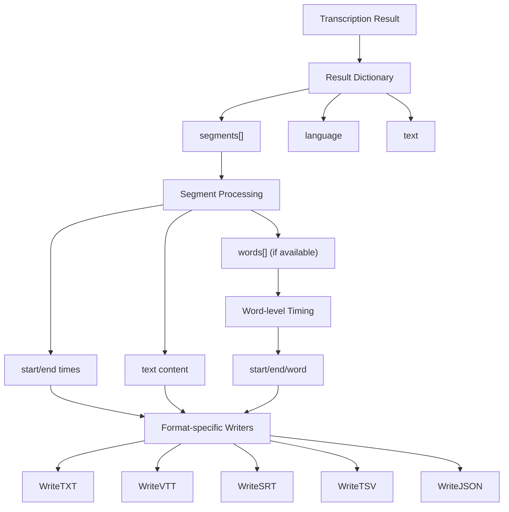

<!-- source: DeepWiki mcp.deepwiki.com · repo openai/whisper · page 4.2 Result Formatting · fetched 2026-10-26 -->

# Result Formatting

<details>
<summary>Relevant source files</summary>

The following files were used as context for generating this wiki page:

- [tests/test_normalizer.py](tests/test_normalizer.py)
- [whisper/normalizers/basic.py](whisper/normalizers/basic.py)
- [whisper/normalizers/english.json](whisper/normalizers/english.json)
- [whisper/normalizers/english.py](whisper/normalizers/english.py)
- [whisper/utils.py](whisper/utils.py)

</details>


This document describes Whisper's result formatting system, which converts transcription results into various output formats and applies text normalization. The system supports multiple output formats including plain text, subtitle formats (VTT, SRT), structured data (JSON, TSV), and provides comprehensive text normalization capabilities.

For information about the transcription pipeline that produces these results, see [Transcription Pipeline](#4.1). For details on word-level timing extraction, see [Word Timestamps](#3.5).

## Output Format System

Whisper's output system is built around a pluggable writer architecture that can generate multiple output formats from the same transcription result. The system is implemented through the `ResultWriter` base class and format-specific implementations.

### Writer Architecture



The factory function `get_writer()` [whisper/utils.py:297]() provides access to all writers and supports an "all" mode that outputs to all formats simultaneously [whisper/utils.py:313-318]().

Sources: [whisper/utils.py:85-318]()

### Output Format Details

| Format | Extension | Purpose | Special Features |
|--------|-----------|---------|------------------|
| TXT | `.txt` | Plain text transcription | Simple line-by-line segment output [whisper/utils.py:109-117]() |
| VTT | `.vtt` | WebVTT subtitles | Web-compatible, decimal timestamps [whisper/utils.py:238-254]() |
| SRT | `.srt` | SubRip subtitles | Numbered entries, comma decimal marker [whisper/utils.py:257-275]() |
| TSV | `.tsv` | Tab-separated values | Integer millisecond timestamps [whisper/utils.py:278-294]() |
| JSON | `.json` | Structured data | Complete result metadata [whisper/utils.py:216-224]() |

Sources: [whisper/utils.py:109-318]()

## Text Normalization System

Whisper includes a comprehensive text normalization system that converts transcribed text into standardized forms. This is particularly important for evaluation and comparison of transcription results.

### Normalization Architecture



The normalization system operates at two levels:
- **Basic normalization**: Handles Unicode normalization, diacritics removal, and symbol processing via `BasicTextNormalizer` [whisper/normalizers/basic.py:60-80]().
- **Language-specific normalization**: Applies complex rules for English via `EnglishTextNormalizer` [whisper/normalizers/english.py:530-552]().

Sources: [whisper/normalizers/basic.py:1-80](), [whisper/normalizers/english.py:12-552](), [whisper/normalizers/english.json:1-209]()

### Normalization Features

The `BasicTextNormalizer` provides several configurable options:

```python
# Core normalization operations
remove_diacritics: bool = False  # Whether to remove diacritics
split_letters: bool = False      # Whether to split into individual characters
```

The normalization process includes:
1. **Case normalization**: Converts text to lowercase [whisper/normalizers/basic.py:68]().
2. **Bracket removal**: Removes content between `<>`, `[]`, and `()` using regex [whisper/normalizers/basic.py:69-70]().
3. **Symbol processing**: Replaces punctuation and symbols with spaces [whisper/normalizers/basic.py:50-57]().
4. **Diacritics handling**: Optional removal of accented characters using `ADDITIONAL_DIACRITICS` mapping [whisper/normalizers/basic.py:7-47]().
5. **Whitespace normalization**: Consolidates multiple spaces [whisper/normalizers/basic.py:76-79]().

The `EnglishTextNormalizer` [whisper/normalizers/english.py:530-552]() further refines English transcriptions by:
- **Number normalization**: Converts spelled-out numbers to Arabic numerals, handling currencies, ordinals, and large numbers using `EnglishNumberNormalizer` [whisper/normalizers/english.py:12-202](). This includes complex cases like "two point five million" to "2500000" or "ninety percent" to "90%" [tests/test_normalizer.py:18-52]().
- **Spelling normalization**: Converts British English spellings to American English using mappings loaded from `english.json` [whisper/normalizers/english.py:538-540](). For example, "mobilisation" becomes "mobilization" [tests/test_normalizer.py:88]().
- **Contraction expansion**: Expands common contractions like "Let's" to "let us" [tests/test_normalizer.py:94]().
- **Unit and abbreviation handling**: Standardizes units (e.g., "10km" to "10 km") and common abbreviations [tests/test_normalizer.py:96-104]().

Sources: [whisper/normalizers/basic.py:60-80](), [whisper/normalizers/english.py:12-552](), [whisper/normalizers/english.json:1-209](), [tests/test_normalizer.py:10-104]()

## Subtitle Generation System

The subtitle generation system handles complex formatting requirements for time-based output formats like VTT and SRT via the `SubtitlesWriter` class [whisper/utils.py:119]().

### Subtitle Processing Pipeline



The system provides "karaoke mode" word highlighting by processing individual `words` within segments if available [whisper/utils.py:151-192](). The `iterate_result` method [whisper/utils.py:123-137]() takes various options to control subtitle formatting, such as `max_line_width`, `max_line_count`, `highlight_words`, and `max_words_per_line`. It then uses an internal `iterate_subtitles` generator to yield subtitle chunks based on these constraints [whisper/utils.py:142-192]().

### Subtitle Options

| Option | Type | Purpose |
|--------|------|---------|
| `max_line_width` | `int` | Maximum characters per line [whisper/utils.py:134]() |
| `max_line_count` | `int` | Maximum lines per subtitle [whisper/utils.py:135]() |
| `highlight_words` | `bool` | Enable word-level highlighting (Karaoke mode) [whisper/utils.py:136]() |
| `max_words_per_line` | `int` | Maximum words per line [whisper/utils.py:137]() |

Sources: [whisper/utils.py:123-229]()

## Timestamp Formatting

Whisper provides precise timestamp formatting via `format_timestamp()` [whisper/utils.py:50]() that adapts to different output format requirements.

### Timestamp Format Variants



The `format_timestamp` function [whisper/utils.py:50-68]() takes a float `seconds` and optional `always_include_hours` and `decimal_marker` arguments. It calculates hours, minutes, seconds, and milliseconds, then formats them into a string.

The timestamp formatting function handles different format requirements:

- **VTT format**: `MM:SS.mmm` or `HH:MM:SS.mmm` (decimal point) [whisper/utils.py:246]()
- **SRT format**: `HH:MM:SS,mmm` (comma decimal, always include hours) [whisper/utils.py:265]()
- **TSV format**: Integer milliseconds for parsing efficiency [whisper/utils.py:290-291]()

Sources: [whisper/utils.py:50-68](), [whisper/utils.py:230-235]()

## Integration with Transcription Pipeline

The result formatting system receives structured transcription results (usually from `whisper.transcribe`) and processes them for output.

### Result Structure Processing



Each writer processes the same result structure but extracts different information:
- **Text writers**: Extract segment text only [whisper/utils.py:115-116]().
- **Subtitle writers**: Process timing and text with wrapping logic [whisper/utils.py:142-195]().
- **Structured writers**: Preserve complete metadata including language and segments [whisper/utils.py:216-224]().

Sources: [whisper/utils.py:91-102](), [whisper/utils.py:115-294]()

## Utility Functions

The formatting system includes several utility functions for result processing:

### Result Processing Utilities

| Function | Purpose | Usage |
|----------|---------|-------|
| `get_start()` | Extract first timestamp from segments or words | [whisper/utils.py:71-75]() |
| `get_end()` | Extract last timestamp from segments or words | [whisper/utils.py:78-82]() |
| `compression_ratio()` | Calculate text compression via zlib | [whisper/utils.py:45-47]() |
| `make_safe()` | Replaces unrepresentable characters with '?' | [whisper/utils.py:12-21]() |

Sources: [whisper/utils.py:12-83]()

---

