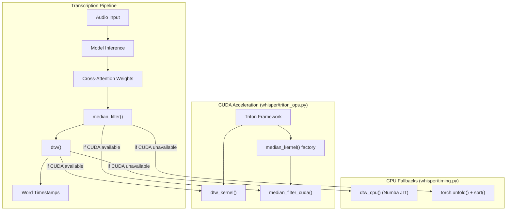
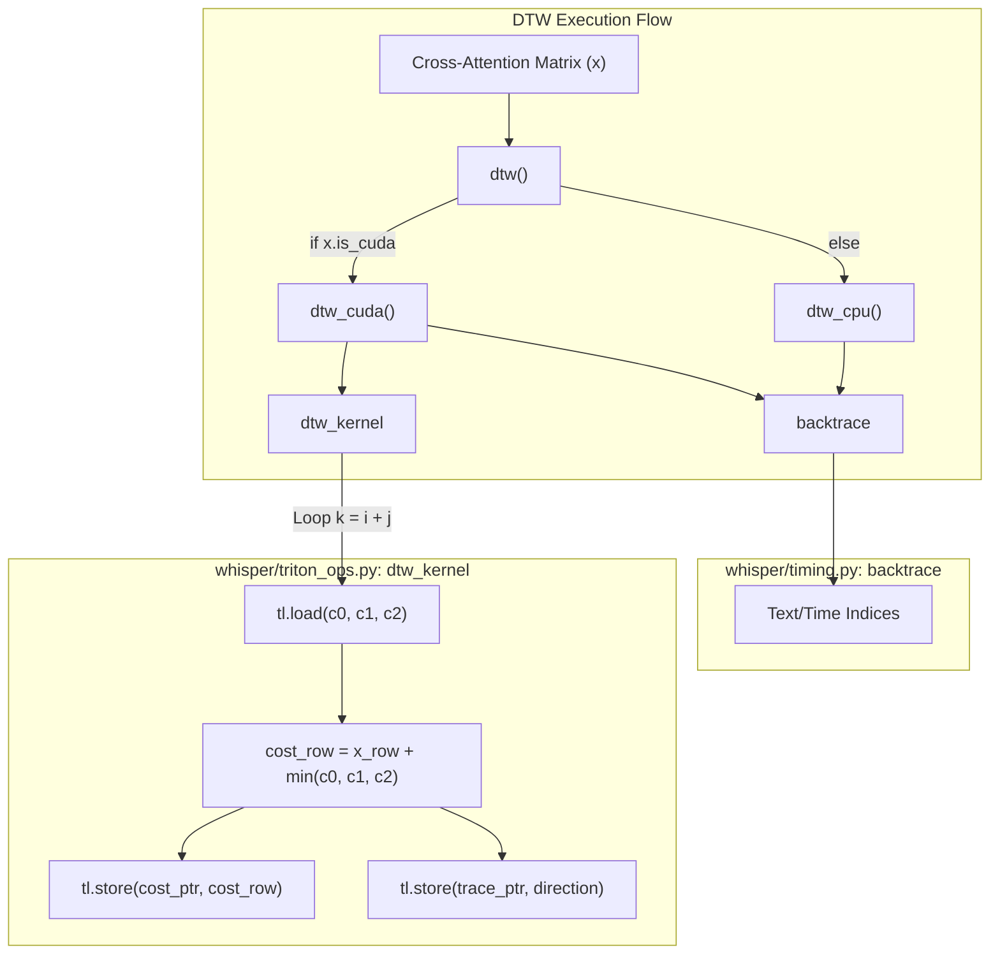

<!-- source: DeepWiki mcp.deepwiki.com · repo openai/whisper · page 4.3 CUDA Acceleration · fetched 2026-10-26 -->

# CUDA Acceleration

Relevant source files

The following files were used as context for generating this wiki page:

- [tests/test_timing.py](tests/test_timing.py)
- [whisper/triton_ops.py](whisper/triton_ops.py)

This document explains the GPU acceleration capabilities in the Whisper ASR system, focusing on the CUDA-optimized operations implemented using the Triton framework. These optimizations significantly improve performance of key computational bottlenecks in the audio processing and word timestamp generation pipeline. For information about the general decoding process, see page 3.4, and for details on the word timestamp generation, see page 3.5.

## Overview of GPU Acceleration

Whisper implements custom CUDA kernels for two computationally intensive operations in the word timestamp alignment process:

1.  **Dynamic Time Warping (DTW)** - Used to align text tokens with audio features via `dtw_kernel` in `triton_ops.py` [whisper/triton_ops.py:14-41]().
2.  **Median Filtering** - Used to denoise attention matrices for more accurate alignments via `median_filter_cuda` in `triton_ops.py` [whisper/triton_ops.py:106-117]().

Both operations are implemented with PyTorch-compatible CUDA kernels using the Triton framework, with automatic fallback to CPU implementations using Numba JIT or standard PyTorch operations when CUDA is unavailable. The specific fallback mechanisms are detailed in the "Error Handling and Fallbacks" section.

### CUDA Acceleration in Whisper Transcription Pipeline

Sources: [whisper/triton_ops.py:14-41](), [whisper/triton_ops.py:43-103](), [whisper/triton_ops.py:106-117]()

## Triton Framework Integration

Whisper uses the [Triton](https://github.com/openai/triton) framework for writing custom CUDA kernels. Triton provides a Python interface for GPU programming, making it easier to write and maintain high-performance GPU code compared to raw CUDA.

### Triton Framework Integration Architecture

```mermaid
flowchart LR
    subgraph "whisper/timing.py"
        TimingMedianFilter["median_filter(x, filter_width)"]
        TimingDTW["dtw(x)"]

        TimingMedianFilter --> CheckCUDA_Median["x.is_cuda"]
        TimingDTW --> CheckCUDA_DTW["x.is_cuda"]

        CheckCUDA_Median -- "True" --> CallMedianFilterCuda["triton_ops.median_filter_cuda(x, filter_width)"]
        CheckCUDA_Median -- "False" --> FallbackMedianCPU["CPU fallback (torch.unfold + sort)"]

        CheckCUDA_DTW -- "True" --> CallDTWCuda["triton_ops.dtw_kernel(...)"]
        CheckCUDA_DTW -- "False" --> FallbackDTWCPU["CPU fallback (dtw_cpu)"]
    end

    subgraph "whisper/triton_ops.py"
        CallMedianFilterCuda --> MedianKernelFactory["median_kernel(filter_width)"]
        MedianKernelFactory --> TritonJIT_Median["@triton.jit kernel"]
        CallDTWCuda --> TritonJIT_DTW["@triton.jit dtw_kernel"]
    end

    subgraph "System Dependencies"
        TritonImport["import triton"]
        TritonImport --> TritonJIT_Median
        TritonImport --> TritonJIT_DTW
        TritonJIT_Median --> CUDARuntime["CUDA Runtime"]
        TritonJIT_DTW --> CUDARuntime
    end
```

Sources: [whisper/triton_ops.py:6-10](), [whisper/triton_ops.py:13-41](), [whisper/triton_ops.py:43-103](), [whisper/triton_ops.py:106-117]()

### Error Handling and Fallbacks

Whisper implements graceful fallbacks to CPU implementations when CUDA is unavailable or when the Triton kernels fail to launch. The `triton` import is wrapped in a `try-except` block, raising a `RuntimeError` if it fails, indicating that Triton is not installed or configured correctly [whisper/triton_ops.py:6-10]().

The CPU fallbacks for `dtw` and `median_filter` are handled in `whisper/timing.py`.
*   **Numba JIT**: `dtw_cpu` and `backtrace` are decorated with `@numba.jit(nopython=True)` for high-performance CPU execution.
*   **PyTorch Operations**: `median_filter` uses `torch.unfold` and `sort` as a fallback, which is faster than `torch.median`.

Sources: [whisper/triton_ops.py:6-10]()

## Accelerated Operations

### Dynamic Time Warping (DTW)

DTW is used in `find_alignment` to align text tokens with audio frames. The CUDA implementation `dtw_kernel` [whisper/triton_ops.py:14-41]() processes the cost and trace matrices.

The `dtw_kernel` operates in a loop over `k = i + j`, where `i` and `j` are indices for the two sequences being aligned. This structure allows for parallel computation along anti-diagonals of the cost matrix.
*   `cost`: Stores the accumulated cost to reach a cell.
*   `trace`: Stores the path taken (0 for horizontal, 1 for vertical, 2 for diagonal).

The kernel loads costs from previous cells (`c0`, `c1`, `c2`) [whisper/triton_ops.py:27-29](), calculates the current cell's cost by adding `x_row` (the current element's cost) to the minimum of the three previous costs [whisper/triton_ops.py:31-32](), and then stores the new cost and the trace direction [whisper/triton_ops.py:34-40]().

#### DTW Operation Flow

Sources: [whisper/triton_ops.py:14-41]()

### Median Filtering

Median filtering denoises cross-attention weights. The CUDA implementation `median_filter_cuda` [whisper/triton_ops.py:106-117]() uses dynamic code generation to create optimized kernels for specific filter widths.

#### Dynamic Kernel Generation

The `median_kernel` function [whisper/triton_ops.py:43-103]() is a factory that generates a specialized Triton kernel for a given `filter_width`. It achieves this by replacing placeholders in a template kernel string:
1.  **`LOAD_ALL_ROWS_HERE`**: Replaced with `tl.load` calls for each row within the `filter_width` window [whisper/triton_ops.py:64-71](). For example, `row0 = tl.load(x_ptr + offsets + 0, mask=mask)`.
2.  **`BUBBLESORT_HERE`**: Replaced with a hardcoded bubble sort sequence. This sequence uses `tl.where` to perform comparisons and swaps without branches, which is efficient on GPUs [whisper/triton_ops.py:73-93](). The number of passes in the bubble sort is `filter_width // 2 + 1`.
3.  **`MIDDLE_ROW_HERE`**: Replaced with the variable name corresponding to the median element after sorting, e.g., `row{filter_width // 2}` [whisper/triton_ops.py:95-95]().

The generated kernel is then stored and returned. The `lru_cache` decorator ensures that kernels for the same `filter_width` are reused [whisper/triton_ops.py:43-43]().

The `median_filter_cuda` function [whisper/triton_ops.py:106-117]() takes a `torch.Tensor` `x` and `filter_width`. It first uses `x.unfold` to create overlapping windows along the last dimension [whisper/triton_ops.py:108-108](). It then calculates the `BLOCK_SIZE` for the Triton kernel launch and executes the dynamically generated kernel [whisper/triton_ops.py:114-115]().

Sources: [whisper/triton_ops.py:43-117]()

## Performance Considerations

### Testing and Validation

The test suite in `tests/test_timing.py` validates the correctness of the CUDA implementations through equivalence testing against CPU and SciPy references.

| Test Function | Purpose | Sources |
| :--- | :--- | :--- |
| `test_dtw` | Validates DTW algorithm against manual trace | [tests/test_timing.py:22-53]() |
| `test_dtw_cuda_equivalence` | Ensures `dtw_cpu` and `dtw_cuda` match | [tests/test_timing.py:55-64]() |
| `test_median_filter` | Validates against `scipy.ndimage.median_filter` | [tests/test_timing.py:67-84]() |
| `test_median_filter_equivalence` | Ensures CPU and GPU median filters match | [tests/test_timing.py:87-96]() |

Sources: [tests/test_timing.py:22-53](), [tests/test_timing.py:55-64](), [tests/test_timing.py:67-84](), [tests/test_timing.py:87-96]()

### Performance Characteristics

| Operation | CPU Path | GPU Path | Optimization |
| :--- | :--- | :--- | :--- |
| **DTW** | Numba JIT `dtw_cpu` | Triton `dtw_kernel` | Parallel diagonal processing [whisper/triton_ops.py:20-40]() |
| **Median Filter** | `unfold` + `sort` | Triton `median_kernel` | Branchless bubble sort code generation [whisper/triton_ops.py:73-93]() |

Sources: [whisper/triton_ops.py:13-41](), [whisper/triton_ops.py:43-103]()

---

