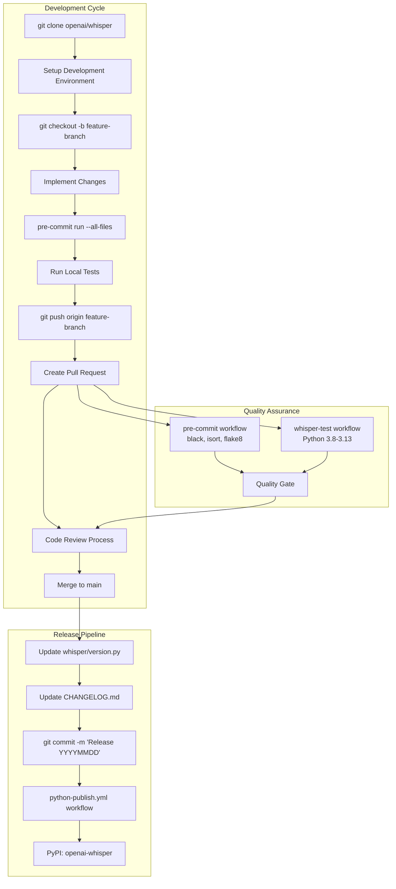
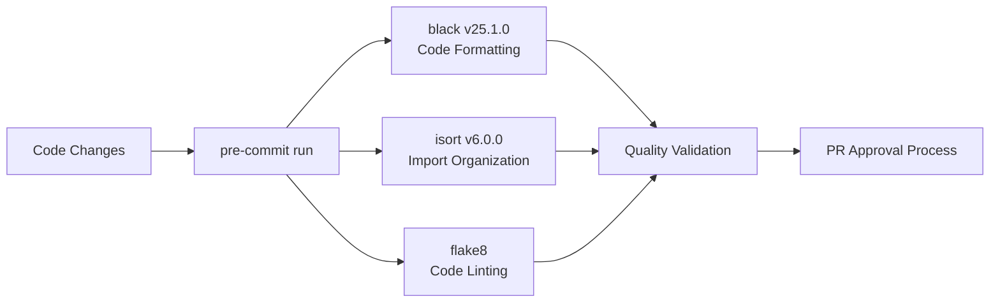
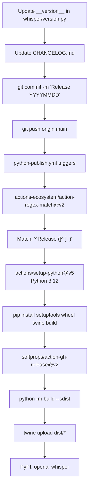

<!-- source: DeepWiki mcp.deepwiki.com · repo openai/whisper · page 5 Development · fetched 2026-10-26 -->

# Development

<details>
<summary>Relevant source files</summary>

The following files were used as context for generating this wiki page:

- [.github/workflows/python-publish.yml](.github/workflows/python-publish.yml)
- [CHANGELOG.md](CHANGELOG.md)
- [whisper/version.py](whisper/version.py)

</details>


This page provides essential information for developers who want to work with or contribute to the Whisper codebase. It covers the development workflow, testing infrastructure, version management, and release process. For detailed information about the codebase organization, see [Project Structure](#5.3).

## Development Workflow

The Whisper project follows a GitHub-based development workflow with automated quality assurance and release management. The workflow integrates code quality tools, automated testing, and streamlined release processes.

### Development Process Flow



### Code Quality Integration

The development workflow enforces quality standards through automated tooling configured in the repository.



Sources: [.github/workflows/python-publish.yml](), [CHANGELOG.md:12](), [CHANGELOG.md:57]()

## Testing Infrastructure

Whisper uses GitHub Actions for continuous integration testing and automated quality assurance. The project includes automated testing across multiple Python and PyTorch versions, pre-commit hooks for code quality, and Dependabot for dependency updates. For details, see [Testing](#5.2).

### Pre-commit Quality Checks

The project uses pre-commit hooks for code quality enforcement with the following tools, managed in the `pre-commit` job of the test workflow.

Sources: [CHANGELOG.md:12]()

### Multi-Version Testing Matrix

The `whisper-test` job executes a comprehensive compatibility matrix across multiple environments.

| Environment | Versions | Configuration |
|----------------|---------------|-------|
| Python | 3.8, 3.9, 3.10, 3.11, 3.12, 3.13 | |
| PyTorch | 1.10.1 to 2.5.1 | |
| NumPy | <2.0 or latest | |
| OS | ubuntu-latest | |

The test suite is executed via `pytest`, filtering out heavy transcription tasks or CUDA-specific tests in the CI environment to maintain efficiency.

Sources: [CHANGELOG.md:13](), [CHANGELOG.md:26](), [CHANGELOG.md:28]()

## Version Management

Whisper uses a date-based versioning scheme in the format `YYYYMMDD`. This approach reflects the release date and enables easy tracking of when specific features or fixes were introduced. For details, see [Versioning and Releases](#5.1).

### Version File Structure

The version is stored in `whisper/version.py` as a module-level constant:

```python
__version__ = "20250625"
```

This version is dynamically loaded into the package metadata via the `setuptools` backend defined in `pyproject.toml`.

Sources: [whisper/version.py:1]()

## Release Process

Releases are fully automated through GitHub Actions using a regex-based commit message detection system in the `python-publish.yml` workflow.

### Release Automation Workflow



### Release Implementation

The automated release process uses the following key components:

1.  **Regex Pattern Matching**: `'^Release ([^ ]+)'` extracts the version from the commit message to trigger the deployment. [[.github/workflows/python-publish.yml:12-16]()]
2.  **GitHub Release Creation**: Automatically creates a tag `vYYYYMMDD` on GitHub. [[.github/workflows/python-publish.yml:26-29]()]
3.  **PyPI Publication**: Uses `twine` to upload the source distribution to PyPI. [[.github/workflows/python-publish.yml:30-37]()]

Sources: [.github/workflows/python-publish.yml:1-37]()

## Project Structure and Evaluation

The repository has migrated from `setup.py` to `pyproject.toml` for modern packaging. For details on repository organization, see [Project Structure](#5.3). 

For details on how changes are evaluated using metrics like Word Error Rate (WER) and the data used for benchmarking, see [Evaluation and Data](#5.4).

Sources: [CHANGELOG.md:14]()

## Changelog Management

Whisper maintains a comprehensive `CHANGELOG.md` file that documents all changes between releases. Each entry typically links to the specific pull request for detailed technical information.

Sources: [CHANGELOG.md:1-23]()

---

