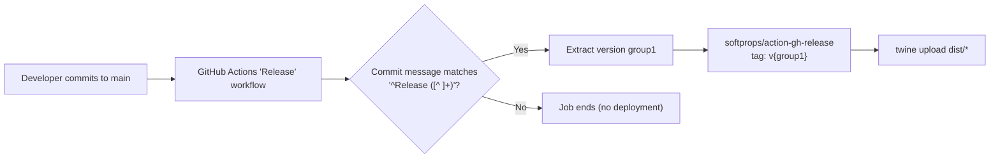
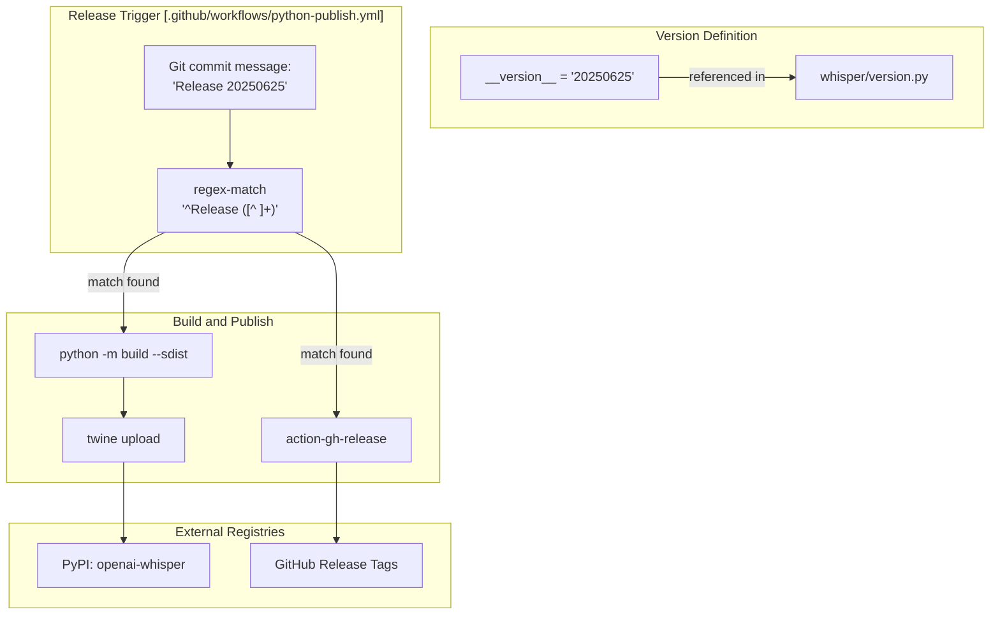
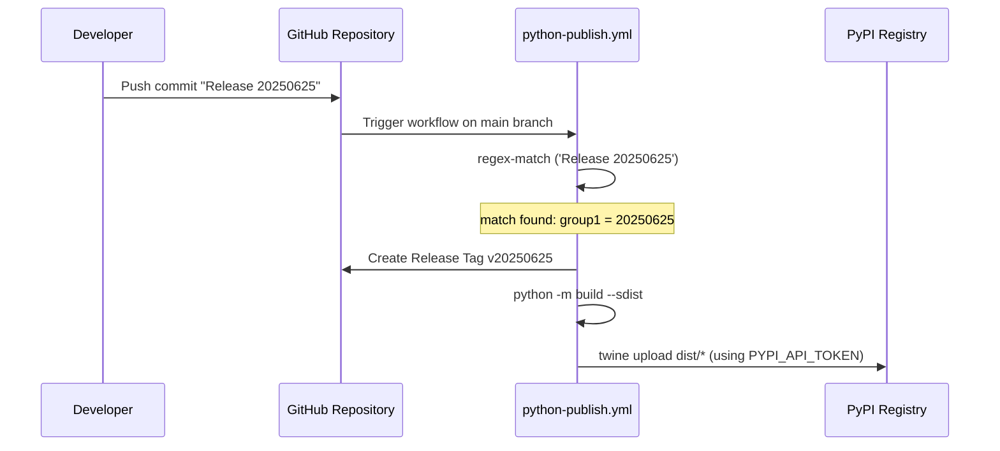

<!-- source: DeepWiki mcp.deepwiki.com · repo openai/whisper · page 5.1 Versioning and Releases · fetched 2026-10-26 -->

# Versioning and Releases

<details>
<summary>Relevant source files</summary>

The following files were used as context for generating this wiki page:

- [.github/workflows/python-publish.yml](.github/workflows/python-publish.yml)
- [CHANGELOG.md](CHANGELOG.md)
- [whisper/version.py](whisper/version.py)

</details>


This document covers the versioning scheme, release management, and automated deployment pipeline for the Whisper project. It explains how versions are tracked, how releases are triggered and published, and the integration with development workflows.

For information about the testing infrastructure that supports releases, see [Testing](#5.2). For details about the overall project structure and packaging, see [Project Structure](#5.3).

## Version Numbering Scheme

Whisper uses a date-based versioning scheme following the format `YYYYMMDD`. This approach provides clear chronological ordering and makes it easy to understand when a release was made.

The version is centrally managed in a single file:

```python
__version__ = "20250625"
```

The version string is defined in [whisper/version.py:1]() and is referenced throughout the packaging system. The project recently migrated from `setup.py` to `pyproject.toml` [CHANGELOG.md:14](), which now handles metadata and build configurations.

### Version History

The project maintains a comprehensive `CHANGELOG.md` tracking all releases. Recent versions include:

| Version | Release Date | Key Changes |
|---------|-------------|-------------|
| `v20250625` | June 25, 2025 | Security fix (weights_only=True), DTW device fixes, Python 3.13 support [CHANGELOG.md:3-13]() |
| `v20240930` | September 30, 2024 | `large-v3-turbo` model release, NumPy 2.0 support [CHANGELOG.md:24-29]() |
| `v20240927` | September 27, 2024 | PyTorch 2.4 compatibility, Triton env marker fix [CHANGELOG.md:31-36]() |
| `v20231106` | November 6, 2023 | `large-v3` model release [CHANGELOG.md:42-44]() |
| `v20230314` | March 14, 2023 | Integration of `tiktoken` for tokenization [CHANGELOG.md:78-84]() |

Sources: [CHANGELOG.md:1-98](), [whisper/version.py:1]()

## Release Automation Pipeline

The Whisper project uses a fully automated release pipeline triggered by specific commit messages on the `main` branch and managed through GitHub Actions.

### Release Trigger Mechanism


Title: Release Trigger Workflow

The release process is triggered by push events to the `main` branch [.github/workflows/python-publish.yml:3-6](). The workflow uses `actions-ecosystem/action-regex-match` to inspect the `github.event.head_commit.message` [.github/workflows/python-publish.yml:12-16](). If the message starts with "Release" followed by the version, the deployment steps are executed.

Sources: [.github/workflows/python-publish.yml:1-16]()

### Release Pipeline Components

The automated release pipeline consists of several integrated components:


Title: Release Pipeline Component Overview

Sources: [.github/workflows/python-publish.yml:12-37](), [whisper/version.py:1]()

## Packaging Configuration

The project uses `pyproject.toml` for modern packaging, specifying build requirements and dependencies.

### Build System and Publication

The deployment job runs on `ubuntu-latest` and uses Python 3.12 [.github/workflows/python-publish.yml:9-20](). It installs the following tools for the release:
- `setuptools`
- `wheel`
- `twine`
- `build`

The publication process involves building the source distribution (`sdist`) and uploading it to PyPI using a secret token [.github/workflows/python-publish.yml:21-37]().

Sources: [.github/workflows/python-publish.yml:21-37]()

## Release Workflow Integration

The release process integrates with the broader development workflow through several automated mechanisms.

### GitHub Actions Integration


Title: GitHub Actions Release Sequence

### Dependency Maintenance

To ensure the release pipeline remains stable, the project uses GitHub Dependabot to keep GitHub Actions updated. Recent updates include bumping the `github-actions` group to address Node.js warnings and other security improvements [CHANGELOG.md:10-16]().

Sources: [CHANGELOG.md:10-16](), [.github/workflows/python-publish.yml:25-37]()

## Distribution and Availability

Released versions are made available through two primary channels:

1.  **PyPI Distribution**: The package is published as `openai-whisper`. The automated pipeline uses `twine` to upload the built artifacts [.github/workflows/python-publish.yml:37]().
2.  **GitHub Releases**: The `softprops/action-gh-release` action creates a formal release on GitHub, tagging the repository with the version number (e.g., `v20250625`) [.github/workflows/python-publish.yml:27-29]().

### Package Security and Integrity
Recent releases have focused on security, such as updating `torch.load` to use `weights_only=True` to prevent security vulnerabilities during model loading [CHANGELOG.md:5]().

Sources: [.github/workflows/python-publish.yml:25-37](), [CHANGELOG.md:3-6]()

---

