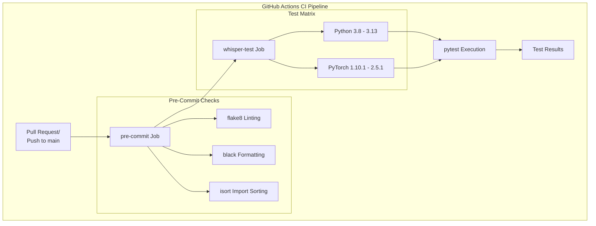
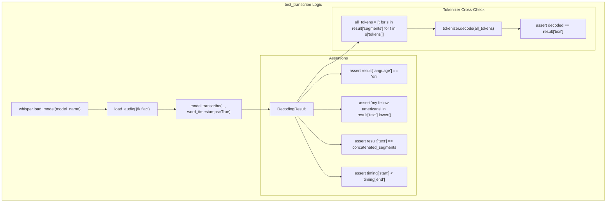
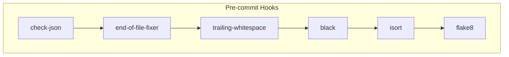
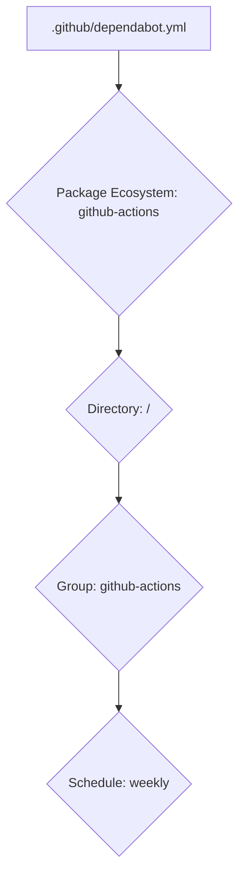

<!-- source: DeepWiki mcp.deepwiki.com · repo openai/whisper · page 5.2 Testing · fetched 2026-10-26 -->

# Testing

<details>
<summary>Relevant source files</summary>

The following files were used as context for generating this wiki page:

- [.github/dependabot.yml](.github/dependabot.yml)
- [.github/workflows/test.yml](.github/workflows/test.yml)
- [.pre-commit-config.yaml](.pre-commit-config.yaml)
- [tests/conftest.py](tests/conftest.py)
- [tests/test_transcribe.py](tests/test_transcribe.py)

</details>


This page documents the testing infrastructure and practices for the Whisper ASR system. It covers the automated testing setup, testing strategy, and how to run tests locally. For information about development and contributing to Whisper, see [Development](#5) and [Project Structure](#5.3).

## Overview of Testing Infrastructure

Whisper uses a comprehensive testing infrastructure based on `pytest` and GitHub Actions to ensure code quality and functionality across multiple Python and PyTorch versions.

**CI Pipeline Architecture**

Sources: [.github/workflows/test.yml:1-75](), [.pre-commit-config.yaml:1-28]()

## Test Configuration

The `whisper-test` job in `.github/workflows/test.yml` defines a comprehensive test matrix ensuring compatibility across Python and PyTorch versions. The matrix specifically handles the transition to NumPy 2.0 by enforcing `numpy<2` for older environments.

**Compatibility Matrix**
| Python | PyTorch | NumPy Requirement |
| :--- | :--- | :--- |
| 3.8 | 1.10.1, 1.13.1, 2.0.1 | `numpy<2` |
| 3.9 | 2.1.2 | `numpy<2` |
| 3.10 | 2.2.2 | `numpy<2` |
| 3.11 | 2.3.1 | `numpy` |
| 3.12 | 2.4.1, 2.5.1 | `numpy` |
| 3.13 | 2.5.1 | `numpy` |

Sources: [.github/workflows/test.yml:42-72]()

## Test Categories and Structure

The test suite is organized around `pytest` markers and parameterization to control test execution. Custom markers like `requires_cuda` are defined in `tests/conftest.py` [tests/conftest.py:7-8]().

| Test Type | Implementation | Execution Control |
| :--- | :--- | :--- |
| **Transcription** | `test_transcribe` in `tests/test_transcribe.py` | Parameterized by `whisper.available_models()` |
| **Tokenizer** | `test_tokenizer` in `tests/test_tokenizer.py` | Validates BPE and Multilingual logic |
| **Audio** | `test_audio` in `tests/test_audio.py` | Validates FFmpeg loading and Mel generation |
| **CUDA Ops** | Marked with `@pytest.mark.requires_cuda` | Excluded in standard CI (CPU-only) |

**CI Filtering Logic**
The CI pipeline executes `pytest` with a specific filter to balance coverage and speed:
`pytest --durations=0 -vv -k 'not test_transcribe or test_transcribe[tiny] or test_transcribe[tiny.en]' -m 'not requires_cuda'` [/.github/workflows/test.yml:79]()
This ensures only `tiny` models are tested during the transcription phase in CI.

Sources: [.github/workflows/test.yml:79](), [tests/test_transcribe.py:10-11](), [tests/conftest.py:7-14]()

## Transcription Testing Implementation

The `test_transcribe` function in `tests/test_transcribe.py` provides end-to-end validation of the transcription pipeline using the `jfk.flac` sample.

**Transcription Data Flow**

Sources: [tests/test_transcribe.py:11-42](), [whisper/tokenizer.py:3]()

### Tokenizer and Audio Validation
- **Tokenizer**: `tests/test_tokenizer.py` verifies that the multilingual tokenizer correctly encodes and decodes non-English text (e.g., Korean) and handles Unicode splitting [tests/test_tokenizer.py:14-34]().
- **Audio**: `tests/test_audio.py` verifies that `log_mel_spectrogram` produces consistent results whether loading from a file path or an in-memory `numpy` array [tests/test_audio.py:8-19]().

## Running Tests Locally

### Environment Setup
Install Whisper with development dependencies to include `pytest`:
```bash
pip install .["dev"]
```
Sources: [.github/workflows/test.yml:78]()

### Execution Commands
| Command | Purpose |
| :--- | :--- |
| `pytest` | Run the full suite (excluding CUDA if no GPU) |
| `pytest -m "not requires_cuda"` | Run only CPU-compatible tests |
| `pytest tests/test_tokenizer.py` | Run specific tokenizer tests |
| `pytest -k "tiny"` | Run tests only for the `tiny` model |

## Pre-commit Code Quality Checks

Whisper enforces strict linting and formatting via `pre-commit`. The configuration in `.pre-commit-config.yaml` targets Python files for consistency.

**Quality Control Pipeline**


### Hook Configurations
- **Black**: Uses version `25.1.0` for standardized formatting [/.pre-commit-config.yaml:13-16]().
- **Isort**: Configured with `--profile black` and a line length of `88` [/.pre-commit-config.yaml:17-22]().
- **Flake8**: Ignores specific errors (`E203`, `E501`, `W503`, `W504`) to remain compatible with Black's formatting [/.pre-commit-config.yaml:23-28]().

Sources: [.pre-commit-config.yaml:1-28]()

## Test Resources and Assets

The `tests/` directory contains necessary assets for functional verification:
- **`jfk.flac`**: A standard audio sample used for transcription and audio processing tests [tests/test_transcribe.py:14](), [tests/test_audio.py:9]().
- **`conftest.py`**: Provides a `random` fixture that seeds `numpy.random` and `random` with `42` to ensure reproducible test behavior [tests/conftest.py:11-14]().

Sources: [tests/test_transcribe.py:14](), [tests/conftest.py:1-14]()

## Dependency Management with Dependabot

The project uses Dependabot to automatically keep GitHub Actions workflows up to date. This ensures that the CI/CD pipeline benefits from the latest security patches and features of the actions used.

**Dependabot Configuration**

Dependabot is configured to check for updates to `github-actions` weekly and group all updates into a single pull request [/.github/dependabot.yml:5-13]().

Sources: [/.github/dependabot.yml:1-13]()

---

