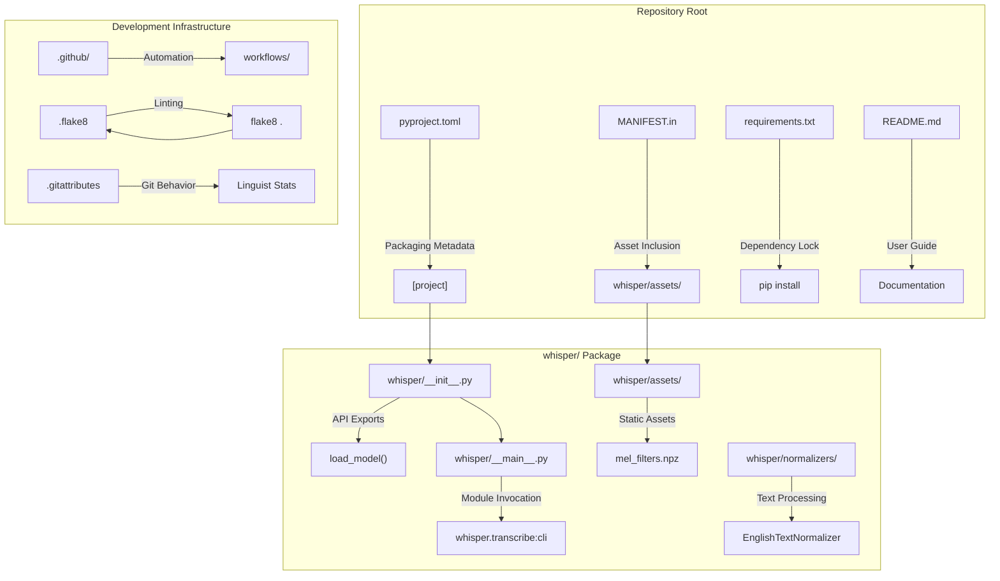
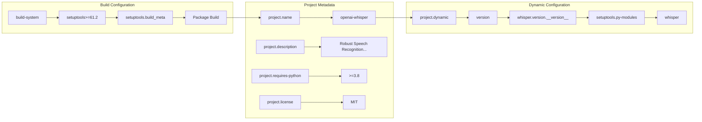
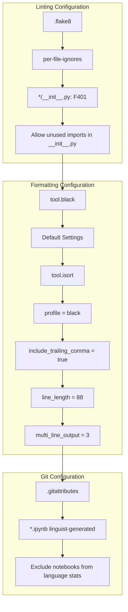
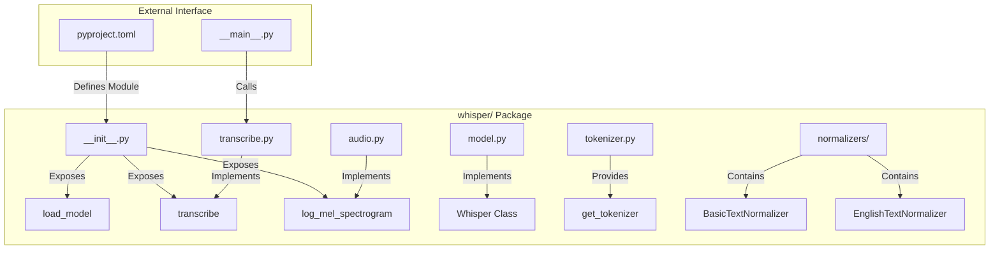

<!-- source: DeepWiki mcp.deepwiki.com · repo openai/whisper · page 5.3 Project Structure · fetched 2026-10-26 -->

# Project Structure

Relevant source files

The following files were used as context for generating this wiki page:

- [.flake8](.flake8)
- [.gitattributes](.gitattributes)
- [MANIFEST.in](MANIFEST.in)
- [pyproject.toml](pyproject.toml)
- [requirements.txt](requirements.txt)
- [tests/test_audio.py](tests/test_audio.py)
- [tests/test_tokenizer.py](tests/test_tokenizer.py)
- [whisper/__main__.py](whisper/__main__.py)
- [whisper/normalizers/__init__.py](whisper/normalizers/__init__.py)

This document covers the organization of the Whisper repository, its packaging configuration, and development environment setup. It explains how the codebase is structured, how the Python package is configured and built, and how the development tooling is organized.

For information about the actual testing framework and CI/CD processes, see [Testing](#5.2). For details about version management and release automation, see [Versioning and Releases](#5.1).

## Repository Layout

The Whisper repository follows a standard Python package structure with additional configuration for modern Python packaging standards. The core package is structured as a single top-level module with supporting development infrastructure.

### Natural Language to Code Entity Space: Repository Components
The following diagram maps high-level repository concepts to their specific file entities in the codebase.

Sources: [pyproject.toml:1-54](), [MANIFEST.in:1-5](), [whisper/__main__.py:1-3](), [.flake8:1-4]()

## Package Configuration

The project uses `pyproject.toml` as the primary configuration file, following PEP 621 standards for modern Python packaging. This replaces the traditional `setup.py` approach with a declarative configuration.

### Build System Configuration

The build system is configured to use `setuptools` with a minimum version requirement:

The package configuration includes:
- **Name**: `openai-whisper` for PyPI distribution [pyproject.toml:7]()
- **Python Support**: Python 3.8 through 3.13 [pyproject.toml:13-21]()
- **Dynamic Versioning**: Version extracted from `whisper.version.__version__` [pyproject.toml:42]()
- **Module Structure**: Single top-level module `whisper` [pyproject.toml:38]()

Sources: [pyproject.toml:1-12](), [pyproject.toml:37-46]()

### Dependencies and Optional Dependencies

The project defines core dependencies and optional development dependencies:

| Dependency Category | Packages | Purpose |
|-------------------|----------|---------|
| Core Runtime | `torch`, `numpy`, `tiktoken` | Neural network and tokenization [pyproject.toml:27-29]() |
| Audio Processing | `numba`, `more-itertools` | Performance optimization [pyproject.toml:25-26]() |
| Platform-Specific | `triton>=2` (Linux x86_64) | GPU acceleration [pyproject.toml:31]() |
| Development | `black`, `flake8`, `isort`, `pytest`, `scipy` | Code quality and testing [pyproject.toml:33]() |

The conditional `triton` dependency demonstrates platform-specific package management:
`triton>=2; (platform_machine=='x86_64' and sys_platform=='linux') or sys_platform=='linux2'` [pyproject.toml:31]()

Sources: [pyproject.toml:24-33](), [requirements.txt:1-7]()

## Development Environment Setup

The repository includes comprehensive development tooling configuration to ensure code quality and consistency across contributors.

### Code Quality Tools

The development environment is configured with:
- **Black**: Code formatting with default settings [pyproject.toml:48-49]()
- **isort**: Import sorting compatible with Black [pyproject.toml:50-54]()
- **Flake8**: Linting with relaxed rules for `__init__.py` files to allow public API exports without unused-import warnings [.flake8:1-4]()
- **.gitattributes**: Overrides GitHub Linguist's language detection for `.ipynb` files, marking them as generated to provide a more accurate representation of the repository's primary code languages [.gitattributes:1-3]().

Sources: [pyproject.toml:48-54](), [.flake8:1-4](), [.gitattributes:1-3]()

## Build and Distribution

The package build and distribution system is configured through `setuptools` with specific file inclusion rules defined in `MANIFEST.in`.

### Package Entry Points and Execution
The package supports execution via both a command-line script and as a Python module.

| Entry Point | Implementation | Purpose |
|-------------|----------------|---------|
| CLI Script | `whisper = "whisper.transcribe:cli"` | Global `whisper` command [pyproject.toml:35]() |
| Module Exec | `whisper/__main__.py` | `python -m whisper` execution [whisper/__main__.py:1-3]() |

### File Inclusion Rules

The `MANIFEST.in` file specifies which additional files to include in the source distribution:
- Core dependency file: `requirements.txt` [MANIFEST.in:1]()
- Documentation: `README.md` [MANIFEST.in:2]()
- Legal: `LICENSE` [MANIFEST.in:3]()
- Asset files: `whisper/assets/*` [MANIFEST.in:4]()
- Normalization data: `whisper/normalizers/english.json` [MANIFEST.in:5]()

The `setuptools` configuration excludes test files from the built package [pyproject.toml:45]() while including package data [pyproject.toml:39]().

Sources: [MANIFEST.in:1-5](), [pyproject.toml:35-46](), [whisper/__main__.py:1-3]()

## Module Organization

The project uses a flat module structure with the `whisper` package as the primary namespace. This design choice simplifies imports and provides a clean public API.

### Code Entity Space: Module Hierarchy
This diagram visualizes how code entities are organized within the `whisper/` directory.

The module is configured as a single top-level package without namespace support, following traditional Python package conventions [pyproject.toml:38-46](). The `__init__.py` file acts as the primary orchestrator, importing key functions like `load_model`, `transcribe`, and `log_mel_spectrogram` for external consumption. The `whisper/normalizers/__init__.py` file specifically exposes `BasicTextNormalizer` and `EnglishTextNormalizer` from their respective modules [whisper/normalizers/__init__.py:1-2]().

Sources: [pyproject.toml:37-46](), [whisper/__main__.py:1-3](), [whisper/normalizers/__init__.py:1-2]()

---

