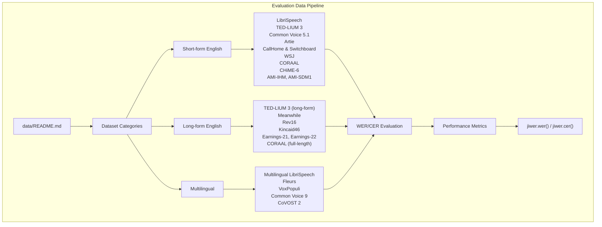
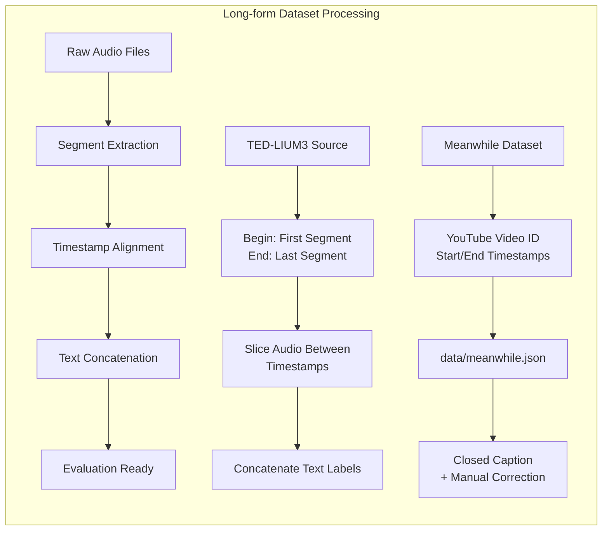
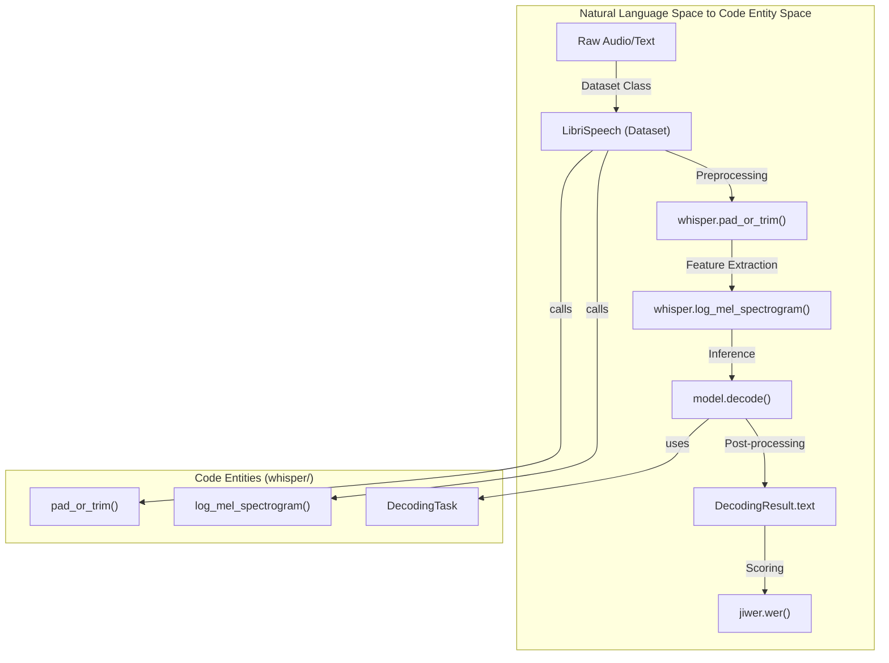

<!-- source: DeepWiki mcp.deepwiki.com · repo openai/whisper · page 5.4 Evaluation and Data · fetched 2026-10-26 -->

# Evaluation and Data

Relevant source files

The following files were used as context for generating this wiki page:

- [data/README.md](data/README.md)
- [data/meanwhile.json](data/meanwhile.json)
- [notebooks/LibriSpeech.ipynb](notebooks/LibriSpeech.ipynb)
- [notebooks/Multilingual_ASR.ipynb](notebooks/Multilingual_ASR.ipynb)

This document describes the evaluation datasets, benchmarking procedures, and data preparation methodologies used for Whisper model evaluation and research. It covers the comprehensive suite of datasets across multiple languages and domains, along with the preprocessing steps and notebook-based implementations required to prepare them for evaluation.

For information about model testing and CI/CD procedures, see [Testing](#5.2). For details about the transcription pipeline implementation, see [Transcription Pipeline](#4.1).

## Dataset Categories and Evaluation Framework

Whisper evaluation encompasses three primary dataset categories, each serving different evaluation purposes and representing distinct use cases for automatic speech recognition.

**Dataset Evaluation Framework**

Sources: [data/README.md:1-118](), [notebooks/LibriSpeech.ipynb:22-24]()

## Short-form English Datasets

Short-form datasets contain audio segments typically under 30 seconds. The repository provides specific research notebooks to demonstrate benchmarking on these datasets, notably LibriSpeech.

### LibriSpeech Benchmarking
The `LibriSpeech.ipynb` notebook implements a full evaluation loop. It uses `torchaudio.datasets.LIBRISPEECH` to fetch the `test-clean` split [notebooks/LibriSpeech.ipynb:78-82]().

**Implementation Details:**
- **Data Loading**: The `LibriSpeech` class (a `torch.utils.data.Dataset` subclass) handles audio preprocessing [notebooks/LibriSpeech.ipynb:72-95]().
- **Audio Prep**: Audio is flattened and processed via `whisper.pad_or_trim()` to ensure a 30-second window, then converted to log-Mel spectrograms via `whisper.log_mel_spectrogram()` [notebooks/LibriSpeech.ipynb:91-92]().
- **Inference**: Uses `model.decode()` with `DecodingOptions(without_timestamps=True)` for short-form prediction [notebooks/LibriSpeech.ipynb:154-202]().
- **Metrics**: Word Error Rate (WER) is calculated using the `jiwer` library [notebooks/LibriSpeech.ipynb:22-24]() for evaluation [notebooks/LibriSpeech.ipynb:22-24]().

### Academic and Conversational Datasets

| Dataset | Source | Description | Preprocessing |
|---------|---------|-------------|---------------|
| **TED-LIUM 3** | [OpenSLR](https://www.openslr.org/51/) | Test split with segmented manual transcripts | Included segmentation used [data/README.md:9-11]() |
| **WSJ** | [LDC93S6B](https://catalog.ldc.upenn.edu/LDC93S6B) | Wall Street Journal corpus | Kaldi s5 recipe [data/README.md:34-36]() |
| **CallHome** | [LDC2002S09](https://catalog.ldc.upenn.edu/LDC2002S09) | Telephone conversations | `eval2000_data_prep.sh` [data/README.md:21-23]() |
| **CORAAL** | [CORAAL](https://oraal.uoregon.edu/coraal) | African American Vernacular English | FairSpeech segmentations [data/README.md:38-40]() |

Sources: [data/README.md:3-49](), [notebooks/LibriSpeech.ipynb:72-95]()

## Long-form English Datasets

Long-form evaluation tests the model's ability to maintain coherence across extended audio.

### The Meanwhile Dataset
The `data/meanwhile.json` file serves as a reference for 64 segments from *The Late Show with Stephen Colbert* [data/README.md:71-74]().

**Data Structure in `meanwhile.json`**:
Each entry is keyed by YouTube Video ID and contains:
- `begin`: Start timestamp (e.g., "1:04.0") [data/meanwhile.json:3]()
- `end`: End timestamp (e.g., "2:11.0") [data/meanwhile.json:4]()
- `text`: Manually inspected and corrected ground truth labels [data/meanwhile.json:5]()

### Long-form Processing Pipeline

**Long-form Dataset Processing Pipeline**

Sources: [data/README.md:51-74](), [data/meanwhile.json:1-20]()

## Multilingual Datasets

Multilingual evaluation is supported through the `Multilingual_ASR.ipynb` notebook and several large-scale corpora.

### Fleurs Dataset Integration
The `Fleurs` class in the multilingual notebook wraps HuggingFace's implementation to collect audio and transcripts for 102 languages [notebooks/Multilingual_ASR.ipynb:162-167]().

**Fleurs Implementation Details:**
- **Language Selection**: Uses an `ipywidgets.Dropdown` to select from 82 supported language codes (e.g., `af_za`, `cmn_hans_cn`, `ko_kr`) [notebooks/Multilingual_ASR.ipynb:102-112]().
- **Translation Task**: Translation evaluation is performed by matching numerical utterance IDs to English transcripts [data/README.md:106-107]().

### Multilingual Data Sources

| Dataset | Purpose | Collection Method |
|---------|---------|-------------------|
| **MLS** | Multilingual ASR | Test splits from Multilingual LibriSpeech [data/README.md:100-103]() |
| **VoxPopuli** | European Languages | `get_asr_data.py` script from official repo [data/README.md:108-110]() |
| **CoVOST 2** | Speech Translation | `X into English` data collection [data/README.md:116-118]() |
| **Common Voice 9**| Broad Language ASR | Official Mozilla datasets [data/README.md:112-114]() |

Sources: [data/README.md:98-118](), [notebooks/Multilingual_ASR.ipynb:102-167]()

## Evaluation Pipeline and Code Integration

The evaluation process bridges raw data to model performance via specific code entities.

**Evaluation Code Integration Map**

### Preprocessing Command Examples

**CallHome & Switchboard WAV conversion**:
The `wav.scp` files are converted using a bash loop to pipe commands into `bash` for processing [data/README.md:25-31]().

**Selected file subsets**:
- **Rev16**: 16 specific podcast episodes (e.g., 3, 4, 9, 10) chosen to avoid sponsor-related label mismatches [data/README.md:77-79]().
- **Kincaid46 Human Benchmark**: A subset of 25 examples (e.g., Ref ID 2, 4, 5) used for human-level comparison [data/README.md:85-87]().

### Metrics Integration

| Metric | Code Implementation / Library | Application |
|--------|-------------------------------|-------------|
| **WER** | `jiwer.wer()` | Standard English ASR accuracy [notebooks/LibriSpeech.ipynb:23]() |
| **CER** | `jiwer.cer()` | Character-level accuracy for specific scripts |
| **BLEU** | `sacrebleu` | Translation quality (X-to-English) |

Sources: [data/README.md:23-31](), [data/README.md:77-87](), [notebooks/LibriSpeech.ipynb:23-95]()

---

