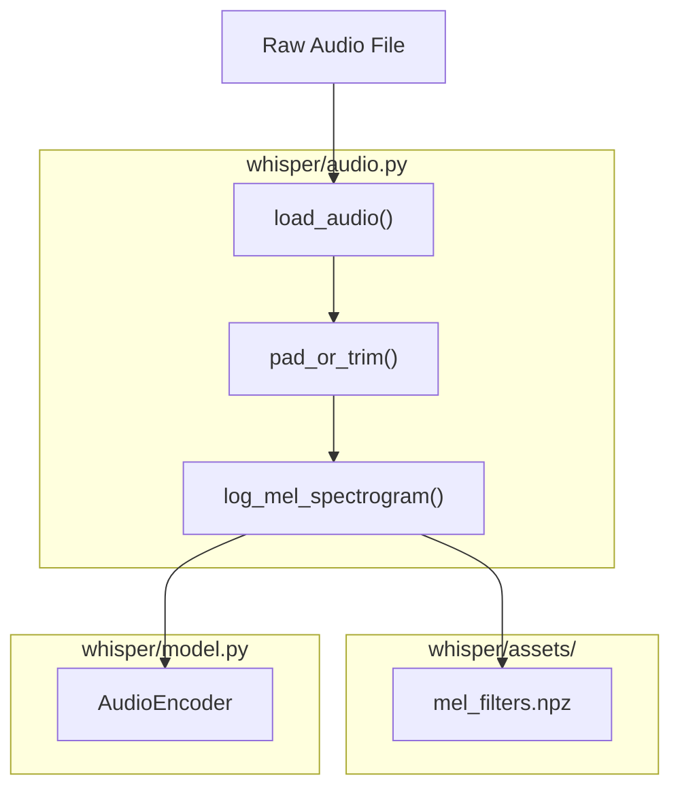
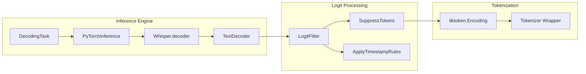

<!-- source: DeepWiki mcp.deepwiki.com · repo openai/whisper · page 6 Glossary · fetched 2026-10-26 -->

# Glossary

Relevant source files

The following files were used as context for generating this wiki page:

- [README.md](README.md)
- [whisper/audio.py](whisper/audio.py)
- [whisper/decoding.py](whisper/decoding.py)
- [whisper/model.py](whisper/model.py)
- [whisper/timing.py](whisper/timing.py)

This page provides definitions for codebase-specific terms, abbreviations, and domain concepts used throughout the Whisper repository. It serves as a technical reference for onboarding engineers to understand how high-level speech recognition concepts map to specific implementations in the code.

## Core Concepts

### 30-Second Window
Whisper processes audio in fixed-length segments of 30 seconds. If the input audio is longer, the `transcribe()` function iterates through the audio using a sliding window approach, managing "seek" points to track progress.
*   **Implementation**: Defined by `CHUNK_LENGTH` in [whisper/audio.py:16-16]().
*   **Usage**: The `transcribe` function calculates `content_frames` and manages the sliding loop in [README.md:125-125]().

### Mel Spectrogram
The input feature format for the Whisper model. It represents audio as a log-magnitude 2D image where the x-axis is time and the y-axis is frequency (Mel scale).
*   **Implementation**: Computed via `log_mel_spectrogram()` in [whisper/audio.py:110-157]().
*   **Assets**: Uses pre-computed filterbanks from `mel_filters.npz` [whisper/audio.py:105-107]().

### Task (Transcribe vs. Translate)
Whisper is a multi-task model. It can either transcribe audio into its native language or translate it directly into English.
*   **Code Entity**: Managed by `DecodingOptions.task` in [whisper/decoding.py:83-83]().
*   **Special Tokens**: Mapped to `<|transcribe|>` or `<|translate|>` tokens in [README.md:99-99]().

Sources: [whisper/audio.py:16-16](), [whisper/audio.py:105-107](), [whisper/audio.py:110-157](), [whisper/decoding.py:83-83](), [README.md:99-99](), [README.md:125-125]()

---

## Technical Terms & Jargon

| Term | Definition | Code Pointer |
| :--- | :--- | :--- |
| **SOT** | "Start of Transcript". A special token indicating the beginning of the decoding sequence. | `tokenizer.sot` [whisper/decoding.py:56-56]() |
| **EOT** | "End of Transcript". A special token indicating the completion of a segment. | `tokenizer.eot` [whisper/timing.py:181-181]() |
| **KV Cache** | Key-Value cache used to store previous hidden states during autoregressive decoding to improve performance. | `PyTorchInference.kv_cache` [whisper/decoding.py:148-148]() |
| **DTW** | Dynamic Time Warping. An algorithm used to align text tokens with audio frames to extract timestamps. | `dtw()` in [whisper/timing.py:141-151]() |
| **SDPA** | Scaled Dot Product Attention. A PyTorch-optimized attention implementation. | `SDPA_AVAILABLE` [whisper/model.py:19-22]() |
| **No Speech Prob** | The probability that a 30-second segment contains no speech. | `DecodingResult.no_speech_prob` [whisper/decoding.py:125-125]() |

Sources: [whisper/decoding.py:56-56](), [whisper/decoding.py:125-125](), [whisper/decoding.py:148-148](), [whisper/model.py:19-22](), [whisper/timing.py:141-151](), [whisper/timing.py:181-181]()

---

## Architectural Mapping

The following diagrams bridge the gap between high-level speech processing concepts and the specific classes and functions in the Whisper codebase.

### Audio Data Flow: From File to Features
This diagram shows how raw audio is transformed into the format expected by the `AudioEncoder`.

Sources: [whisper/audio.py:25-157](), [whisper/model.py:181-194]()

### Decoding Pipeline: From Features to Text
This diagram maps the natural language generation process to the code entities that handle inference and token management.

Sources: [whisper/decoding.py:144-178](), [whisper/model.py:207-215](), [whisper/tokenizer.py:131-160]()

---

## Detailed Component Definitions

### `DecodingOptions`
A dataclass that encapsulates all hyperparameters for the decoding process, including temperature, beam size, and token suppression rules.
*   **File**: [whisper/decoding.py:81-115]()

### `Alignment Heads`
Specific attention heads in the Transformer layers that have been identified to provide the best correlation between text tokens and audio timing. These are used during the DTW process.
*   **Code Pointer**: `model.alignment_heads` used in [whisper/timing.py:207-207]().

### `ResultWriter`
The base class for formatting transcription output into various file types like SRT, VTT, or JSON.
*   **File**: [whisper/utils.py:85-107]()
*   **Subclasses**: `WriteTXT` [whisper/utils.py:109](), `SubtitlesWriter` [whisper/utils.py:119]().

### `Triton Kernels`
High-performance GPU kernels written in the Triton language to accelerate specific operations like Dynamic Time Warping and Median Filtering.
*   **File**: [whisper/triton_ops.py:14-41]()
*   **Functions**: `dtw_kernel` [whisper/triton_ops.py:14](), `median_kernel` [whisper/triton_ops.py:44]().

### `Temperature Fallback`
A strategy used in `transcribe()` where the model retries decoding with a higher temperature if the initial result fails quality checks (e.g., high repetition or low log probability).
*   **Implementation**: Managed by `decode_with_fallback` within `transcribe()` [whisper/transcribe.py:184-184]().
*   **Thresholds**: Controlled by `compression_ratio_threshold` and `logprob_threshold` [whisper/transcribe.py:76-81]().

Sources: [whisper/decoding.py:81-115](), [whisper/timing.py:207-207](), [whisper/transcribe.py:76-81](), [whisper/transcribe.py:184-184](), [whisper/triton_ops.py:14-41](), [whisper/utils.py:85-107](), [whisper/utils.py:109](), [whisper/utils.py:119]()