# Page: Overview

# Overview

<details>
<summary>Relevant source files</summary>

The following files were used as context for generating this wiki page:

- [README.md](README.md)
- [language-breakdown.svg](language-breakdown.svg)
- [model-card.md](model-card.md)

</details>


## Purpose and Scope

This document provides a comprehensive overview of the Whisper speech recognition system, including its core capabilities, architecture, and key components. It serves as an entry point for understanding how the various subsystems work together to perform speech-to-text transcription and translation.

Whisper is a general-purpose speech recognition model developed by OpenAI that performs multilingual speech recognition, speech translation, and language identification. It uses a Transformer sequence-to-sequence architecture trained on 680,000 hours of diverse audio data from the internet [README.md:1-15](), [model-card.md:1-10]().

## Core Capabilities

Whisper is a multitasking model that jointly represents various speech processing tasks as a sequence of tokens to be predicted by the decoder [README.md:15-15]().

| Capability | Description | Task Specifier |
|------------|-------------|----------------|
| **Speech Recognition** | Transcribe audio to text in the original language | `transcribe` |
| **Speech Translation** | Translate non-English speech directly to English text | `translate` |
| **Language Identification** | Detect the spoken language in audio | Language Detection |

The system supports 98 different languages [model-card.md:51-51](). Performance is directly correlated with the amount of training data in a given language, with English representing 65% of the training set [model-card.md:51-53]().

**Sources:** [README.md:8-15](), [model-card.md:49-53]()

## Available Models

Whisper provides six model sizes with different parameter counts and performance characteristics. The `.en` models are specialized for English-only applications [README.md:73-73]().

| Model Size | Parameters | English-only | Multilingual | VRAM Required | Relative Speed |
|------------|------------|--------------|--------------|---------------|----------------|
| `tiny` | 39M | `tiny.en` | `tiny` | ~1 GB | ~10x |
| `base` | 74M | `base.en` | `base` | ~1 GB | ~7x |
| `small` | 244M | `small.en` | `small` | ~2 GB | ~4x |
| `medium` | 769M | `medium.en` | `medium` | ~5 GB | ~2x |
| `large` | 1550M | N/A | `large` | ~10 GB | 1x |
| `turbo` | 809M | N/A | `turbo` | ~6 GB | ~8x |

The `turbo` model is an optimized version of `large-v3` (specifically `large-v3-turbo`) designed for faster inference [model-card.md:21-22](), [README.md:74-74](). Note that the `turbo` model is not trained for translation tasks [README.md:88-88]().

**Sources:** [README.md:58-74](), [model-card.md:10-22]()

## High-Level System Architecture

### Core Processing Pipeline

The pipeline transitions from raw audio input to structured text output through several functional stages.

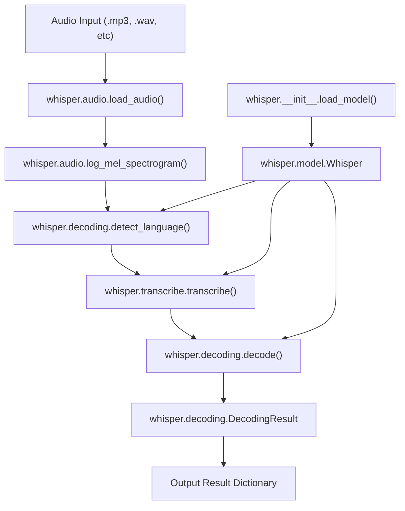
**Sources:** [README.md:113-151]()

### Model Loading and Weight Management

The `load_model` function manages the acquisition of model checkpoints and the instantiation of the `Whisper` class.

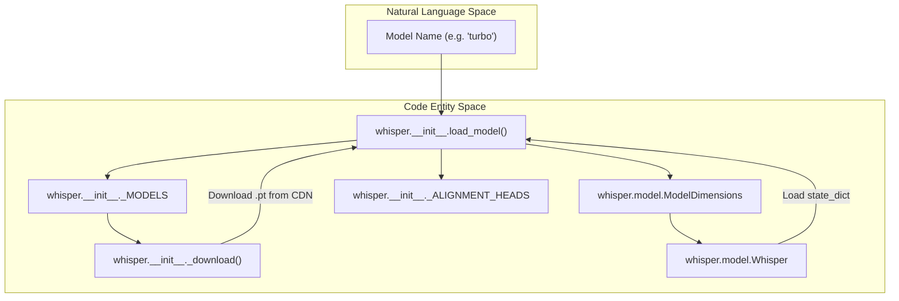
**Sources:** [README.md:113-121]()

## Key Components

### Audio Processing System
- **`load_audio`**: Uses FFmpeg to read audio files and resample to 16,000 Hz.
- **`pad_or_trim`**: Ensures the audio input matches the expected 30-second window (480,000 samples).
- **`log_mel_spectrogram`**: Computes the log-Mel spectrogram with 80 or 128 bins depending on the model version.

### Model Architecture (`whisper.model.Whisper`)
The model is an encoder-decoder Transformer [README.md:15-15]().
- **`AudioEncoder`**: A convolutional stem followed by Transformer blocks that processes the Mel spectrogram.
- **`TextDecoder`**: An autoregressive Transformer decoder that predicts text tokens, conditioned on the encoder's hidden states.
- **`ModelDimensions`**: A dataclass defining the architecture hyperparameters (layers, heads, etc.).

### Decoding and Transcription
- **`transcribe()`**: The high-level entry point that handles the sliding 30-second window logic and temperature fallback strategies [README.md:125-125]().
- **`decode()`**: A lower-level interface for running a single pass of the model on a 30-second Mel spectrogram.
- **`DecodingOptions`**: Configuration for the decoding process, such as beam size and task.

**Sources:** [README.md:125-125]()

## Usage Patterns

### High-Level API
The `transcribe()` method is recommended for most use cases as it handles long-form audio by processing it in segments.

```python
import whisper
model = whisper.load_model("turbo")
result = model.transcribe("audio.mp3")
print(result["text"])
```
**Sources:** [README.md:117-123]()

### Low-Level API
The `decode()` function provides granular control over a single 30-second audio segment.

```python
import whisper

model = whisper.load_model("turbo")
audio = whisper.load_audio("audio.mp3")
audio = whisper.pad_or_trim(audio)

mel = whisper.log_mel_spectrogram(audio).to(model.device)
_, probs = model.detect_language(mel)
options = whisper.DecodingOptions()
result = whisper.decode(model, mel, options)
```
**Sources:** [README.md:130-145]()

## System Dependencies
Whisper relies on several key external libraries for performance and functionality:
- **PyTorch**: Core neural network framework [README.md:20-20]().
- **tiktoken**: Fast BPE tokenization [README.md:20-20]().
- **FFmpeg**: Audio decoding and resampling [README.md:32-32]().
- **Numba/Triton**: Performance optimizations for specific kernels like DTW.

**Sources:** [README.md:18-56]()

---

# Page: Getting Started

# Getting Started

<details>
<summary>Relevant source files</summary>

The following files were used as context for generating this wiki page:

- [README.md](README.md)

</details>


This page provides a comprehensive guide to setting up and using the Whisper automatic speech recognition (ASR) system. This document covers installation, model selection, and basic usage through both command-line and Python interfaces.

## Installation

Whisper can be installed using `pip`, which downloads the latest stable release. The package is named `openai-whisper` on PyPI [pyproject.toml:7-7]().

```bash
pip install -U openai-whisper
```

Alternatively, you can install the latest version directly from GitHub:

```bash
pip install git+https://github.com/openai/whisper.git
```

For detailed requirements and platform-specific instructions, see [Installation](#2.1).

### Dependencies

Whisper requires several core libraries to function:

1.  **Python**: Compatible with versions 3.8 through 3.13 [pyproject.toml:13-22]().
2.  **PyTorch**: Required for model execution [requirements.txt:3-3]().
3.  **tiktoken**: OpenAI's fast BPE tokenizer [requirements.txt:6-6]().
4.  **FFmpeg**: External command-line tool required for audio processing [README.md:32-33]().
5.  **Triton**: Used for GPU acceleration on Linux x86_64 systems [requirements.txt:7-7]().

### Installation Workflow

The following diagram illustrates the setup process and dependency checks.

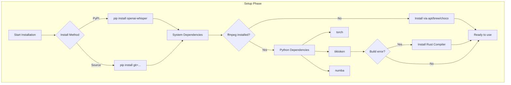

Sources: [README.md:18-55](), [requirements.txt:1-7](), [pyproject.toml:24-32]()

## Available Models

Whisper offers six model sizes with varying performance characteristics. Smaller models like `tiny` and `base` offer high speed, while `large` and `turbo` provide higher accuracy [README.md:64-71]().

| Size | Parameters | English-only model | Multilingual model | Required VRAM | Relative speed |
| :--- | :--- | :--- | :--- | :--- | :--- |
| **tiny** | 39 M | `tiny.en` | `tiny` | ~1 GB | ~10x |
| **base** | 74 M | `base.en` | `base` | ~1 GB | ~7x |
| **small** | 244 M | `small.en` | `small` | ~2 GB | ~4x |
| **medium** | 769 M | `medium.en` | `medium` | ~5 GB | ~2x |
| **large** | 1550 M | N/A | `large` | ~10 GB | 1x |
| **turbo** | 809 M | N/A | `turbo` | ~6 GB | ~8x |

The `turbo` model is an optimized version of `large-v3` [README.md:74-74](). English-only models (`.en`) generally perform better for English-specific tasks [README.md:73-73]().

Sources: [README.md:58-75]()

## Basic Usage

Whisper can be operated via the command line or integrated into Python applications. For a deep dive into options, see [Basic Usage](#2.2).

### Command-line Interface (CLI)

The CLI entry point is defined in `whisper.transcribe:cli` [pyproject.toml:35-35]().

```bash
# Basic transcription
whisper audio.mp3 --model turbo

# Transcription with language specification
whisper japanese.wav --language Japanese

# Translation to English
whisper japanese.wav --model medium --task translate
```

### Python API

The high-level `transcribe()` method manages the sliding 30-second window logic [README.md:125-125]().

```python
import whisper

# Load model into memory
model = whisper.load_model("turbo")

# Run the transcription pipeline
result = model.transcribe("audio.mp3")
print(result["text"])
```

Sources: [README.md:80-123](), [pyproject.toml:35-35]()

## System Architecture Bridge

This diagram maps the logical concepts of the speech pipeline to the specific code entities that implement them.

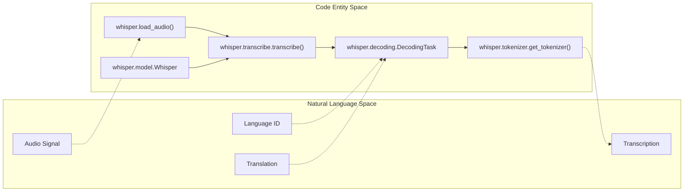

Sources: [whisper/tokenizer.py:3-3](), [whisper/transcribe.py:77-77](), [whisper/model.py:200-200](), [whisper/decoding.py:700-700]()

## Resource Navigation

- **[Installation](#2.1)**: Detailed environment setup, including `ffmpeg` and `rust` troubleshooting.
- **[Basic Usage](#2.2)**: Comprehensive guide to CLI flags and the `transcribe()` method parameters.
- **[Examples and Tutorials](#2.3)**: Links to Jupyter notebooks for LibriSpeech evaluation and multilingual ASR.
- **[API Reference](#2.4)**: Technical documentation for `load_model()`, `DecodingOptions`, and result dictionaries.

For the internal mechanics of how these components work, refer to the [Architecture](#3) section.

---

# Page: Installation

# Installation

<details>
<summary>Relevant source files</summary>

The following files were used as context for generating this wiki page:

- [.flake8](.flake8)
- [MANIFEST.in](MANIFEST.in)
- [README.md](README.md)
- [pyproject.toml](pyproject.toml)
- [requirements.txt](requirements.txt)
- [tests/test_tokenizer.py](tests/test_tokenizer.py)

</details>


This document covers the installation requirements, dependencies, and setup procedures for the Whisper speech recognition system. It provides detailed instructions for installing Whisper on various platforms and resolving common installation issues.

For information about basic usage after installation, see [Basic Usage](#2.2). For advanced configuration and API reference, see [API Reference](#2.4).

## System Requirements

Whisper requires Python 3.8 or higher and is compatible with recent PyTorch versions. The system was developed and tested with Python 3.9.9 and PyTorch 1.10.1, but maintains compatibility across a broader range of versions including Python 3.13.

### Python Version Compatibility

| Python Version | Support Status |
|---------------|----------------|
| 3.8           | Supported      |
| 3.9           | Supported      |
| 3.10          | Supported      |
| 3.11          | Supported      |
| 3.12          | Supported      |
| 3.13          | Supported      |

### Hardware Requirements

Whisper can run on both CPU and GPU. GPU acceleration is recommended for better performance, especially for larger models. The system supports CUDA-enabled GPUs with Triton acceleration on Linux x86_64 systems. Approximate VRAM requirements range from ~1 GB for `tiny` models to ~10 GB for `large` models.

Sources: [README.md:20-21](), [README.md:64-71](), [pyproject.toml:13-22]()

## Installation Methods

### Method 1: Install from PyPI (Recommended)

The simplest installation method uses the official PyPI package:

```bash
pip install -U openai-whisper
```

This command installs the latest stable release with all required dependencies.

### Method 2: Install from Git Repository

For the latest development version, install directly from the GitHub repository:

```bash
pip install git+https://github.com/openai/whisper.git
```

### Method 3: Update from Git Repository

To update an existing installation to the latest development version:

```bash
pip install --upgrade --no-deps --force-reinstall git+https://github.com/openai/whisper.git
```

## Installation Dependency Flow

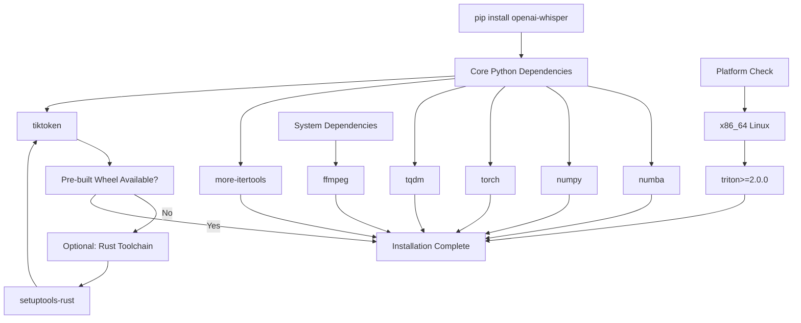

Sources: [README.md:22-30](), [requirements.txt:1-7](), [pyproject.toml:24-32]()

## Core Dependencies

### Python Package Dependencies

The following Python packages are automatically installed with Whisper as defined in the project configuration:

| Package | Purpose | Platform Notes |
|---------|---------|----------------|
| `numba` | JIT compilation for performance | All platforms |
| `numpy` | Numerical computing | All platforms |
| `torch` | Deep learning framework | All platforms |
| `tqdm` | Progress bars | All platforms |
| `more-itertools` | Extended iteration utilities | All platforms |
| `tiktoken` | Fast tokenization | May require Rust for compilation |
| `triton` | GPU acceleration | Linux x86_64 only |

### System Dependencies

#### FFmpeg Installation

Whisper requires the `ffmpeg` command-line tool for audio processing. Internally, the `whisper.load_audio` function relies on `ffmpeg` to decode and resample audio files to 16,000 Hz. Install it using your system's package manager:

```bash
# Ubuntu/Debian
sudo apt update && sudo apt install ffmpeg

# Arch Linux
sudo pacman -S ffmpeg

# macOS (Homebrew)
brew install ffmpeg

# Windows (Chocolatey)
choco install ffmpeg

# Windows (Scoop)
scoop install ffmpeg
```

Sources: [README.md:32-49](), [requirements.txt:1-7](), [pyproject.toml:24-32]()

## Platform-Specific Installation

### Linux x86_64

Linux x86_64 systems receive additional GPU acceleration through Triton. The dependency is specifically scoped to this platform in the configuration.

```bash
# Triton is automatically installed on supported platforms
pip install openai-whisper
```

The `triton>=2.0.0` package is conditionally installed based on platform detection in `pyproject.toml`.

### Other Platforms

For non-x86_64 Linux systems (e.g., Windows, macOS, or ARM Linux), Triton is excluded from installation but core functionality remains available via CPU or standard PyTorch CUDA kernels.

```bash
pip install openai-whisper
# Triton will be skipped automatically
```

Sources: [requirements.txt:7](), [pyproject.toml:31]()

## Dependency Resolution Flow

The following diagram maps the installation logic to the specific requirements and platform constraints defined in the codebase.

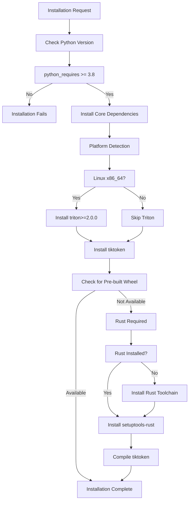

Sources: [requirements.txt:7](), [pyproject.toml:13](), [pyproject.toml:31]()

## Troubleshooting Common Issues

### Rust Installation Required

If you encounter errors related to `tiktoken` installation, it is likely because a pre-built wheel is not available for your platform, requiring a Rust compiler to build from source.

```bash
# Install Rust (follow instructions at https://rustup.rs/)
curl --proto '=https' --tlsv1.2 -sSf https://sh.rustup.rs | sh

# Configure PATH
export PATH="$HOME/.cargo/bin:$PATH"

# Install setuptools-rust if needed
pip install setuptools-rust
```

### Missing setuptools_rust

If installation fails with `No module named 'setuptools_rust'`, you must manually install the bridge between Python and Rust:

```bash
pip install setuptools-rust
```

### FFmpeg Not Found

Ensure `ffmpeg` is properly installed and available in your system PATH. Whisper's audio loading logic will fail if the binary cannot be executed.

```bash
# Test FFmpeg installation
ffmpeg -version
```

Sources: [README.md:51-55]()

## Development Dependencies

For development, testing, and contributing to the repository, additional packages are required. These are defined as optional `dev` dependencies in `pyproject.toml`.

```bash
pip install openai-whisper[dev]
```

This installs additional tools including:
- `black` - Code formatting
- `flake8` - Code linting  
- `isort` - Import sorting
- `pytest` - Testing framework (used for `tests/test_tokenizer.py` etc.)
- `scipy` - Scientific computing

Sources: [pyproject.toml:33](), [MANIFEST.in:1-5]()

## Verification

After installation, verify that Whisper is correctly installed by checking the CLI entry point defined in `pyproject.toml`.

```bash
# Check command-line interface (points to whisper.transcribe:cli)
whisper --help

# Test Python import
python -c "import whisper; print('Whisper installed successfully')"
```

The installation process is now complete. You can proceed to [Basic Usage](#2.2) to begin using Whisper for speech recognition tasks.

Sources: [README.md:104-108](), [pyproject.toml:35]()

---

# Page: Basic Usage

# Basic Usage

<details>
<summary>Relevant source files</summary>

The following files were used as context for generating this wiki page:

- [README.md](README.md)
- [whisper/__init__.py](whisper/__init__.py)
- [whisper/transcribe.py](whisper/transcribe.py)

</details>


This page provides a technical guide for using Whisper to perform speech transcription and translation, covering both the command-line interface (CLI) and the Python API (`load_model()` and `transcribe()`). For installation details, see [Installation](#2.1). For an exhaustive API specification, see [API Reference](#2.4).

Sources: [README.md:1-126](), [whisper/__init__.py:103-161](), [whisper/transcribe.py:38-126]()

---

## Command-line Interface

Whisper exposes a command-line utility via `pyproject.toml` entry points that parses terminal arguments and invokes the transcription pipeline.

### Basic Transcription

To transcribe an audio file using default settings (`turbo` model):

```bash
whisper audio.mp3
```
Sources: [README.md:80-86]()

### Specifying a Model and Language

To select an explicit model size or specify the spoken language for non-English audio:

```bash
whisper japanese.wav --model medium --language Japanese
```
Sources: [README.md:90-94]()

### Translation to English

To translate non-English audio streams into English output text, pass the `--task translate` parameter alongside a multilingual model checkpoint (`medium` or `large`):

```bash
whisper japanese.wav --model medium --language Japanese --task translate
```
Sources: [README.md:96-102]()

### Word-level Timestamps

To compute precise word timing using attention patterns and dynamic time warping:

```bash
whisper audio.mp3 --word_timestamps True
```
Sources: [whisper/transcribe.py:91-93]()

Sources: [README.md:80-111](), [whisper/transcribe.py:91-93]()

---

## Python API Usage

### High-level Transcription

In Python, transcription is orchestrated by loading a model via `whisper.load_model()` and invoking `model.transcribe()`:

```python
import whisper

model = whisper.load_model("turbo")
result = model.transcribe("audio.mp3")
print(result["text"])
```
Sources: [README.md:113-123]()

Internally, `transcribe()` [whisper/transcribe.py:38]() reads the input audio, chunks it into a sliding 30-second window loop, and executes autoregressive sequence-to-sequence predictions [README.md:125]().

Sources: [README.md:113-126](), [whisper/transcribe.py:38-126]()

---

## Lower-level Audio Processing

For fine-grained control over model inference, developers can invoke lower-level pipeline components directly without using `transcribe()`.

Title: Lower-Level Audio Preprocessing and Decoding Data Flow
```mermaid
flowchart TD
    AudioFile[""audio file path""] --> LoadAudio[""whisper.load_audio()""]
    LoadAudio --> AudioArray[""np.ndarray audio""]
    AudioArray --> LogMelSpec[""whisper.log_mel_spectrogram()""]
    LogMelSpec --> MelTensor[""mel spectrogram tensor""]
    
    MelTensor --> PadOrTrim[""whisper.pad_or_trim()""]
    PadOrTrim --> DetectLanguage[""Whisper.detect_language()""]
    DetectLanguage --> LanguageProbs[""language probabilities""]
    
    MelTensor --> ModelDecode[""whisper.decode()""]
    DecodingOptions[""DecodingOptions""] --> ModelDecode
    ModelDecode --> DecodingResult[""DecodingResult""]
    
    subgraph WhisperModel["""Whisper model instance""]
        DetectLanguage
        ModelDecode
    end
```
Sources: [README.md:129-151](), [whisper/__init__.py:11-14]()

### Step-by-Step Execution Example

```python
import whisper

# 1. Load the model checkpoint
model = whisper.load_model("turbo")

# 2. Load and preprocess raw waveform
audio = whisper.load_audio("audio.mp3")
audio = whisper.pad_or_trim(audio)
mel = whisper.log_mel_spectrogram(audio, n_mels=model.dims.n_mels).to(model.device)

# 3. Detect language
_, probs = model.detect_language(mel)
detected_language = max(probs, key=probs.get)
print(f"Detected language: {detected_language}")

# 4. Run decoding
options = whisper.DecodingOptions()
result = whisper.decode(model, mel, options)
print(result.text)
```
Sources: [README.md:129-151](), [whisper/transcribe.py:138-140]()

Sources: [README.md:129-151](), [whisper/__init__.py:11-14](), [whisper/transcribe.py:138-140]()

---

## Key Functions and Parameters

### `load_model(name, device, download_root, in_memory)`
Defined in `whisper/__init__.py` [whisper/__init__.py:103](), `load_model()` fetches model weights from remote URLs (stored in `_MODELS`) or a local checkpoint file, instantiates `Whisper` [whisper/model.py] using `ModelDimensions`, and moves it to the target PyTorch `device`.

### `transcribe(model, audio, ...)`
Defined in `whisper/transcribe.py` [whisper/transcribe.py:38](), `transcribe()` handles end-to-end processing:
1. **Audio Preprocessing**: Converts input paths or arrays into a log-Mel spectrogram via `log_mel_spectrogram()` [whisper/transcribe.py:139]().
2. **Language Identification**: Automatically detects spoken language over the initial 30-second window if unspecified [whisper/transcribe.py:143-153]().
3. **Sliding Window Loop**: Iterates across 30-second audio segments [whisper/transcribe.py:172]().
4. **Fallback Handling**: Executes decoding via `decode_with_fallback()` with temperature schedules upon compression ratio or log-probability failures [whisper/transcribe.py:184-244]().

### Important `transcribe()` Parameters

| Parameter | Type | Description |
|-----------|------|-------------|
| `model` | `Whisper` | The model instance initialized via `load_model()` [whisper/transcribe.py:62-63]() |
| `audio` | `Union[str, np.ndarray, torch.Tensor]` | File path, NumPy waveform array, or PyTorch Tensor [whisper/transcribe.py:65-66]() |
| `temperature` | `Union[float, Tuple[float, ...]]` | Sampling temperature schedule for fallback retries [whisper/transcribe.py:72-75]() |
| `compression_ratio_threshold` | `float` | Gzip compression ratio threshold to trigger fallback retries [whisper/transcribe.py:76-77]() |
| `logprob_threshold` | `float` | Average log probability threshold for segment rejection [whisper/transcribe.py:79-80]() |
| `word_timestamps` | `bool` | Enables cross-attention and DTW alignment extraction [whisper/transcribe.py:91-93]() |
| `initial_prompt` | `Optional[str]` | Prefix text providing task context or vocabulary hints [whisper/transcribe.py:101-104]() |

Sources: [whisper/__init__.py:103-135](), [whisper/transcribe.py:38-126]()

---

## Transcription Workflow Implementation

Title: Transcribe Pipeline Architecture and Code Entity Mapping
```mermaid
flowchart TD
    Start[""transcribe(model, audio)""] --> Mel[""log_mel_spectrogram()""]
    Mel --> LangCheck{""Language specified?"}
    
    LangCheck -- No --> Detect[""Whisper.detect_language(mel_segment)""]
    LangCheck -- Yes --> Tokenize[""get_tokenizer()""]
    Detect --> Tokenize
    
    Tokenize --> Loop[""Main Loop: seek_clips""]
    
    subgraph SegmentProcessing[""Segment Processing Pipeline""]
        Loop --> Fallback[""decode_with_fallback(mel_segment)""]
        Fallback --> Result[""DecodingResult""]
    end
    
    Result --> WordTS{""word_timestamps?"}
    WordTS -- Yes --> AddTS[""add_word_timestamps()""]
    WordTS -- No --> NewSeg[""new_segment()""]
    AddTS --> NewSeg
    
    NewSeg --> EndCheck{""End of audio?"}
    EndCheck -- No --> Loop
    EndCheck -- Yes --> Final[""Return dict(text, segments, language)""]
```
Sources: [whisper/transcribe.py:38-514](), [whisper/transcribe.py:139](), [whisper/transcribe.py:152](), [whisper/transcribe.py:161](), [whisper/transcribe.py:184](), [whisper/transcribe.py:307]()

Sources: [whisper/transcribe.py:38-514]()

---

## Model Selection Guidelines

| Model Size | Parameters | English-only Model | Multilingual Model | Required VRAM | Relative Speed |
|------------|------------|--------------------|--------------------|---------------|----------------|
| `tiny` | 39 M | `tiny.en` [README.md:66]() | `tiny` [README.md:66]() | ~1 GB [README.md:66]() | ~10x [README.md:66]() |
| `base` | 74 M | `base.en` [README.md:67]() | `base` [README.md:67]() | ~1 GB [README.md:67]() | ~7x [README.md:67]() |
| `small` | 244 M | `small.en` [README.md:68]() | `small` [README.md:68]() | ~2 GB [README.md:68]() | ~4x [README.md:68]() |
| `medium` | 769 M | `medium.en` [README.md:69]() | `medium` [README.md:69]() | ~5 GB [README.md:69]() | ~2x [README.md:69]() |
| `large` | 1550 M | N/A [README.md:70]() | `large` [README.md:70]() | ~10 GB [README.md:70]() | 1x [README.md:70]() |
| `turbo` | 809 M | N/A [README.md:71]() | `turbo` [README.md:71]() | ~6 GB [README.md:71]() | ~8x [README.md:71]() |

Sources: [README.md:58-75]()

---

# Page: Examples and Tutorials

# Examples and Tutorials

<details>
<summary>Relevant source files</summary>

The following files were used as context for generating this wiki page:

- [notebooks/LibriSpeech.ipynb](notebooks/LibriSpeech.ipynb)
- [notebooks/Multilingual_ASR.ipynb](notebooks/Multilingual_ASR.ipynb)

</details>


This page provides comprehensive examples and interactive tutorials demonstrating Whisper's capabilities for speech recognition, translation, and analysis. The tutorials cover both English-only and multilingual scenarios, with practical code examples for common use cases including performance evaluation and word-level timing extraction.

For basic API usage without detailed examples, see [Basic Usage](). For complete API documentation, see [API Reference]().

## Tutorial Overview

The Whisper repository includes several Jupyter notebooks that demonstrate key functionality through hands-on examples. These tutorials are designed to be run in Google Colab or local Jupyter environments and provide practical implementations of common speech recognition workflows.

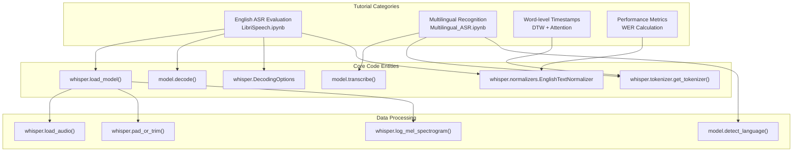

**Sources:** [notebooks/LibriSpeech.ipynb:1-240](), [notebooks/Multilingual_ASR.ipynb:1-161]()

## English Speech Recognition Tutorial

The LibriSpeech tutorial demonstrates systematic evaluation of Whisper models on the standard LibriSpeech test-clean dataset. This example shows how to process audio in batches and calculate word error rates (WER) for performance assessment.

### Dataset Integration and Preprocessing

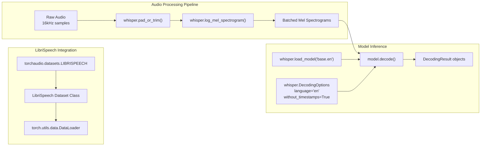

The tutorial implements a custom dataset wrapper `LibriSpeech` [notebooks/LibriSpeech.ipynb:72-95]() that handles the LibriSpeech format and ensures consistent 30-second audio segments through `whisper.pad_or_trim()` [notebooks/LibriSpeech.ipynb:91-91](). The preprocessing converts audio to mel spectrograms using `whisper.log_mel_spectrogram()` [notebooks/LibriSpeech.ipynb:92-92]() before batch inference.

**Sources:** [notebooks/LibriSpeech.ipynb:72-95](), [notebooks/LibriSpeech.ipynb:140-155]()

### Performance Evaluation with Text Normalization

The evaluation pipeline demonstrates proper text normalization for accurate WER calculation:

| Processing Step | Code Entity | Purpose |
|----------------|-------------|---------|
| Model Loading | `whisper.load_model("base.en")` | Load English-only model [notebooks/LibriSpeech.ipynb:140-140]() |
| Decoding Options | `whisper.DecodingOptions(language="en", without_timestamps=True)` | Configure inference parameters [notebooks/LibriSpeech.ipynb:154-154]() |
| Batch Inference | `model.decode(mels, options)` | Process batched spectrograms [notebooks/LibriSpeech.ipynb:202-202]() |
| Evaluation Metric | `jiwer.wer()` | Compute word error rate [notebooks/LibriSpeech.ipynb:23-23]() |

**Sources:** [notebooks/LibriSpeech.ipynb:140-155](), [notebooks/LibriSpeech.ipynb:198-204]()

## Multilingual Recognition and Translation

The multilingual tutorial showcases Whisper's ability to handle diverse languages using the FLEURS dataset. This example demonstrates both transcription and translation capabilities with interactive language selection.

### Language-Specific Processing Workflow

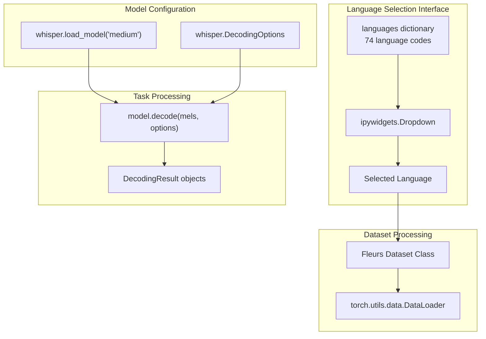

The tutorial handles 74 different languages [notebooks/Multilingual_ASR.ipynb:104-104]() with automatic dataset downloading and processing via a custom `Fleurs` class [notebooks/Multilingual_ASR.ipynb:162-166](). The `download` function [notebooks/Multilingual_ASR.ipynb:150-160]() is used to fetch the dataset files.

**Sources:** [notebooks/Multilingual_ASR.ipynb:102-113](), [notebooks/Multilingual_ASR.ipynb:150-160](), [notebooks/Multilingual_ASR.ipynb:162-170]()

## Benchmark Data Reference

The repository provides details on various datasets used for evaluation to ensure reproducibility.

| Dataset Category | Datasets Included | Source |
|------------------|-------------------|--------|
| Short-form English | LibriSpeech, TED-LIUM 3, Common Voice 5.1, Artie, WSJ, CORAAL, CHiME-6, AMI | [data/README.md:3-50]() |
| Long-form English | TED-LIUM 3 (sliced), Meanwhile, Rev16, Kincaid46, Earnings-21/22 | [data/README.md:51-97]() |
| Multilingual | Multilingual LibriSpeech (MLS), Fleurs, VoxPopuli, Common Voice 9, CoVOST 2 | [data/README.md:98-118]() |

The `meanwhile.json` file provides specific metadata for the "Meanwhile" dataset, including YouTube video IDs and precise `begin`/`end` timestamps for evaluation segments [data/meanwhile.json:1-30]().

**Sources:** [data/README.md:1-118](), [data/meanwhile.json:1-30]()

---

# Page: API Reference

# API Reference

<details>
<summary>Relevant source files</summary>

The following files were used as context for generating this wiki page:

- [whisper/__init__.py](whisper/__init__.py)
- [whisper/decoding.py](whisper/decoding.py)

</details>


This document provides comprehensive reference documentation for Whisper's public Python API and command-line interface. It covers all functions, classes, and configuration options available for speech recognition and transcription tasks.

For installation instructions, see [Installation](#2.1). For basic usage examples, see [Basic Usage](#2.2). For detailed implementation information, see [Architecture](#3).

## API Overview

The Whisper API is organized into several functional areas: model management, audio processing, transcription, and decoding. All public functions are accessible through the main `whisper` module.

Whisper API Entry Points
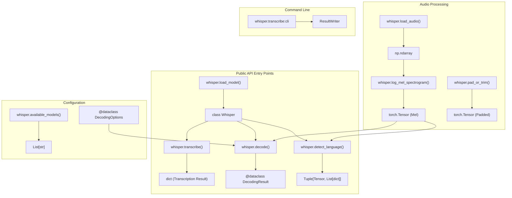

Sources: [whisper/__init__.py:1-15]()

## Model Loading

### `whisper.load_model()`

Loads a Whisper ASR model instance from either a pre-trained model name or a checkpoint file.

```python
def load_model(
    name: str,
    device: Optional[Union[str, torch.device]] = None,
    download_root: str = None,
    in_memory: bool = False,
) -> Whisper
```

**Parameters:**
- `name`: Model name from `available_models()` or path to checkpoint file [whisper/__init__.py:114-116]().
- `device`: PyTorch device (`"cuda"`, `"cpu"`, or `torch.device`). Defaults to CUDA if available [whisper/__init__.py:130-131]().
- `download_root`: Directory to cache downloaded models (default: `~/.cache/whisper`) [whisper/__init__.py:132-134]().
- `in_memory`: Whether to load model weights into memory instead of disk [whisper/__init__.py:122]().

**Returns:** `Whisper` model instance ready for inference [whisper/__init__.py:126-127]().

**Example:**
```python
import whisper
model = whisper.load_model("turbo")
model_on_cpu = whisper.load_model("base", device="cpu")
```

### `whisper.available_models()`

Returns the list of available pre-trained model names.

```python
def available_models() -> List[str]
```

**Returns:** List of model names: `["tiny.en", "tiny", "base.en", "base", "small.en", "small", "medium.en", "medium", "large-v1", "large-v2", "large-v3", "large", "large-v3-turbo", "turbo"]` [whisper/__init__.py:17-32](), [whisper/__init__.py:98-100]().

Sources: [whisper/__init__.py:17-51](), [whisper/__init__.py:103-161]()

## Transcription API

### `whisper.transcribe()`

The main transcription function that processes audio files or arrays and returns transcribed text with optional word-level timestamps. It handles long-form audio by sliding a 30-second window [whisper/transcribe.py:38-56]().

```python
def transcribe(
    model: "Whisper",
    audio: Union[str, np.ndarray, torch.Tensor],
    *,
    verbose: Optional[bool] = None,
    temperature: Union[float, Tuple[float, ...]] = (0.0, 0.2, 0.4, 0.6, 0.8, 1.0),
    compression_ratio_threshold: Optional[float] = 2.4,
    logprob_threshold: Optional[float] = -1.0,
    no_speech_threshold: Optional[float] = 0.6,
    condition_on_previous_text: bool = True,
    initial_prompt: Optional[str] = None,
    carry_initial_prompt: bool = False,
    word_timestamps: bool = False,
    prepend_punctuations: str = "\"'"¿([{-",
    append_punctuations: str = "\"'.。,，!！?？:：")]}、",
    clip_timestamps: Union[str, List[float]] = "0",
    hallucination_silence_threshold: Optional[float] = None,
    **decode_options,
) -> dict
```

**Core Parameters:**
- `model`: `Whisper` model instance [whisper/transcribe.py:62-63]().
- `audio`: Audio file path, numpy array, or torch tensor [whisper/transcribe.py:65-66]().
- `verbose`: Controls progress display (`True`, `False`, or `None`) [whisper/transcribe.py:68-70]().
- `temperature`: Sampling temperature(s) for fallback strategy [whisper/transcribe.py:72-74]().
- `word_timestamps`: Extract word-level timing information using cross-attention patterns [whisper/transcribe.py:91-93]().

**Quality Control:**
- `compression_ratio_threshold`: Detect repetitive output (default: 2.4) [whisper/transcribe.py:76-77]().
- `logprob_threshold`: Detect low-confidence output (default: -1.0) [whisper/transcribe.py:79-80]().
- `no_speech_threshold`: Detect silent segments (default: 0.6) [whisper/transcribe.py:82-85]().
- `hallucination_silence_threshold`: Skip silent periods in word timestamps [whisper/transcribe.py:118-120]().

**Text Processing:**
- `condition_on_previous_text`: Use previous output as context [whisper/transcribe.py:86-89]().
- `initial_prompt`: Custom vocabulary or context prompt [whisper/transcribe.py:101-104]().
- `carry_initial_prompt`: Prepend initial prompt to each segment [whisper/transcribe.py:106-110]().

**Segmentation:**
- `clip_timestamps`: Process specific time ranges [whisper/transcribe.py:114-116]().

**Returns:** Dictionary containing `"text"`, `"segments"`, and detected `"language"` [whisper/transcribe.py:122-126]().

Sources: [whisper/transcribe.py:38-126]()

### Transcription Result Format

Transcription Data Structure
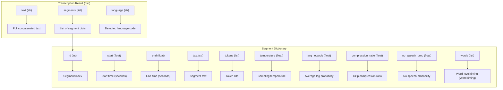

Sources: [whisper/transcribe.py:246-261](), [whisper/transcribe.py:510-514]()

## Audio Processing API

### `whisper.load_audio()`
Loads audio from various file formats and converts to a numpy array at the required 16kHz sample rate [whisper/audio.py]().

### `whisper.log_mel_spectrogram()`
Converts audio to log-mel spectrogram for model input [whisper/audio.py]().
- `n_mels`: Number of mel filter banks (default 80, or 128 for large-v3) [whisper/audio.py]().

### `whisper.pad_or_trim()`
Pads or trims audio to exactly 30 seconds (480,000 samples) [whisper/audio.py]().

Sources: [whisper/__init__.py:11](), [whisper/audio.py]()

## Decoding API

### `whisper.decode()`
Low-level decoding function for single 30-second audio segments [whisper/decoding.py]().

```python
def decode(model: "Whisper", mel: torch.Tensor, options: DecodingOptions) -> DecodingResult
```

### `whisper.detect_language()`
Detects the spoken language in an audio segment by inspecting the first token logits [whisper/decoding.py:19-33]().

```python
def detect_language(
    model: "Whisper", mel: Tensor, tokenizer: Tokenizer = None
) -> Tuple[Tensor, List[dict]]
```

**Returns:** Tuple of `language_tokens` (most probable ID) and `language_probs` (full distribution) [whisper/decoding.py:27-33]().

Sources: [whisper/__init__.py:12](), [whisper/decoding.py:19-77]()

## Configuration Objects

### `DecodingOptions`
Configuration for the decoding process [whisper/decoding.py:80-115]().

| Field | Type | Description |
| :--- | :--- | :--- |
| `task` | `str` | `"transcribe"` or `"translate"` [whisper/decoding.py:83]() |
| `language` | `Optional[str]` | Language code (e.g., `"en"`, `"jp"`) [whisper/decoding.py:86]() |
| `temperature` | `float` | Sampling temperature [whisper/decoding.py:89]() |
| `sample_len` | `Optional[int]` | Max tokens to sample [whisper/decoding.py:90]() |
| `beam_size` | `Optional[int]` | Number of beams for beam search [whisper/decoding.py:92]() |
| `prompt` | `Optional[Union[str, List[int]]]` | Previous context [whisper/decoding.py:101]() |
| `prefix` | `Optional[Union[str, List[int]]]` | Current context prefix [whisper/decoding.py:102]() |
| `suppress_blank` | `bool` | Suppress empty output [whisper/decoding.py:107]() |
| `without_timestamps` | `bool` | Use `<|notimestamps|>` token [whisper/decoding.py:110]() |

### `DecodingResult`
Result object returned by the `decode` function [whisper/decoding.py:117-128]().

**Fields:** `audio_features`, `language`, `language_probs`, `tokens`, `text`, `avg_logprob`, `no_speech_prob`, `temperature`, `compression_ratio`.

Sources: [whisper/decoding.py:80-128]()

## Command Line Interface

### `whisper` Command
The CLI entry point provides access to the transcription pipeline [whisper/transcribe.py:517-623]().

**Example Usage:**
```bash
# Basic transcription using the turbo model
whisper audio.mp3 --model turbo

# Translation to English
whisper spanish.wav --task translate --model medium

# Outputting word-level timestamps to JSON
whisper audio.wav --word_timestamps True --output_format json
```

Sources: [whisper/transcribe.py:517-623]()

## API Usage Patterns

### Basic Transcription Flow

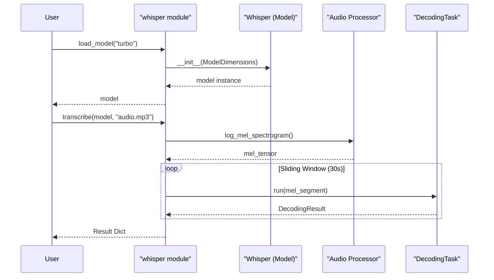

Sources: [whisper/transcribe.py:138-244](), [whisper/decoding.py:218-240]()

---

# Page: Architecture

# Architecture

<details>
<summary>Relevant source files</summary>

The following files were used as context for generating this wiki page:

- [whisper/model.py](whisper/model.py)

</details>


This page provides a high-level overview of Whisper's internal architecture and core components. Whisper is an encoder-decoder Transformer designed for robust speech recognition and translation, trained on a diverse dataset of 680,000 hours of multilingual and multitask supervised data.

## Complete System Architecture

Whisper implements a comprehensive speech-to-text system with a transformer-based encoder-decoder neural network at its core. The architecture consists of multiple interconnected subsystems that handle audio processing, model inference, tokenization, decoding, and output generation.

### High-Level System Flow

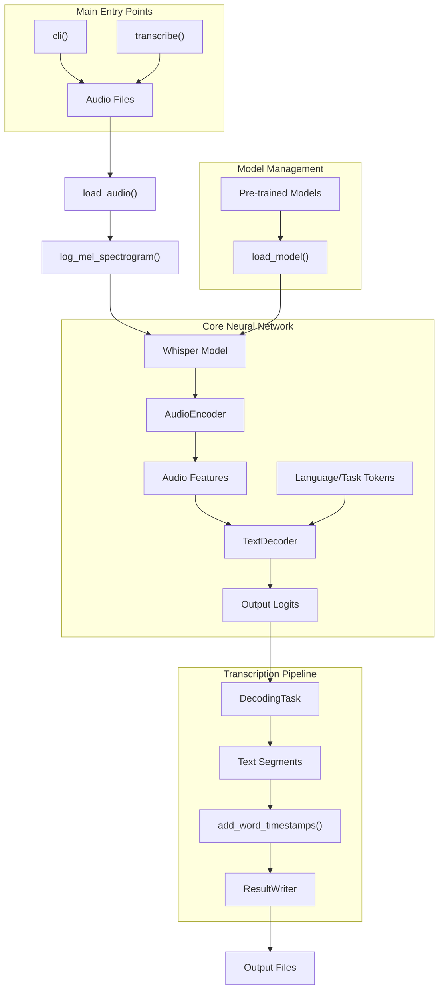

Sources: [whisper/model.py:252-307](), [whisper/audio.py:25-62](), [whisper/transcribe.py:38-305](), [whisper/decoding.py:596-646](), [whisper/tokenizer.py:114-159](), [whisper/timing.py:246-302](), [whisper/utils.py:136-160](), [whisper/__init__.py:140-161]()

## Core Components

The following sections summarize the primary architectural pillars of the repository.

### Model Architecture
The neural network is a standard Transformer encoder-decoder. The `AudioEncoder` (`[whisper/model.py:181-196]()`) processes mel spectrograms through a convolutional stem followed by `ResidualAttentionBlock` layers (`[whisper/model.py:149-179]()`). The `TextDecoder` is an autoregressive Transformer that attends to the encoder's output using cross-attention. Configuration is managed via the `ModelDimensions` dataclass (`[whisper/model.py:25-37]()`).
For details, see [Model Architecture](#3.1).

Sources: [whisper/model.py:25-37](), [whisper/model.py:81-147](), [whisper/model.py:149-179](), [whisper/model.py:181-196]()

### Audio Processing
Whisper operates on 16kHz mono audio. The pipeline involves loading audio via FFmpeg, padding or trimming to 30-second chunks (`N_SAMPLES`), and computing an 80 or 128-channel log-mel spectrogram using a pre-computed filterbank asset (`mel_filters.npz`).
For details, see [Audio Processing](#3.2).

Sources: [whisper/audio.py:12-23](), [whisper/audio.py:65-88](), [whisper/audio.py:110-157]()

### Tokenization
Whisper uses Byte-Pair Encoding (BPE) via `tiktoken` for text representation. It supports both English-only and multilingual tokenizers initialized through `get_tokenizer()`. The vocabulary includes special tokens for task control (transcribe/translate), language identification, and timestamp boundaries.
For details, see [Tokenization](#3.3).

Sources: [whisper/tokenizer.py:114-159](), [whisper/tokenizer.py:252-273]()

### Decoding System
The decoding system orchestrates the generation of text from audio features. It supports greedy decoding and beam search, managed by the `DecodingTask` class (`[whisper/decoding.py:596-646]()`). It includes sophisticated logit filters like `SuppressBlank` and `ApplyTimestampRules` to ensure high-quality output.
For details, see [Decoding System](#3.4).

Sources: [whisper/decoding.py:81-115](), [whisper/decoding.py:236-258](), [whisper/decoding.py:596-646]()

### Word Timestamps
Whisper can provide word-level timing by analyzing cross-attention weights between the audio and text via `find_alignment()` and `add_word_timestamps()`. It uses Dynamic Time Warping (DTW) to align the generated tokens with the audio frames, even in the presence of non-linear speech rates.
For details, see [Word Timestamps](#3.5).

Sources: [whisper/timing.py:73-138](), [whisper/timing.py:246-302]()

## Code Entity Map

The following diagram maps the high-level conceptual components to their specific implementations in the codebase.

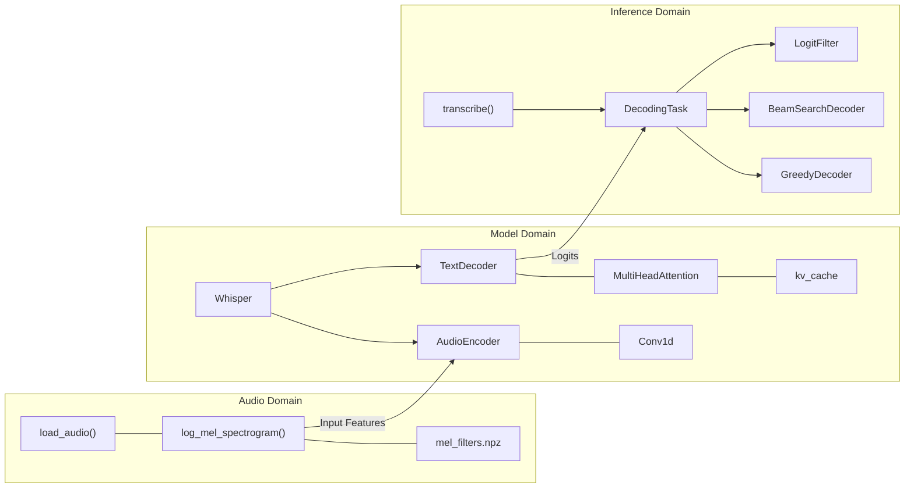

Sources: [whisper/model.py:252-307](), [whisper/audio.py:110-157](), [whisper/decoding.py:596-646](), [whisper/transcribe.py:38-305]()

---

# Page: Model Architecture

# Model Architecture

<details>
<summary>Relevant source files</summary>

The following files were used as context for generating this wiki page:

- [whisper/model.py](whisper/model.py)

</details>


This document provides a detailed technical overview of the Whisper neural network architecture, including the core components, data flow, and implementation details of the sequence-to-sequence transformer model used for speech recognition and translation.

For information about the audio preprocessing pipeline that feeds into this model, see [Audio Processing](#3.2). For details on the token generation process that uses this model, see [Decoding System](#3.4).

## Overview

The Whisper model implements a sequence-to-sequence transformer architecture consisting of an audio encoder and a text decoder. The encoder processes mel spectrogram representations of audio into feature vectors, while the decoder generates text tokens using cross-attention to the encoded audio features.

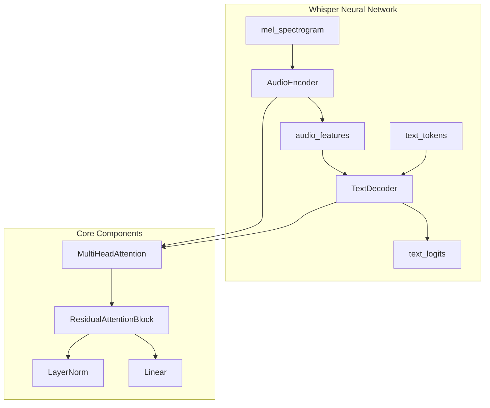

Sources: [whisper/model.py:252-346]()

## Model Dimensions and Configuration

The `ModelDimensions` dataclass defines the architectural parameters for different model sizes. These dimensions govern the width, depth, and attention head counts for both the encoder and decoder.

| Component | Description |
|-----------|-------------|
| `n_mels` | Number of Mel frequency bins in input spectrograms |
| `n_audio_ctx` | Maximum audio context length (time steps) |
| `n_audio_state` | Hidden state dimension of the audio encoder |
| `n_audio_head` | Number of attention heads in the audio encoder |
| `n_audio_layer` | Number of transformer layers in the audio encoder |
| `n_vocab` | Vocabulary size of the text decoder |
| `n_text_ctx` | Maximum text context length (tokens) |
| `n_text_state` | Hidden state dimension of the text decoder |
| `n_text_head` | Number of attention heads in the text decoder |
| `n_text_layer` | Number of transformer layers in the text decoder |

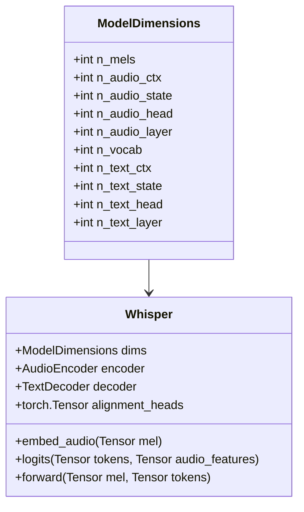

Sources: [whisper/model.py:25-37](), [whisper/model.py:252-270]()

## Audio Encoder Architecture

The `AudioEncoder` class implements the acoustic model. It consists of a convolutional stem followed by a series of transformer blocks. It uses sinusoidal positional embeddings to provide temporal information.


The encoder implementation includes:
- **Convolutional stem**: Two 1D convolution layers. The second layer uses a stride of 2, effectively downsampling the temporal dimension by half [whisper/model.py:186-187]().
- **Positional encoding**: Fixed sinusoidal embeddings generated by `sinusoids()` and registered as a buffer [whisper/model.py:62-68](), [whisper/model.py:188-188]().
- **Transformer blocks**: A sequence of `ResidualAttentionBlock` instances [whisper/model.py:190-192]().
- **Normalization**: A final `LayerNorm` is applied to the output of the transformer stack [whisper/model.py:193-193]().

Sources: [whisper/model.py:181-205](), [whisper/model.py:62-68]()

## Text Decoder Architecture

The `TextDecoder` class generates text tokens autoregressively. It utilizes learned token and positional embeddings and attends to the encoder's output via cross-attention.

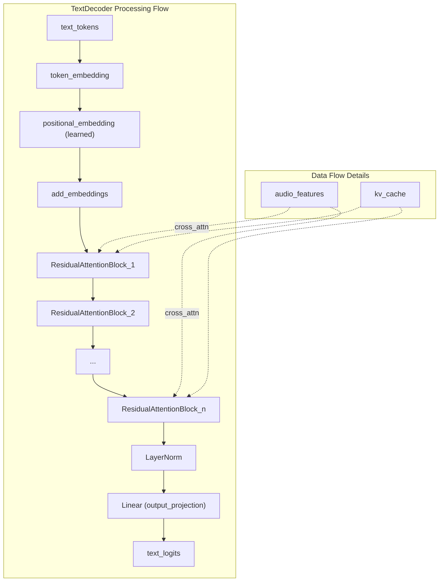

Key decoder features:
- **Embeddings**: Uses standard `nn.Embedding` for tokens and a learned `nn.Parameter` for positional embeddings [whisper/model.py:213-214]().
- **Cross-attention**: Each `ResidualAttentionBlock` in the decoder includes a `cross_attn` module to process the encoder's `audio_features` [whisper/model.py:149-160]().
- **Inference Optimization**: Supports `kv_cache` to avoid recomputing keys and values for previously generated tokens during autoregressive decoding [whisper/model.py:97-110](), [whisper/model.py:172-176]().

Sources: [whisper/model.py:207-249](), [whisper/model.py:149-178]()

## Attention Mechanisms and SDPA

Whisper's `MultiHeadAttention` implementation supports modern hardware acceleration via PyTorch's `scaled_dot_product_attention` (SDPA).

```mermaid
graph TB
    subgraph "MultiHeadAttention.forward"
        A["input x"] --> B["Linear query"]
        C["input xa (optional)"] --> D["Linear key"]
        C --> E["Linear value"]
        
        B --> F["qkv_attention"]
        D --> F
        E --> F
        
        F --> G["SDPA Path (if available)"]
        F --> H["Manual Softmax Path"]
        
        G --> I["Linear out"]
        H --> I
    end
```

- **SDPA Support**: If `torch.nn.functional.scaled_dot_product_attention` is available and `MultiHeadAttention.use_sdpa` is True, Whisper uses the optimized kernel [whisper/model.py:123-134]().
- **Causal Masking**: For self-attention in the decoder, a mask is applied to ensure tokens only attend to previous positions [whisper/model.py:131-133]().
- **KV Caching Logic**: If a `kv_cache` dictionary is provided, the model stores and retrieves key/value tensors to accelerate inference [whisper/model.py:101-110]().

Sources: [whisper/model.py:81-147](), [whisper/model.py:16-22]()

## Residual Attention Blocks

The `ResidualAttentionBlock` is the fundamental building block of both the encoder and decoder. It follows the Pre-LN transformer variant where layer normalization is applied before the attention and MLP sub-layers.

| Sub-layer | Description |
|-----------|-------------|
| `attn` | Multi-head self-attention [whisper/model.py:153-153]() |
| `cross_attn` | Multi-head cross-attention (decoder only) [whisper/model.py:156-159]() |
| `mlp` | Feed-forward network: Linear (4x) -> GELU -> Linear [whisper/model.py:161-164]() |

```mermaid
graph TD
    X["input x"] --> LN1["attn_ln (LayerNorm)"]
    LN1 --> AT["attn (MultiHeadAttention)"]
    AT --> ADD1["x + attn_out"]
    
    ADD1 --> LN2["cross_attn_ln (LayerNorm)"]
    LN2 --> CAT["cross_attn (MultiHeadAttention)"]
    CAT --> ADD2["x + cross_attn_out"]
    
    ADD2 --> LN3["mlp_ln (LayerNorm)"]
    LN3 --> MLP["mlp (Sequential)"]
    MLP --> ADD3["x + mlp_out"]
    
    ADD3 --> OUT["output"]
```

Sources: [whisper/model.py:149-178](), [whisper/model.py:39-51]()

## Model Integration

The `Whisper` class provides the high-level API for interacting with the model.

- **`embed_audio(mel)`**: Runs the encoder to produce audio features [whisper/model.py:287-296]().
- **`logits(tokens, audio_features)`**: Runs the decoder for a given set of tokens and audio features [whisper/model.py:302-308]().
- **`forward(mel, tokens)`**: A full pass used primarily for training or single-step logit calculation [whisper/model.py:310-313]().
- **`install_kv_cache_hooks()`**: A utility to setup the model for efficient incremental decoding by attaching hooks that manage the `kv_cache` [whisper/model.py:321-346]().

Sources: [whisper/model.py:252-346]()

---

# Page: Audio Processing

# Audio Processing

<details>
<summary>Relevant source files</summary>

The following files were used as context for generating this wiki page:

- [tests/test_audio.py](tests/test_audio.py)
- [whisper/__main__.py](whisper/__main__.py)
- [whisper/assets/mel_filters.npz](whisper/assets/mel_filters.npz)
- [whisper/audio.py](whisper/audio.py)
- [whisper/normalizers/__init__.py](whisper/normalizers/__init__.py)

</details>


This document covers the audio preprocessing pipeline in Whisper, which transforms raw audio files into mel spectrograms suitable for neural network processing. The audio processing system handles audio loading, format conversion, resampling, and feature extraction through mel spectrogram computation.

For information about the neural network model architecture that processes these audio features, see [Model Architecture](#3.1). For details about the complete transcription pipeline, see [4.1. Transcription Pipeline]().

## Audio Loading Pipeline

The audio loading system uses FFmpeg to handle various audio formats and convert them to a standardized format. The `load_audio` function [whisper/audio.py:25]() serves as the primary entry point for audio file processing.

### Audio Loading Data Flow

```mermaid
flowchart TB
    A["Audio File (str)"] -- "file" --> B["load_audio()"]
    B -- "subprocess.run()" --> C["FFmpeg CLI"]
    C -- "stdout" --> D["Raw Bytes (s16le)"]
    D -- "np.frombuffer()" --> E["np.int16 Array"]
    E -- "/ 32768.0" --> F["np.float32 Waveform"]
    
    subgraph "FFmpeg Configuration [whisper/audio.py:45-55]"
        G["-f s16le"]
        H["-ac 1 (Mono)"]
        I["-ar 16000 (Resample)"]
        J["-acodec pcm_s16le"]
    end
    
    C --- G
    C --- H
    C --- I
    C --- J
```

The `load_audio` function [whisper/audio.py:25-62]() launches an FFmpeg subprocess with specific parameters:
- `-nostdin`: Prevents FFmpeg from reading from stdin [whisper/audio.py:47]().
- `-threads 0`: Uses optimal number of threads [whisper/audio.py:48]().
- `-ac 1`: Down-mixes audio to a single channel (mono) [whisper/audio.py:51]().
- `-acodec pcm_s16le`: Uses 16-bit PCM encoding [whisper/audio.py:52]().
- `-ar str(sr)`: Resamples to the target sample rate (default 16kHz) [whisper/audio.py:53]().

The resulting buffer is converted to a NumPy array and normalized to the range `[-1.0, 1.0]` by dividing the 16-bit integers by 32768.0 [whisper/audio.py:62]().

**Sources:** [whisper/audio.py:25-62]()

## Audio Preprocessing

Audio preprocessing standardizes the input length to match the encoder's expected input size. The `pad_or_trim` function [whisper/audio.py:65]() ensures all audio segments are exactly `N_SAMPLES` (480,000 samples for 30 seconds at 16kHz).

### Standardizing Input Length

```mermaid
flowchart LR
    input["Input Array/Tensor"] -- "axis" --> check{"Shape > length?"}
    check -- "Yes" --> trim["index_select / take"]
    check -- "No" --> pad["F.pad / np.pad"]
    trim --> output["Standardized Output"]
    pad --> output
    
    subgraph "Constants [whisper/audio.py:13-17]"
        SAMPLE_RATE["SAMPLE_RATE = 16000"]
        CHUNK_LENGTH["CHUNK_LENGTH = 30"]
        N_SAMPLES["N_SAMPLES = 480000"]
    end
```

The function handles both PyTorch tensors and NumPy arrays [whisper/audio.py:69-86](). Padding is applied to the right (end) of the audio with zeros, while trimming removes samples from the end of the array to reach the target length [whisper/audio.py:71-86]().

**Sources:** [whisper/audio.py:13-17](), [whisper/audio.py:65-88]()

## Mel Spectrogram Generation

The core audio feature extraction is performed by `log_mel_spectrogram` [whisper/audio.py:110](), which converts time-domain audio into frequency-domain log-mel spectrograms.

### Feature Extraction Pipeline

```mermaid
flowchart TB
    A["Waveform (Tensor)"] -- "torch.hann_window(400)" --> B["torch.stft()"]
    B -- "abs() ** 2" --> C["Power Magnitudes"]
    C -- "Filters (mel_filters.npz)" --> D["Mel Spectrogram"]
    D -- "torch.clamp(min=1e-10).log10()" --> E["Log Spectrogram"]
    E -- "max(log_spec) - 8.0" --> F["Dynamic Range Clipping"]
    F -- "(log_spec + 4.0) / 4.0" --> G["Normalized Log-Mel Features"]

    subgraph "STFT Params [whisper/audio.py:14-15]"
        N_FFT["N_FFT = 400"]
        HOP_LENGTH["HOP_LENGTH = 160"]
    end
```

The process involves:
1.  **STFT**: Computed using a Hann window of 400 samples and a hop length of 160 [whisper/audio.py:147-148]().
2.  **Mel Projection**: The squared magnitudes are multiplied by mel filterbank matrices [whisper/audio.py:151-152]().
3.  **Log Scaling**: Values are clamped to `1e-10` before taking the base-10 logarithm [whisper/audio.py:154]().
4.  **Normalization**: The spectrogram is clipped to an 8.0 dB dynamic range from its maximum value and then shifted/scaled to a range roughly around `[-1, 1]` [whisper/audio.py:155-156]().

**Sources:** [whisper/audio.py:110-157]()

## Mel Filterbank Matrices

The mel filterbanks are pre-computed matrices stored in an asset file. The `mel_filters` function [whisper/audio.py:92]() loads these matrices and uses an LRU cache for performance [whisper/audio.py:91]().

| Asset File | Content | Source |
|-----------|---------|--------|
| `whisper/assets/mel_filters.npz` | Compressed NumPy arrays for 80 and 128 mel bins | [whisper/assets/mel_filters.npz:1-16]() |

The filters were generated using `librosa.filters.mel` with a sample rate of 16,000 and `n_fft=400` [whisper/audio.py:97-101](). Whisper supports two configurations: 80 bins (standard) and 128 bins (used in v3 models) [whisper/audio.py:103]().

**Sources:** [whisper/audio.py:91-107](), [whisper/assets/mel_filters.npz:1-16]()

## Audio Hyperparameters

The audio processing system uses hard-coded constants to define temporal and spectral resolution:

| Constant | Value | Description |
|-----------|-------|-------------|
| `SAMPLE_RATE` | 16000 | 16 kHz audio frequency [whisper/audio.py:13]() |
| `N_FFT` | 400 | Window size for STFT [whisper/audio.py:14]() |
| `HOP_LENGTH` | 160 | Stride between STFT windows [whisper/audio.py:15]() |
| `CHUNK_LENGTH` | 30 | Fixed duration of audio segments in seconds [whisper/audio.py:16]() |
| `N_SAMPLES` | 480000 | Total samples in a 30s chunk [whisper/audio.py:17]() |
| `N_FRAMES` | 3000 | Total spectrogram frames in a 30s chunk [whisper/audio.py:18]() |
| `FRAMES_PER_SECOND` | 100 | 10ms temporal resolution per frame [whisper/audio.py:21]() |
| `TOKENS_PER_SECOND` | 50 | 20ms resolution per model token (due to stride 2) [whisper/audio.py:22]()

**Sources:** [whisper/audio.py:12-22]()

---

# Page: Tokenization

# Tokenization

<details>
<summary>Relevant source files</summary>

The following files were used as context for generating this wiki page:

- [MANIFEST.in](MANIFEST.in)
- [requirements.txt](requirements.txt)
- [tests/test_tokenizer.py](tests/test_tokenizer.py)
- [whisper/assets/gpt2.tiktoken](whisper/assets/gpt2.tiktoken)
- [whisper/assets/multilingual.tiktoken](whisper/assets/multilingual.tiktoken)
- [whisper/tokenizer.py](whisper/tokenizer.py)

</details>


## Purpose and Scope

This document covers Whisper's text tokenization system, which converts between natural language and the token sequences processed by the Transformer model. The system utilizes Byte Pair Encoding (BPE) via the `tiktoken` library, supporting both English-only and multilingual models across 99 languages. It manages specialized control tokens for tasks, language identification, and 30-second window timestamps.

For details on how these tokens are processed by the neural network, see [Model Architecture](3.1). For the logic that selects these tokens during inference, see [Decoding System](3.4).

## Architecture Overview

The tokenization system acts as the bridge between raw text and the model's embedding space. It is primarily implemented in `whisper/tokenizer.py` and relies on pre-computed BPE vocabularies stored as `.tiktoken` assets.

```mermaid
graph TB
    subgraph "Natural Language Space"
        InputText["Raw Text String"]
        LangName["Language Name (e.g., 'french')"]
    end

    subgraph "Code Entity Space: whisper/tokenizer.py"
        direction TB
        GetTok["get_tokenizer()"]
        TokClass["class Tokenizer"]
        LangMap["LANGUAGES / TO_LANGUAGE_CODE"]
        
        subgraph "tiktoken Integration"
            TikEnc["tiktoken.Encoding"]
            BPEAssets["multilingual.tiktoken / gpt2.tiktoken"]
        end
    end

    subgraph "Model Token Space"
        SOT["sot_sequence"]
        Content["Text Tokens"]
        TS["Timestamp Tokens"]
    end

    InputText --> TokClass
    LangName --> LangMap
    LangMap --> GetTok
    GetTok --> TokClass
    TokClass --> TikEnc
    TikEnc -.-> BPEAssets
    TokClass --> SOT
    TokClass --> Content
    TokClass --> TS
```

Sources: [whisper/tokenizer.py:1-132](), [whisper/tokenizer.py:366-395](), [whisper/assets/multilingual.tiktoken:1-497]()

## Token Space Structure

Whisper utilizes a structured token vocabulary where specific ID ranges are reserved for different functional categories.

| Token Range | Description | Example IDs |
| :--- | :--- | :--- |
| `0` to `vocab_size - 1` | Base BPE text tokens for content representation. | `[50256]` (multilingual) |
| Special Tokens | Control tokens for model state and task steering. | `<|startoftranscript|>` |
| Language Tokens | Tokens representing one of the 99 supported languages. | `<|en|>`, `<|fr|>` |
| Task Tokens | Specifies whether to transcribe or translate. | `<|transcribe|>`, `<|translate|>` |
| Timestamp Tokens | 1,501 tokens representing time offsets from `0.00s` to `30.00s`. | `<|0.00|>`, `<|30.00|>` |

### Start-of-Transcript (SOT) Sequence
The `sot_sequence` is a crucial prefix of tokens that initializes the decoder. It is constructed in `Tokenizer.__post_init__` based on the provided language and task.

```mermaid
graph LR
    subgraph "sot_sequence Assembly"
        SOT["<|startoftranscript|>"] --> Lang["<|lang|> (Optional)"]
        Lang --> Task["<|task|> (Optional)"]
        Task --> Prev["<|startofprev|> (Contextual)"]
    end
```

Sources: [whisper/tokenizer.py:147-159]()

## The Tokenizer Class

The `Tokenizer` class is a thin wrapper around `tiktoken` providing quick access to special tokens and Whisper-specific decoding logic.

### Key Methods and Properties

*   **`encode(text)`**: Directly calls the underlying `tiktoken` encoder [whisper/tokenizer.py:161-162]().
*   **`decode(token_ids)`**: Decodes tokens into text but explicitly filters out any tokens equal to or greater than `timestamp_begin` to ensure timing tokens don't appear in final text output [whisper/tokenizer.py:164-166]().
*   **`decode_with_timestamps(token_ids)`**: Decodes the full sequence, allowing timestamp tokens (e.g., `<|1.02|>`) to be rendered as text [whisper/tokenizer.py:168-173]().
*   **`sot_sequence`**: A tuple of integers representing the prefix for the decoder [whisper/tokenizer.py:139]().
*   **`non_speech_tokens`**: A cached property containing IDs for symbols, punctuation, and musical notes (e.g., `♪`, `♬`) that are typically suppressed to prevent hallucinations during silent audio segments.

### Language Mapping
The system maintains a comprehensive dictionary of 99 languages in `LANGUAGES` [whisper/tokenizer.py:10-111]() and a reverse lookup `TO_LANGUAGE_CODE` which includes aliases like "mandarin" for "zh" or "flemish" for "nl" [whisper/tokenizer.py:114-128]().

Sources: [whisper/tokenizer.py:131-234]()

## Tokenizer Factory: `get_tokenizer()`

The `get_tokenizer()` function is the primary entry point for obtaining a configured tokenizer. It handles the logic of selecting between the English-only GPT-2 BPE and the Multilingual BPE.

```mermaid
flowchart TD
    Call["get_tokenizer(multilingual=True, language='fr', task='transcribe')"]
    
    subgraph "Factory Logic"
        CheckMulti{"is multilingual?"}
        CheckMulti -- No --> GPT2["Use gpt2.tiktoken<br/>num_languages=1"]
        CheckMulti -- Yes --> Multi["Use multilingual.tiktoken<br/>num_languages=99"]
        
        Load["tiktoken.get_encoding(name)"]
        Init["Tokenizer(encoding, num_languages, ...)"]
    end
    
    Call --> CheckMulti
    GPT2 --> Load
    Multi --> Load
    Load --> Init
    Init --> Return["Configured Tokenizer Instance"]
```

Sources: [whisper/tokenizer.py:366-395]()

## Word-Level Token Splitting

For advanced features like word-level timestamps (see [Word Timestamps](3.5)), the tokenizer must split sequences into "word" units. Because Whisper uses BPE, a single word may be composed of multiple tokens.

The `split_to_word_tokens` method uses two different strategies:
1.  **Space-based**: For most Western languages, it splits based on the space prefix (character ` `) and punctuation.
2.  **Unicode-based**: For languages without spaces (Chinese, Japanese, Thai, Lao, Myanmar, Cantonese), it uses `split_tokens_on_unicode` to identify boundaries based on valid UTF-8 character sequences.

Sources: [tests/test_tokenizer.py:27-34]()

## Data Assets
The vocabularies are stored in the `whisper/assets/` directory as Base64 encoded files:
*   `multilingual.tiktoken`: Contains the expanded vocabulary for 99 languages [whisper/assets/multilingual.tiktoken:1-497]().
*   `gpt2.tiktoken`: The standard GPT-2 vocabulary for English-only models [whisper/assets/gpt2.tiktoken:1-498]().

Sources: [MANIFEST.in:4](), [whisper/assets/multilingual.tiktoken:1-497](), [whisper/assets/gpt2.tiktoken:1-498]()

---

# Page: Decoding System

# Decoding System

<details>
<summary>Relevant source files</summary>

The following files were used as context for generating this wiki page:

- [whisper/decoding.py](whisper/decoding.py)

</details>


The decoding system handles token generation from the Whisper model's logits, implementing multiple decoding strategies including greedy decoding and beam search. This system takes audio features and produces text tokens through controlled sampling with various constraints and filters.

For information about the complete transcription pipeline, see [Transcription Pipeline](#4.1). For details about the neural network architecture that produces the logits, see [Model Architecture](#3.1).

## Core Components Overview

The decoding system consists of several coordinated components that work together to generate tokens from model logits:

```mermaid
graph TD
    subgraph "Input"
        A["mel_spectrogram"] --> B["DecodingOptions"]
        B --> C["DecodingTask.__init__()"]
    end
    
    subgraph "DecodingTask Components"
        C --> D["PyTorchInference"]
        C --> E["GreedyDecoder | BeamSearchDecoder"]
        C --> F["MaximumLikelihoodRanker"]
        C --> G["LogitFilter[]"]
    end
    
    subgraph "Main Loop"
        D --> H["inference.logits()"]
        H --> I["logit_filter.apply()"]
        I --> J["decoder.update()"]
        J --> K["tokens, completed"]
        K --> L{completed?}
        L -->|No| H
        L -->|Yes| M["decoder.finalize()"]
    end
    
    subgraph "Output"
        M --> N["sequence_ranker.rank()"]
        N --> O["DecodingResult"]
    end
    
    style C fill:#f9f,stroke:#333,stroke-width:2px
    style E fill:#bbf,stroke:#333,stroke-width:2px
    style G fill:#bfb,stroke:#333,stroke-width:2px
```

**Sources:** [whisper/decoding.py:508-789]()

## DecodingOptions and DecodingResult

The decoding system uses two main data structures to configure and return results:

### DecodingOptions

`DecodingOptions` is a frozen dataclass that configures the decoding behavior [whisper/decoding.py:80-115]():

| Parameter | Type | Default | Description |
|-----------|------|---------|-------------|
| `task` | `str` | `"transcribe"` | Task type: "transcribe" or "translate" [whisper/decoding.py:83]() |
| `language` | `Optional[str]` | `None` | Target language, auto-detected if None [whisper/decoding.py:86]() |
| `temperature` | `float` | `0.0` | Sampling temperature (0.0 = greedy) [whisper/decoding.py:89]() |
| `beam_size` | `Optional[int]` | `None` | Number of beams for beam search [whisper/decoding.py:92]() |
| `best_of` | `Optional[int]` | `None` | Number of candidates for sampling [whisper/decoding.py:91]() |
| `suppress_tokens` | `Optional[Union[str, Iterable[int]]]` | `"-1"` | Tokens to suppress during sampling [whisper/decoding.py:106]() |
| `without_timestamps` | `bool` | `False` | Whether to generate timestamps [whisper/decoding.py:110]() |

### DecodingResult

`DecodingResult` contains the output of the decoding process [whisper/decoding.py:117-128]():

```python
@dataclass(frozen=True)
class DecodingResult:
    audio_features: Tensor
    language: str
    language_probs: Optional[Dict[str, float]] = None
    tokens: List[int] = field(default_factory=list)
    text: str = ""
    avg_logprob: float = np.nan
    no_speech_prob: float = np.nan
    temperature: float = np.nan
    compression_ratio: float = np.nan
```

**Sources:** [whisper/decoding.py:80-128]()

## DecodingTask Architecture

The `DecodingTask` class orchestrates the entire decoding process. It is instantiated via `model.decode()` and manages the lifecycle of token generation [whisper/decoding.py:508-510]().

```mermaid
graph TD
    subgraph "DecodingTask Initialization"
        A["DecodingTask.__init__()"] --> B["get_tokenizer()"]
        A --> C["_verify_options()"]
        A --> D["_get_initial_tokens()"]
        A --> E["_get_suppress_tokens()"]
        
        B --> F["self.tokenizer: Tokenizer"]
        C --> G["self.options: DecodingOptions"]
        D --> H["self.initial_tokens: Tuple[int]"]
        E --> I["self.sot_sequence: Tuple[int]"]
    end
    
    subgraph "Component Creation"
        A --> J["PyTorchInference"]
        A --> K["MaximumLikelihoodRanker"]
        A --> L["GreedyDecoder | BeamSearchDecoder"]
        A --> M["LogitFilter[]"]
        
        J --> N["self.inference"]
        K --> O["self.sequence_ranker"]
        L --> P["self.decoder"]
        M --> Q["self.logit_filters"]
    end
    
    subgraph "Execution"
        R["DecodingTask.run()"] --> S["_get_audio_features()"]
        S --> T["_detect_language()"]
        T --> U["_main_loop()"]
        U --> V["decoder.finalize()"]
        V --> W["sequence_ranker.rank()"]
        W --> X["DecodingResult[]"]
    end
    
    style A fill:#f9f,stroke:#333,stroke-width:2px
    style R fill:#bbf,stroke:#333,stroke-width:2px
```

The task initialization process configures:
- **Tokenizer**: Language-specific tokenization based on model type [whisper/decoding.py:516-521]().
- **Sequence Setup**: Start-of-transcript tokens and initial prompt handling [whisper/decoding.py:644-675]().
- **Decoding Strategy**: `GreedyDecoder` is used if `beam_size` is None, otherwise `BeamSearchDecoder` [whisper/decoding.py:568-575]().
- **Logit Filters**: Constraints for token generation such as `SuppressBlank` and `ApplyTimestampRules` [whisper/decoding.py:577-584]().

**Sources:** [whisper/decoding.py:508-789]()

## Token Decoders

The system implements two main decoding strategies through the `TokenDecoder` interface:

### GreedyDecoder

`GreedyDecoder` implements deterministic token selection (if temperature is 0) or random sampling [whisper/decoding.py:272-302]():

```mermaid
graph LR
    subgraph "GreedyDecoder.update()"
        A["logits: Tensor"] --> B{temperature == 0?}
        B -->|Yes| C["logits.argmax()"]
        B -->|No| D["Categorical().sample()"]
        C --> E["next_tokens"]
        D --> E
        E --> F["torch.cat([tokens, next_tokens])"]
        F --> G["completed = all(tokens == eot)"]
        G --> H["return tokens, completed"]
    end
    
    style C fill:#bfb,stroke:#333,stroke-width:2px
    style D fill:#fbb,stroke:#333,stroke-width:2px
```

### BeamSearchDecoder

`BeamSearchDecoder` maintains multiple candidate sequences to find the path with the highest cumulative probability [whisper/decoding.py:305-404]():

```mermaid
graph TD
    subgraph "BeamSearchDecoder.update()"
        A["logits: Tensor"] --> B["F.log_softmax()"]
        B --> C["For each beam:"]
        C --> D["logprobs.topk(beam_size + 1)"]
        D --> E["Calculate cumulative scores"]
        E --> F["Sort by score"]
        F --> G["Keep top beam_size candidates"]
        G --> H["Update finished_sequences"]
        H --> I["inference.rearrange_kv_cache()"]
        I --> J["return tokens, completed"]
    end
    
    subgraph "State Management"
        K["self.finished_sequences: List[Dict]"] --> L["Completed sequences"]
        M["self.max_candidates: int"] --> N["beam_size * patience"]
        O["source_indices: List[int]"] --> P["KV cache reordering"]
    end
    
    style G fill:#bbf,stroke:#333,stroke-width:2px
    style I fill:#fbf,stroke:#333,stroke-width:2px
```

**Sources:** [whisper/decoding.py:272-404]()

## Logit Filters

Logit filters apply constraints to token generation by modifying logits in-place before sampling [whisper/decoding.py:407-410]():

```mermaid
graph TD
    subgraph "LogitFilter Types"
        A["LogitFilter.apply()"] --> B["SuppressBlank"]
        A --> C["SuppressTokens"]
        A --> D["ApplyTimestampRules"]
    end
    
    subgraph "SuppressBlank"
        B --> E["At sample_begin:"]
        E --> F["logits[:, space_tokens] = -inf"]
        E --> G["logits[:, eot_token] = -inf"]
    end
    
    subgraph "SuppressTokens"
        C --> H["logits[:, suppress_tokens] = -inf"]
    end
    
    subgraph "ApplyTimestampRules"
        D --> I["Enforce timestamp pairing"]
        D --> J["Prevent timestamp regression"]
        D --> K["Apply max_initial_timestamp"]
        D --> L["Force timestamp if probability > text"]
    end
    
    style B fill:#bfb,stroke:#333,stroke-width:2px
    style C fill:#fbb,stroke:#333,stroke-width:2px
    style D fill:#bbf,stroke:#333,stroke-width:2px
```

The `ApplyTimestampRules` filter implements complex logic to ensure valid timestamp sequences [whisper/decoding.py:438-506]():
- **Monotonicity**: Ensures timestamps never decrease [whisper/decoding.py:476-478]().
- **Pairing**: Ensures timestamps are generated in pairs (start and end) [whisper/decoding.py:466-471]().
- **Initial Constraint**: `max_initial_timestamp` limits how late the first timestamp can appear [whisper/decoding.py:480-484]().
- **Thresholding**: If the sum of timestamp probabilities exceeds text token probabilities, it forces a timestamp [whisper/decoding.py:494-504]().

**Sources:** [whisper/decoding.py:407-506]()

## Inference and Caching

The `PyTorchInference` class handles model forward passes and manages the key-value (KV) cache to avoid redundant computation [whisper/decoding.py:144-178]():

```mermaid
graph TD
    subgraph "PyTorchInference"
        A["logits(tokens, audio_features)"] --> B{kv_cache exists?}
        B -->|No| C["model.install_kv_cache_hooks()"]
        B -->|Yes| D["Check token length"]
        C --> E["self.kv_cache, self.hooks"]
        D --> F{tokens.length > initial?}
        F -->|Yes| G["tokens = tokens[:, -1:]"]
        F -->|No| H["Use full tokens"]
        G --> I["model.decoder(tokens, audio_features, kv_cache)"]
        H --> I
        E --> I
    end
    
    subgraph "Cache Management"
        J["rearrange_kv_cache(source_indices)"] --> K["For each kv_module:"]
        K --> L["kv_cache[module] = kv_cache[module][source_indices]"]
        M["cleanup_caching()"] --> N["Remove hooks"]
        N --> O["Clear kv_cache"]
    end
    
    style C fill:#f9f,stroke:#333,stroke-width:2px
    style J fill:#bbf,stroke:#333,stroke-width:2px
```

Key-value caching optimizes inference by:
- Storing attention keys and values from previous tokens [whisper/decoding.py:148-153]().
- Only computing logits for the last token in subsequent passes [whisper/decoding.py:159-161]().
- Reordering cache entries for beam search candidate tracking via `rearrange_kv_cache` [whisper/decoding.py:172-177]().

**Sources:** [whisper/decoding.py:144-177]()

## Language Detection

The `detect_language` function identifies the spoken language in an audio segment [whisper/decoding.py:19-77](). This is performed outside the main decode loop to prevent interference with KV-caching [whisper/decoding.py:22-26]().

```mermaid
graph TD
    subgraph "detect_language(model, mel, tokenizer)"
        A["Input: mel (audio features)"] --> B{tokenizer is None?}
        B -->|Yes| C["get_tokenizer()"]
        C --> D["tokenizer"]
        B -->|No| D
        D --> E{tokenizer has language tokens?}
        E -->|No| F["Raise ValueError"]
        E -->|Yes| G["model.encoder(mel)"]
        G --> H["x = [[tokenizer.sot]]"]
        H --> I["model.logits(x, mel)"]
        I --> J["Mask non-language tokens"]
        J --> K["logits.argmax(dim=-1)"]
        K --> L["language_tokens"]
        J --> M["logits.softmax(dim=-1)"]
        M --> N["language_probs"]
        L --> O["Return language_tokens, language_probs"]
        N --> O
    end
```

The process involves:
1.  **Tokenizer Initialization**: Ensures a tokenizer capable of language identification is available [whisper/decoding.py:34-44]().
2.  **Encoder Pass**: Processes the audio features through the model's encoder [whisper/decoding.py:51-52]().
3.  **Single Token Forward Pass**: Uses only the `startoftranscript` token to get initial logits [whisper/decoding.py:55-57]().
4.  **Logit Masking**: Suppresses all non-language tokens in the logits to focus on language prediction [whisper/decoding.py:60-62]().
5.  **Language Prediction**: Determines the most probable language token and its probability distribution [whisper/decoding.py:63-71]().

**Sources:** [whisper/decoding.py:19-77]()

## Integration with Transcription Pipeline

The decoding system is utilized by the higher-level transcription pipeline, specifically within the `decode_with_fallback` function which handles quality-based retries [whisper/transcribe.py:184-224]():

```mermaid
graph TD
    subgraph "transcribe.py Integration"
        A["decode_with_fallback(segment)"] --> B["For each temperature:"]
        B --> C["Create DecodingOptions"]
        C --> D["model.decode(segment, options)"]
        D --> E["DecodingResult"]
        E --> F["Check failure conditions:"]
        F --> G["compression_ratio > threshold"]
        F --> H["avg_logprob < threshold"]  
        F --> I["no_speech_prob > threshold"]
        G --> J{needs_fallback?}
        H --> J
        I --> J
        J -->|Yes| K["Try next temperature"]
        J -->|No| L["Return result"]
        K --> B
    end
    
    subgraph "Failure Detection"
        M["compression_ratio"] --> N["Repetition detection"]
        O["avg_logprob"] --> P["Quality assessment"]
        Q["no_speech_prob"] --> R["Silence detection"]
    end
    
    style D fill:#f9f,stroke:#333,stroke-width:2px
    style J fill:#bbf,stroke:#333,stroke-width:2px
```

The fallback mechanism iterates through temperature values to find acceptable results:
- **Temperature 0.0**: Deterministic greedy decoding.
- **Higher temperatures**: Increasing randomness for difficult segments.
- **Quality checks**: Results are validated using `compression_ratio` (to detect repetitive loops) and `avg_logprob` (to detect low-confidence hallucinations) [whisper/transcribe.py:198-212]().

**Sources:** [whisper/transcribe.py:184-224]()

---

# Page: Word Timestamps

# Word Timestamps

<details>
<summary>Relevant source files</summary>

The following files were used as context for generating this wiki page:

- [whisper/timing.py](whisper/timing.py)

</details>


## Purpose and Scope

This document covers the word-level timestamp extraction system in Whisper, which provides precise timing information for individual words in transcribed audio. The system uses Dynamic Time Warping (DTW) and cross-attention weights to align text tokens with audio frames, enabling applications like subtitle generation and precise audio-text synchronization.

The implementation resides primarily in `whisper/timing.py`, with GPU-accelerated kernels defined in `whisper/triton_ops.py`.

## System Overview

The word timestamps system operates as a post-processing step after initial transcription, adding precise timing information to each word in the transcript. The system leverages the Whisper model's cross-attention mechanism to determine how text tokens align with audio frames.

### Core Word Timestamp Pipeline

```mermaid
flowchart TD
    A["segments"] --> B["add_word_timestamps()"]
    C["model (Whisper)"] --> B
    D["tokenizer (Tokenizer)"] --> B
    E["mel (torch.Tensor)"] --> B
    
    B --> F["find_alignment()"]
    F --> G["Cross-attention Hooks"]
    F --> H["DTW Alignment"]
    F --> I["WordTiming Dataclass"]
    
    G --> J["QKs attention weights"]
    J --> K["median_filter()"]
    K --> L["DTW Matrix"]
    
    H --> M["dtw_cpu() / dtw_cuda()"]
    L --> M
    M --> N["text_indices, time_indices"]
    
    I --> O["merge_punctuations()"]
    O --> P["Enhanced Segments with Words"]
    
    style B fill:#ffffff
    style F fill:#ffffff
    style M fill:#ffffff
```

Sources: [whisper/timing.py:279-388](), [whisper/timing.py:163-242]()

## Core Components

### WordTiming Dataclass

The `WordTiming` class is a data structure that stores the metadata for a single word alignment.

| Attribute | Type | Description |
|-----------|------|-------------|
| `word` | `str` | The text string of the word |
| `tokens` | `List[int]` | The integer token IDs composing the word |
| `start` | `float` | Start time in seconds |
| `end` | `float` | End time in seconds |
| `probability` | `float` | Confidence score based on token probabilities |

Sources: [whisper/timing.py:154-161]()

### Alignment Process

The `find_alignment()` function performs the core alignment between text tokens and audio frames. It installs hooks on `model.decoder.blocks[i].cross_attn` to capture attention maps.

| Step | Component | Description |
|------|-----------|-------------|
| 1 | **Cross-attention Hooks** | Extract attention weights from decoder layers using `register_forward_hook` [whisper/timing.py:188-192](). |
| 2 | **Weight Processing** | Normalize weights and apply `median_filter` to smooth the attention map [whisper/timing.py:210-212](). |
| 3 | **DTW Alignment** | Compute optimal alignment path using the negative mean attention matrix [whisper/timing.py:214-216](). |
| 4 | **Word Boundary Detection** | Map tokens to word boundaries using `tokenizer.split_to_word_tokens()` [whisper/timing.py:218-226](). |
| 5 | **Timing Calculation** | Convert frame indices to timestamps using `TOKENS_PER_SECOND` [whisper/timing.py:229-231](). |

Sources: [whisper/timing.py:163-242]()

## Dynamic Time Warping Implementation

The DTW algorithm finds the optimal alignment path between text tokens and audio frames by minimizing cumulative distance. Whisper provides both a Numba-accelerated CPU version and a Triton-accelerated GPU version.

### DTW Implementation Flow

```mermaid
graph TB
    A["DTW Input Matrix"] --> B["dtw() function"]
    B --> C{"x.is_cuda?"}
    
    C -->|Yes| D["dtw_cuda()"]
    C -->|No| E["dtw_cpu()"]
    
    D --> F["Triton dtw_kernel"]
    F --> G["backtrace()"]
    
    E --> H["Numba JIT dtw_cpu"]
    H --> G
    
    G --> I["Alignment Path (indices)"]
    
    style B fill:#ffffff
    style F fill:#ffffff
    style H fill:#ffffff
```

Sources: [whisper/timing.py:141-151](), [whisper/timing.py:82-105](), [whisper/timing.py:108-138]()

### DTW Cost Matrix Computation

The DTW algorithm uses a dynamic programming approach. In `dtw_cpu`, the cost matrix is initialized with infinity and filled iteratively.

| Transition | Direction | Cost Update Logic |
|------------|-----------|-------------------|
| Diagonal | `(i-1, j-1)` | Preferred for simultaneous token/time progression |
| Vertical | `(i-1, j)` | Token progresses, time stays (e.g., fast speech) |
| Horizontal | `(i, j-1)` | Time progresses, token stays (e.g., silence/prolongation) |

Sources: [whisper/timing.py:88-103]()

## Performance Optimizations

### CUDA Acceleration via Triton

For performance-critical operations, Whisper utilizes Triton kernels in `whisper/triton_ops.py`.

*   **`dtw_kernel`**: Implements the DTW cost calculation in parallel across blocks, utilizing `tl.load` and `tl.store` for efficient memory access [whisper/triton_ops.py:14-41]().
*   **`median_filter_cuda`**: Wraps a dynamically generated `median_kernel`. The kernel is specialized for a specific `filter_width` by unrolling a bubble sort algorithm in the Triton IR [whisper/triton_ops.py:43-103]().

### Median Filtering

The `median_filter()` function in `whisper/timing.py` acts as a dispatcher. If the input tensor is on a CUDA device, it attempts to use `median_filter_cuda`. If Triton is unavailable or the device is CPU, it falls back to a `torch.sort()` based implementation [whisper/timing.py:36-50]().

Sources: [whisper/timing.py:19-54](), [whisper/triton_ops.py:1-117]()

## Word Boundary Processing

### Token-to-Word Mapping

The system maps token-level alignments to word boundaries using the tokenizer's word segmentation logic.

```mermaid
flowchart TD
    A["text_tokens"] --> B["tokenizer.split_to_word_tokens()"]
    B --> C["words, word_tokens"]
    C --> D["np.cumsum() word boundaries"]
    
    E["DTW alignment indices"] --> F["Jump detection (np.diff)"]
    F --> G["jump_times calculation"]
    
    D --> H["Boundary mapping"]
    G --> H
    H --> I["start_times, end_times"]
    
    I --> J["WordTiming objects"]
    
    style B fill:#ffffff
    style F fill:#ffffff
    style H fill:#ffffff
```

Sources: [whisper/timing.py:218-241]()

### Punctuation Merging

The `merge_punctuations()` function ensures that punctuation marks are logically grouped with their respective words rather than standing as independent "words" with their own timestamps.

*   **Prepended Punctuation**: Characters like `"` or `(` are merged into the following word [whisper/timing.py:255-263]().
*   **Appended Punctuation**: Characters like `.` or `!` are merged into the preceding word [whisper/timing.py:265-273]().

Sources: [whisper/timing.py:245-277]()

## Integration with Transcription Pipeline

### Segment Enhancement

The `add_word_timestamps()` function is the primary entry point for the transcription pipeline to add timing data. It processes segments produced by the decoder and populates them with a `words` key containing a list of dictionaries [whisper/timing.py:388]().

### Timing Adjustments and Heuristics

The system applies several heuristics to refine the raw DTW output:
1.  **Standard Deviation Scaling**: Attention weights are standardized before DTW [whisper/timing.py:210-211]().
2.  **Duration Constraints**: Words that are excessively long (relative to the median) are truncated to avoid artifacts [whisper/timing.py:328-333]().
3.  **Segment Boundary Clipping**: Word timestamps are clipped to ensure they do not exceed the parent segment's boundaries [whisper/timing.py:368-372]().

Sources: [whisper/timing.py:279-388]()

## Testing and Validation

The timing system includes tests in `tests/test_timing.py` to ensure consistency between CPU and GPU implementations.

*   **`test_dtw`**: Validates the `dtw_cpu` implementation against a known random path [tests/test_timing.py:22-53]().
*   **`test_dtw_cuda_equivalence`**: Ensures that `dtw_cuda` produces the same results as `dtw_cpu` [tests/test_timing.py:55-64]().
*   **`test_median_filter`**: Compares the custom median filter implementation against `scipy.ndimage.median_filter` [tests/test_timing.py:67-84]().

Sources: [tests/test_timing.py:1-96]()

---

# Page: Implementation Details

# Implementation Details

<details>
<summary>Relevant source files</summary>

The following files were used as context for generating this wiki page:

- [whisper/transcribe.py](whisper/transcribe.py)

</details>


This document provides deeper technical information on the key components and internal mechanisms that power the Whisper automatic speech recognition system. It focuses on the implementation specifics rather than high-level architecture. For a broader architectural overview, see [Architecture](#3).

## Core Transcription Pipeline

The transcription process is implemented through the `transcribe()` function in `transcribe.py`, which orchestrates the entire workflow from audio input to formatted text output. It manages a sliding 30-second window, handles language detection, and manages the state of the transcription across segments.

```mermaid
flowchart TD
    subgraph "whisper/transcribe.py"
        Audio["Audio Input\n(file/array/tensor)"] --> LogMel["log_mel_spectrogram()"]
        LogMel --> LangDetect["model.detect_language()"]
        LangDetect --> Tokenizer["get_tokenizer()"]
        Tokenizer --> SegmentLoop["while seek < content_frames"]
        
        subgraph "Segment Processing Loop"
            PrepSegment["pad_or_trim(mel_segment)"] --> TempLoop["decode_with_fallback()"]
            TempLoop --> CheckFallback["Check compression_ratio_threshold\n& logprob_threshold"]
            CheckFallback -- "Fail" --> TempLoop
            CheckFallback -- "Pass" --> TokenProcess["Process Timestamp Tokens"]
            TokenProcess --> WordTS["add_word_timestamps()\n(if enabled)"]
            WordTS --> HallCheck["Hallucination Detection Logic"]
            HallCheck --> NextSegment["seek += segment_duration"]
        end
        
        SegmentLoop --> FinalResult["Assemble Result Dict"]
    end
```

Sources: [whisper/transcribe.py:38-514]()

### Temperature Fallback Mechanism

The `decode_with_fallback()` function implements a mechanism to handle uncertain transcriptions by trying multiple temperature values sequentially. If the output fails quality thresholds (e.g., repetitive text or low confidence), the system retries with a higher temperature to introduce more randomness.

For details, see [Transcription Pipeline](#4.1).

| Criterion | Parameter | Default | Description |
|-----------|-----------|---------|-------------|
| Compression Ratio | `compression_ratio_threshold` | 2.4 | Indicates repetitive text via zlib compression |
| Log Probability | `logprob_threshold` | -1.0 | Average confidence of sampled tokens |
| No Speech Probability | `no_speech_threshold` | 0.6 | Threshold to consider a segment as silent |

Sources: [whisper/transcribe.py:73-85](), [whisper/transcribe.py:184-224]()

## Result Formatting System

Whisper provides a flexible result formatting system via the `ResultWriter` class hierarchy. This system supports various output formats including plain text, subtitles (SRT/VTT), and structured data (JSON/TSV).

```mermaid
classDiagram
    class ResultWriter {
        <<whisper/utils.py>>
        +extension: str
        +output_dir: str
        +__call__(result, audio_path)
        +write_result(result, file, options)
    }
    
    class WriteTXT {
        +extension: "txt"
    }
    
    class SubtitlesWriter {
        +iterate_result()
    }
    
    class WriteVTT {
        +extension: "vtt"
    }
    
    class WriteSRT {
        +extension: "srt"
    }
    
    class WriteJSON {
        +extension: "json"
    }
    
    ResultWriter <|-- WriteTXT
    ResultWriter <|-- SubtitlesWriter
    ResultWriter <|-- WriteJSON
    SubtitlesWriter <|-- WriteVTT
    SubtitlesWriter <|-- WriteSRT
```

Sources: [whisper/utils.py:85-318]()

The `get_writer()` factory function is used to instantiate the appropriate formatter based on the desired output format string.

For details, see [Result Formatting](#4.2).

## CUDA Acceleration

Whisper utilizes custom Triton kernels to accelerate performance-critical operations on NVIDIA GPUs. These optimizations primarily target the alignment and filtering stages used in word-level timestamp generation.

```mermaid
flowchart LR
    subgraph "whisper/triton_ops.py"
        DTW["dtw_kernel"] -- "Accelerates" --> Align["find_alignment()"]
        Median["median_kernel"] -- "Accelerates" --> Filter["median_filter_cuda()"]
    end
    
    subgraph "whisper/timing.py"
        Align --> WordTS["add_word_timestamps()"]
        Filter --> Smooth["Smooth Attention Weights"]
    end
```

Sources: [whisper/triton_ops.py:14-117](), [whisper/timing.py:6-7]()

Key accelerated components include:
*   **DTW Kernel**: A Triton-based Dynamic Time Warping implementation for aligning tokens to audio frames.
*   **Median Filter**: A GPU-accelerated median filter used to smooth cross-attention weights before alignment.
*   **CPU Fallbacks**: The system provides Numba JIT-compiled versions (`dtw_cpu`) for environments without CUDA support.

For details, see [CUDA Acceleration](#4.3).

## Text Normalization

To ensure consistent evaluation and readable output, Whisper includes a text normalization system. The `EnglishTextNormalizer` handles complex English-specific transformations like expanding contractions and standardizing numbers, while the `BasicTextNormalizer` provides general-purpose cleaning (removing punctuation, lowercasing).

Sources: [whisper/normalizers/english.py:15-18](), [whisper/normalizers/basic.py:6-10]()

For details on normalization rules and usage, see [Result Formatting](#4.2).

---

# Page: Transcription Pipeline

# Transcription Pipeline

<details>
<summary>Relevant source files</summary>

The following files were used as context for generating this wiki page:

- [whisper/transcribe.py](whisper/transcribe.py)

</details>


This document covers the complete transcription pipeline that processes audio input and generates text output with optional word-level timestamps. The pipeline handles audio preprocessing, language detection, windowed decoding, and quality control mechanisms.

For information about the underlying neural network model architecture, see [Model Architecture](3.1). For details about audio preprocessing components, see [Audio Processing](3.2). For output formatting and writer systems, see [Result Formatting](4.2).

## Overview

The transcription pipeline is the main orchestrator that coordinates all components to transform audio input into structured text output. The core pipeline is implemented in the `transcribe()` function [whisper/transcribe.py:38-126](), which processes audio through multiple stages including preprocessing, language detection, windowed decoding, and post-processing.

### Transcription Flow (Natural Language to Code)

This diagram maps the high-level transcription stages to the specific functions and classes in the codebase.

```mermaid
graph TD
    A["Audio Input (Path/Tensor)"] --> B["log_mel_spectrogram()"]
    B --> C["model.detect_language()"]
    C --> D["get_tokenizer()"]
    D --> E["transcribe() Main Loop"]
    E --> F["decode_with_fallback()"]
    F --> G["add_word_timestamps()"]
    G --> H["Result Assembly"]
    
    subgraph "whisper/transcribe.py"
        E
        F
        H
    end
    
    subgraph "whisper/audio.py"
        B
    end
    
    subgraph "whisper/tokenizer.py"
        D
    end
    
    subgraph "whisper/timing.py"
        G
    end
```

Sources: [whisper/transcribe.py:38-514](), [whisper/audio.py:11-19](), [whisper/tokenizer.py:161-166](), [whisper/timing.py:21-21]()

## Audio Preprocessing

The pipeline begins by converting the input audio into a mel spectrogram representation. The `log_mel_spectrogram()` function processes the audio and adds padding to ensure proper windowing.

| Component | Function | Purpose |
|-----------|----------|---------|
| Mel Spectrogram Generation | `log_mel_spectrogram()` | Converts audio to model input format [whisper/audio.py:92-132]() |
| Padding | `N_SAMPLES` padding | Adds 30 seconds of silence for slicing [whisper/transcribe.py:139-139]() |
| Frame Calculation | `content_frames` | Determines total processing duration [whisper/transcribe.py:140-141]() |

Sources: [whisper/transcribe.py:139-141](), [whisper/audio.py:12-18]()

## Language Detection

When no language is specified, the pipeline performs automatic language detection using the first 30 seconds of audio. The detection process uses the model's language classification capabilities [whisper/transcribe.py:143-158]().

```mermaid
graph TD
    A["decode_options.language == None"] --> B["model.is_multilingual check"]
    B --> C["mel_segment = pad_or_trim(mel, N_FRAMES)"]
    C --> D["model.detect_language(mel_segment)"]
    D --> E["_, probs = detect_language()"]
    E --> F["max(probs, key=probs.get)"]
    F --> G["decode_options['language'] = detected_language"]
    
    B2["English-only model"] --> G2["decode_options['language'] = 'en'"]
    
    B --> B2
```

Sources: [whisper/transcribe.py:143-157](), [whisper/decoding.py:19-77]()

## Main Processing Loop

The core processing loop handles the audio in overlapping 30-second windows. Each window is processed through the decoding pipeline with fallback mechanisms for quality control [whisper/transcribe.py:272-400]().

### Window Processing (Code Entity Space)

This diagram shows how the loop iterates through `seek_clips` and uses the `DecodingTask` (via `model.decode`) to process audio chunks.

```mermaid
graph TD
    A["seek_clips (List[Tuple[int, int]])"] --> B["mel_segment extraction"]
    B --> C["decode_with_fallback()"]
    
    subgraph "decode_with_fallback Internal"
        C1["Temperature escalation loop"] --> C2["DecodingOptions instantiation"]
        C2 --> C3["model.decode(mel_segment, options)"]
        C3 --> C4["DecodingResult validation"]
    end
    
    C4 -- "Fails Thresholds" --> C1
    C4 -- "Passes" --> D["Segment creation"]
```

Sources: [whisper/transcribe.py:184-224](), [whisper/transcribe.py:272-280]()

### Segment Creation and Timestamp Handling

The pipeline processes decoder output tokens to create segments. It handles both consecutive timestamp tokens and single timestamp patterns [whisper/transcribe.py:339-399]().

*   **Timestamp Tokens**: Tokens greater than or equal to `tokenizer.timestamp_begin` [whisper/transcribe.py:340-340]().
*   **Consecutive Timestamps**: Used to identify specific slices within the 30-second window [whisper/transcribe.py:343-346]().
*   **Seek Update**: The `seek` pointer is updated based on the last timestamp token found in the segment [whisper/transcribe.py:392-399]().

Sources: [whisper/transcribe.py:339-399](), [whisper/transcribe.py:246-261]()

## Word Timestamp Extraction

When `word_timestamps=True`, the pipeline extracts word-level timing information using cross-attention weights and Dynamic Time Warping (DTW) alignment [whisper/transcribe.py:401-411]().

1.  **Alignment**: `find_alignment()` extracts cross-attention QK weights and uses DTW to align tokens to audio frames [whisper/timing.py:163-242]().
2.  **Punctuation Merging**: `merge_punctuations()` combines isolated punctuation tokens with adjacent words based on `prepend_punctuations` and `append_punctuations` [whisper/timing.py:388]().
3.  **Refinement**: The system validates word durations and adjusts segment boundaries to match word timings [whisper/timing.py:340-388]().

Sources: [whisper/transcribe.py:401-411](), [whisper/timing.py:163-242](), [whisper/timing.py:388]()

## Quality Control Mechanisms

### Fallback Temperature System

The `decode_with_fallback` function implements temperature escalation [whisper/transcribe.py:184-224](). If the initial greedy decoding (temp 0.0) fails quality thresholds, the system retries with higher temperatures (e.g., 0.2, 0.4) to introduce randomness and escape failure loops.

*   **Compression Ratio**: Detects repetitive "stuck" text via `compression_ratio_threshold` [whisper/transcribe.py:206-207]().
*   **Log Probability**: Detects low-confidence transcriptions via `logprob_threshold` [whisper/transcribe.py:208-209]().
*   **No Speech Probability**: Skips segments if `no_speech_threshold` is met [whisper/transcribe.py:211-218]().

Sources: [whisper/transcribe.py:184-224]()

### Hallucination Detection

The pipeline includes hallucination detection that analyzes word anomalies and silence patterns when word timestamps are enabled [whisper/transcribe.py:422-472]().

*   **Anomaly Scoring**: `is_segment_anomaly()` calculates a score based on low word probabilities and unusual durations [whisper/transcribe.py:316-337]().
*   **Silence Threshold**: If a segment is flagged as an anomaly and is surrounded by silence (exceeding `hallucination_silence_threshold`), it is treated as a hallucination and discarded [whisper/transcribe.py:461-472]().

Sources: [whisper/transcribe.py:316-472]()

## Result Assembly

The final phase assembles all processed segments into a structured dictionary [whisper/transcribe.py:491-514]().

```python
# Result structure example
{
    "text": "Full transcription text...",
    "segments": [
        {
            "id": 0,
            "seek": 0,
            "start": 0.0,
            "end": 5.0,
            "text": " Hello world.",
            "tokens": [...],
            "temperature": 0.0,
            "avg_logprob": -0.12,
            "compression_ratio": 0.8,
            "no_speech_prob": 0.01,
            "words": [...] # if word_timestamps=True
        }
    ],
    "language": "en"
}
```

Sources: [whisper/transcribe.py:491-514]()

---

# Page: Result Formatting

# Result Formatting

<details>
<summary>Relevant source files</summary>

The following files were used as context for generating this wiki page:

- [tests/test_normalizer.py](tests/test_normalizer.py)
- [whisper/normalizers/basic.py](whisper/normalizers/basic.py)
- [whisper/normalizers/english.json](whisper/normalizers/english.json)
- [whisper/normalizers/english.py](whisper/normalizers/english.py)
- [whisper/utils.py](whisper/utils.py)

</details>


This document describes Whisper's result formatting system, which converts transcription results into various output formats and applies text normalization. The system supports multiple output formats including plain text, subtitle formats (VTT, SRT), structured data (JSON, TSV), and provides comprehensive text normalization capabilities.

For information about the transcription pipeline that produces these results, see [Transcription Pipeline](#4.1). For details on word-level timing extraction, see [Word Timestamps](#3.5).

## Output Format System

Whisper's output system is built around a pluggable writer architecture that can generate multiple output formats from the same transcription result. The system is implemented through the `ResultWriter` base class and format-specific implementations.

### Writer Architecture

```mermaid
classDiagram
    class ResultWriter {
        +string extension
        +string output_dir
        +__call__(result, audio_path, options)
        +write_result(result, file, options)*
    }
    
    class WriteTXT {
        +string extension = "txt"
        +write_result(result, file, options)
    }
    
    class SubtitlesWriter {
        +bool always_include_hours
        +string decimal_marker
        +iterate_result(result, options)
    }
    
    class WriteVTT {
        +string extension = "vtt"
        +bool always_include_hours = false
        +string decimal_marker = "."
        +write_result(result, file, options)
    }
    
    class WriteSRT {
        +string extension = "srt"
        +bool always_include_hours = true
        +string decimal_marker = ","
        +write_result(result, file, options)
    }
    
    class WriteTSV {
        +string extension = "tsv"
        +write_result(result, file, options)
    }
    
    class WriteJSON {
        +string extension = "json"
        +write_result(result, file, options)
    }
    
    ResultWriter <|-- WriteTXT
    ResultWriter <|-- SubtitlesWriter
    ResultWriter <|-- WriteTSV
    ResultWriter <|-- WriteJSON
    SubtitlesWriter <|-- WriteVTT
    SubtitlesWriter <|-- WriteSRT
```

The factory function `get_writer()` [whisper/utils.py:297]() provides access to all writers and supports an "all" mode that outputs to all formats simultaneously [whisper/utils.py:313-318]().

Sources: [whisper/utils.py:85-318]()

### Output Format Details

| Format | Extension | Purpose | Special Features |
|--------|-----------|---------|------------------|
| TXT | `.txt` | Plain text transcription | Simple line-by-line segment output [whisper/utils.py:109-117]() |
| VTT | `.vtt` | WebVTT subtitles | Web-compatible, decimal timestamps [whisper/utils.py:238-254]() |
| SRT | `.srt` | SubRip subtitles | Numbered entries, comma decimal marker [whisper/utils.py:257-275]() |
| TSV | `.tsv` | Tab-separated values | Integer millisecond timestamps [whisper/utils.py:278-294]() |
| JSON | `.json` | Structured data | Complete result metadata [whisper/utils.py:216-224]() |

Sources: [whisper/utils.py:109-318]()

## Text Normalization System

Whisper includes a comprehensive text normalization system that converts transcribed text into standardized forms. This is particularly important for evaluation and comparison of transcription results.

### Normalization Architecture

```mermaid
flowchart TD
    A["Raw Transcription Text"] --> B["BasicTextNormalizer"]
    B --> C["remove_symbols_and_diacritics()"]
    B --> D["remove_symbols()"]
    C --> E["Unicode NFKD Normalization"]
    D --> F["Unicode NFKC Normalization"]
    E --> G["ADDITIONAL_DIACRITICS Mapping"]
    F --> H["Symbol Removal"]
    G --> I["Cleaned Text"]
    H --> I
    I --> J["Regex Processing"]
    J --> K["Final Normalized Text"]
    
    L["EnglishTextNormalizer"] --> M["EnglishNumberNormalizer"]
    L --> N["EnglishSpellingNormalizer"]
    M --> O["english.json Mappings"]
    N --> O
    O --> P["English-Specific Output"]
```

The normalization system operates at two levels:
- **Basic normalization**: Handles Unicode normalization, diacritics removal, and symbol processing via `BasicTextNormalizer` [whisper/normalizers/basic.py:60-80]().
- **Language-specific normalization**: Applies complex rules for English via `EnglishTextNormalizer` [whisper/normalizers/english.py:530-552]().

Sources: [whisper/normalizers/basic.py:1-80](), [whisper/normalizers/english.py:12-552](), [whisper/normalizers/english.json:1-209]()

### Normalization Features

The `BasicTextNormalizer` provides several configurable options:

```python
# Core normalization operations
remove_diacritics: bool = False  # Whether to remove diacritics
split_letters: bool = False      # Whether to split into individual characters
```

The normalization process includes:
1. **Case normalization**: Converts text to lowercase [whisper/normalizers/basic.py:68]().
2. **Bracket removal**: Removes content between `<>`, `[]`, and `()` using regex [whisper/normalizers/basic.py:69-70]().
3. **Symbol processing**: Replaces punctuation and symbols with spaces [whisper/normalizers/basic.py:50-57]().
4. **Diacritics handling**: Optional removal of accented characters using `ADDITIONAL_DIACRITICS` mapping [whisper/normalizers/basic.py:7-47]().
5. **Whitespace normalization**: Consolidates multiple spaces [whisper/normalizers/basic.py:76-79]().

The `EnglishTextNormalizer` [whisper/normalizers/english.py:530-552]() further refines English transcriptions by:
- **Number normalization**: Converts spelled-out numbers to Arabic numerals, handling currencies, ordinals, and large numbers using `EnglishNumberNormalizer` [whisper/normalizers/english.py:12-202](). This includes complex cases like "two point five million" to "2500000" or "ninety percent" to "90%" [tests/test_normalizer.py:18-52]().
- **Spelling normalization**: Converts British English spellings to American English using mappings loaded from `english.json` [whisper/normalizers/english.py:538-540](). For example, "mobilisation" becomes "mobilization" [tests/test_normalizer.py:88]().
- **Contraction expansion**: Expands common contractions like "Let's" to "let us" [tests/test_normalizer.py:94]().
- **Unit and abbreviation handling**: Standardizes units (e.g., "10km" to "10 km") and common abbreviations [tests/test_normalizer.py:96-104]().

Sources: [whisper/normalizers/basic.py:60-80](), [whisper/normalizers/english.py:12-552](), [whisper/normalizers/english.json:1-209](), [tests/test_normalizer.py:10-104]()

## Subtitle Generation System

The subtitle generation system handles complex formatting requirements for time-based output formats like VTT and SRT via the `SubtitlesWriter` class [whisper/utils.py:119]().

### Subtitle Processing Pipeline

```mermaid
flowchart TD
    A["Transcription Result"] --> B["iterate_result()"]
    B --> C["Word-level Timing Check"]
    C --> D["iterate_subtitles()"]
    D --> E["Line Length Calculation"]
    E --> F["Word Grouping Logic"]
    F --> G["Line Break Detection"]
    G --> H["Subtitle Break Detection"]
    H --> I["Timestamp Formatting"]
    I --> J["Text Assembly"]
    J --> K["Format-specific Output"]
    
    L["Options"] --> B
    L --> M["max_line_width"]
    L --> N["max_line_count"]
    L --> O["highlight_words"]
    L --> P["max_words_per_line"]
    
    M --> F
    N --> H
    O --> I
    P --> F
```

The system provides "karaoke mode" word highlighting by processing individual `words` within segments if available [whisper/utils.py:151-192](). The `iterate_result` method [whisper/utils.py:123-137]() takes various options to control subtitle formatting, such as `max_line_width`, `max_line_count`, `highlight_words`, and `max_words_per_line`. It then uses an internal `iterate_subtitles` generator to yield subtitle chunks based on these constraints [whisper/utils.py:142-192]().

### Subtitle Options

| Option | Type | Purpose |
|--------|------|---------|
| `max_line_width` | `int` | Maximum characters per line [whisper/utils.py:134]() |
| `max_line_count` | `int` | Maximum lines per subtitle [whisper/utils.py:135]() |
| `highlight_words` | `bool` | Enable word-level highlighting (Karaoke mode) [whisper/utils.py:136]() |
| `max_words_per_line` | `int` | Maximum words per line [whisper/utils.py:137]() |

Sources: [whisper/utils.py:123-229]()

## Timestamp Formatting

Whisper provides precise timestamp formatting via `format_timestamp()` [whisper/utils.py:50]() that adapts to different output format requirements.

### Timestamp Format Variants

```mermaid
flowchart LR
    A["Float Seconds"] --> B["format_timestamp()"]
    B --> C["Hours Calculation"]
    B --> D["Minutes Calculation"]
    B --> E["Seconds Calculation"]
    B --> F["Milliseconds Calculation"]
    
    C --> G["Hours Display Logic"]
    D --> H["Minutes Display"]
    E --> I["Seconds Display"]
    F --> J["Milliseconds Display"]
    
    G --> K["Final Timestamp"]
    H --> K
    I --> K
    J --> K
    
    L["always_include_hours"] --> G
    M["decimal_marker"] --> J
```

The `format_timestamp` function [whisper/utils.py:50-68]() takes a float `seconds` and optional `always_include_hours` and `decimal_marker` arguments. It calculates hours, minutes, seconds, and milliseconds, then formats them into a string.

The timestamp formatting function handles different format requirements:

- **VTT format**: `MM:SS.mmm` or `HH:MM:SS.mmm` (decimal point) [whisper/utils.py:246]()
- **SRT format**: `HH:MM:SS,mmm` (comma decimal, always include hours) [whisper/utils.py:265]()
- **TSV format**: Integer milliseconds for parsing efficiency [whisper/utils.py:290-291]()

Sources: [whisper/utils.py:50-68](), [whisper/utils.py:230-235]()

## Integration with Transcription Pipeline

The result formatting system receives structured transcription results (usually from `whisper.transcribe`) and processes them for output.

### Result Structure Processing

```mermaid
flowchart TD
    A["Transcription Result"] --> B["Result Dictionary"]
    B --> C["segments[]"]
    B --> D["language"]
    B --> E["text"]
    
    C --> F["Segment Processing"]
    F --> G["start/end times"]
    F --> H["text content"]
    F --> I["words[] (if available)"]
    
    I --> J["Word-level Timing"]
    J --> K["start/end/word"]
    
    G --> L["Format-specific Writers"]
    H --> L
    K --> L
    
    L --> M["WriteTXT"]
    L --> N["WriteVTT"]
    L --> O["WriteSRT"]
    L --> P["WriteTSV"]
    L --> Q["WriteJSON"]
```

Each writer processes the same result structure but extracts different information:
- **Text writers**: Extract segment text only [whisper/utils.py:115-116]().
- **Subtitle writers**: Process timing and text with wrapping logic [whisper/utils.py:142-195]().
- **Structured writers**: Preserve complete metadata including language and segments [whisper/utils.py:216-224]().

Sources: [whisper/utils.py:91-102](), [whisper/utils.py:115-294]()

## Utility Functions

The formatting system includes several utility functions for result processing:

### Result Processing Utilities

| Function | Purpose | Usage |
|----------|---------|-------|
| `get_start()` | Extract first timestamp from segments or words | [whisper/utils.py:71-75]() |
| `get_end()` | Extract last timestamp from segments or words | [whisper/utils.py:78-82]() |
| `compression_ratio()` | Calculate text compression via zlib | [whisper/utils.py:45-47]() |
| `make_safe()` | Replaces unrepresentable characters with '?' | [whisper/utils.py:12-21]() |

Sources: [whisper/utils.py:12-83]()

---

# Page: CUDA Acceleration

# CUDA Acceleration

<details>
<summary>Relevant source files</summary>

The following files were used as context for generating this wiki page:

- [tests/test_timing.py](tests/test_timing.py)
- [whisper/triton_ops.py](whisper/triton_ops.py)

</details>


This document explains the GPU acceleration capabilities in the Whisper ASR system, focusing on the CUDA-optimized operations implemented using the Triton framework. These optimizations significantly improve performance of key computational bottlenecks in the audio processing and word timestamp generation pipeline. For information about the general decoding process, see page 3.4, and for details on the word timestamp generation, see page 3.5.

## Overview of GPU Acceleration

Whisper implements custom CUDA kernels for two computationally intensive operations in the word timestamp alignment process:

1.  **Dynamic Time Warping (DTW)** - Used to align text tokens with audio features via `dtw_kernel` in `triton_ops.py` [whisper/triton_ops.py:14-41]().
2.  **Median Filtering** - Used to denoise attention matrices for more accurate alignments via `median_filter_cuda` in `triton_ops.py` [whisper/triton_ops.py:106-117]().

Both operations are implemented with PyTorch-compatible CUDA kernels using the Triton framework, with automatic fallback to CPU implementations using Numba JIT or standard PyTorch operations when CUDA is unavailable. The specific fallback mechanisms are detailed in the "Error Handling and Fallbacks" section.

### CUDA Acceleration in Whisper Transcription Pipeline

```mermaid
flowchart TD
    subgraph "Transcription Pipeline"
        Audio["Audio Input"] --> ModelInference["Model Inference"]
        ModelInference --> CrossAttention["Cross-Attention Weights"]
        CrossAttention --> MedianFiltering["median_filter()"]
        MedianFiltering --> DTWAlignment["dtw()"]
        DTWAlignment --> WordTimestamps["Word Timestamps"]
    end

    subgraph "CUDA Acceleration (whisper/triton_ops.py)"
        TritonFramework["Triton Framework"] --> DTWKernel["dtw_kernel()"]
        TritonFramework --> MedianKernelFactory["median_kernel() factory"]
        MedianKernelFactory --> MedianFilterCuda["median_filter_cuda()"]
    end

    subgraph "CPU Fallbacks (whisper/timing.py)"
        DTWCpu["dtw_cpu() (Numba JIT)"]
        MedianFilterCpu["torch.unfold() + sort()"]
    end

    MedianFiltering -- "if CUDA available" --> MedianFilterCuda
    MedianFiltering -- "if CUDA unavailable" --> MedianFilterCpu
    DTWAlignment -- "if CUDA available" --> DTWKernel
    DTWAlignment -- "if CUDA unavailable" --> DTWCpu
```

Sources: [whisper/triton_ops.py:14-41](), [whisper/triton_ops.py:43-103](), [whisper/triton_ops.py:106-117]()

## Triton Framework Integration

Whisper uses the [Triton](https://github.com/openai/triton) framework for writing custom CUDA kernels. Triton provides a Python interface for GPU programming, making it easier to write and maintain high-performance GPU code compared to raw CUDA.

### Triton Framework Integration Architecture

```mermaid
flowchart LR
    subgraph "whisper/timing.py"
        TimingMedianFilter["median_filter(x, filter_width)"]
        TimingDTW["dtw(x)"]

        TimingMedianFilter --> CheckCUDA_Median["x.is_cuda"]
        TimingDTW --> CheckCUDA_DTW["x.is_cuda"]

        CheckCUDA_Median -- "True" --> CallMedianFilterCuda["triton_ops.median_filter_cuda(x, filter_width)"]
        CheckCUDA_Median -- "False" --> FallbackMedianCPU["CPU fallback (torch.unfold + sort)"]

        CheckCUDA_DTW -- "True" --> CallDTWCuda["triton_ops.dtw_kernel(...)"]
        CheckCUDA_DTW -- "False" --> FallbackDTWCPU["CPU fallback (dtw_cpu)"]
    end

    subgraph "whisper/triton_ops.py"
        CallMedianFilterCuda --> MedianKernelFactory["median_kernel(filter_width)"]
        MedianKernelFactory --> TritonJIT_Median["@triton.jit kernel"]
        CallDTWCuda --> TritonJIT_DTW["@triton.jit dtw_kernel"]
    end

    subgraph "System Dependencies"
        TritonImport["import triton"]
        TritonImport --> TritonJIT_Median
        TritonImport --> TritonJIT_DTW
        TritonJIT_Median --> CUDARuntime["CUDA Runtime"]
        TritonJIT_DTW --> CUDARuntime
    end
```

Sources: [whisper/triton_ops.py:6-10](), [whisper/triton_ops.py:13-41](), [whisper/triton_ops.py:43-103](), [whisper/triton_ops.py:106-117]()

### Error Handling and Fallbacks

Whisper implements graceful fallbacks to CPU implementations when CUDA is unavailable or when the Triton kernels fail to launch. The `triton` import is wrapped in a `try-except` block, raising a `RuntimeError` if it fails, indicating that Triton is not installed or configured correctly [whisper/triton_ops.py:6-10]().

The CPU fallbacks for `dtw` and `median_filter` are handled in `whisper/timing.py`.
*   **Numba JIT**: `dtw_cpu` and `backtrace` are decorated with `@numba.jit(nopython=True)` for high-performance CPU execution.
*   **PyTorch Operations**: `median_filter` uses `torch.unfold` and `sort` as a fallback, which is faster than `torch.median`.

Sources: [whisper/triton_ops.py:6-10]()

## Accelerated Operations

### Dynamic Time Warping (DTW)

DTW is used in `find_alignment` to align text tokens with audio frames. The CUDA implementation `dtw_kernel` [whisper/triton_ops.py:14-41]() processes the cost and trace matrices.

The `dtw_kernel` operates in a loop over `k = i + j`, where `i` and `j` are indices for the two sequences being aligned. This structure allows for parallel computation along anti-diagonals of the cost matrix.
*   `cost`: Stores the accumulated cost to reach a cell.
*   `trace`: Stores the path taken (0 for horizontal, 1 for vertical, 2 for diagonal).

The kernel loads costs from previous cells (`c0`, `c1`, `c2`) [whisper/triton_ops.py:27-29](), calculates the current cell's cost by adding `x_row` (the current element's cost) to the minimum of the three previous costs [whisper/triton_ops.py:31-32](), and then stores the new cost and the trace direction [whisper/triton_ops.py:34-40]().

#### DTW Operation Flow

```mermaid
flowchart TD
    subgraph "DTW Execution Flow"
        CrossAttentionMatrix["Cross-Attention Matrix (x)"] --> DTWFunction["dtw()"]
        DTWFunction -- "if x.is_cuda" --> DTWCuda["dtw_cuda()"]
        DTWFunction -- "else" --> DTWCpu["dtw_cpu()"]
        DTWCuda --> TritonKernel["dtw_kernel(cost, trace, x, ...)"]
        DTWCuda --> Backtrace["backtrace()"]
        DTWCpu --> Backtrace
    end

    subgraph "whisper/triton_ops.py: dtw_kernel"
        TritonKernel["dtw_kernel"]
        TritonKernel -- "Loop k = i + j" --> LoadCosts["tl.load(c0, c1, c2)"]
        LoadCosts --> ComputeCost["cost_row = x_row + min(c0, c1, c2)"]
        ComputeCost --> StoreCost["tl.store(cost_ptr, cost_row)"]
        ComputeCost --> StoreTrace["tl.store(trace_ptr, direction)"]
    end

    subgraph "whisper/timing.py: backtrace"
        Backtrace["backtrace"] --> AlignmentIndices["Text/Time Indices"]
    end
```

Sources: [whisper/triton_ops.py:14-41]()

### Median Filtering

Median filtering denoises cross-attention weights. The CUDA implementation `median_filter_cuda` [whisper/triton_ops.py:106-117]() uses dynamic code generation to create optimized kernels for specific filter widths.

#### Dynamic Kernel Generation

The `median_kernel` function [whisper/triton_ops.py:43-103]() is a factory that generates a specialized Triton kernel for a given `filter_width`. It achieves this by replacing placeholders in a template kernel string:
1.  **`LOAD_ALL_ROWS_HERE`**: Replaced with `tl.load` calls for each row within the `filter_width` window [whisper/triton_ops.py:64-71](). For example, `row0 = tl.load(x_ptr + offsets + 0, mask=mask)`.
2.  **`BUBBLESORT_HERE`**: Replaced with a hardcoded bubble sort sequence. This sequence uses `tl.where` to perform comparisons and swaps without branches, which is efficient on GPUs [whisper/triton_ops.py:73-93](). The number of passes in the bubble sort is `filter_width // 2 + 1`.
3.  **`MIDDLE_ROW_HERE`**: Replaced with the variable name corresponding to the median element after sorting, e.g., `row{filter_width // 2}` [whisper/triton_ops.py:95-95]().

The generated kernel is then stored and returned. The `lru_cache` decorator ensures that kernels for the same `filter_width` are reused [whisper/triton_ops.py:43-43]().

The `median_filter_cuda` function [whisper/triton_ops.py:106-117]() takes a `torch.Tensor` `x` and `filter_width`. It first uses `x.unfold` to create overlapping windows along the last dimension [whisper/triton_ops.py:108-108](). It then calculates the `BLOCK_SIZE` for the Triton kernel launch and executes the dynamically generated kernel [whisper/triton_ops.py:114-115]().

Sources: [whisper/triton_ops.py:43-117]()

## Performance Considerations

### Testing and Validation

The test suite in `tests/test_timing.py` validates the correctness of the CUDA implementations through equivalence testing against CPU and SciPy references.

| Test Function | Purpose | Sources |
| :--- | :--- | :--- |
| `test_dtw` | Validates DTW algorithm against manual trace | [tests/test_timing.py:22-53]() |
| `test_dtw_cuda_equivalence` | Ensures `dtw_cpu` and `dtw_cuda` match | [tests/test_timing.py:55-64]() |
| `test_median_filter` | Validates against `scipy.ndimage.median_filter` | [tests/test_timing.py:67-84]() |
| `test_median_filter_equivalence` | Ensures CPU and GPU median filters match | [tests/test_timing.py:87-96]() |

Sources: [tests/test_timing.py:22-53](), [tests/test_timing.py:55-64](), [tests/test_timing.py:67-84](), [tests/test_timing.py:87-96]()

### Performance Characteristics

| Operation | CPU Path | GPU Path | Optimization |
| :--- | :--- | :--- | :--- |
| **DTW** | Numba JIT `dtw_cpu` | Triton `dtw_kernel` | Parallel diagonal processing [whisper/triton_ops.py:20-40]() |
| **Median Filter** | `unfold` + `sort` | Triton `median_kernel` | Branchless bubble sort code generation [whisper/triton_ops.py:73-93]() |

Sources: [whisper/triton_ops.py:13-41](), [whisper/triton_ops.py:43-103]()

---

# Page: Development

# Development

<details>
<summary>Relevant source files</summary>

The following files were used as context for generating this wiki page:

- [.github/workflows/python-publish.yml](.github/workflows/python-publish.yml)
- [CHANGELOG.md](CHANGELOG.md)
- [whisper/version.py](whisper/version.py)

</details>


This page provides essential information for developers who want to work with or contribute to the Whisper codebase. It covers the development workflow, testing infrastructure, version management, and release process. For detailed information about the codebase organization, see [Project Structure](#5.3).

## Development Workflow

The Whisper project follows a GitHub-based development workflow with automated quality assurance and release management. The workflow integrates code quality tools, automated testing, and streamlined release processes.

### Development Process Flow

```mermaid
flowchart TD
    subgraph "Development Cycle"
        Clone["git clone openai/whisper"] --> Setup["Setup Development Environment"]
        Setup --> Branch["git checkout -b feature-branch"]
        Branch --> Implement["Implement Changes"]
        Implement --> PreCommitLocal["pre-commit run --all-files"]
        PreCommitLocal --> Test["Run Local Tests"]
        Test --> Push["git push origin feature-branch"]
        Push --> PR["Create Pull Request"]
        PR --> Review["Code Review Process"]
        Review --> Merge["Merge to main"]
    end

    subgraph "Quality Assurance"
        PR --> PreCommitCI["pre-commit workflow<br/>black, isort, flake8"]
        PR --> TestMatrix["whisper-test workflow<br/>Python 3.8-3.13"]
        PreCommitCI --> QualityGate["Quality Gate"]
        TestMatrix --> QualityGate
        QualityGate --> Review
    end

    subgraph "Release Pipeline"
        Merge --> VersionUpdate["Update whisper/version.py"]
        VersionUpdate --> ChangelogUpdate["Update CHANGELOG.md"]
        ChangelogUpdate --> ReleaseCommit["git commit -m 'Release YYYYMMDD'"]
        ReleaseCommit --> PythonPublishYml["python-publish.yml workflow"]
        PythonPublishYml --> PyPIRelease["PyPI: openai-whisper"]
    end
```

### Code Quality Integration

The development workflow enforces quality standards through automated tooling configured in the repository.

```mermaid
flowchart LR
    CodeChange["Code Changes"] --> PreCommitHooks["pre-commit run"]
    
    PreCommitHooks --> BlackFormatter["black v25.1.0<br/>Code Formatting"]
    PreCommitHooks --> IsortImports["isort v6.0.0<br/>Import Organization"]
    PreCommitHooks --> Flake8Linting["flake8<br/>Code Linting"]
    
    BlackFormatter --> QualityValidation["Quality Validation"]
    IsortImports --> QualityValidation
    Flake8Linting --> QualityValidation
    
    QualityValidation --> PRApproval["PR Approval Process"]
```

Sources: [.github/workflows/python-publish.yml](), [CHANGELOG.md:12](), [CHANGELOG.md:57]()

## Testing Infrastructure

Whisper uses GitHub Actions for continuous integration testing and automated quality assurance. The project includes automated testing across multiple Python and PyTorch versions, pre-commit hooks for code quality, and Dependabot for dependency updates. For details, see [Testing](#5.2).

### Pre-commit Quality Checks

The project uses pre-commit hooks for code quality enforcement with the following tools, managed in the `pre-commit` job of the test workflow.

Sources: [CHANGELOG.md:12]()

### Multi-Version Testing Matrix

The `whisper-test` job executes a comprehensive compatibility matrix across multiple environments.

| Environment | Versions | Configuration |
|----------------|---------------|-------|
| Python | 3.8, 3.9, 3.10, 3.11, 3.12, 3.13 | |
| PyTorch | 1.10.1 to 2.5.1 | |
| NumPy | <2.0 or latest | |
| OS | ubuntu-latest | |

The test suite is executed via `pytest`, filtering out heavy transcription tasks or CUDA-specific tests in the CI environment to maintain efficiency.

Sources: [CHANGELOG.md:13](), [CHANGELOG.md:26](), [CHANGELOG.md:28]()

## Version Management

Whisper uses a date-based versioning scheme in the format `YYYYMMDD`. This approach reflects the release date and enables easy tracking of when specific features or fixes were introduced. For details, see [Versioning and Releases](#5.1).

### Version File Structure

The version is stored in `whisper/version.py` as a module-level constant:

```python
__version__ = "20250625"
```

This version is dynamically loaded into the package metadata via the `setuptools` backend defined in `pyproject.toml`.

Sources: [whisper/version.py:1]()

## Release Process

Releases are fully automated through GitHub Actions using a regex-based commit message detection system in the `python-publish.yml` workflow.

### Release Automation Workflow

```mermaid
flowchart TD
    VersionUpdate["Update __version__ in whisper/version.py"] --> ChangelogUpdate["Update CHANGELOG.md"]
    ChangelogUpdate --> ReleaseCommit["git commit -m 'Release YYYYMMDD'"]
    ReleaseCommit --> PushMain["git push origin main"]
    
    PushMain --> WorkflowTrigger["python-publish.yml triggers"]
    WorkflowTrigger --> RegexMatch["actions-ecosystem/action-regex-match@v2"]
    RegexMatch --> PatternCheck["Match: '^Release ([^ ]+)'"]
    
    PatternCheck --> SetupPython["actions/setup-python@v5<br/>Python 3.12"]
    SetupPython --> InstallDeps["pip install setuptools wheel twine build"]
    InstallDeps --> CreateRelease["softprops/action-gh-release@v2"]
    CreateRelease --> BuildPackage["python -m build --sdist"]
    BuildPackage --> TwineUpload["twine upload dist/*"]
    
    TwineUpload --> PyPIRelease["PyPI: openai-whisper"]
```

### Release Implementation

The automated release process uses the following key components:

1.  **Regex Pattern Matching**: `'^Release ([^ ]+)'` extracts the version from the commit message to trigger the deployment. [[.github/workflows/python-publish.yml:12-16]()]
2.  **GitHub Release Creation**: Automatically creates a tag `vYYYYMMDD` on GitHub. [[.github/workflows/python-publish.yml:26-29]()]
3.  **PyPI Publication**: Uses `twine` to upload the source distribution to PyPI. [[.github/workflows/python-publish.yml:30-37]()]

Sources: [.github/workflows/python-publish.yml:1-37]()

## Project Structure and Evaluation

The repository has migrated from `setup.py` to `pyproject.toml` for modern packaging. For details on repository organization, see [Project Structure](#5.3). 

For details on how changes are evaluated using metrics like Word Error Rate (WER) and the data used for benchmarking, see [Evaluation and Data](#5.4).

Sources: [CHANGELOG.md:14]()

## Changelog Management

Whisper maintains a comprehensive `CHANGELOG.md` file that documents all changes between releases. Each entry typically links to the specific pull request for detailed technical information.

Sources: [CHANGELOG.md:1-23]()

---

# Page: Versioning and Releases

# Versioning and Releases

<details>
<summary>Relevant source files</summary>

The following files were used as context for generating this wiki page:

- [.github/workflows/python-publish.yml](.github/workflows/python-publish.yml)
- [CHANGELOG.md](CHANGELOG.md)
- [whisper/version.py](whisper/version.py)

</details>


This document covers the versioning scheme, release management, and automated deployment pipeline for the Whisper project. It explains how versions are tracked, how releases are triggered and published, and the integration with development workflows.

For information about the testing infrastructure that supports releases, see [Testing](#5.2). For details about the overall project structure and packaging, see [Project Structure](#5.3).

## Version Numbering Scheme

Whisper uses a date-based versioning scheme following the format `YYYYMMDD`. This approach provides clear chronological ordering and makes it easy to understand when a release was made.

The version is centrally managed in a single file:

```python
__version__ = "20250625"
```

The version string is defined in [whisper/version.py:1]() and is referenced throughout the packaging system. The project recently migrated from `setup.py` to `pyproject.toml` [CHANGELOG.md:14](), which now handles metadata and build configurations.

### Version History

The project maintains a comprehensive `CHANGELOG.md` tracking all releases. Recent versions include:

| Version | Release Date | Key Changes |
|---------|-------------|-------------|
| `v20250625` | June 25, 2025 | Security fix (weights_only=True), DTW device fixes, Python 3.13 support [CHANGELOG.md:3-13]() |
| `v20240930` | September 30, 2024 | `large-v3-turbo` model release, NumPy 2.0 support [CHANGELOG.md:24-29]() |
| `v20240927` | September 27, 2024 | PyTorch 2.4 compatibility, Triton env marker fix [CHANGELOG.md:31-36]() |
| `v20231106` | November 6, 2023 | `large-v3` model release [CHANGELOG.md:42-44]() |
| `v20230314` | March 14, 2023 | Integration of `tiktoken` for tokenization [CHANGELOG.md:78-84]() |

Sources: [CHANGELOG.md:1-98](), [whisper/version.py:1]()

## Release Automation Pipeline

The Whisper project uses a fully automated release pipeline triggered by specific commit messages on the `main` branch and managed through GitHub Actions.

### Release Trigger Mechanism

```mermaid
flowchart LR
    A["Developer commits to main"] --> B["GitHub Actions 'Release' workflow"]
    B --> C{"Commit message matches<br/>'^Release ([^ ]+)'?"}
    C -->|Yes| D["Extract version group1"]
    C -->|No| E["Job ends (no deployment)"]
    D --> F["softprops/action-gh-release<br/>tag: v{group1}"]
    F --> G["twine upload dist/*"]
```
Title: Release Trigger Workflow

The release process is triggered by push events to the `main` branch [.github/workflows/python-publish.yml:3-6](). The workflow uses `actions-ecosystem/action-regex-match` to inspect the `github.event.head_commit.message` [.github/workflows/python-publish.yml:12-16](). If the message starts with "Release" followed by the version, the deployment steps are executed.

Sources: [.github/workflows/python-publish.yml:1-16]()

### Release Pipeline Components

The automated release pipeline consists of several integrated components:

```mermaid
graph TB
    subgraph "Version Definition"
        V_FILE["whisper/version.py"]
        V_STR["__version__ = '20250625'"]
    end
    
    subgraph "Release Trigger [.github/workflows/python-publish.yml]"
        COMMIT["Git commit message:<br/>'Release 20250625'"]
        REGEX["regex-match<br/>'^Release ([^ ]+)'"]
    end
    
    subgraph "Build and Publish"
        BUILD["python -m build --sdist"]
        TWINE["twine upload"]
        GH_REL["action-gh-release"]
    end
    
    subgraph "External Registries"
        PYPI["PyPI: openai-whisper"]
        GH_TAGS["GitHub Release Tags"]
    end
    
    V_STR -- "referenced in" --> V_FILE
    COMMIT --> REGEX
    REGEX -- "match found" --> GH_REL
    REGEX -- "match found" --> BUILD
    BUILD --> TWINE
    TWINE --> PYPI
    GH_REL --> GH_TAGS
```
Title: Release Pipeline Component Overview

Sources: [.github/workflows/python-publish.yml:12-37](), [whisper/version.py:1]()

## Packaging Configuration

The project uses `pyproject.toml` for modern packaging, specifying build requirements and dependencies.

### Build System and Publication

The deployment job runs on `ubuntu-latest` and uses Python 3.12 [.github/workflows/python-publish.yml:9-20](). It installs the following tools for the release:
- `setuptools`
- `wheel`
- `twine`
- `build`

The publication process involves building the source distribution (`sdist`) and uploading it to PyPI using a secret token [.github/workflows/python-publish.yml:21-37]().

Sources: [.github/workflows/python-publish.yml:21-37]()

## Release Workflow Integration

The release process integrates with the broader development workflow through several automated mechanisms.

### GitHub Actions Integration

```mermaid
sequenceDiagram
    participant D as Developer
    participant G as GitHub Repository
    participant A as python-publish.yml
    participant P as PyPI Registry
    
    D->>G: Push commit "Release 20250625"
    G->>A: Trigger workflow on main branch
    A->>A: regex-match ('Release 20250625')
    Note over A: match found: group1 = 20250625
    A->>G: Create Release Tag v20250625
    A->>A: python -m build --sdist
    A->>P: twine upload dist/* (using PYPI_API_TOKEN)
```
Title: GitHub Actions Release Sequence

### Dependency Maintenance

To ensure the release pipeline remains stable, the project uses GitHub Dependabot to keep GitHub Actions updated. Recent updates include bumping the `github-actions` group to address Node.js warnings and other security improvements [CHANGELOG.md:10-16]().

Sources: [CHANGELOG.md:10-16](), [.github/workflows/python-publish.yml:25-37]()

## Distribution and Availability

Released versions are made available through two primary channels:

1.  **PyPI Distribution**: The package is published as `openai-whisper`. The automated pipeline uses `twine` to upload the built artifacts [.github/workflows/python-publish.yml:37]().
2.  **GitHub Releases**: The `softprops/action-gh-release` action creates a formal release on GitHub, tagging the repository with the version number (e.g., `v20250625`) [.github/workflows/python-publish.yml:27-29]().

### Package Security and Integrity
Recent releases have focused on security, such as updating `torch.load` to use `weights_only=True` to prevent security vulnerabilities during model loading [CHANGELOG.md:5]().

Sources: [.github/workflows/python-publish.yml:25-37](), [CHANGELOG.md:3-6]()

---

# Page: Testing

# Testing

<details>
<summary>Relevant source files</summary>

The following files were used as context for generating this wiki page:

- [.github/dependabot.yml](.github/dependabot.yml)
- [.github/workflows/test.yml](.github/workflows/test.yml)
- [.pre-commit-config.yaml](.pre-commit-config.yaml)
- [tests/conftest.py](tests/conftest.py)
- [tests/test_transcribe.py](tests/test_transcribe.py)

</details>


This page documents the testing infrastructure and practices for the Whisper ASR system. It covers the automated testing setup, testing strategy, and how to run tests locally. For information about development and contributing to Whisper, see [Development](#5) and [Project Structure](#5.3).

## Overview of Testing Infrastructure

Whisper uses a comprehensive testing infrastructure based on `pytest` and GitHub Actions to ensure code quality and functionality across multiple Python and PyTorch versions.

**CI Pipeline Architecture**
```mermaid
flowchart TD
    subgraph "GitHub Actions CI Pipeline"
        PR["Pull Request/\nPush to main"] --> PreCommitJob["pre-commit Job"]
        PreCommitJob --> WhisperTestJob["whisper-test Job"]
        
        subgraph "Pre-Commit Checks"
            PreCommitJob --> Linting["flake8 Linting"]
            PreCommitJob --> Formatting["black Formatting"]
            PreCommitJob --> Sorting["isort Import Sorting"]
        end
        
        subgraph "Test Matrix"
            WhisperTestJob --> PyVersions["Python 3.8 - 3.13"]
            WhisperTestJob --> TorchVersions["PyTorch 1.10.1 - 2.5.1"]
        end
        
        PyVersions --> PyTest["pytest Execution"]
        TorchVersions --> PyTest
        PyTest --> TestResults["Test Results"]
    end
```
Sources: [.github/workflows/test.yml:1-75](), [.pre-commit-config.yaml:1-28]()

## Test Configuration

The `whisper-test` job in `.github/workflows/test.yml` defines a comprehensive test matrix ensuring compatibility across Python and PyTorch versions. The matrix specifically handles the transition to NumPy 2.0 by enforcing `numpy<2` for older environments.

**Compatibility Matrix**
| Python | PyTorch | NumPy Requirement |
| :--- | :--- | :--- |
| 3.8 | 1.10.1, 1.13.1, 2.0.1 | `numpy<2` |
| 3.9 | 2.1.2 | `numpy<2` |
| 3.10 | 2.2.2 | `numpy<2` |
| 3.11 | 2.3.1 | `numpy` |
| 3.12 | 2.4.1, 2.5.1 | `numpy` |
| 3.13 | 2.5.1 | `numpy` |

Sources: [.github/workflows/test.yml:42-72]()

## Test Categories and Structure

The test suite is organized around `pytest` markers and parameterization to control test execution. Custom markers like `requires_cuda` are defined in `tests/conftest.py` [tests/conftest.py:7-8]().

| Test Type | Implementation | Execution Control |
| :--- | :--- | :--- |
| **Transcription** | `test_transcribe` in `tests/test_transcribe.py` | Parameterized by `whisper.available_models()` |
| **Tokenizer** | `test_tokenizer` in `tests/test_tokenizer.py` | Validates BPE and Multilingual logic |
| **Audio** | `test_audio` in `tests/test_audio.py` | Validates FFmpeg loading and Mel generation |
| **CUDA Ops** | Marked with `@pytest.mark.requires_cuda` | Excluded in standard CI (CPU-only) |

**CI Filtering Logic**
The CI pipeline executes `pytest` with a specific filter to balance coverage and speed:
`pytest --durations=0 -vv -k 'not test_transcribe or test_transcribe[tiny] or test_transcribe[tiny.en]' -m 'not requires_cuda'` [/.github/workflows/test.yml:79]()
This ensures only `tiny` models are tested during the transcription phase in CI.

Sources: [.github/workflows/test.yml:79](), [tests/test_transcribe.py:10-11](), [tests/conftest.py:7-14]()

## Transcription Testing Implementation

The `test_transcribe` function in `tests/test_transcribe.py` provides end-to-end validation of the transcription pipeline using the `jfk.flac` sample.

**Transcription Data Flow**
```mermaid
flowchart TD
    subgraph "test_transcribe Logic"
        Model["whisper.load_model(model_name)"] --> Audio["load_audio('jfk.flac')"]
        Audio --> Transcribe["model.transcribe(..., word_timestamps=True)"]
        Transcribe --> Res["DecodingResult"]
        
        subgraph "Assertions"
            Res --> Lang["assert result['language'] == 'en'"]
            Res --> Text["assert 'my fellow americans' in result['text'].lower()"]
            Res --> Segs["assert result['text'] == concatenated_segments"]
            Res --> Time["assert timing['start'] < timing['end']"]
        end
        
        subgraph "Tokenizer Cross-Check"
            Res --> Tokens["all_tokens = [t for s in result['segments'] for t in s['tokens']]"]
            Tokens --> Decode["tokenizer.decode(all_tokens)"]
            Decode --> Match["assert decoded == result['text']"]
        end
    end
```
Sources: [tests/test_transcribe.py:11-42](), [whisper/tokenizer.py:3]()

### Tokenizer and Audio Validation
- **Tokenizer**: `tests/test_tokenizer.py` verifies that the multilingual tokenizer correctly encodes and decodes non-English text (e.g., Korean) and handles Unicode splitting [tests/test_tokenizer.py:14-34]().
- **Audio**: `tests/test_audio.py` verifies that `log_mel_spectrogram` produces consistent results whether loading from a file path or an in-memory `numpy` array [tests/test_audio.py:8-19]().

## Running Tests Locally

### Environment Setup
Install Whisper with development dependencies to include `pytest`:
```bash
pip install .["dev"]
```
Sources: [.github/workflows/test.yml:78]()

### Execution Commands
| Command | Purpose |
| :--- | :--- |
| `pytest` | Run the full suite (excluding CUDA if no GPU) |
| `pytest -m "not requires_cuda"` | Run only CPU-compatible tests |
| `pytest tests/test_tokenizer.py` | Run specific tokenizer tests |
| `pytest -k "tiny"` | Run tests only for the `tiny` model |

## Pre-commit Code Quality Checks

Whisper enforces strict linting and formatting via `pre-commit`. The configuration in `.pre-commit-config.yaml` targets Python files for consistency.

**Quality Control Pipeline**
```mermaid
flowchart LR
    subgraph "Pre-commit Hooks"
        direction LR
        Hook1["check-json"] --> Hook2["end-of-file-fixer"]
        Hook2 --> Hook3["trailing-whitespace"]
        Hook3 --> Hook4["black"]
        Hook4 --> Hook5["isort"]
        Hook5 --> Hook6["flake8"]
    end
```

### Hook Configurations
- **Black**: Uses version `25.1.0` for standardized formatting [/.pre-commit-config.yaml:13-16]().
- **Isort**: Configured with `--profile black` and a line length of `88` [/.pre-commit-config.yaml:17-22]().
- **Flake8**: Ignores specific errors (`E203`, `E501`, `W503`, `W504`) to remain compatible with Black's formatting [/.pre-commit-config.yaml:23-28]().

Sources: [.pre-commit-config.yaml:1-28]()

## Test Resources and Assets

The `tests/` directory contains necessary assets for functional verification:
- **`jfk.flac`**: A standard audio sample used for transcription and audio processing tests [tests/test_transcribe.py:14](), [tests/test_audio.py:9]().
- **`conftest.py`**: Provides a `random` fixture that seeds `numpy.random` and `random` with `42` to ensure reproducible test behavior [tests/conftest.py:11-14]().

Sources: [tests/test_transcribe.py:14](), [tests/conftest.py:1-14]()

## Dependency Management with Dependabot

The project uses Dependabot to automatically keep GitHub Actions workflows up to date. This ensures that the CI/CD pipeline benefits from the latest security patches and features of the actions used.

**Dependabot Configuration**
```mermaid
graph TD
    A[".github/dependabot.yml"] --> B{Package Ecosystem: github-actions}
    B --> C{Directory: /}
    C --> D{Group: github-actions}
    D --> E{Schedule: weekly}
```
Dependabot is configured to check for updates to `github-actions` weekly and group all updates into a single pull request [/.github/dependabot.yml:5-13]().

Sources: [/.github/dependabot.yml:1-13]()

---

# Page: Project Structure

# Project Structure

<details>
<summary>Relevant source files</summary>

The following files were used as context for generating this wiki page:

- [.flake8](.flake8)
- [.gitattributes](.gitattributes)
- [MANIFEST.in](MANIFEST.in)
- [pyproject.toml](pyproject.toml)
- [requirements.txt](requirements.txt)
- [tests/test_audio.py](tests/test_audio.py)
- [tests/test_tokenizer.py](tests/test_tokenizer.py)
- [whisper/__main__.py](whisper/__main__.py)
- [whisper/normalizers/__init__.py](whisper/normalizers/__init__.py)

</details>


This document covers the organization of the Whisper repository, its packaging configuration, and development environment setup. It explains how the codebase is structured, how the Python package is configured and built, and how the development tooling is organized.

For information about the actual testing framework and CI/CD processes, see [Testing](#5.2). For details about version management and release automation, see [Versioning and Releases](#5.1).

## Repository Layout

The Whisper repository follows a standard Python package structure with additional configuration for modern Python packaging standards. The core package is structured as a single top-level module with supporting development infrastructure.

### Natural Language to Code Entity Space: Repository Components
The following diagram maps high-level repository concepts to their specific file entities in the codebase.

```mermaid
graph TB
    subgraph "Repository Root"
        A["pyproject.toml"] -- "Packaging Metadata" --> B["[project]"]
        C["MANIFEST.in"] -- "Asset Inclusion" --> D["whisper/assets/"]
        E["requirements.txt"] -- "Dependency Lock" --> F["pip install"]
        G["README.md"] -- "User Guide" --> H["Documentation"]
    end
    
    subgraph "whisper/ Package"
        I["whisper/__init__.py"] -- "API Exports" --> J["load_model()"]
        K["whisper/__main__.py"] -- "Module Invocation" --> L["whisper.transcribe:cli"]
        M["whisper/assets/"] -- "Static Assets" --> N["mel_filters.npz"]
        O["whisper/normalizers/"] -- "Text Processing" --> P["EnglishTextNormalizer"]
    end
    
    subgraph "Development Infrastructure"
        Q[".github/"] -- "Automation" --> R["workflows/"]
        S[".flake8"] -- "Linting" --> T["flake8 ."]
        U[".gitattributes"] -- "Git Behavior" --> V["Linguist Stats"]
    end
    
    B --> I
    D --> M
    I --> K
    T --> S
```

Sources: [pyproject.toml:1-54](), [MANIFEST.in:1-5](), [whisper/__main__.py:1-3](), [.flake8:1-4]()

## Package Configuration

The project uses `pyproject.toml` as the primary configuration file, following PEP 621 standards for modern Python packaging. This replaces the traditional `setup.py` approach with a declarative configuration.

### Build System Configuration

The build system is configured to use `setuptools` with a minimum version requirement:

```mermaid
graph LR
    subgraph "Build Configuration"
        A["build-system"] --> B["setuptools>=61.2"]
        B --> C["setuptools.build_meta"]
        C --> D["Package Build"]
    end
    
    subgraph "Project Metadata"
        E["project.name"] --> F["openai-whisper"]
        G["project.description"] --> H["Robust Speech Recognition..."]
        I["project.requires-python"] --> J[">=3.8"]
        K["project.license"] --> L["MIT"]
    end
    
    subgraph "Dynamic Configuration"
        M["project.dynamic"] --> N["version"]
        N --> O["whisper.version.__version__"]
        P["setuptools.py-modules"] --> Q["whisper"]
    end
    
    D --> E
    F --> M
    O --> P
```

The package configuration includes:
- **Name**: `openai-whisper` for PyPI distribution [pyproject.toml:7]()
- **Python Support**: Python 3.8 through 3.13 [pyproject.toml:13-21]()
- **Dynamic Versioning**: Version extracted from `whisper.version.__version__` [pyproject.toml:42]()
- **Module Structure**: Single top-level module `whisper` [pyproject.toml:38]()

Sources: [pyproject.toml:1-12](), [pyproject.toml:37-46]()

### Dependencies and Optional Dependencies

The project defines core dependencies and optional development dependencies:

| Dependency Category | Packages | Purpose |
|-------------------|----------|---------|
| Core Runtime | `torch`, `numpy`, `tiktoken` | Neural network and tokenization [pyproject.toml:27-29]() |
| Audio Processing | `numba`, `more-itertools` | Performance optimization [pyproject.toml:25-26]() |
| Platform-Specific | `triton>=2` (Linux x86_64) | GPU acceleration [pyproject.toml:31]() |
| Development | `black`, `flake8`, `isort`, `pytest`, `scipy` | Code quality and testing [pyproject.toml:33]() |

The conditional `triton` dependency demonstrates platform-specific package management:
`triton>=2; (platform_machine=='x86_64' and sys_platform=='linux') or sys_platform=='linux2'` [pyproject.toml:31]()

Sources: [pyproject.toml:24-33](), [requirements.txt:1-7]()

## Development Environment Setup

The repository includes comprehensive development tooling configuration to ensure code quality and consistency across contributors.

### Code Quality Tools

```mermaid
graph TB
    subgraph "Linting Configuration"
        A[".flake8"] --> B["per-file-ignores"]
        B --> C["*/__init__.py: F401"]
        C --> D["Allow unused imports in __init__.py"]
    end
    
    subgraph "Formatting Configuration"
        E["tool.black"] --> F["Default Settings"]
        G["tool.isort"] --> H["profile = black"]
        H --> I["include_trailing_comma = true"]
        I --> J["line_length = 88"]
        J --> K["multi_line_output = 3"]
    end
    
    subgraph "Git Configuration"
        L[".gitattributes"] --> M["*.ipynb linguist-generated"]
        M --> N["Exclude notebooks from language stats"]
    end
    
    D --> E
    F --> G
    K --> L
```

The development environment is configured with:
- **Black**: Code formatting with default settings [pyproject.toml:48-49]()
- **isort**: Import sorting compatible with Black [pyproject.toml:50-54]()
- **Flake8**: Linting with relaxed rules for `__init__.py` files to allow public API exports without unused-import warnings [.flake8:1-4]()
- **.gitattributes**: Overrides GitHub Linguist's language detection for `.ipynb` files, marking them as generated to provide a more accurate representation of the repository's primary code languages [.gitattributes:1-3]().

Sources: [pyproject.toml:48-54](), [.flake8:1-4](), [.gitattributes:1-3]()

## Build and Distribution

The package build and distribution system is configured through `setuptools` with specific file inclusion rules defined in `MANIFEST.in`.

### Package Entry Points and Execution
The package supports execution via both a command-line script and as a Python module.

| Entry Point | Implementation | Purpose |
|-------------|----------------|---------|
| CLI Script | `whisper = "whisper.transcribe:cli"` | Global `whisper` command [pyproject.toml:35]() |
| Module Exec | `whisper/__main__.py` | `python -m whisper` execution [whisper/__main__.py:1-3]() |

### File Inclusion Rules

The `MANIFEST.in` file specifies which additional files to include in the source distribution:
- Core dependency file: `requirements.txt` [MANIFEST.in:1]()
- Documentation: `README.md` [MANIFEST.in:2]()
- Legal: `LICENSE` [MANIFEST.in:3]()
- Asset files: `whisper/assets/*` [MANIFEST.in:4]()
- Normalization data: `whisper/normalizers/english.json` [MANIFEST.in:5]()

The `setuptools` configuration excludes test files from the built package [pyproject.toml:45]() while including package data [pyproject.toml:39]().

Sources: [MANIFEST.in:1-5](), [pyproject.toml:35-46](), [whisper/__main__.py:1-3]()

## Module Organization

The project uses a flat module structure with the `whisper` package as the primary namespace. This design choice simplifies imports and provides a clean public API.

### Code Entity Space: Module Hierarchy
This diagram visualizes how code entities are organized within the `whisper/` directory.

```mermaid
graph TB
    subgraph "whisper/ Package"
        A["__init__.py"] -- "Exposes" --> B["load_model"]
        A -- "Exposes" --> C["transcribe"]
        A -- "Exposes" --> D["log_mel_spectrogram"]
        
        E["audio.py"] -- "Implements" --> D
        F["transcribe.py"] -- "Implements" --> C
        G["model.py"] -- "Implements" --> H["Whisper Class"]
        
        I["tokenizer.py"] -- "Provides" --> J["get_tokenizer"]
        K["normalizers/"] -- "Contains" --> L["BasicTextNormalizer"]
        K -- "Contains" --> M["EnglishTextNormalizer"]
    end
    
    subgraph "External Interface"
        N["pyproject.toml"] -- "Defines Module" --> A
        O["__main__.py"] -- "Calls" --> F
    end
```

The module is configured as a single top-level package without namespace support, following traditional Python package conventions [pyproject.toml:38-46](). The `__init__.py` file acts as the primary orchestrator, importing key functions like `load_model`, `transcribe`, and `log_mel_spectrogram` for external consumption. The `whisper/normalizers/__init__.py` file specifically exposes `BasicTextNormalizer` and `EnglishTextNormalizer` from their respective modules [whisper/normalizers/__init__.py:1-2]().

Sources: [pyproject.toml:37-46](), [whisper/__main__.py:1-3](), [whisper/normalizers/__init__.py:1-2]()

---

# Page: Evaluation and Data

# Evaluation and Data

<details>
<summary>Relevant source files</summary>

The following files were used as context for generating this wiki page:

- [data/README.md](data/README.md)
- [data/meanwhile.json](data/meanwhile.json)
- [notebooks/LibriSpeech.ipynb](notebooks/LibriSpeech.ipynb)
- [notebooks/Multilingual_ASR.ipynb](notebooks/Multilingual_ASR.ipynb)

</details>


This document describes the evaluation datasets, benchmarking procedures, and data preparation methodologies used for Whisper model evaluation and research. It covers the comprehensive suite of datasets across multiple languages and domains, along with the preprocessing steps and notebook-based implementations required to prepare them for evaluation.

For information about model testing and CI/CD procedures, see [Testing](#5.2). For details about the transcription pipeline implementation, see [Transcription Pipeline](#4.1).

## Dataset Categories and Evaluation Framework

Whisper evaluation encompasses three primary dataset categories, each serving different evaluation purposes and representing distinct use cases for automatic speech recognition.

```mermaid
graph TD
    subgraph "Evaluation Data Pipeline"
        A["data/README.md"] --> B["Dataset Categories"]
        B --> C["Short-form English"]
        B --> D["Long-form English"]
        B --> E["Multilingual"]
        
        C --> F["LibriSpeech<br/>TED-LIUM 3<br/>Common Voice 5.1<br/>Artie<br/>CallHome & Switchboard<br/>WSJ<br/>CORAAL<br/>CHiME-6<br/>AMI-IHM, AMI-SDM1"]
        
        D --> G["TED-LIUM 3 (long-form)<br/>Meanwhile<br/>Rev16<br/>Kincaid46<br/>Earnings-21, Earnings-22<br/>CORAAL (full-length)"]
        
        E --> H["Multilingual LibriSpeech<br/>Fleurs<br/>VoxPopuli<br/>Common Voice 9<br/>CoVOST 2"]
        
        F --> I["WER/CER Evaluation"]
        G --> I
        H --> I
        
        I --> J["Performance Metrics"]
        J --> K["jiwer.wer() / jiwer.cer()"]
    end
```

**Dataset Evaluation Framework**

Sources: [data/README.md:1-118](), [notebooks/LibriSpeech.ipynb:22-24]()

## Short-form English Datasets

Short-form datasets contain audio segments typically under 30 seconds. The repository provides specific research notebooks to demonstrate benchmarking on these datasets, notably LibriSpeech.

### LibriSpeech Benchmarking
The `LibriSpeech.ipynb` notebook implements a full evaluation loop. It uses `torchaudio.datasets.LIBRISPEECH` to fetch the `test-clean` split [notebooks/LibriSpeech.ipynb:78-82]().

**Implementation Details:**
- **Data Loading**: The `LibriSpeech` class (a `torch.utils.data.Dataset` subclass) handles audio preprocessing [notebooks/LibriSpeech.ipynb:72-95]().
- **Audio Prep**: Audio is flattened and processed via `whisper.pad_or_trim()` to ensure a 30-second window, then converted to log-Mel spectrograms via `whisper.log_mel_spectrogram()` [notebooks/LibriSpeech.ipynb:91-92]().
- **Inference**: Uses `model.decode()` with `DecodingOptions(without_timestamps=True)` for short-form prediction [notebooks/LibriSpeech.ipynb:154-202]().
- **Metrics**: Word Error Rate (WER) is calculated using the `jiwer` library [notebooks/LibriSpeech.ipynb:22-24]() for evaluation [notebooks/LibriSpeech.ipynb:22-24]().

### Academic and Conversational Datasets

| Dataset | Source | Description | Preprocessing |
|---------|---------|-------------|---------------|
| **TED-LIUM 3** | [OpenSLR](https://www.openslr.org/51/) | Test split with segmented manual transcripts | Included segmentation used [data/README.md:9-11]() |
| **WSJ** | [LDC93S6B](https://catalog.ldc.upenn.edu/LDC93S6B) | Wall Street Journal corpus | Kaldi s5 recipe [data/README.md:34-36]() |
| **CallHome** | [LDC2002S09](https://catalog.ldc.upenn.edu/LDC2002S09) | Telephone conversations | `eval2000_data_prep.sh` [data/README.md:21-23]() |
| **CORAAL** | [CORAAL](https://oraal.uoregon.edu/coraal) | African American Vernacular English | FairSpeech segmentations [data/README.md:38-40]() |

Sources: [data/README.md:3-49](), [notebooks/LibriSpeech.ipynb:72-95]()

## Long-form English Datasets

Long-form evaluation tests the model's ability to maintain coherence across extended audio.

### The Meanwhile Dataset
The `data/meanwhile.json` file serves as a reference for 64 segments from *The Late Show with Stephen Colbert* [data/README.md:71-74]().

**Data Structure in `meanwhile.json`**:
Each entry is keyed by YouTube Video ID and contains:
- `begin`: Start timestamp (e.g., "1:04.0") [data/meanwhile.json:3]()
- `end`: End timestamp (e.g., "2:11.0") [data/meanwhile.json:4]()
- `text`: Manually inspected and corrected ground truth labels [data/meanwhile.json:5]()

### Long-form Processing Pipeline

```mermaid
flowchart LR
    subgraph "Long-form Dataset Processing"
        A["Raw Audio Files"] --> B["Segment Extraction"]
        B --> C["Timestamp Alignment"]
        C --> D["Text Concatenation"]
        D --> E["Evaluation Ready"]
        
        F["TED-LIUM3 Source"] --> G["Begin: First Segment<br/>End: Last Segment"]
        G --> H["Slice Audio Between<br/>Timestamps"]
        H --> I["Concatenate Text Labels"]
        
        J["Meanwhile Dataset"] --> K["YouTube Video ID<br/>Start/End Timestamps"]
        K --> L["data/meanwhile.json"]
        L --> M["Closed Caption<br/>+ Manual Correction"]
    end
```

**Long-form Dataset Processing Pipeline**

Sources: [data/README.md:51-74](), [data/meanwhile.json:1-20]()

## Multilingual Datasets

Multilingual evaluation is supported through the `Multilingual_ASR.ipynb` notebook and several large-scale corpora.

### Fleurs Dataset Integration
The `Fleurs` class in the multilingual notebook wraps HuggingFace's implementation to collect audio and transcripts for 102 languages [notebooks/Multilingual_ASR.ipynb:162-167]().

**Fleurs Implementation Details:**
- **Language Selection**: Uses an `ipywidgets.Dropdown` to select from 82 supported language codes (e.g., `af_za`, `cmn_hans_cn`, `ko_kr`) [notebooks/Multilingual_ASR.ipynb:102-112]().
- **Translation Task**: Translation evaluation is performed by matching numerical utterance IDs to English transcripts [data/README.md:106-107]().

### Multilingual Data Sources

| Dataset | Purpose | Collection Method |
|---------|---------|-------------------|
| **MLS** | Multilingual ASR | Test splits from Multilingual LibriSpeech [data/README.md:100-103]() |
| **VoxPopuli** | European Languages | `get_asr_data.py` script from official repo [data/README.md:108-110]() |
| **CoVOST 2** | Speech Translation | `X into English` data collection [data/README.md:116-118]() |
| **Common Voice 9**| Broad Language ASR | Official Mozilla datasets [data/README.md:112-114]() |

Sources: [data/README.md:98-118](), [notebooks/Multilingual_ASR.ipynb:102-167]()

## Evaluation Pipeline and Code Integration

The evaluation process bridges raw data to model performance via specific code entities.

```mermaid
flowchart TD
    subgraph "Natural Language Space to Code Entity Space"
        Data["Raw Audio/Text"] -- "Dataset Class" --> LS["LibriSpeech (Dataset)"]
        LS -- "Preprocessing" --> PT["whisper.pad_or_trim()"]
        PT -- "Feature Extraction" --> LMS["whisper.log_mel_spectrogram()"]
        LMS -- "Inference" --> MD["model.decode()"]
        MD -- "Post-processing" --> DR["DecodingResult.text"]
        DR -- "Scoring" --> WER["jiwer.wer()"]
    end
    
    subgraph "Code Entities (whisper/)"
        PT_func["pad_or_trim()"]
        LMS_func["log_mel_spectrogram()"]
        Task["DecodingTask"]
    end

    LS -- calls --> PT_func
    LS -- calls --> LMS_func
    MD -- uses --> Task
```

**Evaluation Code Integration Map**

### Preprocessing Command Examples

**CallHome & Switchboard WAV conversion**:
The `wav.scp` files are converted using a bash loop to pipe commands into `bash` for processing [data/README.md:25-31]().

**Selected file subsets**:
- **Rev16**: 16 specific podcast episodes (e.g., 3, 4, 9, 10) chosen to avoid sponsor-related label mismatches [data/README.md:77-79]().
- **Kincaid46 Human Benchmark**: A subset of 25 examples (e.g., Ref ID 2, 4, 5) used for human-level comparison [data/README.md:85-87]().

### Metrics Integration

| Metric | Code Implementation / Library | Application |
|--------|-------------------------------|-------------|
| **WER** | `jiwer.wer()` | Standard English ASR accuracy [notebooks/LibriSpeech.ipynb:23]() |
| **CER** | `jiwer.cer()` | Character-level accuracy for specific scripts |
| **BLEU** | `sacrebleu` | Translation quality (X-to-English) |

Sources: [data/README.md:23-31](), [data/README.md:77-87](), [notebooks/LibriSpeech.ipynb:23-95]()

---

# Page: Glossary

# Glossary

<details>
<summary>Relevant source files</summary>

The following files were used as context for generating this wiki page:

- [README.md](README.md)
- [whisper/audio.py](whisper/audio.py)
- [whisper/decoding.py](whisper/decoding.py)
- [whisper/model.py](whisper/model.py)
- [whisper/timing.py](whisper/timing.py)

</details>


This page provides definitions for codebase-specific terms, abbreviations, and domain concepts used throughout the Whisper repository. It serves as a technical reference for onboarding engineers to understand how high-level speech recognition concepts map to specific implementations in the code.

## Core Concepts

### 30-Second Window
Whisper processes audio in fixed-length segments of 30 seconds. If the input audio is longer, the `transcribe()` function iterates through the audio using a sliding window approach, managing "seek" points to track progress.
*   **Implementation**: Defined by `CHUNK_LENGTH` in [whisper/audio.py:16-16]().
*   **Usage**: The `transcribe` function calculates `content_frames` and manages the sliding loop in [README.md:125-125]().

### Mel Spectrogram
The input feature format for the Whisper model. It represents audio as a log-magnitude 2D image where the x-axis is time and the y-axis is frequency (Mel scale).
*   **Implementation**: Computed via `log_mel_spectrogram()` in [whisper/audio.py:110-157]().
*   **Assets**: Uses pre-computed filterbanks from `mel_filters.npz` [whisper/audio.py:105-107]().

### Task (Transcribe vs. Translate)
Whisper is a multi-task model. It can either transcribe audio into its native language or translate it directly into English.
*   **Code Entity**: Managed by `DecodingOptions.task` in [whisper/decoding.py:83-83]().
*   **Special Tokens**: Mapped to `<|transcribe|>` or `<|translate|>` tokens in [README.md:99-99]().

Sources: [whisper/audio.py:16-16](), [whisper/audio.py:105-107](), [whisper/audio.py:110-157](), [whisper/decoding.py:83-83](), [README.md:99-99](), [README.md:125-125]()

---

## Technical Terms & Jargon

| Term | Definition | Code Pointer |
| :--- | :--- | :--- |
| **SOT** | "Start of Transcript". A special token indicating the beginning of the decoding sequence. | `tokenizer.sot` [whisper/decoding.py:56-56]() |
| **EOT** | "End of Transcript". A special token indicating the completion of a segment. | `tokenizer.eot` [whisper/timing.py:181-181]() |
| **KV Cache** | Key-Value cache used to store previous hidden states during autoregressive decoding to improve performance. | `PyTorchInference.kv_cache` [whisper/decoding.py:148-148]() |
| **DTW** | Dynamic Time Warping. An algorithm used to align text tokens with audio frames to extract timestamps. | `dtw()` in [whisper/timing.py:141-151]() |
| **SDPA** | Scaled Dot Product Attention. A PyTorch-optimized attention implementation. | `SDPA_AVAILABLE` [whisper/model.py:19-22]() |
| **No Speech Prob** | The probability that a 30-second segment contains no speech. | `DecodingResult.no_speech_prob` [whisper/decoding.py:125-125]() |

Sources: [whisper/decoding.py:56-56](), [whisper/decoding.py:125-125](), [whisper/decoding.py:148-148](), [whisper/model.py:19-22](), [whisper/timing.py:141-151](), [whisper/timing.py:181-181]()

---

## Architectural Mapping

The following diagrams bridge the gap between high-level speech processing concepts and the specific classes and functions in the Whisper codebase.

### Audio Data Flow: From File to Features
This diagram shows how raw audio is transformed into the format expected by the `AudioEncoder`.

```mermaid
graph TD
    A["Raw Audio File"] --> B["load_audio()"]
    B --> C["pad_or_trim()"]
    C --> D["log_mel_spectrogram()"]
    D --> E["mel_filters.npz"]
    D --> F["AudioEncoder"]

    subgraph "whisper/audio.py"
        B
        C
        D
    end
    subgraph "whisper/assets/"
        E
    end
    subgraph "whisper/model.py"
        F
    end
```
Sources: [whisper/audio.py:25-157](), [whisper/model.py:181-194]()

### Decoding Pipeline: From Features to Text
This diagram maps the natural language generation process to the code entities that handle inference and token management.

```mermaid
graph LR
    subgraph "Inference Engine"
        A["DecodingTask"] --> B["PyTorchInference"]
        B --> C["Whisper.decoder"]
        C --> D["TextDecoder"]
    end

    subgraph "Logit Processing"
        E["LogitFilter"] --> F["SuppressTokens"]
        E --> G["ApplyTimestampRules"]
    end

    subgraph "Tokenization"
        H["tiktoken.Encoding"] --> I["Tokenizer Wrapper"]
    end

    D --> E
    F --> H
```
Sources: [whisper/decoding.py:144-178](), [whisper/model.py:207-215](), [whisper/tokenizer.py:131-160]()

---

## Detailed Component Definitions

### `DecodingOptions`
A dataclass that encapsulates all hyperparameters for the decoding process, including temperature, beam size, and token suppression rules.
*   **File**: [whisper/decoding.py:81-115]()

### `Alignment Heads`
Specific attention heads in the Transformer layers that have been identified to provide the best correlation between text tokens and audio timing. These are used during the DTW process.
*   **Code Pointer**: `model.alignment_heads` used in [whisper/timing.py:207-207]().

### `ResultWriter`
The base class for formatting transcription output into various file types like SRT, VTT, or JSON.
*   **File**: [whisper/utils.py:85-107]()
*   **Subclasses**: `WriteTXT` [whisper/utils.py:109](), `SubtitlesWriter` [whisper/utils.py:119]().

### `Triton Kernels`
High-performance GPU kernels written in the Triton language to accelerate specific operations like Dynamic Time Warping and Median Filtering.
*   **File**: [whisper/triton_ops.py:14-41]()
*   **Functions**: `dtw_kernel` [whisper/triton_ops.py:14](), `median_kernel` [whisper/triton_ops.py:44]().

### `Temperature Fallback`
A strategy used in `transcribe()` where the model retries decoding with a higher temperature if the initial result fails quality checks (e.g., high repetition or low log probability).
*   **Implementation**: Managed by `decode_with_fallback` within `transcribe()` [whisper/transcribe.py:184-184]().
*   **Thresholds**: Controlled by `compression_ratio_threshold` and `logprob_threshold` [whisper/transcribe.py:76-81]().

Sources: [whisper/decoding.py:81-115](), [whisper/timing.py:207-207](), [whisper/transcribe.py:76-81](), [whisper/transcribe.py:184-184](), [whisper/triton_ops.py:14-41](), [whisper/utils.py:85-107](), [whisper/utils.py:109](), [whisper/utils.py:119]()