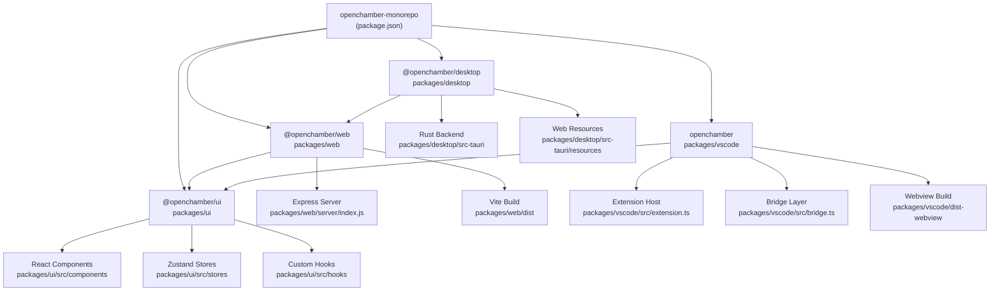
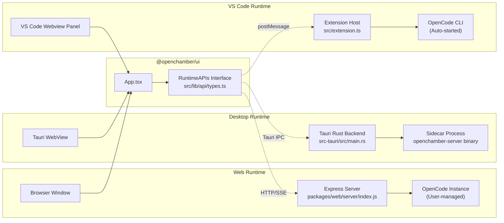
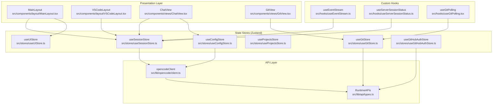
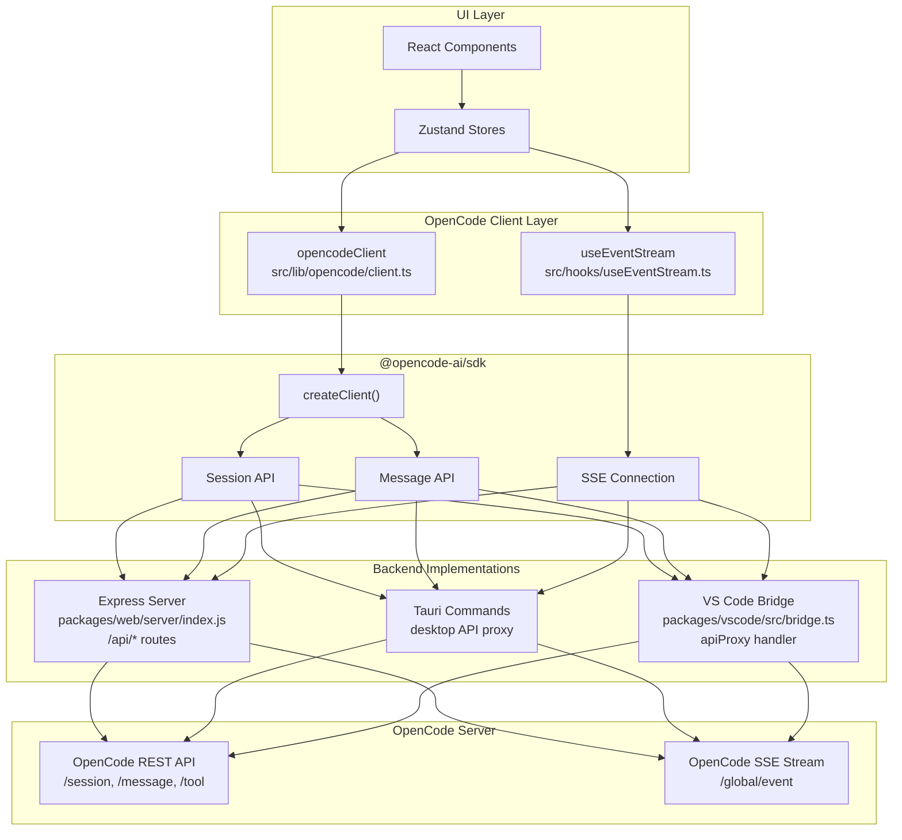

<!-- source: DeepWiki mcp.deepwiki.com · repo btriapitsyn/openchamber · page 1 Overview · fetched 2026-10-26 -->

# Overview

<details>
<summary>Relevant source files</summary>

The following files were used as context for generating this wiki page:

- [CHANGELOG.md](CHANGELOG.md)
- [bun.lock](bun.lock)
- [package.json](package.json)
- [packages/desktop/package.json](packages/desktop/package.json)
- [packages/desktop/src-tauri/Cargo.lock](packages/desktop/src-tauri/Cargo.lock)
- [packages/desktop/src-tauri/Cargo.toml](packages/desktop/src-tauri/Cargo.toml)
- [packages/desktop/src-tauri/src/main.rs](packages/desktop/src-tauri/src/main.rs)
- [packages/desktop/src-tauri/tauri.conf.json](packages/desktop/src-tauri/tauri.conf.json)
- [packages/ui/package.json](packages/ui/package.json)
- [packages/ui/src/App.tsx](packages/ui/src/App.tsx)
- [packages/ui/src/lib/api/types.ts](packages/ui/src/lib/api/types.ts)
- [packages/vscode/CHANGELOG.md](packages/vscode/CHANGELOG.md)
- [packages/vscode/package.json](packages/vscode/package.json)
- [packages/vscode/src/bridge.ts](packages/vscode/src/bridge.ts)
- [packages/web/package.json](packages/web/package.json)
- [packages/web/server/index.js](packages/web/server/index.js)

</details>


OpenChamber is an AI-powered coding assistant that provides an integrated development environment for interacting with AI models through the OpenCode platform. The system is designed to run in three distinct deployment environments—web browser, native desktop application, and VS Code extension—while sharing a unified React-based user interface codebase.

This document provides a high-level overview of the OpenChamber system architecture, its core components, and how the different runtime environments relate to each other. For detailed information about specific subsystems, see:
- Architecture patterns and design decisions: [Architecture](#3)
- Desktop application implementation: [Desktop Application](#4)
- Web server and client details: [Web Application](#5)
- VS Code extension specifics: [VS Code Extension](#6)
- Shared UI components: [UI Component Library](#7)

## Monorepo Structure

OpenChamber is organized as a monorepo workspace with four primary packages that handle different concerns. The root package orchestrates builds and shared dependencies, while specialized packages implement platform-specific functionality.

### Package Organization



**Sources:** [package.json:1-151](), [packages/web/package.json:1-103](), [packages/ui/package.json:1-104](), [packages/desktop/package.json:1-27](), [packages/vscode/package.json:1-240]()

The monorepo uses Bun as its package manager and workspace orchestrator. Each package declares its own dependencies, but common dependencies like React, Zustand, and the OpenCode SDK are shared at the root level through workspace hoisting.

### Shared Dependencies

| Dependency | Version | Used By | Purpose |
|------------|---------|---------|---------|
| `@opencode-ai/sdk` | ^1.1.65 | All packages | OpenCode API client and types |
| `react` | ^19.1.1 | ui, web, vscode | UI framework |
| `zustand` | ^5.0.8 | ui | State management |
| `@radix-ui/*` | Various | ui, web | Headless UI primitives |
| `simple-git` | ^3.28.0 | web, ui | Git operations |

**Sources:** [package.json:60-119](), [bun.lock:1-300]()

## Runtime Environments

OpenChamber supports three distinct runtime environments, each with its own deployment model and backend architecture. All three runtimes share the same React UI components from `@openchamber/ui`, but differ in how they communicate with the OpenCode backend and handle platform-specific features.

### Runtime Architecture Comparison



**Sources:** [packages/ui/src/App.tsx:1-328](), [packages/ui/src/lib/api/types.ts:1-20](), [packages/web/server/index.js:1-100](), [packages/desktop/src-tauri/src/main.rs:1-50](), [packages/vscode/src/extension.ts:1-50]()

### Web Runtime

The web runtime deploys as a standalone Express server that serves a Vite-built React application. The server acts as a proxy to an external OpenCode instance and provides additional functionality like terminal sessions, Git operations, and GitHub integration.

**Entry points:**
- Server: [packages/web/server/index.js:1-50]()
- Client: [packages/web/src/main.tsx:1-50]()
- CLI: [packages/web/bin/cli.js:1-50]()

### Desktop Runtime

The desktop runtime uses Tauri to bundle the entire web application as a native executable. It spawns the Express server as a sidecar process and communicates with the UI through Tauri's IPC mechanism. This allows the desktop app to run completely offline without requiring a separate server installation.

**Entry points:**
- Tauri backend: [packages/desktop/src-tauri/src/main.rs:1-100]()
- Sidecar configuration: [packages/desktop/src-tauri/tauri.conf.json:1-85]()

### VS Code Runtime

The VS Code runtime integrates OpenChamber as an extension with a webview-based UI. The extension manages the OpenCode CLI lifecycle and proxies API requests through a message-passing bridge between the webview and extension host.

**Entry points:**
- Extension activation: [packages/vscode/src/extension.ts:1-100]()
- Bridge layer: [packages/vscode/src/bridge.ts:1-100]()
- Webview entry: [packages/vscode/webview/main.tsx:1-50]()

## Core Component Architecture

The OpenChamber UI is built on React with Zustand for state management. The architecture separates concerns into stores, hooks, and presentation components, with a runtime abstraction layer that enables the same UI code to run across all three platforms.

### State Management Structure



**Sources:** [packages/ui/src/stores/useSessionStore.ts:1-50](), [packages/ui/src/stores/useConfigStore.ts:1-50](), [packages/ui/src/hooks/useEventStream.ts:1-50](), [packages/ui/src/lib/api/types.ts:1-450]()

### Zustand Stores

OpenChamber uses Zustand for global state management with domain-specific stores:

| Store | File | Responsibilities |
|-------|------|-----------------|
| `useSessionStore` | src/stores/useSessionStore.ts | Chat sessions, messages, streaming state |
| `useConfigStore` | src/stores/useConfigStore.ts | Providers, agents, models, MCP tools |
| `useUIStore` | src/stores/useUIStore.ts | UI preferences, theme, layout state |
| `useProjectsStore` | src/stores/useProjectsStore.ts | Workspace projects, active directory |
| `useGitStore` | src/stores/useGitStore.ts | Git status, branches, commit history |
| `useGitHubAuthStore` | src/stores/useGitHubAuthStore.ts | GitHub authentication state |
| `useDirectoryStore` | src/stores/useDirectoryStore.ts | Current directory, switching state |

**Sources:** [packages/ui/src/stores/useSessionStore.ts:1-50](), [packages/ui/src/stores/useConfigStore.ts:1-50](), [packages/ui/src/stores/useUIStore.ts:1-50]()

## OpenCode Integration

OpenChamber integrates with the OpenCode platform through the `@opencode-ai/sdk` package. The SDK provides a typed client for interacting with OpenCode's REST API and Server-Sent Events (SSE) streams.

### OpenCode Client Architecture



**Sources:** [packages/ui/src/lib/opencode/client.ts:1-50](), [packages/ui/src/hooks/useEventStream.ts:1-50](), [packages/web/server/index.js:1-100](), [packages/vscode/src/bridge.ts:1-100]()

The `opencodeClient` instance is configured with the appropriate base URL and authentication headers for each runtime environment. All API requests flow through the runtime-specific backend implementation, which handles proxying to the actual OpenCode instance.

### Real-Time Communication

OpenChamber uses Server-Sent Events (SSE) to receive real-time updates from the OpenCode server. The `useEventStream` hook establishes an SSE connection and dispatches events to the appropriate Zustand stores based on event type.

**Key event types:**
- `session.created` / `session.updated` — Session lifecycle events
- `message.created` / `message.updated` — Message state changes
- `message.part.updated` — Streaming message chunks
- `tool.call.created` / `tool.call.updated` — Tool execution events
- `permission.request` — Tool permission prompts

**Sources:** [packages/ui/src/hooks/useEventStream.ts:1-100]()

## Build System and Development Workflow

The monorepo uses a coordinated build system that handles dependencies between packages and produces runtime-specific artifacts.

### Build Targets

| Target | Command | Output | Description |
|--------|---------|--------|-------------|
| Web Package | `bun run build:web` | packages/web/dist | Vite-built SPA + server files |
| UI Library | `bun run build:ui` | Type checking only | Shared components (not bundled) |
| Desktop App | `bun run build:desktop` | App bundle (.dmg, .exe) | Tauri-built native executable |
| VS Code Extension | `bun run vscode:package` | openchamber-X.X.X.vsix | Extension package for marketplace |

**Sources:** [package.json:23-58]()

The build system ensures that:
1. Shared UI components are type-checked before runtime builds
2. Desktop builds bundle the web server as a sidecar executable
3. VS Code builds compile both the extension host and webview separately
4. All runtimes use the same React component tree from `@openchamber/ui`

### Development Mode

Development mode runs multiple watchers in parallel:
- `bun run dev` — Runs web server, web build watcher, and UI type-checking
- `bun run desktop:dev` — Runs Tauri dev mode with web server
- `bun run vscode:dev` — Runs extension and webview watchers

**Sources:** [package.json:24](), [package.json:46](), [package.json:50]()

## Key Technologies

OpenChamber is built on the following core technologies:

| Technology | Purpose | Primary Usage |
|------------|---------|---------------|
| React 19 | UI framework | All presentation components |
| Zustand 5 | State management | Global stores and subscriptions |
| Vite 7 | Build tooling | Web and VS Code webview builds |
| Express 5 | HTTP server | Web runtime backend |
| Tauri 2 | Desktop framework | Native desktop application |
| @opencode-ai/sdk | AI integration | OpenCode platform client |
| simple-git | Git operations | Repository management |
| @octokit/rest | GitHub API | Pull request and issue integration |
| CodeMirror 6 | Code editor | File editing and syntax highlighting |
| Radix UI | Headless components | Accessible UI primitives |
| Tailwind CSS 4 | Styling | Utility-first CSS framework |

**Sources:** [package.json:60-119](), [packages/web/package.json:24-67](), [packages/ui/package.json:13-76]()

## File Organization Patterns

OpenChamber follows consistent patterns across packages for organizing code:

### UI Package Structure
```
packages/ui/src/
├── components/          # React components
│   ├── layout/          # Layout components (MainLayout, VSCodeLayout)
│   ├── views/           # Top-level views (ChatView, GitView, FilesView)
│   ├── chat/            # Chat-specific components
│   ├── git/             # Git-specific components
│   └── ui/              # Reusable UI primitives
├── stores/              # Zustand stores
├── hooks/               # Custom React hooks
├── contexts/            # React contexts and providers
├── lib/                 # Utilities and helpers
│   ├── api/             # Runtime API abstraction
│   ├── opencode/        # OpenCode client
│   └── utils.ts         # Shared utilities
└── types/               # TypeScript type definitions
```

**Sources:** [packages/ui/src/App.tsx:1-328](), [packages/ui/src/lib/api/types.ts:1-450]()

### Runtime-Specific Organization

Each runtime package organizes platform-specific code separately from shared UI:

- **Web:** [packages/web/server/]() contains Express routes and middleware
- **Desktop:** [packages/desktop/src-tauri/src/]() contains Rust backend code
- **VS Code:** [packages/vscode/src/]() contains extension host code

**Sources:** [packages/web/server/index.js:1-100](), [packages/desktop/src-tauri/src/main.rs:1-100](), [packages/vscode/src/extension.ts:1-100]()

---

