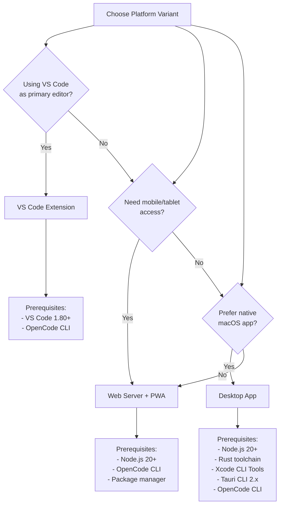
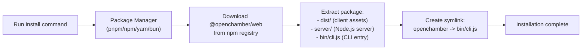
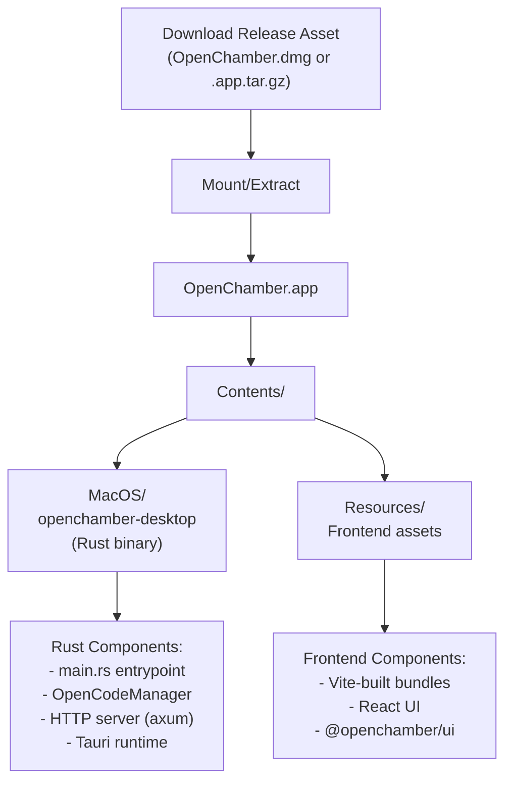
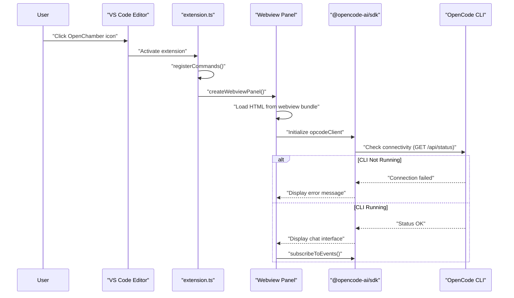
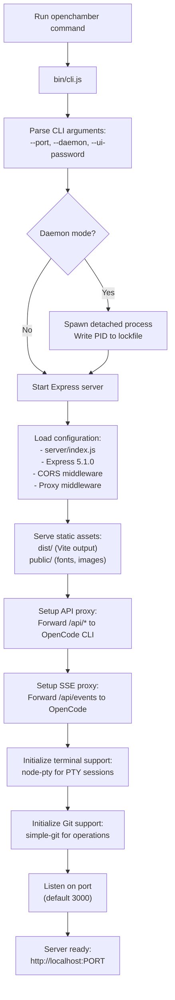
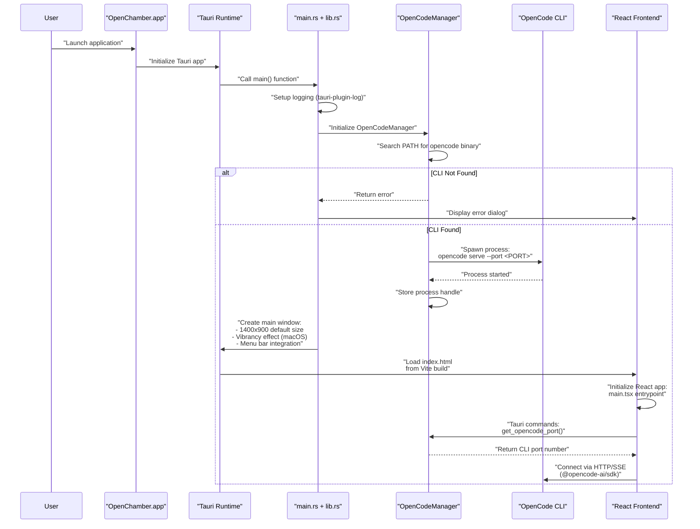
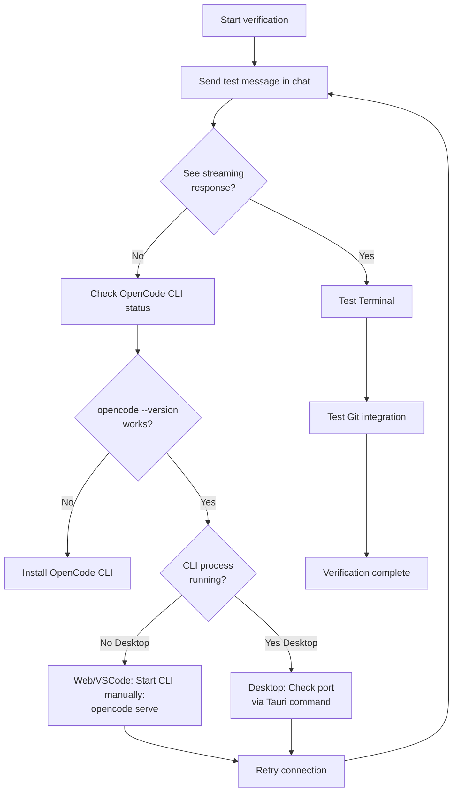
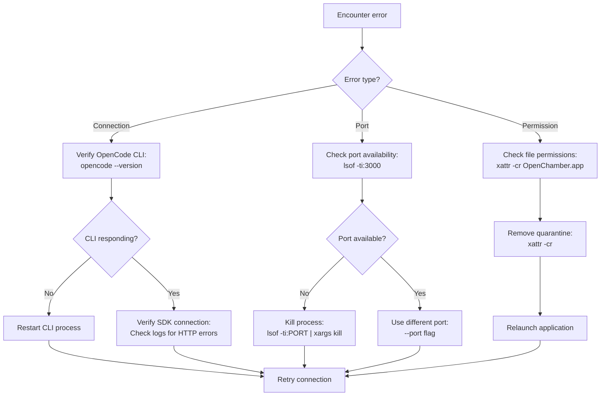

<!-- source: DeepWiki mcp.deepwiki.com · repo btriapitsyn/openchamber · page 2 Getting Started · fetched 2026-10-26 -->

# Getting Started

<details>
<summary>Relevant source files</summary>

The following files were used as context for generating this wiki page:

- [CHANGELOG.md](CHANGELOG.md)
- [bun.lock](bun.lock)
- [package.json](package.json)
- [packages/desktop/package.json](packages/desktop/package.json)
- [packages/desktop/src-tauri/Cargo.lock](packages/desktop/src-tauri/Cargo.lock)
- [packages/desktop/src-tauri/Cargo.toml](packages/desktop/src-tauri/Cargo.toml)
- [packages/desktop/src-tauri/tauri.conf.json](packages/desktop/src-tauri/tauri.conf.json)
- [packages/ui/package.json](packages/ui/package.json)
- [packages/ui/src/components/layout/VSCodeLayout.tsx](packages/ui/src/components/layout/VSCodeLayout.tsx)
- [packages/vscode/CHANGELOG.md](packages/vscode/CHANGELOG.md)
- [packages/vscode/assets/icon-titlebar.svg](packages/vscode/assets/icon-titlebar.svg)
- [packages/vscode/package.json](packages/vscode/package.json)
- [packages/vscode/src/ChatViewProvider.ts](packages/vscode/src/ChatViewProvider.ts)
- [packages/vscode/src/extension.ts](packages/vscode/src/extension.ts)
- [packages/vscode/src/opencode.ts](packages/vscode/src/opencode.ts)
- [packages/vscode/src/sessionActivityWatcher.ts](packages/vscode/src/sessionActivityWatcher.ts)
- [packages/vscode/webview/api/bridge.ts](packages/vscode/webview/api/bridge.ts)
- [packages/vscode/webview/main.tsx](packages/vscode/webview/main.tsx)
- [packages/web/package.json](packages/web/package.json)

</details>


This guide covers installation and initial setup for all OpenChamber platform variants: web server (with CLI), desktop application, and VS Code extension. Each variant provides a graphical interface to the OpenCode AI coding agent, with platform-specific features while maintaining core functionality consistency.

For detailed architecture information, see [Architecture](#3). For platform-specific implementation details, see [Desktop Application](#4), [Web Application](#5), or [VS Code Extension](#6).

---

## Prerequisites

All OpenChamber variants require the **OpenCode CLI** installed and accessible in your system PATH. OpenChamber acts as a frontend that communicates with the OpenCode backend process via HTTP and Server-Sent Events.

### Common Prerequisites

| Requirement | Minimum Version | Purpose |
|-------------|----------------|---------|
| OpenCode CLI | Latest | AI coding agent backend |
| Node.js | 20.x | Runtime for web server and build tools |

### Platform-Specific Prerequisites

**Desktop Application (macOS)**

- Rust stable toolchain (via `rustup`)
- Xcode Command Line Tools
- Tauri CLI 2.x (`cargo install tauri-cli@^2`)

**Web Server**

- Package manager: pnpm, npm, yarn, or bun

**VS Code Extension**

- Visual Studio Code 1.80+
- No additional prerequisites (downloads from Marketplace)

**Prerequisites Decision Tree**



Sources: [README.md:101-105](), [packages/desktop/package.json:6-9]()

---

## Installation

### VS Code Extension

The VS Code extension is the simplest installation option.

**Method 1: VS Code Marketplace (Recommended)**

1. Open VS Code
2. Navigate to Extensions (`Cmd+Shift+X` / `Ctrl+Shift+X`)
3. Search for "OpenChamber"
4. Click **Install** on the extension by `fedaykindev`

**Method 2: Command Line**

```bash
code --install-extension fedaykindev.openchamber
```

The extension includes its webview bundle and communicates with OpenCode CLI via the `@opencode-ai/sdk` client.

Sources: [README.md:74-76]()

### Web Server (CLI Tool)

The web server runs as a Node.js process and can be installed globally via package managers.

**Quick Install (Automatic Package Manager Detection)**

```bash
curl -fsSL https://raw.githubusercontent.com/btriapitsyn/openchamber/main/scripts/install.sh | bash
```

The installation script detects whether you have `pnpm`, `npm`, `yarn`, or `bun` and uses the appropriate command.

**Manual Installation**

```bash
# Using pnpm (recommended)
pnpm add -g @openchamber/web

# Using npm
npm install -g @openchamber/web

# Using yarn
yarn global add @openchamber/web

# Using bun
bun add -g @openchamber/web
```

The package installs the `openchamber` CLI binary defined in [packages/web/package.json:8-10](), which points to `bin/cli.js` as the entry point.

**Web Installation Flow**



Sources: [README.md:78-95](), [packages/web/package.json:1-10]()

### Desktop Application (macOS)

The desktop application is distributed as a signed `.app` bundle for macOS.

**Installation Steps**

1. Download the latest `.dmg` or `.app.tar.gz` from [GitHub Releases](https://github.com/btriapitsyn/openchamber/releases)
2. If `.dmg`: Open and drag **OpenChamber.app** to Applications folder
3. If `.app.tar.gz`: Extract and move **OpenChamber.app** to Applications folder
4. First launch may require right-click → **Open** to bypass Gatekeeper

The desktop application is built with Tauri 2.9.4 and includes its own embedded HTTP server for communicating with the OpenCode CLI process. The application bundle includes:

- Rust native backend compiled from [packages/desktop/src-tauri/src/]()
- Frontend assets built from [packages/desktop/src/]()
- Tauri configuration from `src-tauri/tauri.conf.json`

**Desktop Installation Components**



Sources: [README.md:98-99](), [packages/desktop/src-tauri/Cargo.toml:1-59](), [packages/desktop/package.json:1-40]()

---

## First Launch

### VS Code Extension First Launch

1. After installation, click the **OpenChamber** icon in the Activity Bar (left sidebar)
2. The extension opens a webview panel showing the chat interface
3. The extension automatically detects the workspace folder as the working directory
4. If OpenCode CLI is not found, an error message appears in the panel

The extension communicates with OpenCode CLI via the `@opencode-ai/sdk` at version 1.0.133 as specified in the extension's dependencies.

**VS Code Extension Initialization Flow**



Sources: [README.md:67-70]()

### Web Server First Launch

Start the web server with default settings:

```bash
openchamber
```

This starts the server on port 3000. The CLI tool defined in [packages/web/package.json:8-10]() executes `bin/cli.js`, which spawns the Express server from `server/index.js`.

**Common CLI Options**

```bash
openchamber --port 8080              # Custom port
openchamber --daemon                 # Background process
openchamber --ui-password secret     # Password-protect UI
openchamber stop                     # Stop background server
openchamber update                   # Self-update to latest version
```

**Access Points**

- **Web UI**: http://localhost:3000 (or custom port)
- **PWA**: Open in mobile browser → Add to Home Screen for mobile-optimized interface

**Web Server Startup Flow**



Sources: [README.md:88-95](), [packages/web/package.json:6-23]()

### Desktop Application First Launch

1. Launch **OpenChamber.app** from Applications folder
2. On first launch, a directory picker dialog appears (macOS only)
3. Select your default working directory for coding projects
4. The application checks for OpenCode CLI availability via `OpenCodeManager`
5. If found, it spawns the CLI process and connects
6. Main window appears with chat interface

The desktop application uses the `OpenCodeManager` component (implemented in Rust) to:
- Detect OpenCode CLI location in system PATH
- Spawn the CLI process with appropriate flags
- Monitor process health and restart if needed
- Forward requests to the CLI's HTTP API

**Desktop First Launch Sequence**



Sources: [README.md:63-65](), [packages/desktop/src-tauri/Cargo.toml:19-52]()

---

## Verification

After installation and first launch, verify that OpenChamber is correctly communicating with OpenCode CLI.

### Verification Steps (All Platforms)

1. **Check OpenCode CLI Status**
   ```bash
   opencode --version
   ```
   Ensure the CLI is accessible and returns version information.

2. **Verify Connection**
   - Send a test message in the chat interface
   - Look for the streaming response indicator (animated dots)
   - Confirm the assistant responds

3. **Test Terminal Integration**
   - Open the Terminal view
   - Execute a simple command like `ls` or `pwd`
   - Verify output appears

4. **Test Git Integration**
   - Navigate to Git view
   - Check if current repository status is displayed
   - Attempt to view uncommitted changes

### Platform-Specific Verification

**Web Server**

Check server logs for successful startup:
```bash
# If running in foreground
# Look for: "Server listening on http://localhost:3000"

# If running as daemon
openchamber logs
```

**Desktop Application**

Check the developer console (if devtools are enabled during development):
1. Window menu → Developer → Toggle Developer Tools
2. Look for successful WebSocket/SSE connection messages
3. Verify no errors related to OpenCode CLI communication

**VS Code Extension**

Check the Output panel:
1. View → Output
2. Select "OpenChamber" from dropdown
3. Look for connection success messages

**Verification Decision Tree**



Sources: [README.md:101-104]()

---

## Troubleshooting

### OpenCode CLI Not Found

**Symptom**: Error message "OpenCode CLI not found" or "Failed to connect to OpenCode"

**Solution**:
1. Verify OpenCode CLI is installed: `which opencode`
2. If not found, install from [opencode.ai](https://opencode.ai)
3. Ensure the binary is in your PATH
4. Restart OpenChamber application/server

### Port Already in Use (Web Server)

**Symptom**: `Error: listen EADDRINUSE: address already in use :::3000`

**Solution**:
```bash
# Use a different port
openchamber --port 8080

# Or find and kill the process using port 3000
lsof -ti:3000 | xargs kill -9
```

### Desktop App Won't Launch (macOS)

**Symptom**: "OpenChamber.app is damaged and can't be opened"

**Solution**:
```bash
# Remove quarantine attribute
xattr -cr /Applications/OpenChamber.app

# Then launch normally
```

### Connection Timeouts

**Symptom**: "Reconnecting..." status or timeout errors

**Solution**:
1. Check OpenCode CLI is responsive: `curl http://localhost:PORT/api/status`
2. Verify firewall isn't blocking localhost connections
3. Restart the OpenCode CLI process
4. For desktop: Use Window menu → Force Reload

### VS Code Extension Not Appearing

**Symptom**: Extension installed but icon not visible in Activity Bar

**Solution**:
1. Reload VS Code window: Cmd+Shift+P → "Developer: Reload Window"
2. Check Extensions view for activation errors
3. Verify VS Code version is 1.80 or higher
4. Check Output panel for extension logs

**Common Error Resolution Paths**



Sources: [README.md:101-105](), [packages/desktop/package.json:6-9](), [packages/web/package.json:14-22]()

---

## Next Steps

After successful installation and verification:

- **Learn the architecture**: See [Architecture](#3) for system design overview
- **Explore features**: Review [UI Component Library](#7) for interface capabilities
- **Customize settings**: Access Settings dialog to configure models, themes, and permissions
- **Mobile access**: Install PWA on mobile devices for cross-device continuity
- **Development**: See [Development Guide](#8) to contribute or build from source

---

