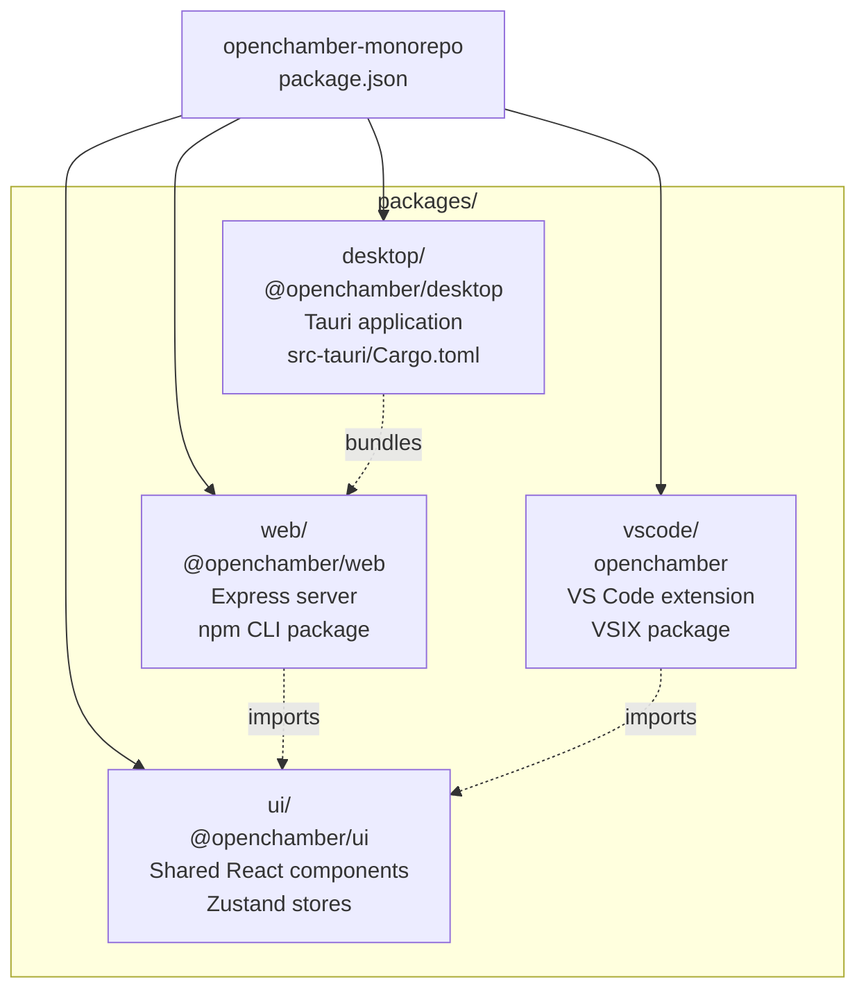
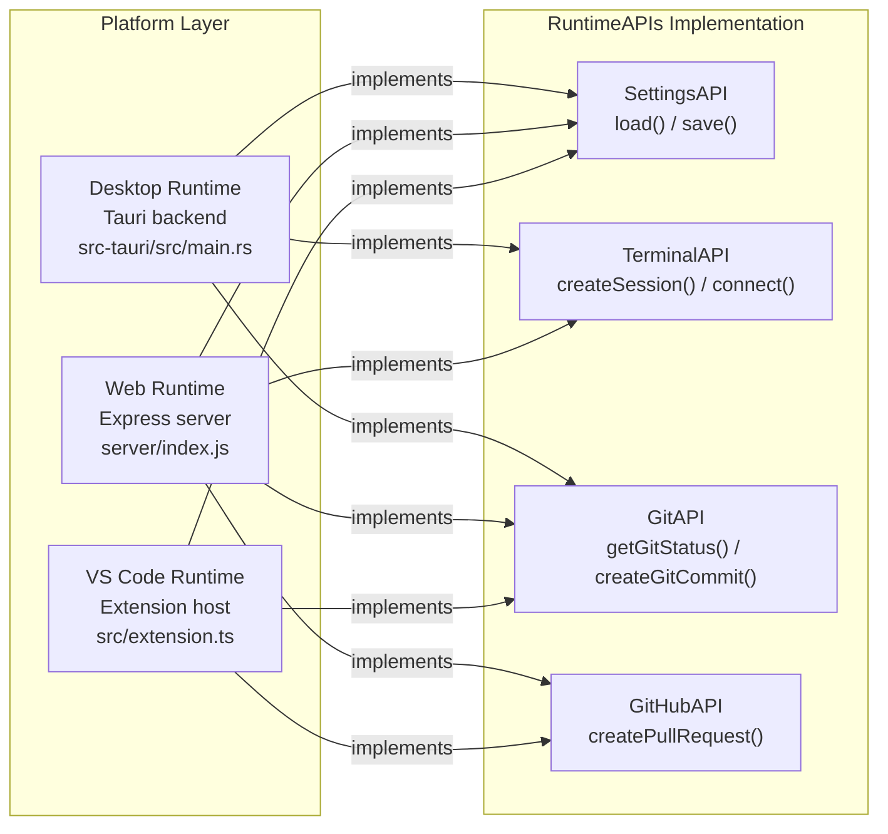
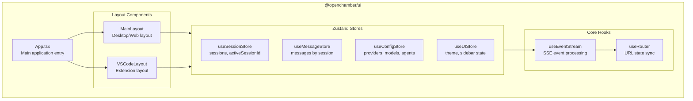
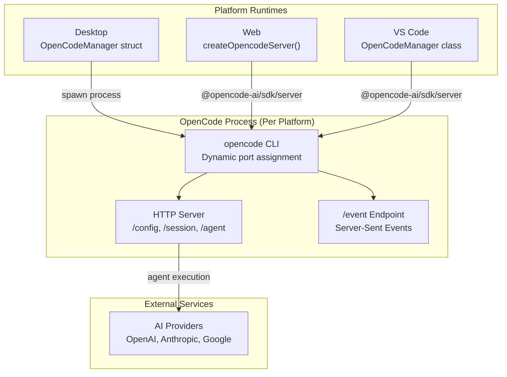
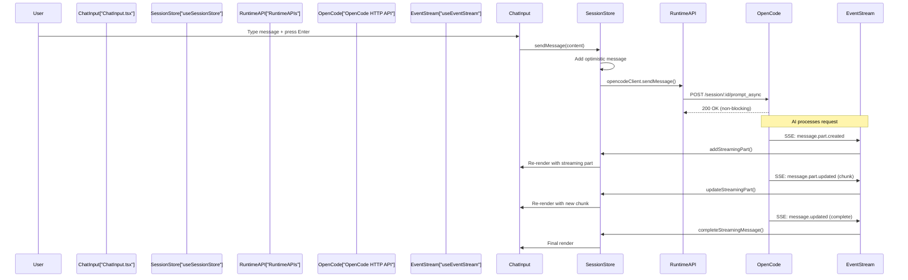
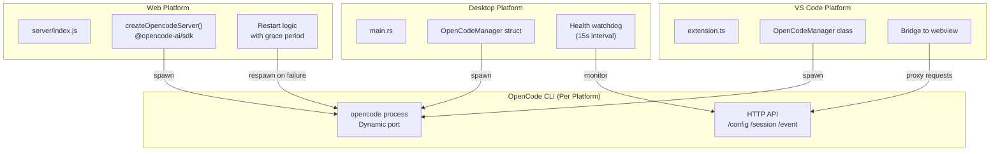
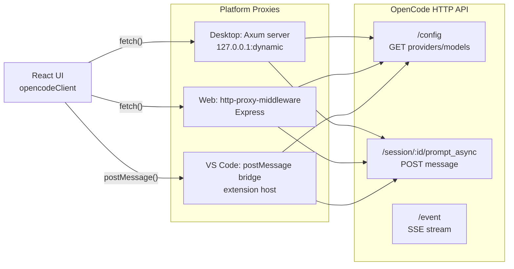
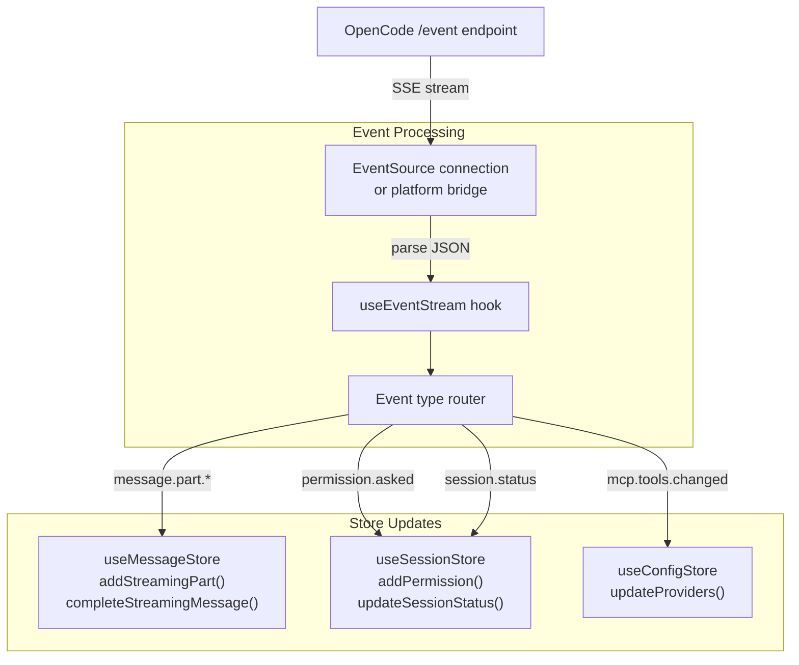
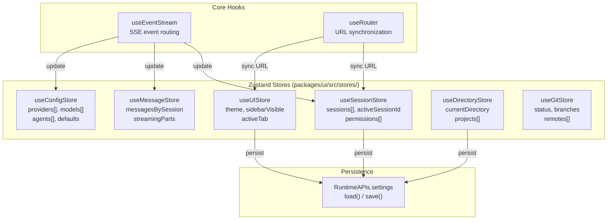
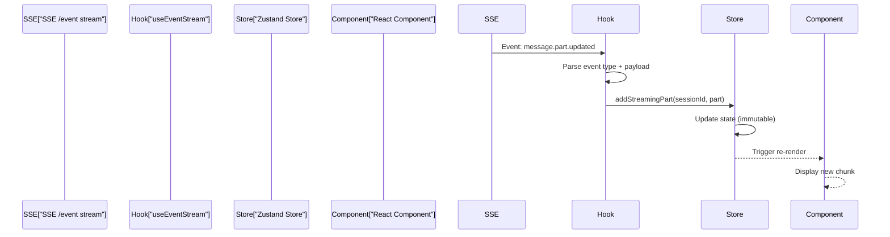

<!-- source: DeepWiki mcp.deepwiki.com · repo btriapitsyn/openchamber · page 3 Architecture · fetched 2026-10-26 -->

# Architecture

<details>
<summary>Relevant source files</summary>

The following files were used as context for generating this wiki page:

- [CHANGELOG.md](CHANGELOG.md)
- [bun.lock](bun.lock)
- [package.json](package.json)
- [packages/desktop/package.json](packages/desktop/package.json)
- [packages/desktop/src-tauri/Cargo.lock](packages/desktop/src-tauri/Cargo.lock)
- [packages/desktop/src-tauri/Cargo.toml](packages/desktop/src-tauri/Cargo.toml)
- [packages/desktop/src-tauri/src/main.rs](packages/desktop/src-tauri/src/main.rs)
- [packages/desktop/src-tauri/tauri.conf.json](packages/desktop/src-tauri/tauri.conf.json)
- [packages/ui/package.json](packages/ui/package.json)
- [packages/ui/src/App.tsx](packages/ui/src/App.tsx)
- [packages/ui/src/lib/api/types.ts](packages/ui/src/lib/api/types.ts)
- [packages/vscode/CHANGELOG.md](packages/vscode/CHANGELOG.md)
- [packages/vscode/package.json](packages/vscode/package.json)
- [packages/vscode/src/bridge.ts](packages/vscode/src/bridge.ts)
- [packages/web/package.json](packages/web/package.json)
- [packages/web/server/index.js](packages/web/server/index.js)

</details>


## Overview

OpenChamber is a multi-platform AI coding assistant that runs as a native desktop application (Tauri), web application (Express + browser), and VS Code extension. All three platforms share the same React UI layer (`@openchamber/ui` package) and integrate with the OpenCode backend for AI agent orchestration.

This page covers the high-level architectural patterns and design decisions. For detailed implementation:

- Multi-platform deployment strategies → [Multi-Platform Deployment](#3.1)
- OpenCode SDK integration and process management → [OpenCode Backend Integration](#3.2)
- SSE streaming and HTTP communication → [Real-Time Communication](#3.3)
- Zustand stores and state persistence → [State Management](#3.4)
- Platform-specific details: [Desktop Application](#4), [Web Application](#5), [VS Code Extension](#6)

## Monorepo Structure

OpenChamber is organized as a Bun workspace with four packages:



**Package responsibilities:**

| Package | Type | Main Entry | Exports |
|---------|------|------------|---------|
| `@openchamber/ui` | Library | `src/main.tsx` | React components, hooks, stores |
| `@openchamber/web` | Application + CLI | `server/index.js` | Express server, `openchamber` CLI |
| `@openchamber/desktop` | Application | `src-tauri/src/main.rs` | Native installers (.dmg, .app) |
| `openchamber` (vscode) | Extension | `src/extension.ts` | VS Code extension (.vsix) |

**Sources:** [package.json:1-10](), [packages/ui/package.json:1-12](), [packages/web/package.json:1-12](), [packages/desktop/package.json:1-11](), [packages/vscode/package.json:1-40]()

---

## Core Architecture Layers

OpenChamber's architecture consists of three primary layers:

### Layer 1: Platform Runtime

Each platform provides a runtime environment with platform-specific capabilities:



The `RuntimeAPIs` interface defines the contract between the UI and platform-specific functionality. Each platform implements this interface differently based on its capabilities.

**Sources:** [packages/ui/src/lib/api/types.ts:1-50](), [packages/desktop/src-tauri/src/main.rs:378-437](), [packages/web/server/index.js:1-100](), [packages/vscode/src/bridge.ts:1-100]()

### Layer 2: Shared UI Layer

The `@openchamber/ui` package contains all React components and state management logic:



**Key files:**
- Entry point: [packages/ui/src/App.tsx:1-328]()
- Store definitions: `packages/ui/src/stores/`
- Layout components: `packages/ui/src/components/layout/`

**Sources:** [packages/ui/src/App.tsx:1-70](), [packages/ui/package.json:1-30]()

### Layer 3: OpenCode Backend

Each platform spawns and manages its own OpenCode CLI process:



**Sources:** [packages/web/server/index.js:1424-1476](), [packages/desktop/src-tauri/src/main.rs:1-100](), [packages/vscode/src/opencode.ts]() (referenced in extension.ts)

---

## Request Flow Example

Here's how a typical user action flows through the system:

### Example: Send Chat Message



**Key code entities:**
- User interaction: `packages/ui/src/components/chat/ChatInput.tsx`
- Message sending: `useSessionStore.sendMessage()` in stores
- OpenCode client: `packages/ui/src/lib/opencode/client.ts`
- Event processing: [packages/ui/src/hooks/useEventStream.ts]()

**Sources:** [packages/web/server/index.js:1125-1203](), [packages/ui/src/lib/api/types.ts:21-24]()

## Platform Deployment Strategies

OpenChamber runs on three platforms with different deployment and runtime characteristics. See [Multi-Platform Deployment](#3.1) for detailed implementation.

### Platform Comparison

| Platform | Runtime | UI Rendering | OpenCode Integration | Distribution |
|----------|---------|--------------|---------------------|--------------|
| **Desktop** | Tauri + Rust | WebView (WKWebView) | Process spawn via Rust | .dmg / .app bundles |
| **Web** | Node.js/Bun + Express | Browser | `createOpencodeServer()` from SDK | npm package |
| **VS Code** | Extension Host | Webview panel | `createOpencodeServer()` from SDK | .vsix package |

### Runtime Detection

The UI layer detects which platform it's running on using the `RuntimeDescriptor` interface:

```typescript
interface RuntimeDescriptor {
  platform: 'web' | 'desktop' | 'vscode';
  isDesktop: boolean;
  isVSCode: boolean;
  label?: string;
}
```

**Platform-specific code paths:**
- Desktop: [packages/ui/src/App.tsx:58-64]() checks `apis.runtime.isVSCode` and `isDesktopShell()`
- VS Code: [packages/ui/src/App.tsx:271-302]() renders `VSCodeLayout` instead of `MainLayout`
- Web: Default rendering path when neither desktop nor VS Code

**Sources:** [packages/ui/src/lib/api/types.ts:3-13](), [packages/ui/src/App.tsx:46-70]()

## OpenCode Integration Pattern

Each platform spawns its own OpenCode CLI process and manages its lifecycle independently. See [OpenCode Backend Integration](#3.2) for detailed implementation.

### Process Management



**Key responsibilities per platform:**
- **Desktop**: Direct process management in Rust, no intermediate SDK
- **Web/VS Code**: Use `@opencode-ai/sdk/server` for process spawning and lifecycle
- **All platforms**: Dynamic port detection, health monitoring, automatic restart on crash

**Sources:** [packages/web/server/index.js:1424-1476](), [packages/desktop/src-tauri/src/main.rs:766-820](), [packages/vscode/src/opencode.ts]() (referenced)

## Communication Patterns

OpenChamber uses a dual-channel model: HTTP for commands and SSE for streaming. See [Real-Time Communication](#3.3) for detailed protocol implementation.

### HTTP Request Proxying

Each platform proxies HTTP requests from the UI to OpenCode's HTTP API:



**Key API endpoints:**
- `/config` - Provider and model metadata
- `/session/:id/prompt_async` - Non-blocking message send
- `/session/:id/message` - Message history retrieval
- `/event` - SSE stream for real-time updates

**Sources:** [packages/desktop/src-tauri/src/main.rs:1073-1101](), [packages/web/server/index.js:1760-1868](), [packages/vscode/src/bridge.ts:49-96]()

### SSE Event Processing

The `useEventStream` hook processes SSE events and routes them to appropriate Zustand stores:



**Event types and handlers:**
- `message.part.created` / `message.part.updated` → Stream message chunks
- `message.updated` → Mark message complete
- `permission.asked` → Show permission dialog
- `session.status` → Update session running/idle state

**Sources:** [packages/web/server/index.js:1125-1203](), [packages/ui/src/hooks/useEventStream.ts]() (referenced)

## State Management Architecture

OpenChamber uses Zustand for state management with domain-specific stores. See [State Management](#3.4) for detailed implementation.

### Store Organization



**Key stores:**
- `useSessionStore` - Session list, active session, permissions
- `useMessageStore` - Message history, streaming chunks
- `useConfigStore` - Providers, models, agents, MCP tools
- `useUIStore` - Theme, sidebar, dialog state
- `useDirectoryStore` - Active project, workspace switching
- `useGitStore` - Git status, branches, commit history

**Sources:** [packages/ui/src/lib/api/types.ts:353-384](), [packages/ui/src/App.tsx:10-18]()

### State Update Flow



Store updates are immutable and trigger React re-renders via Zustand's subscription mechanism. Components subscribe to specific store slices to minimize unnecessary renders.

**Sources:** [packages/web/server/index.js:1125-1203]()

## Cross-Cutting Concerns

### Configuration Hierarchy

OpenCode backend configuration (agents, models) has a three-tier override system:

1. **Built-in** - Bundled with `opencode` CLI
2. **User-level** - `~/.config/opencode/agents/`, `~/.config/opencode/commands/`
3. **Project-level** - `.opencode/agents/`, `.opencode/commands/`

Application settings (theme, projects, defaults) are persisted per platform via `RuntimeAPIs.settings`:

- **Desktop**: Tauri store plugin
- **Web**: `~/.config/openchamber/settings.json`
- **VS Code**: Extension `globalState`

**Sources:** [packages/ui/src/lib/api/types.ts:353-384](), [packages/web/server/index.js:1054-1079]()

### OpenCode API Prefix Detection

OpenCode can serve its API at different prefixes (`/api`, `/`, etc.). Each platform detects the prefix on startup:

1. Fetch `/doc` and extract `__OPENCODE_API_BASE__` from HTML
2. Fallback: Try `/config`, then `/api/config`
3. Environment override: `OPENCODE_API_PREFIX` env var

**Implementation:**
- Desktop: Rust-based detection in `OpenCodeManager`
- Web: [packages/web/server/index.js:1226-1368]()

**Sources:** [packages/web/server/index.js:940-948](), [packages/web/server/index.js:1059-1079]()

### Health Monitoring

Platforms monitor OpenCode process health and emit status updates:

- **Desktop**: 15s polling interval, emits `openchamber:health-changed` events
- **Web**: HTTP 503 during restart, grace period before marking unhealthy
- **VS Code**: Health checks during API initialization

**Sources:** [packages/desktop/src-tauri/src/main.rs:766-820](), [packages/web/server/index.js:1549-1639]()

---

## Summary

OpenChamber's architecture achieves multi-platform deployment through:

1. **Shared UI Layer**: `@openchamber/ui` package with React components and Zustand stores
2. **Platform Adapters**: Each platform implements `RuntimeAPIs` interface with platform-specific capabilities
3. **Unified Backend**: All platforms integrate with OpenCode via HTTP + SSE
4. **Independent Instances**: Each platform spawns and manages its own OpenCode process
5. **Dynamic Configuration**: API prefix detection and health monitoring for resilient operation

This architecture allows OpenChamber to run natively on macOS (Desktop), in any browser (Web), and integrated into VS Code (Extension), while maintaining a consistent user experience and feature set across all platforms.

---

