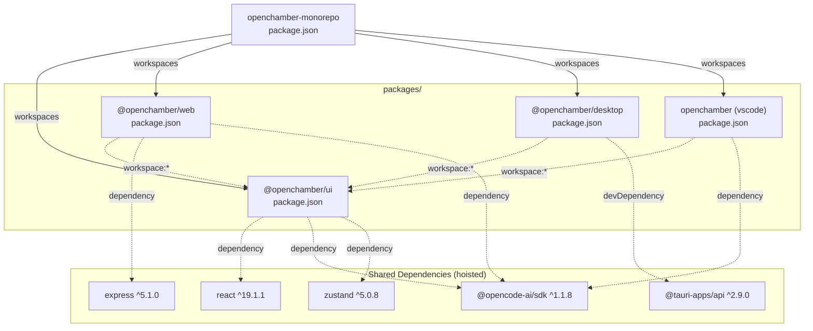
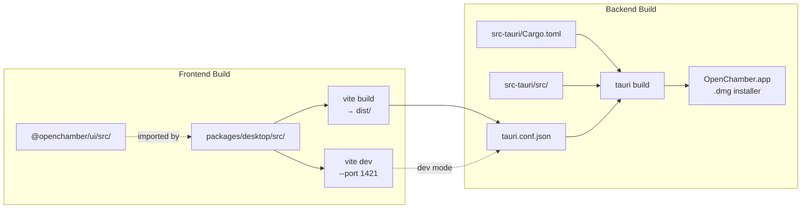
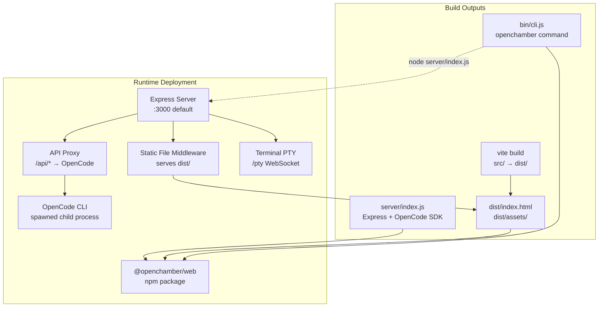
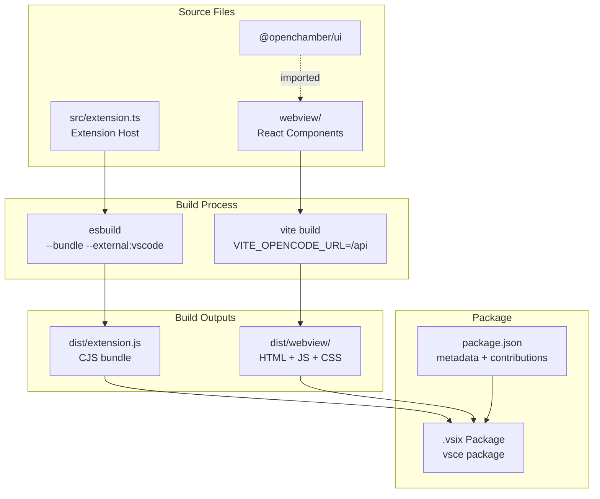
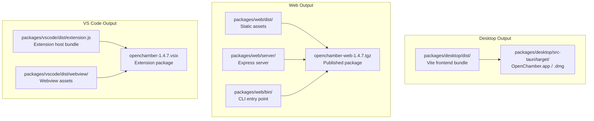

<!-- source: DeepWiki mcp.deepwiki.com · repo btriapitsyn/openchamber · page 3.1 Multi-Platform Deployment · fetched 2026-10-26 -->

# Multi-Platform Deployment

<details>
<summary>Relevant source files</summary>

The following files were used as context for generating this wiki page:

- [packages/desktop/src-tauri/src/main.rs](packages/desktop/src-tauri/src/main.rs)
- [packages/ui/src/App.tsx](packages/ui/src/App.tsx)
- [packages/ui/src/components/layout/VSCodeLayout.tsx](packages/ui/src/components/layout/VSCodeLayout.tsx)
- [packages/ui/src/lib/api/types.ts](packages/ui/src/lib/api/types.ts)
- [packages/ui/src/lib/desktop.ts](packages/ui/src/lib/desktop.ts)
- [packages/ui/src/lib/persistence.ts](packages/ui/src/lib/persistence.ts)
- [packages/vscode/assets/icon-titlebar.svg](packages/vscode/assets/icon-titlebar.svg)
- [packages/vscode/src/ChatViewProvider.ts](packages/vscode/src/ChatViewProvider.ts)
- [packages/vscode/src/bridge.ts](packages/vscode/src/bridge.ts)
- [packages/vscode/src/extension.ts](packages/vscode/src/extension.ts)
- [packages/vscode/src/opencode.ts](packages/vscode/src/opencode.ts)
- [packages/vscode/src/sessionActivityWatcher.ts](packages/vscode/src/sessionActivityWatcher.ts)
- [packages/vscode/webview/api/bridge.ts](packages/vscode/webview/api/bridge.ts)
- [packages/vscode/webview/main.tsx](packages/vscode/webview/main.tsx)
- [packages/web/server/index.js](packages/web/server/index.js)

</details>


## Purpose and Scope

This document explains how OpenChamber deploys as three distinct client platforms—Desktop (Tauri), Web (Express/Node.js), and VS Code Extension—while sharing a common UI component library. It covers the monorepo structure, package organization, build configurations, and platform-specific entry points.

For information about how each platform integrates with the OpenCode backend, see [OpenCode Backend Integration](#3.2). For build system details and development workflows, see [Build System and Workflow](#9.1).

## Monorepo Organization

OpenChamber uses a Bun workspace-based monorepo with four primary packages under `packages/`:

| Package | Purpose | Build Output | Platform |
|---------|---------|--------------|----------|
| `@openchamber/ui` | Shared React components | TypeScript type checking only | All |
| `@openchamber/web` | Web application | Client bundle + Express server + CLI | Browser/Node.js |
| `@openchamber/desktop` | Desktop application | Vite bundle + Tauri native binary | macOS/Linux/Windows |
| `openchamber` (vscode) | VS Code extension | Extension JS + Webview bundle + VSIX | VS Code |

The workspace configuration uses Bun as the package manager ([package.json:7-10]()):

```json
"packageManager": "bun@1.3.5",
"workspaces": [
  "packages/*"
]
```

### Platform Version Synchronization

All packages maintain synchronized version numbers (`1.4.7` as of the latest release). Version updates are coordinated across:
- [package.json:3]() (monorepo root)
- [packages/desktop/package.json:3]()
- [packages/web/package.json:3]()
- [packages/ui/package.json:3]()
- [packages/vscode/package.json:5]()
- [packages/desktop/src-tauri/Cargo.toml:3]()
- [packages/desktop/src-tauri/tauri.conf.json:4]()

**Monorepo Package Structure**



Sources: [package.json:1-127](), [packages/ui/package.json:1-81](), [packages/web/package.json:1-96](), [packages/desktop/package.json:1-40](), [packages/vscode/package.json:1-209]()

## Shared UI Package

The `@openchamber/ui` package ([packages/ui/package.json]()) provides all React components, hooks, and stores consumed by the three platforms. It does not produce a distributable bundle; instead, platforms import directly from TypeScript source files.

### Package Configuration

The package entry point references the source directory ([packages/ui/package.json:6]()):

```json
"main": "src/main.tsx"
```

The build script performs type checking only, without transpilation ([packages/ui/package.json:8-9]()):

```bash
"dev": "tsc --noEmit --watch",
"build": "tsc --noEmit"
```

### Key Dependencies

Core dependencies include ([packages/ui/package.json:13-53]()):
- `react` and `react-dom` for component rendering
- `@opencode-ai/sdk` for OpenCode API types
- `zustand` for state management
- `ghostty-web` for terminal rendering
- `@radix-ui/*` for accessible UI primitives
- `@pierre/diffs` for diff visualization
- `react-syntax-highlighter` for code highlighting

### Runtime Adaptation

The UI package uses runtime detection to adapt to different platforms. Platform-specific code is isolated using environment variables and conditional imports, allowing the same components to render appropriately in Desktop (Tauri), Web (browser), and VS Code (webview) contexts.

Sources: [packages/ui/package.json:1-81]()

## Desktop Platform Architecture

The Desktop application combines a Vite-built frontend with a Tauri Rust backend. The application runs as a native binary with embedded web content.

**Desktop Build Pipeline**



### Frontend Configuration

The Desktop package uses Vite to bundle the frontend ([packages/desktop/package.json:15-16]()):

```json
"dev": "vite dev --host 127.0.0.1 --port 1421",
"build": "vite build"
```

The Tauri configuration specifies the dev server and build output ([packages/desktop/src-tauri/tauri.conf.json:6-10]()):

```json
"build": {
  "beforeDevCommand": "bun run dev",
  "beforeBuildCommand": "bun run build",
  "devUrl": "http://127.0.0.1:1421",
  "frontendDist": "../dist"
}
```

### Rust Backend Dependencies

The Rust backend ([packages/desktop/src-tauri/Cargo.toml]()) includes:
- `tauri` with `macos-private-api` feature for native integrations ([packages/desktop/src-tauri/Cargo.toml:41]())
- `tauri-plugin-updater` for auto-update functionality ([packages/desktop/src-tauri/Cargo.toml:51]())
- `tauri-plugin-notification` for native notifications ([packages/desktop/src-tauri/Cargo.toml:50]())
- `tauri-plugin-shell` for process management ([packages/desktop/src-tauri/Cargo.toml:45]())
- `portable-pty` for terminal emulation ([packages/desktop/src-tauri/Cargo.toml:33]())
- `reqwest`, `axum`, and `tokio` for HTTP and async runtime ([packages/desktop/src-tauri/Cargo.toml:36,21,46]())

### macOS-Specific Configuration

The application enables macOS private APIs for enhanced window customization ([packages/desktop/src-tauri/tauri.conf.json:36]()):

```json
"macOSPrivateApi": true
```

Window configuration includes transparent background and custom traffic light positioning ([packages/desktop/src-tauri/tauri.conf.json:14-30]()):

```json
"transparent": true,
"hiddenTitle": true,
"titleBarStyle": "Overlay",
"trafficLightPosition": {
  "x": 17,
  "y": 26
}
```

Bundle configuration specifies minimum macOS version and updater artifacts ([packages/desktop/src-tauri/tauri.conf.json:44-65]()):

```json
"macOS": {
  "minimumSystemVersion": "14.0",
  "dmg": { ... }
},
"createUpdaterArtifacts": true
```

Sources: [packages/desktop/package.json:1-40](), [packages/desktop/src-tauri/Cargo.toml:1-62](), [packages/desktop/src-tauri/tauri.conf.json:1-76]()

## Web Platform Architecture

The Web application consists of two distinct builds: a client-side Vite bundle served to browsers and a Node.js Express server that spawns the OpenCode process.

**Web Platform Components**



### Build Configuration

The Web package uses Vite for client bundling with watch mode support ([packages/web/package.json:18-19]()):

```json
"build": "vite build",
"build:watch": "vite build --watch"
```

The Express server runs independently ([packages/web/package.json:16-17]()):

```json
"dev:server": "node server/index.js --port 3001",
"dev:server:watch": "nodemon --watch server --ext js --exec \"node server/index.js --port 3001\""
```

### Package Distribution

The published package includes both built and runtime files ([packages/web/package.json:88-95]()):

```json
"files": [
  "dist",
  "server",
  "bin",
  "public",
  "package.json",
  "README.md"
]
```

The CLI entry point ([packages/web/package.json:8-9]()):

```json
"bin": {
  "openchamber": "./bin/cli.js"
}
```

### Web-Specific Dependencies

The Web package includes server-side dependencies not needed by other platforms ([packages/web/package.json:24-62]()):
- `express` for HTTP server
- `http-proxy-middleware` for proxying OpenCode API
- `node-pty` and `bun-pty` for terminal emulation
- `qrcode-terminal` for Cloudflare tunnel QR codes
- `adm-zip` for OpenCode binary extraction

Sources: [packages/web/package.json:1-96]()

## VS Code Extension Architecture

The VS Code extension uses a dual-build system: esbuild for the extension host code and Vite for the webview frontend.

**VS Code Extension Build Pipeline**



### Extension Build Configuration

The extension uses esbuild with VS Code API externalization ([packages/vscode/package.json:180]()):

```bash
esbuild src/extension.ts --bundle --outfile=dist/extension.js --external:vscode --format=cjs --platform=node --minify --main-fields=module,main
```

The webview build uses Vite with a specific API URL prefix ([packages/vscode/package.json:181]()):

```bash
VITE_OPENCODE_URL=/api vite build
```

Concurrent development mode ([packages/vscode/package.json:182]()):

```json
"dev": "concurrently -n \"ext,web\" -c \"cyan,magenta\" \"bun run watch:extension\" \"bun run watch:webview\""
```

### Extension Manifest

The extension contributes a webview view to the activity bar ([packages/vscode/package.json:40-58]()):

```json
"contributes": {
  "viewsContainers": {
    "activitybar": [
      {
        "id": "openchamber",
        "title": "OpenChamber",
        "icon": "assets/icon.svg"
      }
    ]
  },
  "views": {
    "openchamber": [
      {
        "type": "webview",
        "id": "openchamber.chatView",
        "name": "Chat"
      }
    ]
  }
}
```

### Extension Commands

Registered commands include ([packages/vscode/package.json:59-116]()):
- `openchamber.openSidebar` - Open the chat sidebar
- `openchamber.restartApi` - Restart OpenCode connection
- `openchamber.openAgentManager` - Open multi-agent panel
- `openchamber.addToContext` / `explain` / `improveCode` - Context menu actions
- `openchamber.showSettings` - Open settings view

### Extension Dependencies

The extension includes ([packages/vscode/package.json:199-207]()):
- `@openchamber/ui` (workspace dependency)
- `@opencode-ai/sdk` for backend integration
- `adm-zip` for binary extraction
- `jsonc-parser` and `yaml` for configuration parsing

Sources: [packages/vscode/package.json:1-209]()

## Cross-Platform Build System

The monorepo coordinates builds across all platforms using concurrent execution and watch modes.

### Development Scripts

Root-level development scripts ([package.json:24]()):

```bash
bun run dev
# Runs: concurrently -n "server,web,ui" -c "cyan,magenta,yellow" \
#   "bun run --cwd packages/web dev:server:watch" \
#   "bun run --cwd packages/web build:watch" \
#   "bun run --cwd packages/ui dev"
```

This starts three processes simultaneously:
1. Express server with auto-reload ([packages/web/package.json:17]())
2. Vite client build in watch mode ([packages/web/package.json:19]())
3. TypeScript type checking for UI ([packages/ui/package.json:8]())

### Platform-Specific Development

Desktop development ([package.json:46]()):

```bash
bun run desktop:dev
# Executes: node ./packages/desktop/scripts/desktop-dev.mjs
```

VS Code extension development ([package.json:50]()):

```bash
bun run vscode:dev
# Executes: bun run --cwd packages/vscode dev
```

### Production Build Scripts

Full build across all packages ([package.json:25]()):

```bash
bun run build
# Executes: bun run --filter '*' build
```

Individual platform builds:
- Web: `bun run build:web` ([package.json:26]())
- Desktop: `bun run desktop:build` ([package.json:47]())
- VS Code: `bun run vscode:build` ([package.json:51]())

### Type Checking and Linting

Type checking across all packages ([package.json:29]()):

```bash
bun run type-check
# Executes: bun run --filter '*' type-check
```

Desktop includes Rust checks ([package.json:49]()):

```bash
cargo fmt --manifest-path packages/desktop/src-tauri/Cargo.toml -- --check
cargo clippy --manifest-path packages/desktop/src-tauri/Cargo.toml -- -D warnings
```

Sources: [package.json:1-127]()

## Dependency Management

### Shared Dependencies (Hoisted)

Core dependencies are hoisted to the monorepo root to ensure version consistency ([package.json:60-99]()):

| Dependency | Version | Used By |
|------------|---------|---------|
| `react` | ^19.1.1 | All platforms |
| `@opencode-ai/sdk` | ^1.1.8 | All platforms |
| `zustand` | ^5.0.8 | All platforms |
| `express` | ^5.1.0 | Web, UI (types) |
| `ghostty-web` | 0.3.0 | UI (Desktop, Web) |
| `node-pty` / `bun-pty` | ^1.1.0 / ^0.4.5 | Web (terminal) |

### Platform-Specific Dependencies

**Desktop Only:**
- `@tauri-apps/api` - Tauri frontend APIs ([packages/desktop/package.json:31]())
- `@tauri-apps/plugin-*` - Native plugins ([packages/desktop/package.json:22-24]())

**Web Only:**
- `qrcode-terminal` - Cloudflare tunnel QR codes ([packages/web/package.json:51]())
- `adm-zip` - Binary extraction ([packages/web/package.json:40]())

**VS Code Only:**
- `@types/vscode` - VS Code API types ([packages/vscode/package.json:191]())
- `@vscode/vsce` - Extension packaging ([packages/vscode/package.json:193]())

### Workspace Dependencies

All platforms reference the UI package using workspace protocol ([packages/web/package.json:24](), [packages/desktop/package.json:25](), [packages/vscode/package.json:200]()):

```json
"@openchamber/ui": "workspace:*"
```

This ensures they always use the local UI package from the monorepo rather than a published version.

Sources: [package.json:60-99](), [packages/ui/package.json:13-53](), [packages/web/package.json:24-62](), [packages/desktop/package.json:21-27](), [packages/vscode/package.json:199-207]()

## Platform Output Artifacts

**Platform Deployment Artifacts**



### Desktop Artifacts

Desktop builds produce platform-specific installers:
- **macOS**: `.app` bundle and `.dmg` disk image
- **Target directory**: `packages/desktop/src-tauri/target/release/bundle/`
- **Updater artifacts**: `.tar.gz` with signature files for auto-update

### Web Artifacts

Web package includes:
- **Client bundle**: `dist/index.html` and `dist/assets/`
- **Server code**: `server/index.js` (not bundled)
- **CLI tool**: `bin/cli.js`
- **Published to**: npm as `@openchamber/web`

### VS Code Artifacts

Extension produces:
- **Extension bundle**: `dist/extension.js` (CommonJS)
- **Webview bundle**: `dist/webview/` (ES modules + assets)
- **VSIX package**: `openchamber-1.4.7.vsix`
- **Published to**: VS Code Marketplace

Sources: [packages/desktop/src-tauri/tauri.conf.json:38-65](), [packages/web/package.json:88-95](), [packages/vscode/package.json:178-188]()

---

