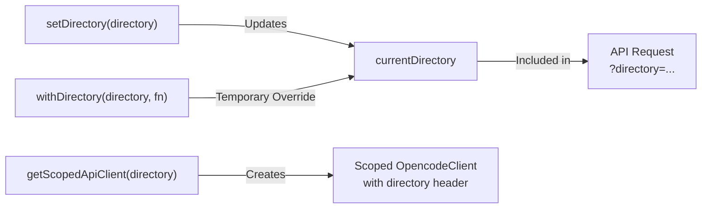
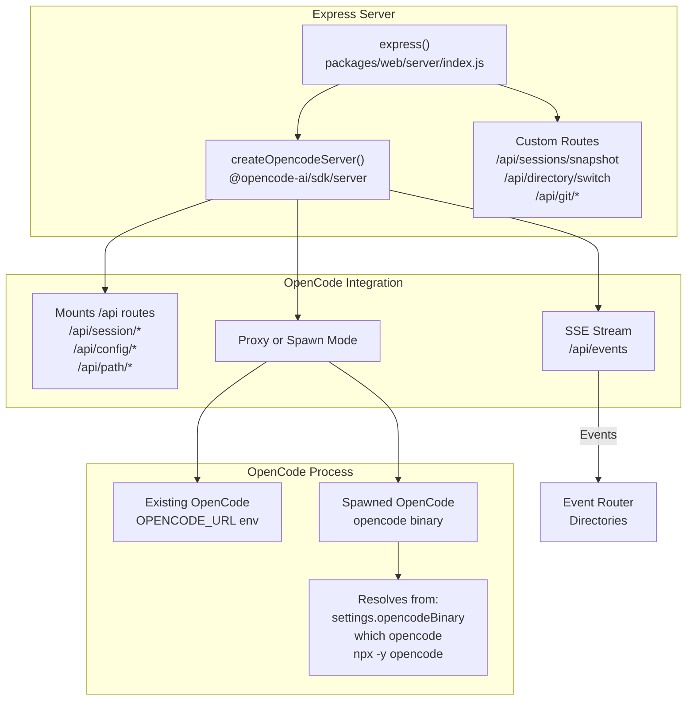
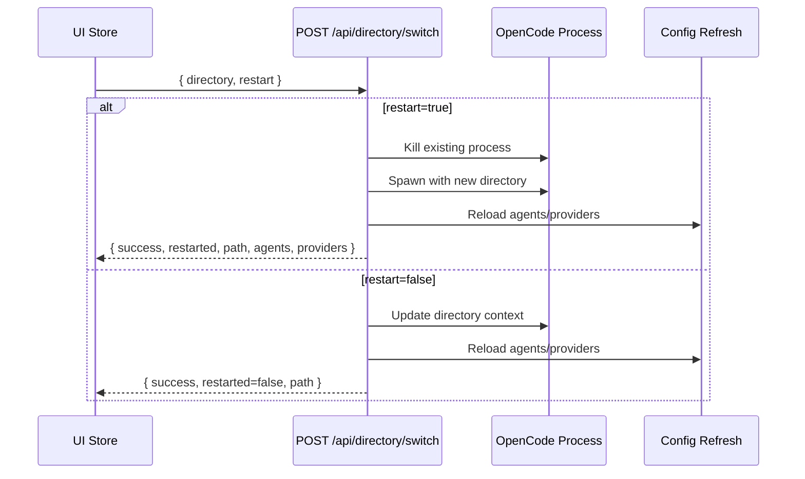
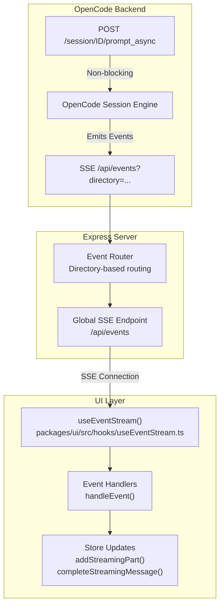
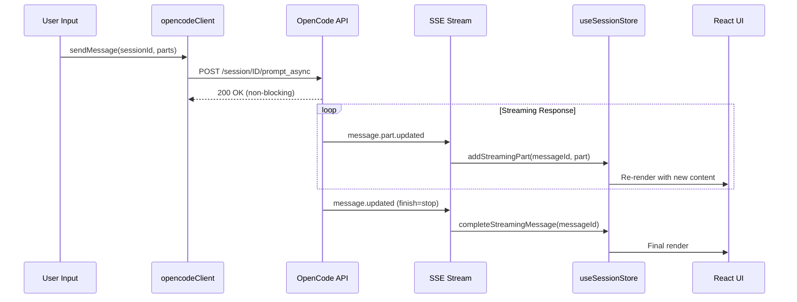
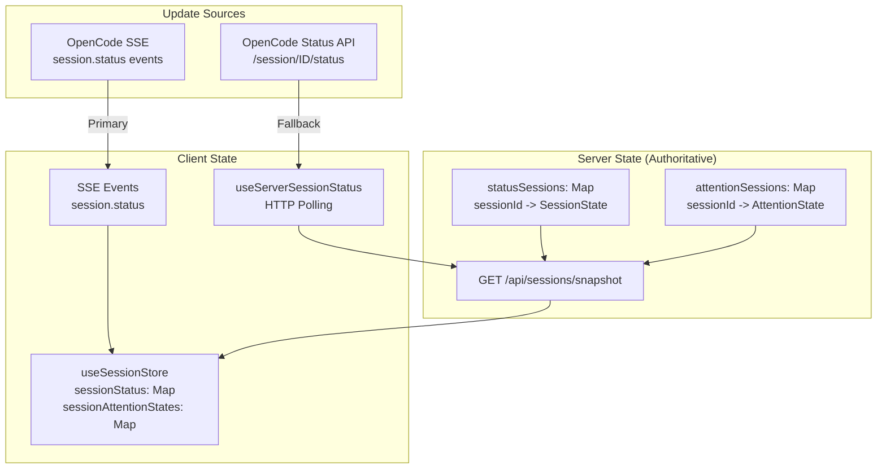
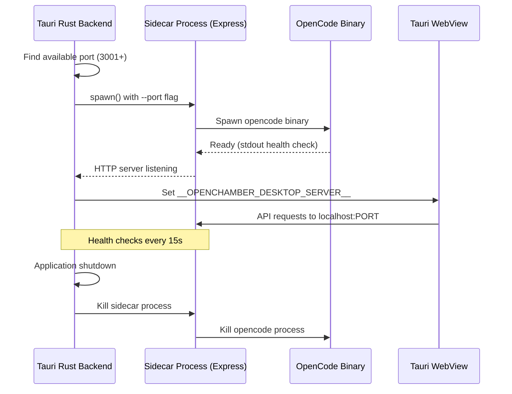
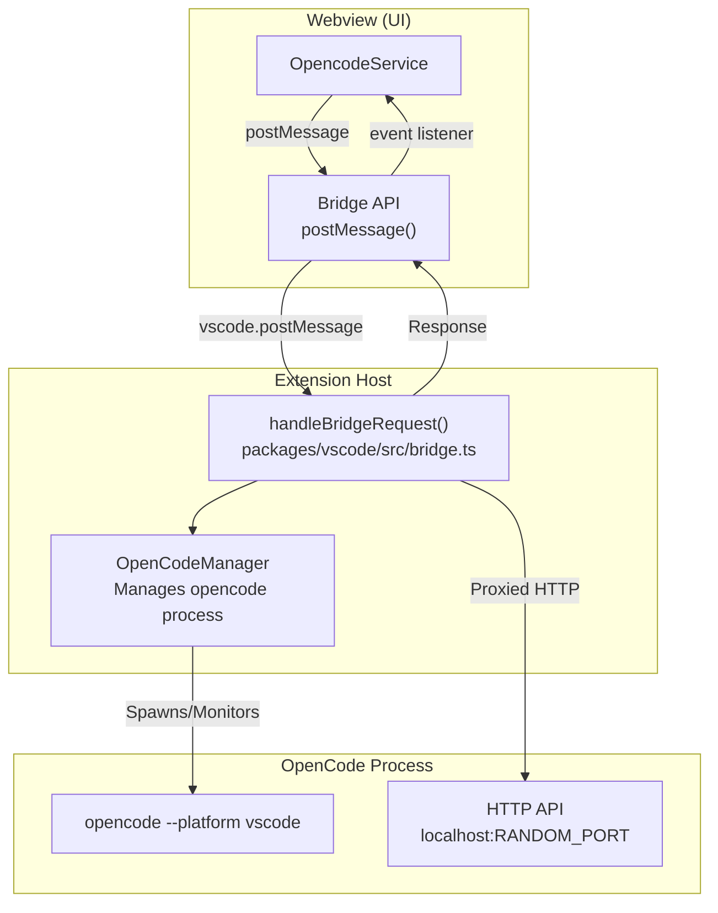
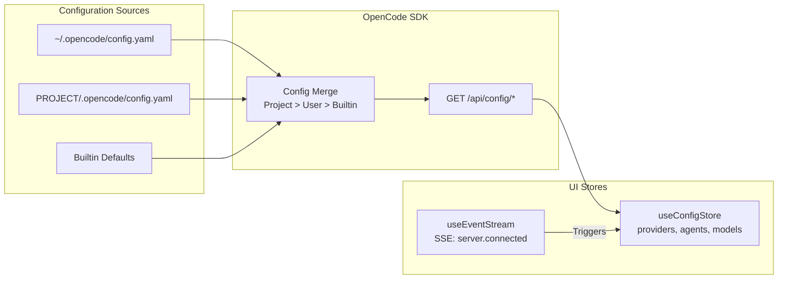

<!-- source: DeepWiki mcp.deepwiki.com · repo btriapitsyn/openchamber · page 3.2 OpenCode Backend Integration · fetched 2026-10-26 -->

# OpenCode Backend Integration

<details>
<summary>Relevant source files</summary>

The following files were used as context for generating this wiki page:

- [packages/desktop/src-tauri/src/main.rs](packages/desktop/src-tauri/src/main.rs)
- [packages/ui/src/App.tsx](packages/ui/src/App.tsx)
- [packages/ui/src/components/sections/openchamber/NotificationSettings.tsx](packages/ui/src/components/sections/openchamber/NotificationSettings.tsx)
- [packages/ui/src/hooks/useEventStream.ts](packages/ui/src/hooks/useEventStream.ts)
- [packages/ui/src/hooks/useServerSessionStatus.ts](packages/ui/src/hooks/useServerSessionStatus.ts)
- [packages/ui/src/lib/api/types.ts](packages/ui/src/lib/api/types.ts)
- [packages/ui/src/lib/appearanceAutoSave.ts](packages/ui/src/lib/appearanceAutoSave.ts)
- [packages/ui/src/lib/opencode/client.ts](packages/ui/src/lib/opencode/client.ts)
- [packages/vscode/src/bridge.ts](packages/vscode/src/bridge.ts)
- [packages/web/server/index.js](packages/web/server/index.js)

</details>


This document describes how OpenChamber integrates with the OpenCode SDK to provide AI provider abstraction, session management, and real-time event streaming. The OpenCode SDK serves as the backend layer that handles all AI provider communication, tool execution, and state management across web, desktop, and VS Code runtimes.

For multi-platform deployment architecture, see [Multi-Platform Deployment](#3.1). For real-time event processing details, see [Real-Time Communication](#3.3).

---

## OpenCode SDK Overview

OpenChamber depends on the `@opencode-ai/sdk` package, which provides a unified API for interacting with AI providers (OpenAI, Anthropic, Google, etc.) and managing conversational sessions. The SDK abstracts provider-specific details and handles tool execution, streaming responses, and session persistence.

**Integration Points:**

| Component | SDK Package | Purpose |
|-----------|-------------|---------|
| Client-side UI | `@opencode-ai/sdk/v2` | Type-safe client for API calls |
| Server-side (Web) | `@opencode-ai/sdk/server` | Express middleware and SSE server |
| Desktop Sidecar | `@opencode-ai/sdk` (via spawned process) | Standalone OpenCode instance |
| VS Code Extension | `@opencode-ai/sdk` (managed process) | Extension-managed OpenCode instance |

The SDK provides three core abstractions:

- **Sessions**: Conversational threads with persistent message history
- **Messages**: User prompts and assistant responses with structured parts
- **Events**: Real-time SSE stream for streaming responses and status updates

**Sources:** [packages/ui/src/lib/opencode/client.ts:1-15](), [packages/web/server/index.js:23]()

---

## Client-Side Integration: OpencodeService

The UI layer interacts with OpenCode through the `OpencodeService` class, which wraps the SDK client and provides directory-scoped API access.

### OpencodeService Architecture

```mermaid
graph TB
    subgraph "UI Layer"
        Stores["Zustand Stores<br/>useSessionStore, useConfigStore"]
        Hooks["React Hooks<br/>useEventStream, useServerSessionStatus"]
    end
    
    subgraph "OpencodeService"
        OpencodeService["OpencodeService<br/>packages/ui/src/lib/opencode/client.ts"]
        BaseClient["client: OpencodeClient<br/>createOpencodeClient()"]
        ScopedClients["scopedClients: Map<br/>directory -> OpencodeClient"]
        DirectoryContext["currentDirectory: string"]
    end
    
    subgraph "SDK Client"
        OpencodeClient["@opencode-ai/sdk/v2<br/>OpencodeClient"]
        SessionAPI["session.list/create/get/delete"]
        MessageAPI["session.messages()"]
        ConfigAPI["config.agents/providers/models"]
        PathAPI["path.get()"]
    end
    
    subgraph "Backend"
        ExpressServer["Express Server<br/>or Sidecar/Extension"]
        OpenCodeBinary["OpenCode Process"]
    end
    
    Stores --> OpencodeService
    Hooks --> OpencodeService
    OpencodeService --> BaseClient
    OpencodeService --> ScopedClients
    OpencodeService --> DirectoryContext
    BaseClient --> OpencodeClient
    ScopedClients --> OpencodeClient
    OpencodeClient -->|HTTP/SSE| ExpressServer
    ExpressServer --> OpenCodeBinary
```

**Sources:** [packages/ui/src/lib/opencode/client.ts:136-268]()

### Directory Scoping

OpenCode uses directory context to determine which project/worktree a session belongs to. The `OpencodeService` maintains a `currentDirectory` state that is included in all API calls.



**Key Methods:**

- `setDirectory(directory)` - Sets the global directory context for all subsequent API calls
- `withDirectory(directory, fn)` - Temporarily overrides directory context for a specific operation
- `getScopedApiClient(directory)` - Returns a cached SDK client pre-configured with a directory

**Sources:** [packages/ui/src/lib/opencode/client.ts:244-268](), [packages/ui/src/lib/opencode/client.ts:171-181]()

### Session Management API

The `OpencodeService` provides convenience methods for session CRUD operations:

```typescript
// From packages/ui/src/lib/opencode/client.ts

async listSessions(): Promise<Session[]>
async createSession(params?: { parentID?: string; title?: string }): Promise<Session>
async getSession(id: string): Promise<Session>
async deleteSession(id: string): Promise<boolean>
async updateSession(id: string, title?: string): Promise<Session>
async getSessionMessages(id: string, limit?: number): Promise<{ info: Message; parts: Part[] }[]>
```

All methods automatically include the current directory context via the `currentDirectory` property.

**Sources:** [packages/ui/src/lib/opencode/client.ts:358-409]()

---

## Server-Side Integration: Express + createOpencodeServer

The web runtime uses an Express server that integrates with OpenCode via the `createOpencodeServer` helper from `@opencode-ai/sdk/server`.

### Express Server Architecture



**Sources:** [packages/web/server/index.js:1-50](), [packages/web/server/index.js:1285-1380]()

### createOpencodeServer Configuration

The server is initialized with directory-specific options:

```javascript
// packages/web/server/index.js:1285-1380

const { server: opencodeServer } = await createOpencodeServer({
  opencode: {
    url: process.env.OPENCODE_URL,
    binary: resolvedBinary,
    args: ['--platform', 'web', '--json'],
    env: { NODE_ENV: 'production' }
  },
  directory: {
    root: baseDirectory || process.cwd(),
    restrict: true  // Prevent access outside root
  },
  events: {
    directory: baseDirectory,
    // Server routes events to UI via SSE
  }
});

app.use('/api', opencodeServer);
```

**Key Configuration:**

- **`opencode.url`** - If set, proxies to existing OpenCode instance instead of spawning
- **`opencode.binary`** - Path to OpenCode CLI binary (resolved from settings or `which opencode`)
- **`directory.root`** - Base directory for project access (home directory or workspace root)
- **`directory.restrict`** - Enforces path sandboxing to prevent directory traversal

**Sources:** [packages/web/server/index.js:1285-1380]()

### Directory Switching Endpoint

The server provides a custom `/api/directory/switch` endpoint that handles directory changes and optionally restarts OpenCode:



**Sources:** [packages/web/server/index.js:1612-1695]()

---

## Event Stream Architecture (SSE)

OpenCode uses Server-Sent Events (SSE) to stream real-time updates to the UI. The event stream is the primary mechanism for:

- Streaming AI responses (message parts)
- Session status updates (idle/busy/retry)
- Permission/question requests
- Configuration changes (MCP tools, agents)

### Event Flow



**Sources:** [packages/ui/src/hooks/useEventStream.ts:104-1074]()

### Event Types

The `useEventStream` hook processes these event types:

| Event Type | Purpose | Store Action |
|------------|---------|--------------|
| `message.part.updated` | Streaming text chunk | `addStreamingPart()` |
| `message.updated` | Message completed | `completeStreamingMessage()` |
| `session.status` | Session state (idle/busy/retry) | Update `sessionStatus` Map |
| `session.updated` | Session metadata (title, summary) | `applySessionMetadata()` |
| `session.created` | New session created | `loadSessions()` |
| `permission.request` | Permission request | `addPermission()` |
| `question.request` | User input needed | `addQuestion()` |
| `mcp.tools.changed` | MCP tools updated | `useMcpStore.refresh()` |
| `server.connected` | OpenCode connected | `checkConnection()` |
| `global.disposed` | OpenCode restarted | `bootstrapState()` |

**Sources:** [packages/ui/src/hooks/useEventStream.ts:584-1074]()

### Message Streaming Implementation



**Key Methods:**

- `addStreamingPart(messageId, part)` - Appends a text chunk to a streaming message
- `completeStreamingMessage(messageId)` - Marks message as complete, removes from streaming state
- `updateMessageInfo(messageId, updates)` - Updates message metadata (finish status, model, etc.)

**Sources:** [packages/ui/src/hooks/useEventStream.ts:584-920](), [packages/ui/src/stores/useSessionStore.ts]()

---

## Session Status Management

Session status tracking uses a hybrid approach: SSE events for real-time updates, with HTTP polling as a backup for reliability.

### Status Synchronization Architecture



**Sources:** [packages/ui/src/hooks/useServerSessionStatus.ts:1-303](), [packages/ui/src/hooks/useEventStream.ts:640-700]()

### Status Types

```typescript
// Session execution status
type SessionStatus = {
  type: 'idle' | 'busy' | 'retry';
  confirmedAt?: number;  // Timestamp of last update
  attempt?: number;      // Retry attempt number
  message?: string;      // Retry error message
  next?: number;         // Next retry timestamp
};

// Attention state (needs user review)
type SessionAttentionState = {
  needsAttention: boolean;
  lastUserMessageAt: number | null;
  lastStatusChangeAt: number;
  status: 'idle' | 'busy' | 'retry';
  isViewed: boolean;  // User has viewed the session
};
```

**Server-Side Tracking:**

The server maintains authoritative session state by tracking message events and view tracking endpoints. The `/api/sessions/snapshot` endpoint provides a consistent view of all session states.

**Client-Side Polling:**

The `useServerSessionStatus` hook polls the snapshot endpoint on:
- Initial mount
- Tab visibility change (foreground)
- After SSE reconnection (triggered via `triggerSessionStatusPoll()`)

**Sources:** [packages/ui/src/hooks/useServerSessionStatus.ts:48-297](), [packages/web/server/index.js]()

---

## Desktop Sidecar Integration

The desktop application spawns the entire web server as a sidecar process, bundling both the Express server and the OpenCode binary.

### Sidecar Lifecycle



**Sources:** [packages/desktop/src-tauri/src/main.rs:1-100](), [packages/web/server/index.js:1285-1380]()

### Port Discovery and Configuration

The desktop app finds an available port and injects the server URL into the UI context:

```rust
// packages/desktop/src-tauri/src/main.rs

fn find_available_port() -> u16 {
  for port in 3001..3100 {
    if let Ok(listener) = TcpListener::bind(("127.0.0.1", port)) {
      drop(listener);
      return port;
    }
  }
  3001 // fallback
}

// Inject into webview context
window.__OPENCHAMBER_DESKTOP_SERVER__ = {
  origin: `http://127.0.0.1:${port}`,
  apiPrefix: '/api'
};
```

The UI detects this context and configures the `OpencodeService` to use the sidecar URL instead of a relative path.

**Sources:** [packages/desktop/src-tauri/src/main.rs](), [packages/ui/src/lib/opencode/client.ts:59-82]()

---

## VS Code Extension Integration

The VS Code extension manages an OpenCode process independently and proxies API calls through the extension host.

### Extension Bridge Architecture



**Sources:** [packages/vscode/src/bridge.ts:49-1800]()

### API Proxying

The extension proxies all OpenCode API calls through a bridge message protocol:

```typescript
// packages/vscode/src/bridge.ts

interface BridgeRequest {
  id: string;
  type: string;
  payload?: unknown;
}

// Example: Proxy session list request
{
  id: "req-123",
  type: "apiProxy",
  payload: {
    method: "GET",
    path: "/session",
    headers: { "Accept": "application/json" }
  }
}
```

The extension host receives the message, makes an HTTP request to the local OpenCode instance, and returns the response via the same message channel.

**Sources:** [packages/vscode/src/bridge.ts:63-1800]()

---

## Configuration Management

OpenCode configuration (agents, providers, models) is loaded from YAML files and exposed via the SDK's config API.

### Configuration Flow



**Sources:** [packages/ui/src/stores/useConfigStore.ts](), [packages/ui/src/hooks/useEventStream.ts:626-627]()

### Loading Configuration

The `useConfigStore` provides methods to load and manage configuration:

```typescript
// From useConfigStore.ts

checkConnection(): Promise<void>
  // Fetches /api/config/agents, /api/config/providers, /api/config/models
  // Populates providers, agents, models, status

getConfig(): Promise<Config>
  // Full configuration object from SDK

refreshConfig(): Promise<void>
  // Reloads all configuration from disk
```

Configuration is reloaded when:
- The app initializes (`initializeApp()`)
- A `server.connected` SSE event is received (OpenCode restart)
- The user switches directories
- MCP tools change (`mcp.tools.changed` event)

**Sources:** [packages/ui/src/stores/useConfigStore.ts](), [packages/ui/src/hooks/useEventStream.ts:626-638]()

---

## Key Integration Patterns

### Pattern 1: Directory-Scoped Operations

All OpenCode operations are scoped to a directory context. The UI maintains a global `currentDirectory` state that is included in every API call:

```typescript
// Set directory globally
opencodeClient.setDirectory('/path/to/project');
await opencodeClient.listSessions();

// Temporary override
await opencodeClient.withDirectory('/other/path', async () => {
  return await opencodeClient.createSession({ title: 'Test' });
});

// Scoped client (for worktree APIs)
const scopedClient = opencodeClient.getScopedApiClient('/worktree/path');
```

**Sources:** [packages/ui/src/lib/opencode/client.ts:244-264]()

### Pattern 2: Streaming Response Handling

Streaming responses use a two-phase approach:

1. **Optimistic Message Creation** - UI creates a pending message immediately
2. **SSE Part Updates** - Accumulate streaming text chunks via `addStreamingPart()`
3. **Completion** - Mark message complete via `completeStreamingMessage()`

```typescript
// Send message (non-blocking)
await opencodeClient.sendMessage(sessionId, parts);

// SSE events update streaming state
// useEventStream handles:
// - message.part.updated -> addStreamingPart()
// - message.updated -> completeStreamingMessage()
```

**Sources:** [packages/ui/src/hooks/useEventStream.ts:584-920]()

### Pattern 3: Configuration Refresh on Directory Change

When switching directories, configuration must be reloaded to reflect project-specific agents/providers:

```typescript
// useDirectoryStore.switchDirectory()
const result = await fetch('/api/directory/switch', {
  method: 'POST',
  body: JSON.stringify({ directory, restart: true })
});

// Response includes refreshed config
const { agents, providers, models } = await result.json();
useConfigStore.setState({ agents, providers, models });
```

**Sources:** [packages/web/server/index.js:1612-1695](), [packages/ui/src/stores/useDirectoryStore.ts]()

---

