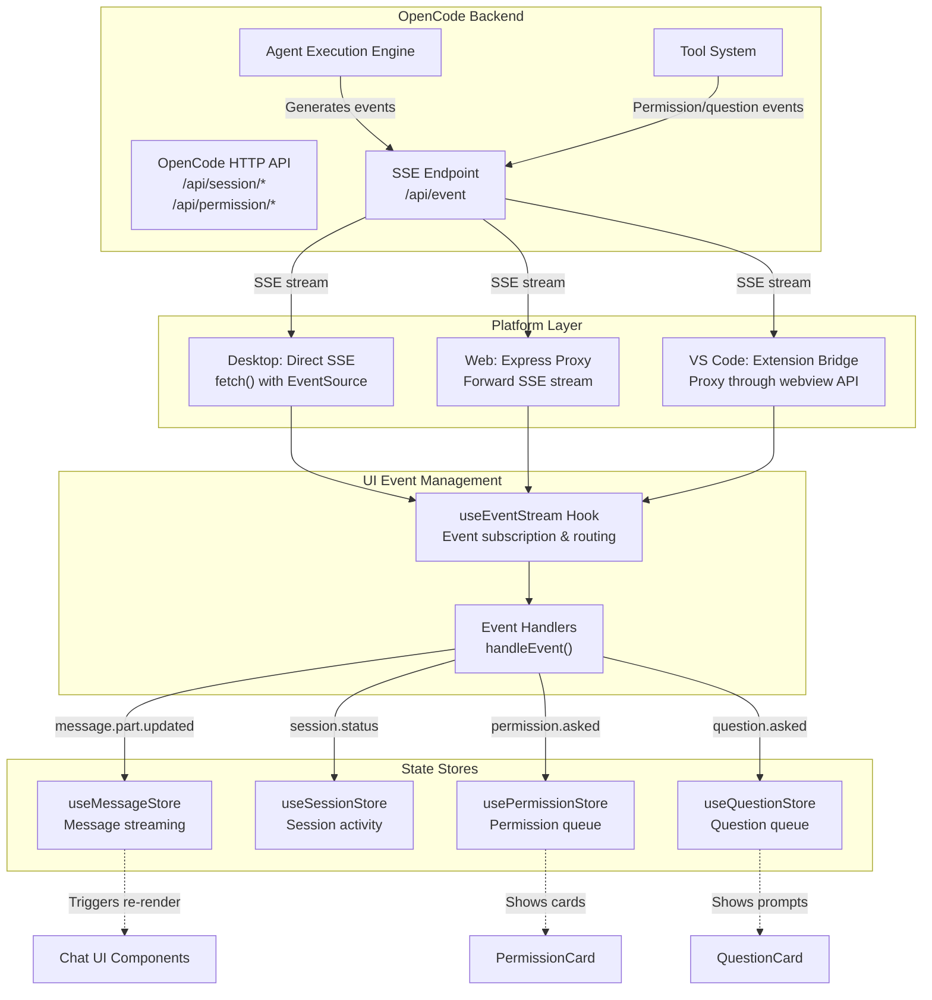
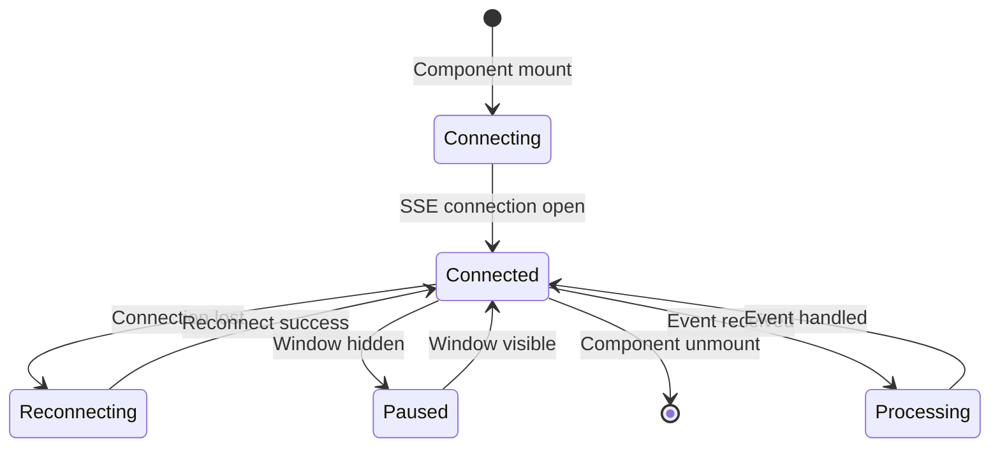
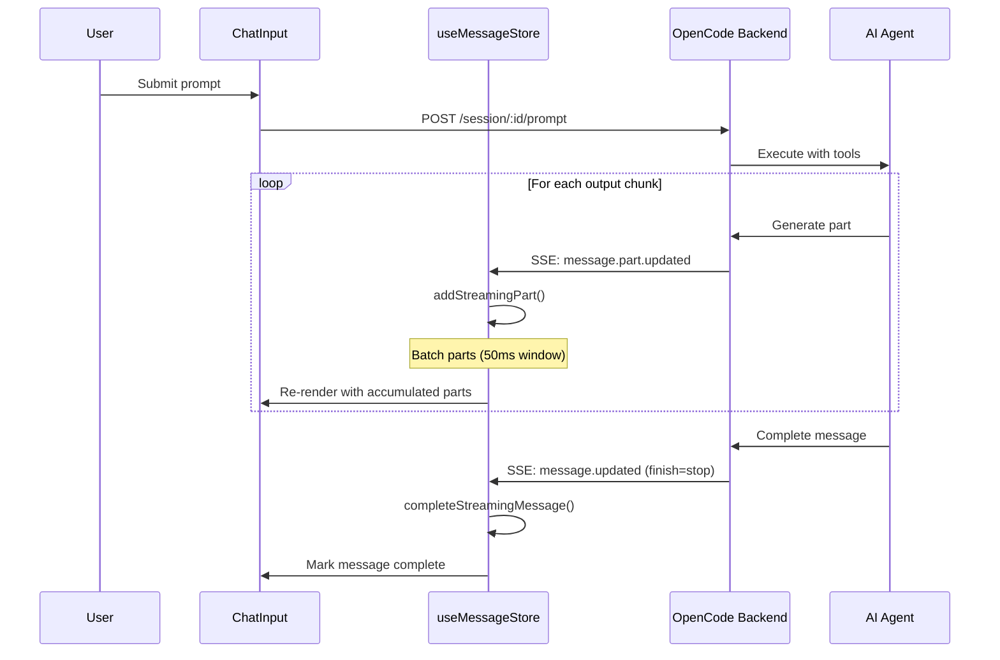
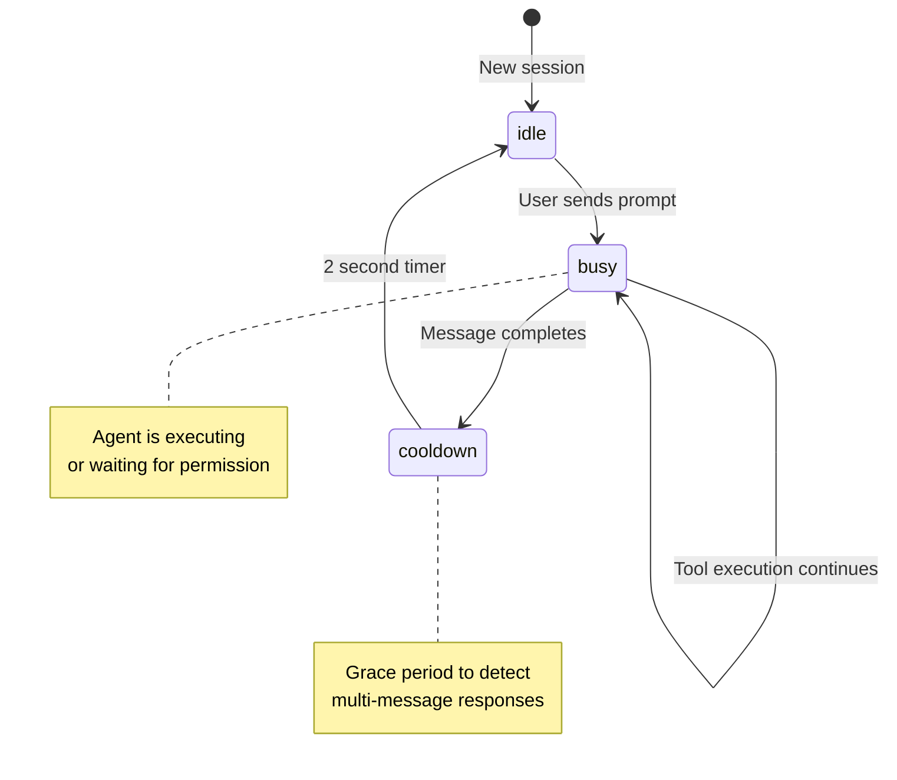
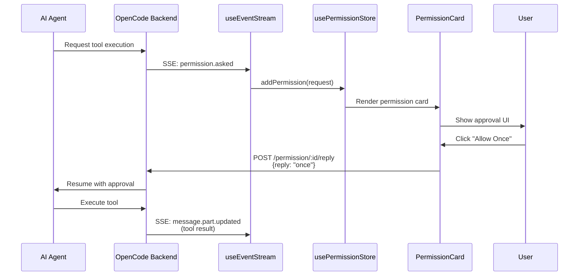

<!-- source: DeepWiki mcp.deepwiki.com · repo btriapitsyn/openchamber · page 3.3 Real-Time Communication · fetched 2026-10-26 -->

# Real-Time Communication

<details>
<summary>Relevant source files</summary>

The following files were used as context for generating this wiki page:

- [packages/ui/src/components/sections/openchamber/NotificationSettings.tsx](packages/ui/src/components/sections/openchamber/NotificationSettings.tsx)
- [packages/ui/src/hooks/useEventStream.ts](packages/ui/src/hooks/useEventStream.ts)
- [packages/ui/src/hooks/useServerSessionStatus.ts](packages/ui/src/hooks/useServerSessionStatus.ts)
- [packages/ui/src/lib/appearanceAutoSave.ts](packages/ui/src/lib/appearanceAutoSave.ts)
- [packages/ui/src/lib/opencode/client.ts](packages/ui/src/lib/opencode/client.ts)

</details>


This document describes the Server-Sent Events (SSE) based real-time communication system that powers live updates in OpenChamber. This system enables streaming message content, permission requests, session status updates, and other events from the OpenCode backend to the UI without polling.

For information about the broader OpenCode backend integration patterns, see [OpenCode Backend Integration](#3.2). For state management that consumes these events, see [State Management](#3.4).

---

## Purpose and Scope

Real-time communication in OpenChamber is built on Server-Sent Events (SSE), a unidirectional protocol where the server pushes updates to connected clients. The system handles:

- **Message streaming**: AI responses arrive incrementally as `Part` objects
- **Permission requests**: Interactive approval/rejection of tool executions
- **Session status**: Busy/idle state tracking across sessions
- **Question prompts**: Multi-field user input requests from agents
- **Metadata updates**: Session titles, summaries, and compaction events

All three platforms (Desktop, Web, VS Code) consume the same event stream but may implement proxying differently to overcome platform constraints.

**Sources:** [packages/ui/src/hooks/useEventStream.ts:1-120]()

---

## Event Flow Architecture



**Sources:** [packages/ui/src/hooks/useEventStream.ts:120-600](), [packages/ui/src/lib/opencode/client.ts:136-149]()

---

## Event Types and Payloads

The system handles multiple event types, each with specific payload structures:

| Event Type | Purpose | Key Properties | Handler Store |
|------------|---------|----------------|---------------|
| `message.part.updated` | Stream message parts incrementally | `part`, `info`, `sessionID`, `messageID` | `useMessageStore` |
| `message.updated` | Finalize message metadata | `info`, `finish`, `sessionID` | `useMessageStore` |
| `session.status` | Update session busy/idle state | `sessionID`, `status.type` | `useSessionStore` |
| `permission.asked` | Request tool execution approval | `id`, `tool`, `args`, `sessionID` | `usePermissionStore` |
| `question.asked` | Request user input | `id`, `questions`, `sessionID` | `useQuestionStore` |
| `openchamber:session-activity` | Desktop-specific activity tracking | `sessionId`, `phase`, `directory` | `useSessionStore` |
| `mcp.tools.changed` | MCP tool registry updated | `directory` | `useMcpStore` |
| `server.connected` | Backend connection established | — | Config refresh |
| `global.disposed` | Backend instance restarted | — | State bootstrap |

**Sources:** [packages/ui/src/hooks/useEventStream.ts:599-680]()

---

## Event Stream Management

### Connection Lifecycle

The `useEventStream` hook manages the SSE connection lifecycle with automatic reconnection and state synchronization:



The hook maintains connection status and publishes it to `useUIStore`:

- **idle**: Not yet connected
- **connecting**: Initial connection attempt
- **connected**: Active SSE stream
- **reconnecting**: Attempting to restore connection
- **paused**: Tab backgrounded (optional pause)
- **offline**: Network unavailable
- **error**: Connection failed

**Sources:** [packages/ui/src/hooks/useEventStream.ts:243-275](), [packages/ui/src/stores/useUIStore.ts:1-50]()

### Visibility and Network Handling

The event stream adapts to browser visibility and network status:

```typescript
// Desktop runtime maintains connection in background
const isDesktopRuntimeRef = React.useRef<boolean>(false);
const visibilityStateRef = React.useRef<'visible' | 'hidden'>(resolveVisibilityState());
const onlineStatusRef = React.useRef<boolean>(navigator.onLine);

// Pause/resume logic for web/VS Code
if (!isDesktopRuntimeRef.current && visibilityState === 'hidden') {
  // May pause SSE after timeout to reduce resource usage
  pauseTimeoutRef.current = setTimeout(() => {
    publishStatus('paused', 'Window hidden');
  }, 30000);
}
```

Desktop applications keep the stream active even when backgrounded to support notifications, while web/VS Code may pause after extended inactivity.

**Sources:** [packages/ui/src/hooks/useEventStream.ts:345-378]()

---

## Message Streaming

### Incremental Part Updates

AI responses arrive as a series of `message.part.updated` events, each containing a single `Part` object:



**Sources:** [packages/ui/src/hooks/useEventStream.ts:681-761](), [packages/ui/src/stores/messageStore.ts:348-450]()

### Batching Strategy

To avoid excessive UI thrashing, part updates are batched using a time-based window:

```typescript
// Queue incoming parts
let batchQueue: QueuedPart[] = [];
let flushTimer: ReturnType<typeof setTimeout> | null = null;
const USER_BATCH_WINDOW_MS = 50;

const addStreamingPart = (sessionId: string, messageId: string, part: Part, role?: string) => {
  batchQueue.push({ sessionId, messageId, part, role });
  
  if (!flushTimer) {
    flushTimer = setTimeout(() => {
      const batch = [...batchQueue];
      batchQueue = [];
      flushTimer = null;
      
      // Process entire batch in single state update
      _addStreamingPartImmediate(batch);
    }, USER_BATCH_WINDOW_MS);
  }
};
```

This reduces state updates from potentially hundreds per second to ~20 per second, improving performance without sacrificing perceived responsiveness.

**Sources:** [packages/ui/src/stores/messageStore.ts:32-50]()

### Completion Detection

Messages transition through phases tracked by `MessageStreamLifecycle`:

```typescript
interface MessageStreamLifecycle {
  phase: 'streaming' | 'cooldown' | 'completed';
  startedAt: number;
  lastUpdateAt: number;
  completedAt?: number;
}
```

Completion is detected via:
1. **Explicit signal**: `message.updated` event with `finish: "stop"`
2. **Timeout detection**: No updates for 3 seconds triggers `forceCompleteMessage()`
3. **Cooldown period**: 2-second grace period before fully settled

**Sources:** [packages/ui/src/stores/types/sessionTypes.ts:18-25](), [packages/ui/src/stores/utils/streamingUtils.ts:1-100]()

---

## Session Activity Tracking

### Activity Phases

Each session tracks its execution state as one of three phases:



These phases are stored in `sessionActivityPhase` map and drive UI indicators like working spinners and input state.

**Sources:** [packages/ui/src/hooks/useEventStream.ts:453-484]()

### Status Refresh Strategy

The system uses a hybrid push/pull model:

1. **Push (primary)**: `session.status` events update individual sessions
2. **Poll (fallback)**: `refreshSessionActivityStatus()` queries all sessions every 1.5s
3. **Inference**: Missing sessions in status response are assumed idle

```typescript
const refreshSessionActivityStatus = async () => {
  // Fetch global status for all sessions
  const globalStatusMap = await opencodeClient.getGlobalSessionStatus();
  
  Object.entries(globalStatusMap).forEach(([sessionId, status]) => {
    const phase = status.type === 'busy' || status.type === 'retry' ? 'busy' : 'idle';
    updateSessionActivityPhase(sessionId, phase);
  });
  
  // Sessions not in status map are idle (important for recovery)
  currentPhases.forEach((phase, sessionId) => {
    if ((phase === 'busy' || phase === 'cooldown') && !observed.has(sessionId)) {
      updateSessionActivityPhase(sessionId, 'idle');
    }
  });
};
```

This ensures sessions don't get "stuck" in busy state if an event is missed.

**Sources:** [packages/ui/src/hooks/useEventStream.ts:486-581]()

---

## Permission and Question Events

### Permission Request Flow

Tool executions requiring approval emit `permission.asked` events:



**Sources:** [packages/ui/src/hooks/useEventStream.ts:174-186](), [packages/ui/src/stores/permissionStore.ts:1-100]()

### Question Request Flow

The `question` tool enables agents to request structured user input:

```typescript
interface QuestionRequest {
  id: string;
  sessionID: string;
  questions: Array<{
    key: string;
    question: string;
    type?: 'text' | 'number' | 'boolean';
    options?: string[];
  }>;
  createdAt: number;
}
```

Users provide answers through `QuestionCard`, which submits responses to `/question/:id/reply` with an `answers` array.

**Sources:** [packages/ui/src/types/question.ts:1-20](), [packages/ui/src/stores/questionStore.ts:1-80]()

---

## Platform-Specific SSE Handling

### Desktop: Direct SSE Connection

Desktop applications connect directly to the OpenCode backend using native `fetch()` with `EventSource`-compatible streaming:

```typescript
// Desktop runtime flag
const isDesktopRuntimeRef = React.useRef<boolean>(
  window.__OPENCHAMBER_RUNTIME_APIS__?.runtime?.isDesktop ?? false
);

// Direct SSE URL
const sseUrl = `${opencodeClient.getBaseUrl()}/event`;
```

Desktop maintains persistent connections even when backgrounded to support native notifications.

**Sources:** [packages/ui/src/hooks/useEventStream.ts:371-378]()

### Web: Express Server Proxy

The web server proxies SSE streams to overcome CORS and authentication challenges:

```typescript
// Express server forwards SSE from OpenCode
app.get('/api/event', async (req, res) => {
  const openCodeStream = await openCodeClient.streamEvents();
  
  res.setHeader('Content-Type', 'text/event-stream');
  res.setHeader('Cache-Control', 'no-cache');
  res.setHeader('Connection', 'keep-alive');
  
  openCodeStream.pipe(res);
});
```

**Sources:** [packages/web/index.js:100-150]()

### VS Code: Extension Host Bridge

VS Code webviews cannot make arbitrary network requests, so the extension host acts as a bridge:

```typescript
// Extension host subscribes to events
const eventStream = await openCodeClient.streamEvents();
eventStream.on('data', (event) => {
  // Forward to webview
  webviewPanel.webview.postMessage({
    type: 'sse-event',
    event: event
  });
});

// Webview receives events via message passing
window.addEventListener('message', (event) => {
  if (event.data.type === 'sse-event') {
    handleEvent(event.data.event);
  }
});
```

**Sources:** [packages/vscode/src/extension.ts:200-300](), [packages/vscode/src/webview/index.tsx:50-100]()

---

## Event Deduplication and Ordering

### Message ID Watermarking

To prevent processing trimmed/reverted messages, the system maintains a `trimmedHeadMaxId` watermark per session:

```typescript
const trimmedHeadMaxId = useSessionStore.getState()
  .sessionMemoryState.get(sessionId)?.trimmedHeadMaxId;

if (trimmedHeadMaxId && !isIdNewer(messageId, trimmedHeadMaxId)) {
  // Skip event for already-trimmed message
  console.debug('Skipping event for trimmed message', { messageId, trimmedHeadMaxId });
  break;
}
```

This prevents "ghost" parts from appearing after messages are removed from memory.

**Sources:** [packages/ui/src/hooks/useEventStream.ts:720-732]()

### Duplicate Part Detection

Parts are deduplicated using composite keys to handle retries:

```typescript
const getPartKey = (part: Part): string | undefined => {
  if (part.id) return part.id;
  if (part.type) {
    const reason = part.reason;
    const callId = part.callID;
    return `${part.type}-${reason ?? ''}-${callId ?? ''}`;
  }
  return undefined;
};

const mergePreferExistingParts = (existing: Part[], incoming: Part[]): Part[] => {
  const merged = [...existing];
  const existingKeys = new Set(existing.map(getPartKey));
  
  incoming.forEach((part) => {
    const key = getPartKey(part);
    if (!key || !existingKeys.has(key)) {
      merged.push(part);
    }
  });
  
  return merged;
};
```

**Sources:** [packages/ui/src/stores/messageStore.ts:109-148]()

---

## Bootstrap and Recovery

### Initial State Bootstrap

On mount and reconnection, the system bootstraps state to recover from missed events:

```typescript
const bootstrapState = async (reason: string) => {
  console.info('[useEventStream] Bootstrapping state:', reason);
  
  await Promise.all([
    loadSessions(),                        // Refresh session list
    currentSessionId 
      ? resyncMessages(currentSessionId)   // Reload current session messages
      : Promise.resolve(),
  ]);
};

// Triggered by:
// - Component mount
// - 'server.connected' event
// - 'global.disposed' event (backend restart)
// - Reconnection after network loss
```

**Sources:** [packages/ui/src/hooks/useEventStream.ts:303-318]()

### Pending Request Recovery

Permission and question requests are reloaded on bootstrap to ensure no interactive prompts are lost:

```typescript
React.useEffect(() => {
  const bootstrapPendingPermissions = async () => {
    const pending = await opencodeClient.listPendingPermissions();
    pending.forEach((request) => {
      addPermission(request);
    });
  };
  
  const bootstrapPendingQuestions = async () => {
    const pending = await opencodeClient.listPendingQuestions({ 
      directories: [effectiveDirectory, ...projectDirs, ...sessionDirs] 
    });
    pending.forEach((request) => {
      addQuestion(request);
    });
  };
  
  bootstrapPendingPermissions();
  bootstrapPendingQuestions();
}, []);
```

**Sources:** [packages/ui/src/hooks/useEventStream.ts:171-216]()

---

## Performance Optimizations

### Stale Connection Detection

A background timer detects stale connections and triggers recovery:

```typescript
const lastEventTimestampRef = React.useRef<number>(Date.now());

const maybeBootstrapIfStale = (reason: string) => {
  const now = Date.now();
  if (now - lastEventTimestampRef.current > 25000) {
    // No events for 25 seconds - connection may be stale
    bootstrapState(reason);
    lastEventTimestampRef.current = now;
  }
};

// Check every 30 seconds
staleCheckIntervalRef.current = setInterval(() => {
  maybeBootstrapIfStale('stale_check');
}, 30000);
```

**Sources:** [packages/ui/src/hooks/useEventStream.ts:360-369]()

### Debounced Metadata Refresh

Session metadata (title, summary) refreshes are debounced to avoid excessive API calls:

```typescript
const metadataRefreshTimestampsRef = React.useRef<Map<string, number>>(new Map());

const requestSessionMetadataRefresh = (sessionId: string) => {
  const now = Date.now();
  const lastRefresh = metadataRefreshTimestampsRef.current.get(sessionId);
  
  if (lastRefresh && now - lastRefresh < 3000) {
    return; // Skip if refreshed within last 3 seconds
  }
  
  metadataRefreshTimestampsRef.current.set(sessionId, now);
  
  // Refresh after 100ms delay
  setTimeout(async () => {
    const session = await opencodeClient.getSession(sessionId);
    applySessionMetadata(sessionId, { 
      title: session.title, 
      summary: session.summary 
    });
  }, 100);
};
```

**Sources:** [packages/ui/src/hooks/useEventStream.ts:391-450]()

---

## Debugging and Observability

### Stream Debug Mode

Enable verbose logging by setting `localStorage.openchamber_stream_debug = "1"`:

```typescript
const streamDebugEnabled = (): boolean => {
  try {
    return window.localStorage.getItem('openchamber_stream_debug') === '1';
  } catch {
    return false;
  }
};

if (streamDebugEnabled()) {
  console.debug('[useEventStream] Received event:', event.type, event.properties);
}
```

This logs:
- Event reception with full payload
- Status transitions (connecting, connected, reconnecting)
- Message streaming lifecycle
- Skip reasons (trimmed messages, duplicate parts)

**Sources:** [packages/ui/src/stores/utils/streamDebug.ts:1-20](), [packages/ui/src/hooks/useEventStream.ts:602-604]()

### Event Stream Status UI

The `useUIStore` exposes connection status for UI indicators:

```typescript
interface UIStore {
  eventStreamStatus: 'idle' | 'connecting' | 'connected' | 'reconnecting' | 'paused' | 'offline' | 'error';
  eventStreamStatusHint: string | null;
}

// Usage in components
const { eventStreamStatus } = useUIStore();

<div className={cn(
  'status-indicator',
  eventStreamStatus === 'connected' && 'status-connected',
  eventStreamStatus === 'reconnecting' && 'status-warning'
)}>
  {eventStreamStatus}
</div>
```

**Sources:** [packages/ui/src/stores/useUIStore.ts:15-25]()

---

