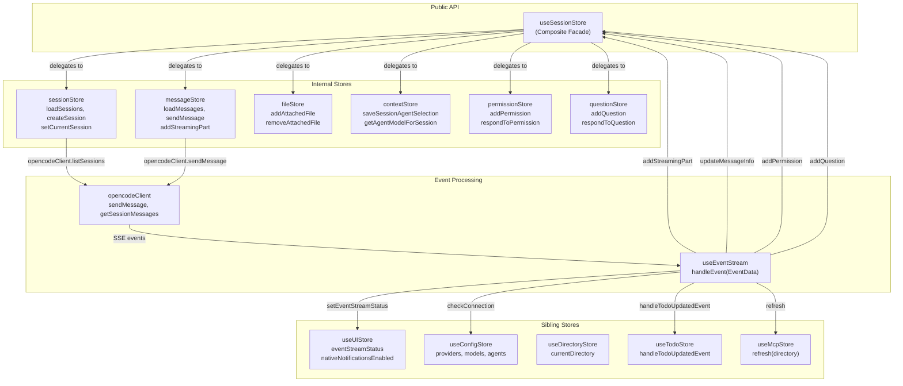
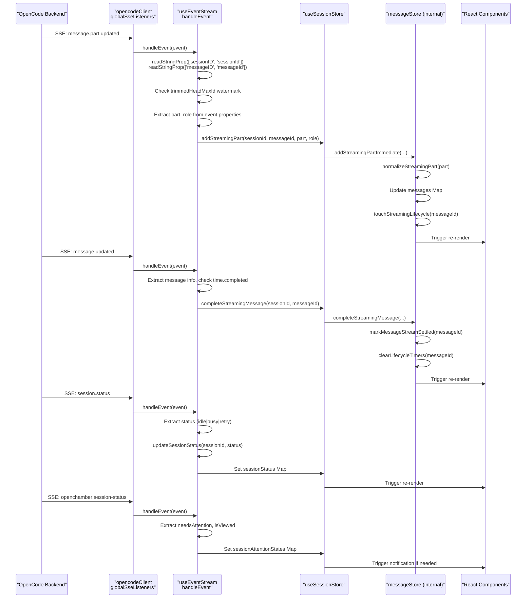
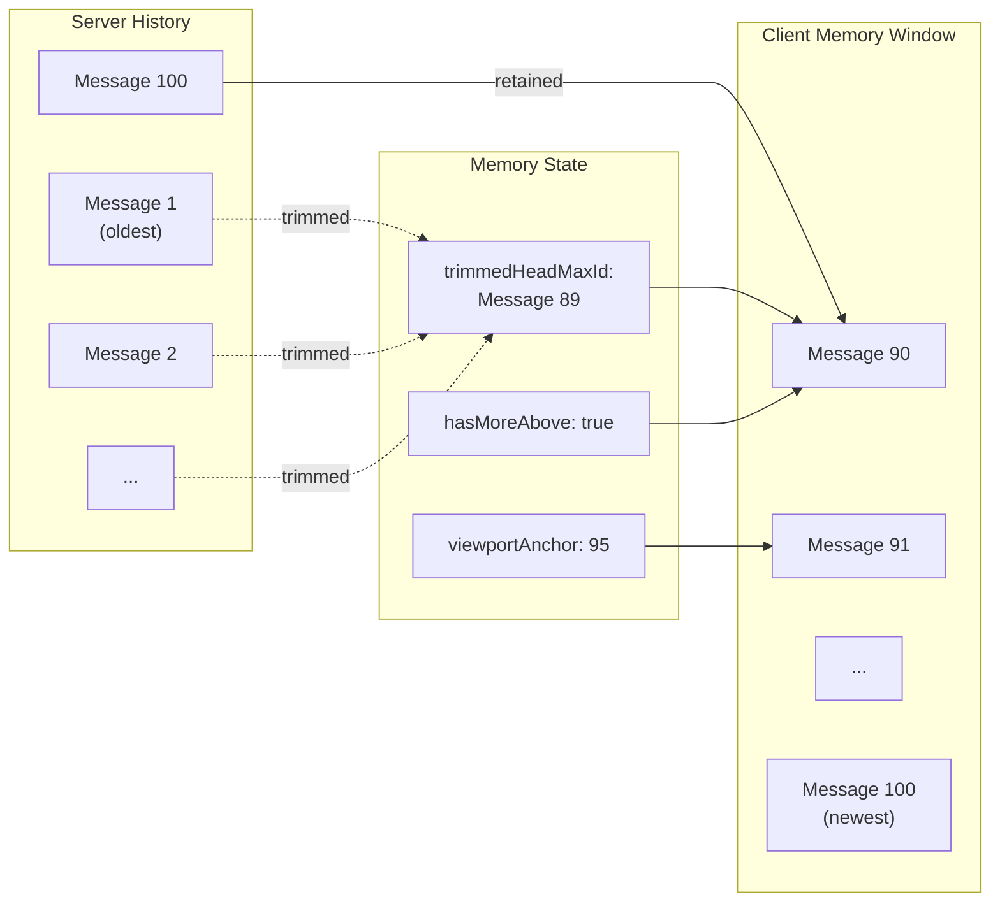

<!-- source: DeepWiki mcp.deepwiki.com · repo btriapitsyn/openchamber · page 3.4 State Management · fetched 2026-10-26 -->

# State Management

<details>
<summary>Relevant source files</summary>

The following files were used as context for generating this wiki page:

- [packages/ui/src/components/chat/ChatContainer.tsx](packages/ui/src/components/chat/ChatContainer.tsx)
- [packages/ui/src/components/chat/MessageList.tsx](packages/ui/src/components/chat/MessageList.tsx)
- [packages/ui/src/components/sections/openchamber/NotificationSettings.tsx](packages/ui/src/components/sections/openchamber/NotificationSettings.tsx)
- [packages/ui/src/hooks/useChatScrollManager.ts](packages/ui/src/hooks/useChatScrollManager.ts)
- [packages/ui/src/hooks/useEventStream.ts](packages/ui/src/hooks/useEventStream.ts)
- [packages/ui/src/hooks/useServerSessionStatus.ts](packages/ui/src/hooks/useServerSessionStatus.ts)
- [packages/ui/src/lib/appearanceAutoSave.ts](packages/ui/src/lib/appearanceAutoSave.ts)
- [packages/ui/src/lib/opencode/client.ts](packages/ui/src/lib/opencode/client.ts)
- [packages/ui/src/stores/messageStore.ts](packages/ui/src/stores/messageStore.ts)
- [packages/ui/src/stores/types/sessionTypes.ts](packages/ui/src/stores/types/sessionTypes.ts)
- [packages/ui/src/stores/useSessionStore.ts](packages/ui/src/stores/useSessionStore.ts)

</details>


This document describes OpenChamber's state management architecture, which coordinates real-time message streaming, session persistence, and UI synchronization across multiple Zustand stores. For information about the event streaming protocol that drives state updates, see [Real-Time Communication](#3.2). For component-level state usage patterns, see [Component Architecture](#7.1).

---

## Overview

OpenChamber uses **Zustand** as its state management solution, organizing application state into specialized stores with a composite pattern. The `useSessionStore` acts as the primary interface, delegating operations to domain-specific stores: `sessionStore` (session metadata), `messageStore` (message streaming), `fileStore` (attachments), `contextStore` (agent context), `permissionStore` (tool permissions), and `questionStore` (user prompts). These stores integrate with Server-Sent Events (SSE) via `useEventStream` to provide real-time updates from the OpenCode backend.

The architecture follows these principles:
- **Composite pattern**: `useSessionStore` provides unified API, delegates to specialized stores
- **Domain separation**: Each internal store manages cohesive state (messages, files, context, permissions)
- **Event-driven updates**: `useEventStream` hook routes SSE events to appropriate store actions
- **Optimistic UI**: Client state updates immediately while awaiting server confirmation
- **Dynamic memory windowing**: Message lists trimmed based on user-configurable limits
- **Selective persistence**: Only `lastUsedProvider` and UI preferences persist across reloads

**Sources**: [packages/ui/src/stores/useSessionStore.ts:1-31](), [packages/ui/src/hooks/useEventStream.ts:1-44](), [packages/ui/src/stores/messageStore.ts:1-32]()

---

## Store Architecture

### Composite Store Pattern



The `useSessionStore` acts as a unified facade, exposing a flat API while internally delegating to specialized stores. This pattern allows components to import a single store while maintaining clean separation of concerns internally.

**Sources**: [packages/ui/src/stores/useSessionStore.ts:67-531](), [packages/ui/src/stores/sessionStore.ts:1-50](), [packages/ui/src/stores/messageStore.ts:1-50](), [packages/ui/src/hooks/useEventStream.ts:104-263]()

---

## Core Stores

### Session Store (`useSessionStore`)

The composite store that provides a unified API for all session-related operations. It delegates to internal stores while maintaining shared state maps.

| State | Type | Purpose |
|-------|------|---------|
| `sessions` | `Session[]` | List of all sessions (from `sessionStore`) |
| `currentSessionId` | `string \| null` | Active session identifier |
| `messages` | `Map<string, {info: Message, parts: Part[]}[]>` | Message collections (shared with `messageStore`) |
| `sessionMemoryState` | `Map<string, SessionMemoryState>` | Memory windowing state per session |
| `sessionStatus` | `Map<string, {type: 'idle'\|'busy'\|'retry', confirmedAt?: number}>` | Server-authoritative session status |
| `sessionAttentionStates` | `Map<string, {needsAttention: boolean, isViewed: boolean}>` | Attention tracking for notifications |
| `streamingMessageIds` | `Map<string, string \| null>` | Currently streaming message per session |
| `messageStreamStates` | `Map<string, MessageStreamLifecycle>` | Streaming lifecycle tracking |
| `permissions` | `Map<string, PermissionRequest[]>` | Pending permission requests per session |
| `questions` | `Map<string, QuestionRequest[]>` | Pending question requests per session |
| `attachedFiles` | `AttachedFile[]` | Files staged for next message |
| `worktreeMetadata` | `Map<string, WorktreeMetadata>` | Git worktree paths for sessions |
| `voiceStatus` | `'disconnected' \| 'connecting' \| 'connected' \| 'error'` | Voice connection state |
| `voiceMode` | `'idle' \| 'speaking' \| 'listening'` | Voice interaction mode |
| `newSessionDraft` | `{open: boolean, directoryOverride: string \| null, ...}` | Draft session creation state |

**Key Actions** (Composite Pattern):
- `loadSessions()`: Delegates to `sessionStore.loadSessions()`
- `setCurrentSession(id)`: Coordinates session switch across stores
- `loadMessages(sessionId, limit?)`: Delegates to `messageStore.loadMessages()`
- `sendMessage(content, providerID, modelID, agent, ...)`: Delegates to `messageStore.sendMessage()`
- `createSessionFromAssistantMessage(messageId)`: Creates new session from assistant response
- `updateSessionTitle(id, title)`: Delegates to `sessionStore.updateSessionTitle()`
- `addStreamingPart(sessionId, messageId, part, role)`: Delegates to `messageStore.addStreamingPart()`
- `completeStreamingMessage(sessionId, messageId)`: Delegates to `messageStore.completeStreamingMessage()`
- `addPermission(permission)`: Delegates to `permissionStore.addPermission()`
- `respondToPermission(sessionId, requestId, response)`: Delegates to `permissionStore.respondToPermission()`
- `addQuestion(question)`: Delegates to `questionStore.addQuestion()`
- `respondToQuestion(sessionId, requestId, answers)`: Delegates to `questionStore.respondToQuestion()`
- `addAttachedFile(file)`: Delegates to `fileStore.addAttachedFile()`
- `removeAttachedFile(id)`: Delegates to `fileStore.removeAttachedFile()`

**Sources**: [packages/ui/src/stores/useSessionStore.ts:67-306](), [packages/ui/src/stores/types/sessionTypes.ts:134-305](), [packages/ui/src/components/chat/ChatContainer.tsx:27-47]()

---

### Message Store (`useMessageStore`)

Internal store handling message lifecycle, streaming part accumulation, and memory management. This implements the most complex state logic due to real-time streaming requirements.

| State | Type | Purpose |
|-------|------|---------|
| `messages` | `Map<string, {info: Message, parts: Part[]}[]>` | Message collections per session |
| `sessionMemoryState` | `Map<string, SessionMemoryState>` | Memory window boundaries per session |
| `messageStreamStates` | `Map<string, MessageStreamLifecycle>` | Streaming lifecycle tracking per message |
| `messageSessionIndex` | `Map<string, string>` | Message ID to session ID lookup |
| `streamingMessageIds` | `Map<string, string \| null>` | Currently streaming message ID per session |
| `pendingAssistantParts` | `Map<string, {sessionId, parts}>` | Buffered parts awaiting header message |
| `sessionCompactionUntil` | `Map<string, number>` | Compaction progress timestamps |
| `sessionAbortFlags` | `Map<string, {timestamp, acknowledged}>` | Abort state tracking |
| `pendingUserMessageMetaBySession` | `Map<string, {mode?, providerID?, modelID?, variant?}>` | Metadata for pending user messages |
| `isSyncing` | `boolean` | Background sync in progress flag |

**Key Actions**:
- `loadMessages(sessionId, limit?)`: Fetch messages from `opencodeClient.getSessionMessages()`
- `sendMessage(content, providerID, modelID, agent, currentSessionId?, attachments?, ...)`: Send via `opencodeClient.sendMessage()`
- `_addStreamingPartImmediate(sessionId, messageId, part, role, currentSessionId)`: Immediate part append (bypasses batch queue)
- `addStreamingPart(sessionId, messageId, part, role, currentSessionId)`: Batched part append
- `completeStreamingMessage(sessionId, messageId)`: Finalize message, clear streaming state
- `forceCompleteMessage(sessionId, messageId, source)`: Timeout-triggered completion
- `markMessageStreamSettled(messageId)`: Clear lifecycle timers
- `updateMessageInfo(sessionId, messageId, messageInfo)`: Update message metadata
- `syncMessages(sessionId, messages)`: Bulk message sync
- `abortCurrentOperation(currentSessionId?)`: Cancel in-progress generation via `opencodeClient.abortSession()`
- `trimToViewportWindow(sessionId, targetSize?, currentSessionId?)`: Memory pressure relief
- `evictLeastRecentlyUsed(currentSessionId?)`: Session memory eviction
- `loadMoreMessages(sessionId, direction)`: Paginated history loading

**Streaming Lifecycle States**:
```typescript
interface MessageStreamLifecycle {
  phase: 'streaming' | 'cooldown' | 'completed';
  startedAt: number;
  lastUpdateAt: number;
  completedAt?: number;
}
```

**Sources**: [packages/ui/src/stores/messageStore.ts:338-376](), [packages/ui/src/stores/types/sessionTypes.ts:18-25](), [packages/ui/src/stores/messageStore.ts:396-442]()

---

### UI Store (`useUIStore`)

Manages UI preferences, appearance settings, and runtime state. Many fields persist to localStorage for cross-session consistency.

| State | Type | Persisted | Purpose |
|-------|------|-----------|---------|
| `activeMainTab` | `'chat' \| 'sessions' \| 'settings' \| 'files' \| 'plan' \| 'git' \| 'terminal'` | No | Current view in mobile/vscode layouts |
| `sessionSwitcherOpen` | `boolean` | No | Mobile session drawer visibility |
| `eventStreamStatus` | `'idle' \| 'connecting' \| 'connected' \| 'reconnecting' \| 'paused' \| 'offline' \| 'error'` | No | SSE connection state |
| `eventStreamStatusHint` | `string \| null` | No | Human-readable connection detail |
| `messageLimit` | `number` | Yes | User-configured message window size (default: 200) |
| `showReasoningTraces` | `boolean` | Yes | Toggle reasoning part visibility |
| `showTextJustificationActivity` | `boolean` | Yes | Show activity indicator during text generation |
| `toolCallExpansion` | `'collapsed' \| 'activity' \| 'detailed'` | Yes | Tool rendering mode |
| `nativeNotificationsEnabled` | `boolean` | Yes | Enable system notifications |
| `notificationMode` | `'always' \| 'hidden-only'` | Yes | When to show notifications |
| `notifyOnCompletion` | `boolean` | Yes | Notify on task completion |
| `notifyOnError` | `boolean` | Yes | Notify on tool errors |
| `notifyOnQuestion` | `boolean` | Yes | Notify on user input needed |
| `notifyOnSubtasks` | `boolean` | Yes | Notify on subtask completion |
| `fontSize` | `number` | Yes | Base font size in pixels |
| `padding` | `number` | Yes | UI padding multiplier |
| `cornerRadius` | `number` | Yes | Border radius multiplier |
| `diffLayoutPreference` | `'dynamic' \| 'inline' \| 'side-by-side'` | Yes | Preferred diff layout mode |
| `diffViewMode` | `'single' \| 'stacked'` | Yes | Diff container display mode |

**Key Actions**:
- `setEventStreamStatus(status, hint?)`: Update SSE connection state
- `setMessageLimit(limit)`: Adjust memory window size (affects `getMessageLimit()`)
- `setNativeNotificationsEnabled(enabled)`: Toggle system notifications
- `setToolCallExpansion(mode)`: Change tool rendering verbosity

**Sources**: [packages/ui/src/stores/useUIStore.ts]() (referenced), [packages/ui/src/hooks/useEventStream.ts:232-264](), [packages/ui/src/components/sections/openchamber/NotificationSettings.tsx:21-42]()

---

### Config Store (`useConfigStore`)

Manages application configuration, provider/model metadata, and agent definitions.

| State | Type | Purpose |
|-------|------|---------|
| `providers` | `Provider[]` | Available AI providers (OpenAI, Anthropic, etc) |
| `models` | `Model[]` | Model definitions with capabilities |
| `agents` | `Agent[]` | Agent presets (code, architect, debug) |
| `isInitialized` | `boolean` | Config loaded flag |
| `selectedProvider` | `string \| null` | Active provider ID |
| `selectedModel` | `string \| null` | Active model ID |

**Key Actions**:
- `initializeApp()`: Load config from backend
- `checkConnection()`: Verify backend availability
- `getCurrentModel()`: Get active model metadata
- `setModelSelection(providerId, modelId)`: Change active model

**Sources**: [packages/ui/src/components/layout/VSCodeLayout.tsx:34-36]()

---

### Directory Store (`useDirectoryStore`)

Tracks the working directory context for session isolation.

| State | Type | Purpose |
|-------|------|---------|
| `currentDirectory` | `string \| null` | Active working directory path |
| `homeDirectory` | `string \| null` | User home directory for path display |

**Key Actions**:
- `setDirectory(path)`: Change working directory
- `getDirectoryLabel()`: Format path for display

**Sources**: [packages/ui/src/components/session/SessionSidebar.tsx:134-136]()

---

### Todo Store (`useTodoStore`)

Manages task/todo status synchronized from the backend.

| State | Type | Purpose |
|-------|------|---------|
| `todos` | `Map<string, Todo[]>` | Task lists per session |

**Key Actions**:
- `updateTodos(sessionId, todos)`: Sync todo list from server

**Sources**: [packages/ui/src/hooks/useEventStream.ts:10]()

---

## Event-Driven State Updates

The `useEventStream` hook bridges SSE events from `opencodeClient` to store mutations, implementing the core state synchronization mechanism.



**Event Handling**: [packages/ui/src/hooks/useEventStream.ts:584-741]()

### Event Processing Pipeline

The `handleEvent` function in `useEventStream` processes each SSE event through this pipeline:

1. **Metadata Extraction**: Extract session/message metadata from nested event properties using `readStringProp`
2. **Watermark Validation**: Check `trimmedHeadMaxId` to skip processing of trimmed history
3. **Role Detection**: Determine message role from existing state or event properties
4. **Store Dispatch**: Route event to appropriate store action based on `event.type`
5. **State Update**: Store action mutates state and triggers React re-renders

**Key Event Types**:
- `message.part.updated` → `addStreamingPart()` - Append streaming part to message
- `message.updated` → `updateMessageInfo()` / `completeStreamingMessage()` - Update message metadata
- `session.status` → `updateSessionStatus()` - Update session busy/idle state
- `openchamber:session-status` → Update `sessionAttentionStates` - Track attention needs
- `permission.request` → `addPermission()` - Add tool permission request
- `question.request` → `addQuestion()` - Add user prompt question
- `mcp.tools.changed` → `useMcpStore.refresh()` - Reload MCP tools

**Sources**: [packages/ui/src/hooks/useEventStream.ts:584-863](), [packages/ui/src/lib/opencode/client.ts:136-161]()

### Message Part Streaming

When `message.part.updated` events arrive, the system performs these steps:

1. **Event Property Extraction**: Use `readStringProp` to extract IDs from nested event structure
   ```typescript
   const resolvedSessionId = readStringProp(partExt, ['sessionID', 'sessionId']) ||
                              readStringProp(messageInfo, ['sessionID', 'sessionId']) ||
                              readStringProp(props, ['sessionID', 'sessionId']);
   ```

2. **Watermark Validation**: Check `sessionMemoryState.get(sessionId)?.trimmedHeadMaxId`
   - Skip events for messages before watermark using `isIdNewer(messageId, trimmedHeadMaxId)`
   - Prevents reprocessing trimmed history after Load More

3. **Role Detection**: Determine message role for proper rendering
   ```typescript
   let roleInfo = 'assistant';
   if (messageInfo?.role === 'string') {
     roleInfo = messageInfo.role;
   } else {
     const existingMessage = getMessageFromStore(sessionId, messageId);
     roleInfo = existingMessage?.info?.role ?? 'assistant';
   }
   ```

4. **Part Normalization**: Ensure part has required fields via `normalizeStreamingPart`
   - Add `type` field (default: 'text')
   - Preserve `sessionID`, `messageID` for tracking

5. **Batched Updates**: User messages use 50ms batch window (`USER_BATCH_WINDOW_MS`), assistant messages flush immediately
   - Queue parts in `batchQueue` array
   - Flush timer in `flushTimer` ref
   - Immediate flush for real-time assistant feedback

6. **Deduplication**: Merge duplicate parts by ID
   - Use `getPartKey(part)` to generate unique key from `part.id` or `type-reason-callID`
   - `mergePreferExistingParts` preserves existing parts, appends new ones

**Sources**: [packages/ui/src/hooks/useEventStream.ts:743-863](), [packages/ui/src/stores/messageStore.ts:40-44](), [packages/ui/src/stores/utils/messageUtils.ts]() (referenced)

---

## Message Lifecycle and Streaming

The message lifecycle tracks streaming progress through phases with timeout-based state transitions, managed in `messageStreamStates` map.

```mermaid
stateDiagram-v2
    [*] --> streaming: "message.part.updated<br/>touchStreamingLifecycle(messageId)"
    streaming --> streaming: "Subsequent parts<br/>Update lastUpdateAt"
    streaming --> cooldown: "completeStreamingMessage()<br/>or message.updated with time.completed"
    cooldown --> completed: "Cooldown expiry (2s)"
    completed --> [*]: "clearLifecycleTimers(messageId)"
    
    note right of streaming: "phase: 'streaming'<br/>startedAt: timestamp<br/>lastUpdateAt: timestamp"
    note right of cooldown: "phase: 'cooldown'<br/>completedAt: timestamp<br/>2000ms buffer period"
    note right of completed: "phase: 'completed'<br/>Lifecycle cleared from map"
```

**Lifecycle Management**: [packages/ui/src/stores/types/sessionTypes.ts:18-25](), [packages/ui/src/stores/utils/streamingUtils.ts]() (referenced)

### Streaming Phase Logic

**Streaming Phase**: Parts are accumulating in real-time
- State: `{ phase: 'streaming', startedAt: number, lastUpdateAt: number }`
- Created by: `touchStreamingLifecycle(messageId)` on first `message.part.updated`
- Updated on: Each subsequent `message.part.updated` (updates `lastUpdateAt`)
- No automatic timeout - relies on explicit completion signal

**Cooldown Phase**: Message finalization grace period
- State: `{ phase: 'cooldown', startedAt: number, lastUpdateAt: number, completedAt: number }`
- Triggered by: `completeStreamingMessage()` or `message.updated` with `time.completed`
- Duration: 2000ms (`COOLDOWN_DURATION_MS` in streamingUtils)
- Purpose: Allows UI animations to complete, prevents race conditions with final parts

**Completed Phase**: Message finalized and stable
- State: Entry removed from `messageStreamStates` map
- Triggered by: Cooldown timer expiry
- Cleanup: `clearLifecycleTimers(messageId)` removes all timers
- Ready for: Memory trimming if session exceeds limits

**Force Completion**: Timeout-based fallback
- Triggered by: `forceCompleteMessage(sessionId, messageId, 'timeout' | 'cooldown')`
- Scenarios: Network interruption, backend crash, SSE reconnection
- Behavior: Immediately transitions to cooldown phase

**Sources**: [packages/ui/src/stores/messageStore.ts:359-373](), [packages/ui/src/stores/utils/streamingUtils.ts:10-120]() (referenced)

### Streaming Phase Logic

**Streaming Phase**: Parts are accumulating in real-time
- Activity timer resets on each `message.part.updated` event
- If no activity for 3000ms, transition to `completing`
- Lifecycle tracked in `messageStreamStates` map

**Completing Phase**: Message finalization in progress
- Triggered by timeout or explicit `message.updated` with `time.completed`
- 300ms grace period allows final parts to arrive
- Prevents rendering artifacts from premature completion

**Cooldown Phase**: Post-completion stabilization
- 2000ms buffer after completion
- Session activity indicator shows "cooldown" state
- Allows UI animations to complete

**Completed Phase**: Message finalized and stable
- Lifecycle state cleared from `messageStreamStates`
- Streaming ID removed from `streamingMessageIds`
- Ready for history trimming if memory pressure

**Sources**: [packages/ui/src/stores/utils/streamingUtils.ts]() (referenced), [packages/ui/src/stores/messageStore.ts:344-361]()

---

## Memory Management and Windowing

OpenChamber implements viewport-based memory windowing to handle conversations with thousands of messages without degrading performance.



### Memory Limits

Memory limits are now **user-configurable** via UI settings, with dynamic accessors that read from `useUIStore`:

| Accessor | Default | Purpose |
|----------|---------|---------|
| `getMessageLimit()` | 200 | User-configured message window size (also used for Load More chunk size) |
| `getBackgroundTrimLimit()` | `Math.round(getMessageLimit() * 0.6)` | Target size for background trim (auto-calculated) |
| `MEMORY_CONSTANTS.MAX_SESSIONS` | 3 | Sessions in memory before eviction |
| `MEMORY_CONSTANTS.BACKGROUND_STREAMING_BUFFER` | 120 | Buffer size for background streaming sessions |
| `MEMORY_CONSTANTS.ZOMBIE_TIMEOUT` | 10 minutes | Inactive session timeout |

**Dynamic Configuration**:
```typescript
// sessionTypes.ts
export const getMessageLimit = (): number => {
  const state = useUIStore.getState?.();
  return state?.messageLimit ?? DEFAULT_MESSAGE_LIMIT;
};

export const getBackgroundTrimLimit = (): number =>
  Math.round(getMessageLimit() * 0.6);
```

Users can adjust `messageLimit` in Settings → Appearance, affecting all memory management operations immediately.

**Sources**: [packages/ui/src/stores/types/sessionTypes.ts:54-106](), [packages/ui/src/stores/messageStore.ts:396-409]()

### Windowing Algorithm

**Load Messages**: Initial load retrieves last N messages
```typescript
loadMessages(sessionId, limit = 50)
```
- Fetches all messages from server
- Filters messages after `trimmedHeadMaxId` watermark
- Keeps last `limit` messages
- Updates `hasMoreAbove` flag

**Trim to Viewport**: Memory pressure relief
```typescript
trimToViewportWindow(sessionId, targetSize = 30)
```
- Triggered when memory pressure exceeds threshold
- Keeps messages around `viewportAnchor`
- Updates `trimmedHeadMaxId` to highest removed message ID
- Preserves streaming message and active parts

**Load More**: Paginated history loading
```typescript
loadMoreMessages(sessionId, direction = 'up')
```
- Fetches 20 additional messages from server
- Maintains scroll position by adjusting for new content height
- Appends to existing messages without duplication

**Sources**: [packages/ui/src/stores/messageStore.ts:383-442](), [packages/ui/src/stores/messageStore.ts:544-631]()

---

## State Persistence

Selective state persistence ensures user preferences and metadata survive page reloads while avoiding stale data issues.

| Store | Persisted State | Storage | Key |
|-------|----------------|---------|-----|
| MessageStore | `lastUsedProvider` | localStorage | `opencode-message-store` |
| UIStore | `toolCallExpansion`, `showReasoningTraces` | localStorage | `opencode-ui-store` |
| ConfigStore | `selectedProvider`, `selectedModel` | localStorage | `opencode-config-store` |
| SessionStore | None | - | (Always fresh from server) |

**Zustand Persist Middleware**: [packages/ui/src/stores/messageStore.ts:366-369]()
```typescript
persist(
  (set, get) => ({ /* store definition */ }),
  {
    name: 'opencode-message-store',
    storage: createJSONStorage(() => getSafeStorage()),
    partialize: (state) => ({ lastUsedProvider: state.lastUsedProvider })
  }
)
```

**Safe Storage Wrapper**: Handles storage access failures gracefully
- Falls back to in-memory storage if localStorage unavailable
- Catches quota exceeded errors
- Supports SSR environments

**Sources**: [packages/ui/src/stores/messageStore.ts:366-369](), [packages/ui/src/stores/utils/safeStorage.ts]() (referenced)

---

## Deduplication and Conflict Resolution

### Message Deduplication

Multiple events may deliver the same message with different part sets. The store implements merge strategies to avoid duplicates:

**By Message ID**: `dedupeMessagesById` merges messages with identical IDs
- Keeps the version with the longest text content
- Prefers versions with `stop` reason in step-finish parts
- Merges unique parts from both versions

**By Part ID**: `mergePreferExistingParts` combines part arrays
- Preserves existing parts by ID
- Appends new parts not in existing set
- Prevents duplicate tool outputs

**Sources**: [packages/ui/src/stores/messageStore.ts:173-193](), [packages/ui/src/stores/messageStore.ts:119-141]()

### Streaming Conflict Resolution

When server-delivered parts conflict with client-side streaming state:

1. **Text Length Comparison**: Reject updates that would shrink text content by >50 chars
2. **Stop Reason Check**: Allow shrinkage if new version has `stop` reason (user abort)
3. **Desktop Override**: Desktop runtime uses zero-tolerance shrinkage protection
4. **Lifecycle Preservation**: Protect messages in active streaming phases

**Sources**: [packages/ui/src/hooks/useEventStream.ts:616-698]()

---

## State Access Patterns

### Component State Selection

Components use Zustand's `useShallow` hook to prevent unnecessary re-renders:

```typescript
// ChatMessage.tsx
const sessionState = useSessionStore(
  useShallow((state) => ({
    lifecyclePhase: state.messageStreamStates.get(message.info.id)?.phase ?? null,
    isStreamingMessage: (state.streamingMessageIds.get(sessionId) ?? null) === message.info.id,
    currentSessionId: state.currentSessionId,
  }))
);
```

**Sources**: [packages/ui/src/components/chat/ChatMessage.tsx:86-103]()

### Direct Store Access

Actions can access other stores directly for cross-store coordination:

```typescript
// messageStore.ts - accessing sessionStore
const sessionStore = useSessionStore.getState();
const session = sessionStore.sessions.find(s => s.id === sessionId);
```

**Sources**: [packages/ui/src/stores/messageStore.ts:275-291]()

### Event Stream Integration

The event stream hook coordinates updates across multiple stores:

```typescript
// useEventStream.ts
const {
  addStreamingPart,
  updateMessageInfo,
  completeStreamingMessage
} = useSessionStore();

const { checkConnection } = useConfigStore();
```

**Sources**: [packages/ui/src/hooks/useEventStream.ts:84-100]()

---

## Performance Optimizations

### Batched Part Updates

Streaming parts are queued and flushed in batches to reduce render cycles:
- User messages: 50ms batch window
- Assistant messages: Immediate flush (real-time feedback)
- Batch queue cleared on session change

**Sources**: [packages/ui/src/stores/messageStore.ts:28-32]()

### Text Length Caching

Part text length computed once and cached in WeakMap:
```typescript
const textLengthCache = new WeakMap<Part[], number>();
```
Prevents O(n) string concatenation on every comparison.

**Sources**: [packages/ui/src/stores/messageStore.ts:77-91]()

### Lifecycle Timer Management

Streaming lifecycle timers are pooled and reused:
- Activity timers reset on each part arrival
- Completion timers cascade into cooldown timers
- All timers cleared on message completion
- Registry prevents timer leaks

**Sources**: [packages/ui/src/stores/messageStore.ts:34-36]()

### Session Memory Eviction

Least-recently-used session eviction when memory pressure exceeds threshold:
```typescript
evictLeastRecentlyUsed(currentSessionId) {
  const sessions = Array.from(this.messages.keys())
    .filter(id => id !== currentSessionId);
  if (sessions.length > MEMORY_PRESSURE_THRESHOLD) {
    // Evict oldest sessions beyond threshold
  }
}
```

**Sources**: [packages/ui/src/stores/messageStore.ts:639-665]() (referenced pattern)

---

