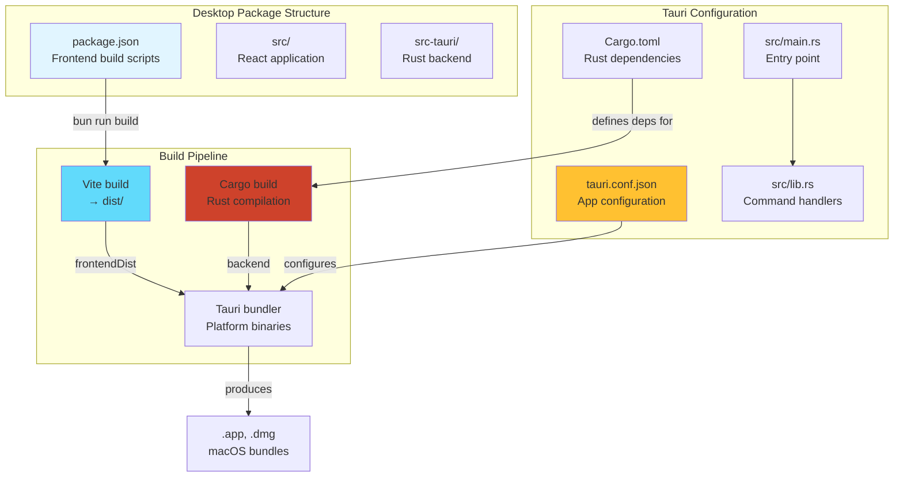
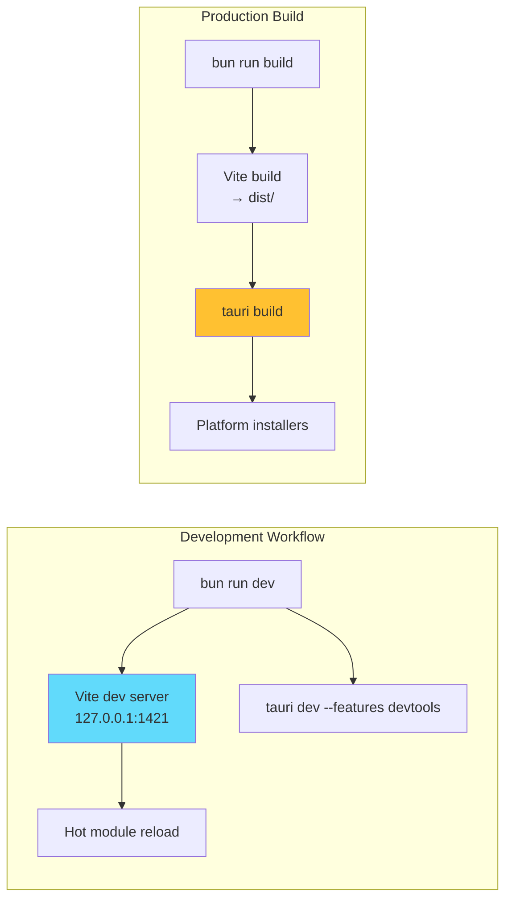
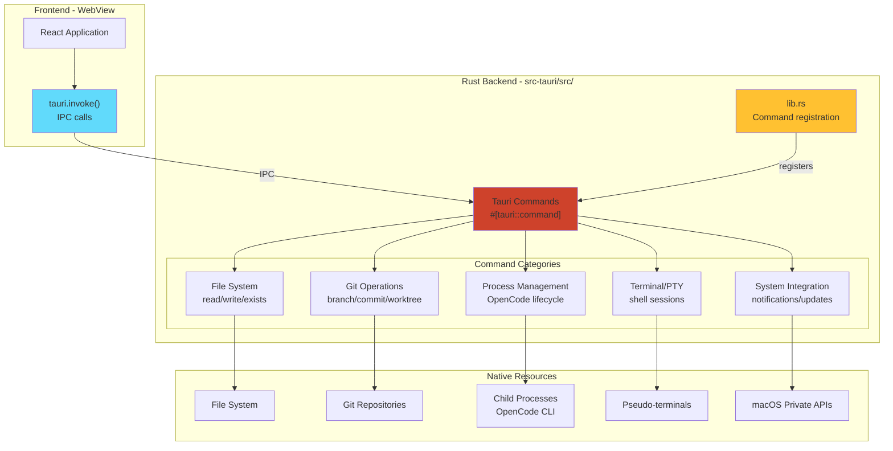
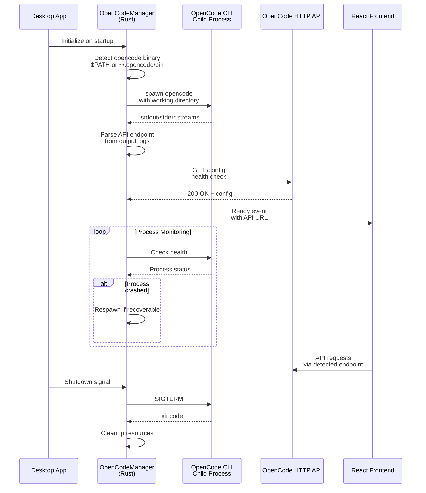
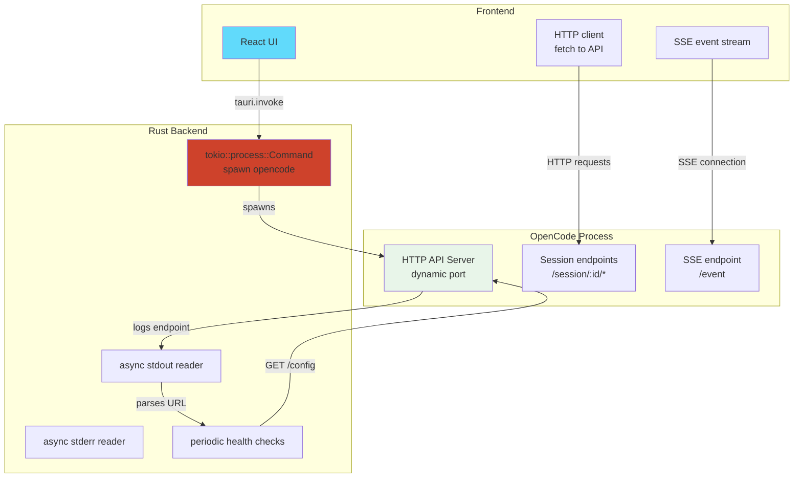
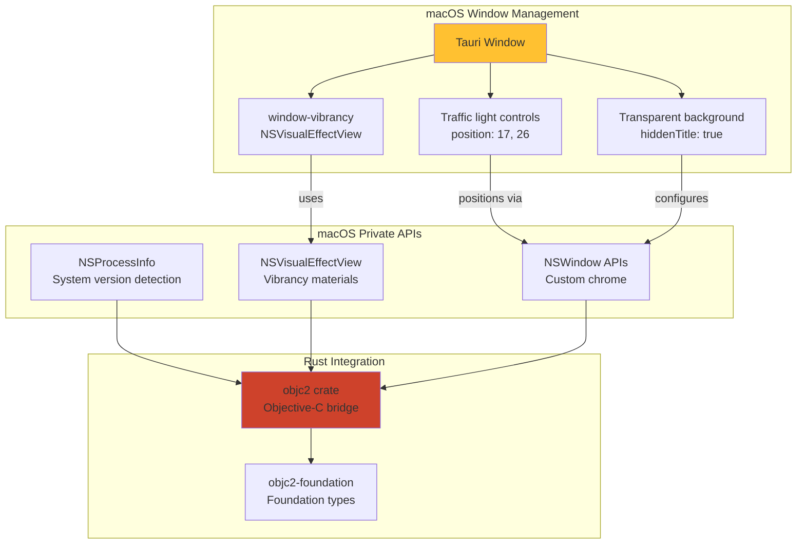
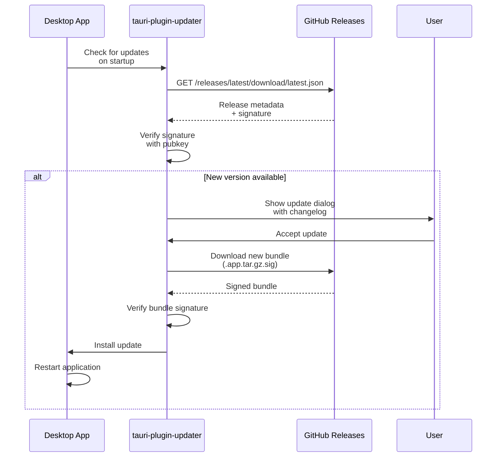
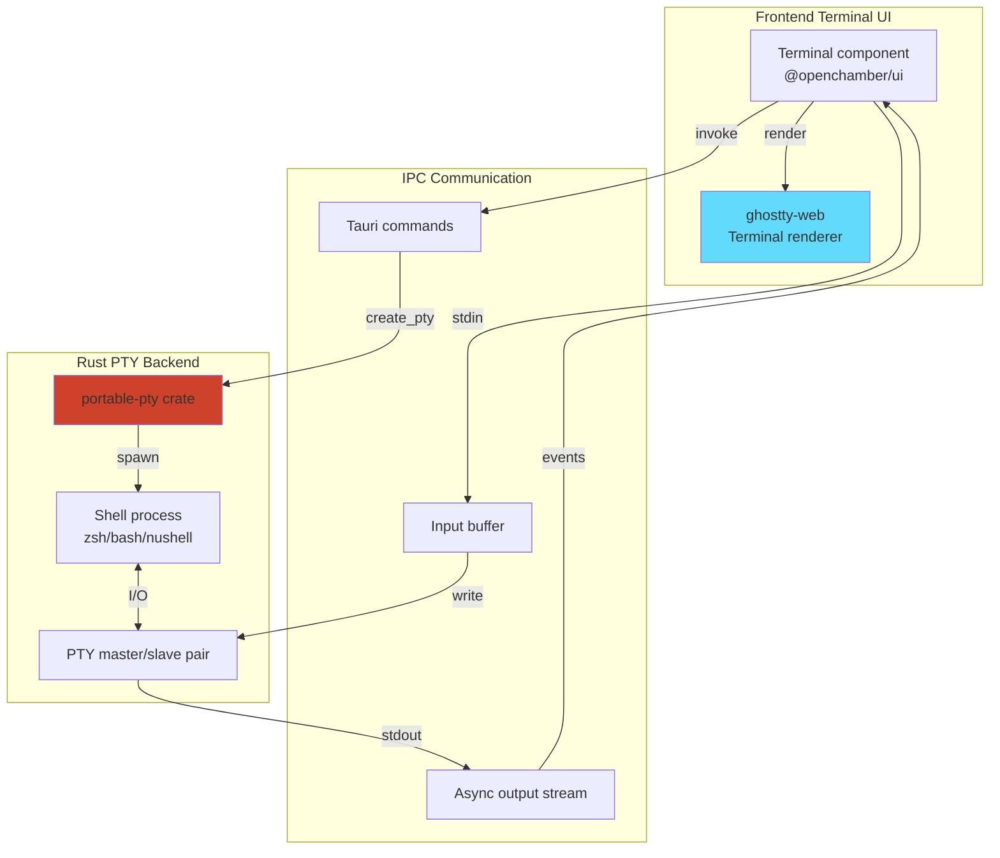
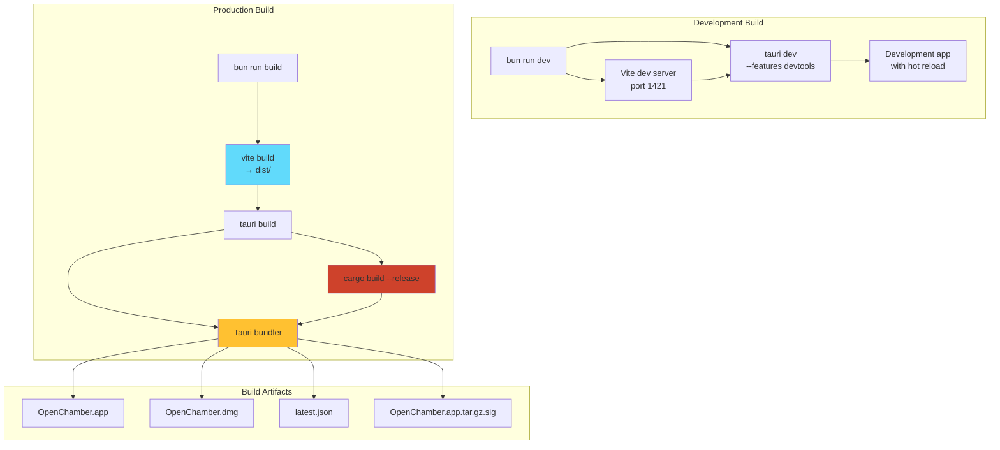

<!-- source: DeepWiki mcp.deepwiki.com · repo btriapitsyn/openchamber · page 4 Desktop Application · fetched 2026-10-26 -->

# Desktop Application

<details>
<summary>Relevant source files</summary>

The following files were used as context for generating this wiki page:

- [CHANGELOG.md](CHANGELOG.md)
- [bun.lock](bun.lock)
- [package.json](package.json)
- [packages/desktop/package.json](packages/desktop/package.json)
- [packages/desktop/src-tauri/Cargo.lock](packages/desktop/src-tauri/Cargo.lock)
- [packages/desktop/src-tauri/Cargo.toml](packages/desktop/src-tauri/Cargo.toml)
- [packages/desktop/src-tauri/tauri.conf.json](packages/desktop/src-tauri/tauri.conf.json)
- [packages/ui/package.json](packages/ui/package.json)
- [packages/ui/src/lib/desktop.ts](packages/ui/src/lib/desktop.ts)
- [packages/ui/src/lib/persistence.ts](packages/ui/src/lib/persistence.ts)
- [packages/vscode/CHANGELOG.md](packages/vscode/CHANGELOG.md)
- [packages/vscode/package.json](packages/vscode/package.json)
- [packages/web/package.json](packages/web/package.json)

</details>


The Desktop Application is OpenChamber's native client built with Tauri, combining a Rust backend with a React frontend. It provides the most integrated experience with native OS features including process management, system notifications, and direct file system access. This document covers the desktop application's architecture, Rust backend implementation, and platform-specific features.

For information about the shared UI components used in the desktop app, see [UI Component Library](#7). For details on how the desktop app integrates with the OpenCode backend, see [OpenCode Backend Integration](#3.2).

---

## Application Architecture

The desktop application follows Tauri's architecture pattern, separating the frontend (React/Vite) from the backend (Rust). The frontend runs in a WebView while the Rust backend handles native operations, process management, and system integration.

### Tauri Configuration and Structure



**Sources:** [packages/desktop/package.json:1-40](), [packages/desktop/src-tauri/tauri.conf.json:1-75](), [packages/desktop/src-tauri/Cargo.toml:1-62]()

The desktop application is configured through `tauri.conf.json` with key settings:

| Configuration | Value | Purpose |
|--------------|-------|---------|
| `identifier` | `ai.opencode.openchamber` | macOS bundle identifier |
| `transparent` | `true` | Enables window transparency |
| `hiddenTitle` | `true` | Hides default title bar |
| `titleBarStyle` | `Overlay` | Custom title bar styling |
| `macOSPrivateApi` | `true` | Enables private macOS APIs |
| `minimumSystemVersion` | `14.0` | Requires macOS 14.0+ |

The application window is configured with traffic light positioning at `(17, 26)` for proper macOS window chrome integration.

**Sources:** [packages/desktop/src-tauri/tauri.conf.json:13-36]()

### Rust Backend Dependencies

The Rust backend uses a comprehensive set of dependencies for native functionality:

| Crate | Version | Purpose |
|-------|---------|---------|
| `tauri` | `2.9.4` | Core framework with macOS private API support |
| `tokio` | `1.38` | Async runtime for process/network operations |
| `axum` | `0.8.4` | HTTP server for internal APIs |
| `portable-pty` | `0.9.0` | Terminal/PTY management |
| `reqwest` | `0.12.4` | HTTP client for external requests |
| `serde_json` | `1.0.143` | JSON serialization |
| `parking_lot` | `0.12.3` | High-performance synchronization primitives |
| `nix` | `0.28` | Unix system calls and signal handling |

**Sources:** [packages/desktop/src-tauri/Cargo.toml:19-55]()

### Frontend Build Configuration



**Sources:** [packages/desktop/package.json:11-16](), [packages/desktop/src-tauri/tauri.conf.json:6-10]()

The frontend development server runs on `127.0.0.1:1421` and is referenced by Tauri during development via the `beforeDevCommand` and `devUrl` configuration. In production, the built assets from `dist/` are bundled into the native application.

---

## Rust Backend Implementation

The Rust backend provides Tauri commands that bridge JavaScript to native functionality. Commands are defined in the library and exposed to the frontend through Tauri's IPC mechanism.

### Command Architecture



**Sources:** [packages/desktop/src-tauri/Cargo.toml:7-9](), [CHANGELOG.md:99]()

Tauri commands are Rust functions decorated with `#[tauri::command]` that can be invoked from the frontend. The library structure uses `lib.rs` as the command registration point and `main.rs` as the entry point for the application binary.

### Core Backend Modules

The backend is organized into functional modules:

**File System Operations**
- Read/write file operations with async I/O
- Directory traversal and existence checks
- Path resolution with home directory expansion (`~`)
- File metadata and permissions handling

**Process Management (OpenCode Integration)**
- Spawn OpenCode CLI as child process
- Monitor process health and lifecycle
- Capture stdout/stderr streams
- Dynamic port detection for API endpoint
- Process cleanup on application exit

**Git Integration**
- Branch creation, deletion, and renaming
- Commit operations with author configuration
- Worktree management for multi-run sessions
- SSH key configuration for per-identity operations
- Diff generation and file status tracking

**Terminal/PTY Management**
- Create pseudo-terminal sessions using `portable-pty`
- Per-directory shell sessions
- Resize handling and terminal control
- Output streaming to frontend
- Process lifecycle tied to session

**System Integration**
- Native notifications via `tauri-plugin-notification`
- Auto-update system via `tauri-plugin-updater`
- Window vibrancy effects on macOS (`window-vibrancy`)
- Dialog APIs via `tauri-plugin-dialog`

**Sources:** [packages/desktop/src-tauri/Cargo.toml:33-51](), [CHANGELOG.md:73-75]()

### Tauri Plugins

The application uses official Tauri plugins for extended functionality:

| Plugin | Package | Purpose |
|--------|---------|---------|
| Notification | `tauri-plugin-notification` | System notifications for agent completion |
| Updater | `tauri-plugin-updater` | GitHub release-based auto-updates |
| Dialog | `tauri-plugin-dialog` | Native file/folder picker dialogs |
| FS | `tauri-plugin-fs` | Enhanced file system operations |
| Shell | `tauri-plugin-shell` | Shell command execution |
| Process | `tauri-plugin-process` | Process management utilities |
| Log | `tauri-plugin-log` | Structured logging to files |

**Sources:** [packages/desktop/src-tauri/Cargo.toml:42-52](), [packages/desktop/package.json:22-25]()

---

## OpenCode Process Management

The desktop application manages the OpenCode CLI process lifecycle directly in Rust, providing the most integrated experience compared to web and VS Code platforms.

### Process Lifecycle



**Sources:** [CHANGELOG.md:313-315](), [CHANGELOG.md:320]()

The OpenCode process lifecycle management includes:

1. **Binary Detection**: Searches `$PATH` and fallback to `~/.opencode/bin` for the `opencode` executable
2. **Dynamic Port Allocation**: OpenCode selects an available port at startup
3. **API Prefix Discovery**: Parses the API endpoint from process output (format: `http://localhost:<port>/<prefix>`)
4. **Health Monitoring**: Periodic checks to detect crashes and trigger respawns
5. **Graceful Shutdown**: Sends SIGTERM to allow clean process termination

### Shell Environment Handling

The desktop app must properly detect and propagate shell environment variables to the OpenCode process to ensure tools like `git`, `node`, and language-specific toolchains are available.

**Environment Detection Strategy:**
- Source user's default shell configuration (`~/.zshrc`, `~/.bashrc`, etc.)
- Capture environment variables from interactive shell
- Pass captured environment to spawned OpenCode process
- Handle Nushell support for operations

**Sources:** [CHANGELOG.md:126](), [CHANGELOG.md:326]()

### Process Communication



**Sources:** [CHANGELOG.md:145-147]()

The desktop app has the most direct connection to the OpenCode API compared to other platforms, eliminating the need for proxying while still handling API prefix detection and health checks.

---

## Platform-Specific Features

The desktop application leverages macOS-specific APIs and system integration for enhanced functionality. These features are only available in the desktop version and differentiate it from web and VS Code deployments.

### macOS Private API Integration

The application uses `macOSPrivateApi: true` in Tauri configuration to access private macOS frameworks:

**Window Customization:**
- Custom traffic light positioning for modern macOS window chrome
- Window vibrancy/transparency effects via `window-vibrancy` crate
- Hidden title bar with overlay style for custom header
- Rounded corner radius adaptation for different macOS versions



**Sources:** [packages/desktop/src-tauri/tauri.conf.json:36](), [packages/desktop/src-tauri/tauri.conf.json:24-27](), [packages/desktop/src-tauri/Cargo.toml:28-30](), [packages/desktop/src-tauri/Cargo.toml:60-61](), [CHANGELOG.md:314-315]()

The `objc2` and `objc2-foundation` crates provide Rust bindings to Objective-C runtime, enabling direct interaction with macOS Foundation frameworks for system version detection and window manipulation.

### Auto-Update System

The desktop app implements automatic updates using GitHub releases:



**Sources:** [packages/desktop/src-tauri/tauri.conf.json:67-73](), [CHANGELOG.md:220](), [CHANGELOG.md:306-307]()

**Update Configuration:**
- **Endpoint**: `https://github.com/btriapitsyn/openchamber/releases/latest/download/latest.json`
- **Signature Verification**: Uses minisign public key for update authenticity
- **Update Artifacts**: Created automatically via `createUpdaterArtifacts: true`
- **User Experience**: Displays changelog from current to new version before update

The update system includes fallback detection for OpenCode CLI in `~/.opencode/bin` and window focus restoration after updates.

**Sources:** [CHANGELOG.md:313-315]()

### Native Notifications

The desktop app uses system notifications to alert users when AI agents complete tasks:

**Notification Triggers:**
- Agent message completion with `finish=stop` event
- Long-running task completion
- Permission requests requiring user input

**Implementation:**
- Uses `tauri-plugin-notification` for native macOS notification center
- Listens to OpenCode SSE stream for completion events
- Only fires when app is not in foreground (inactive state management)

**Sources:** [packages/desktop/src-tauri/Cargo.toml:50](), [packages/desktop/package.json:22](), [CHANGELOG.md:212]()

### Terminal/PTY Integration

The desktop application provides full pseudo-terminal (PTY) support using the `portable-pty` crate:

**Terminal Features:**
- Per-directory shell sessions with automatic creation
- Session restoration and persistence
- Full TUI application support (interactive programs)
- Terminal resizing and control sequences
- Output streaming with backpressure handling

**Implementation:**


**Sources:** [packages/desktop/src-tauri/Cargo.toml:33](), [CHANGELOG.md:73-75]()

The terminal implementation switched to Ghostty-based rendering for improved performance while maintaining compatibility with the existing PTY backend. Sessions are tied to specific directories and survive application restarts.

---

## Build System and Distribution

The desktop application uses a multi-stage build process combining Vite for frontend and Cargo/Tauri for native packaging.

### Build Pipeline



**Sources:** [packages/desktop/package.json:11-16](), [packages/desktop/src-tauri/tauri.conf.json:6-10]()

### Platform-Specific Builds

The application supports multiple macOS architectures:

| Architecture | Target | Binary Size | Support |
|-------------|--------|-------------|---------|
| Apple Silicon (arm64) | `aarch64-apple-darwin` | Optimized | macOS 14.0+ |
| Intel Mac (x86_64) | `x86_64-apple-darwin` | Larger binary | macOS 14.0+ |

**Build Workflow:**
- Separate CI jobs for each architecture
- Code signing and notarization for macOS distribution
- DMG installer with custom window layout and positioning
- Universal binary generation for dual-architecture support

**Sources:** [CHANGELOG.md:99-100](), [packages/desktop/src-tauri/tauri.conf.json:50-63]()

### DMG Configuration

The DMG installer is configured with specific visual layout:

```
Application Position: (180, 170)
Applications Folder Link: (480, 170)
Window Size: 660 x 400
```

This creates a standard macOS drag-to-install experience with the app icon on the left and Applications folder on the right.

**Sources:** [packages/desktop/src-tauri/tauri.conf.json:50-63]()

### entitlements and Info.plist

The application uses custom entitlements and Info.plist for macOS permissions:

**Entitlements:**
- File system access (user-selected directories)
- Network access (OpenCode API communication)
- Reduced sandboxing for git/shell operations

**Info.plist Usage Descriptions:**
- Folder access descriptions to reduce permission prompts
- Custom URL scheme handlers
- Document type associations

**Sources:** [packages/desktop/src-tauri/tauri.conf.json:48-49](), [CHANGELOG.md:305-308]()

### Build Prerequisites

Required tools for building the desktop application:

1. **Rust stable toolchain** - Install via `rustup`
2. **Xcode Command Line Tools** - Required for macOS compilation
3. **Tauri CLI** - Install via `cargo install tauri-cli@^2`
4. **Bun** - For frontend build and package management

**Sources:** [packages/desktop/package.json:6-9]()

---

## Desktop-Specific UI Adaptations

The desktop runtime provides unique UI behaviors through the `@openchamber/ui` package's runtime detection:

**Keyboard Shortcuts:**
- Uses `Cmd` key on macOS (vs `Ctrl` on web/Windows)
- Custom menu bar entries for common actions
- Check for updates from Help menu
- Bug/feature request creation from Help menu

**Directory Selection:**
- Native folder picker on first launch
- Reduces repetitive macOS permission prompts
- Stores selected directories for future sessions

**Window Management:**
- Background throttling disabled for continuous agent execution
- Custom traffic light positioning for modern look
- Window vibrancy with theme-aware materials

**Sources:** [CHANGELOG.md:61](), [CHANGELOG.md:195-198](), [CHANGELOG.md:220](), [CHANGELOG.md:305]()

The desktop application represents the most feature-complete deployment of OpenChamber, with direct access to system resources and the tightest integration with the OpenCode backend. Its native process management, terminal support, and platform-specific optimizations make it the preferred choice for local development workflows.

---

