<!-- source: DeepWiki mcp.deepwiki.com · repo btriapitsyn/openchamber · page 4.1 Application Structure · fetched 2026-10-26 -->

# Application Structure

<details>
<summary>Relevant source files</summary>

The following files were used as context for generating this wiki page:

- [CHANGELOG.md](CHANGELOG.md)
- [bun.lock](bun.lock)
- [package.json](package.json)
- [packages/desktop/package.json](packages/desktop/package.json)
- [packages/desktop/src-tauri/Cargo.lock](packages/desktop/src-tauri/Cargo.lock)
- [packages/desktop/src-tauri/Cargo.toml](packages/desktop/src-tauri/Cargo.toml)
- [packages/desktop/src-tauri/tauri.conf.json](packages/desktop/src-tauri/tauri.conf.json)
- [packages/ui/package.json](packages/ui/package.json)
- [packages/ui/src/lib/desktop.ts](packages/ui/src/lib/desktop.ts)
- [packages/ui/src/lib/persistence.ts](packages/ui/src/lib/persistence.ts)
- [packages/vscode/CHANGELOG.md](packages/vscode/CHANGELOG.md)
- [packages/vscode/package.json](packages/vscode/package.json)
- [packages/web/package.json](packages/web/package.json)

</details>


## Purpose and Scope

This document describes the structure of the OpenChamber Desktop application, a Tauri-based native application that bundles and manages the OpenChamber web server as a sidecar process. Unlike traditional Tauri applications with a bundled frontend, the desktop application spawns the complete web server and loads it in a Tauri webview, providing a standalone experience without requiring separate server installation. This page covers the package configuration, Tauri setup, sidecar bundling, and build pipeline. For details on the Rust backend implementation, see [Rust Backend](#4.2). For sidecar process management specifics, see [Sidecar Process Management](#4.3). For desktop-specific settings persistence, see [Settings and Persistence](#4.4).

**Sources:** [packages/desktop/src-tauri/tauri.conf.json:1-85](), [packages/desktop/package.json:1-26]()

## Monorepo Package Organization

The desktop application resides at `packages/desktop/` within the OpenChamber monorepo. It follows a Tauri 2.x structure with minimal package root configuration and Rust backend code in the `src-tauri/` subdirectory. Unlike typical Tauri applications, it does not include frontend source code, as it bundles and serves the complete `@openchamber/web` package as a sidecar process.

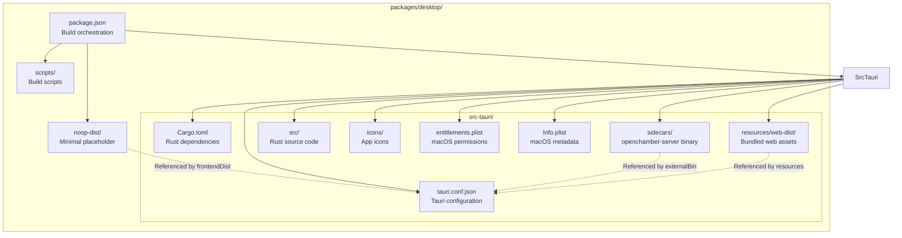

**Directory Structure:**

| Path | Purpose |
|------|---------|
| `scripts/` | Build automation scripts for sidecar preparation |
| `noop-dist/` | Minimal placeholder directory referenced by `frontendDist` |
| `src-tauri/src/` | Rust backend implementation (window management, IPC) |
| `src-tauri/Cargo.toml` | Rust dependencies and package metadata |
| `src-tauri/tauri.conf.json` | Tauri window, bundle, and plugin configuration |
| `src-tauri/icons/` | Application icons for macOS (`.icns`, `.png`) |
| `src-tauri/sidecars/` | Built `openchamber-server` binary (from `@openchamber/web`) |
| `src-tauri/resources/web-dist/` | Complete web application assets bundled into app |

**Sources:** [packages/desktop/package.json:1-26](), [packages/desktop/src-tauri/tauri.conf.json:1-85]()

## Tauri Configuration

The `tauri.conf.json` file at [packages/desktop/src-tauri/tauri.conf.json:1-76]() defines the application's window behavior, bundle settings, and plugin configuration.

### Core Application Metadata

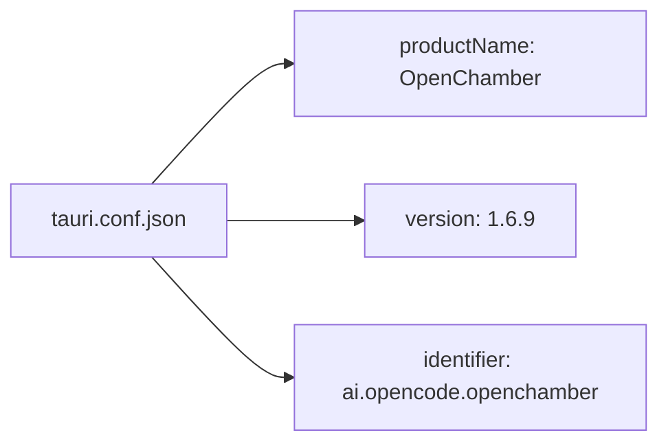

| Key | Value | Purpose |
|-----|-------|---------|
| `productName` | `"OpenChamber"` | Display name in window titles and system menus |
| `version` | `"1.6.9"` | Application version, synchronized with `Cargo.toml` |
| `identifier` | `"ai.opencode.openchamber"` | Bundle identifier for macOS and system registration |

**Sources:** [packages/desktop/src-tauri/tauri.conf.json:2-4]()

### Build Configuration and Sidecar Architecture

The `build` section defines how the web server sidecar is prepared and integrated:

```json
{
  "beforeDevCommand": "node ./scripts/dev-web-server.mjs",
  "beforeBuildCommand": "bun run build:sidecar",
  "devUrl": "http://127.0.0.1:3001",
  "frontendDist": "../noop-dist"
}
```

| Key | Value | Purpose |
|-----|-------|---------|
| `beforeDevCommand` | `"node ./scripts/dev-web-server.mjs"` | Starts the web server in development mode |
| `beforeBuildCommand` | `"bun run build:sidecar"` | Builds and bundles the web server binary and assets |
| `devUrl` | `"http://127.0.0.1:3001"` | URL where the web server runs (default port) |
| `frontendDist` | `"../noop-dist"` | Minimal placeholder directory (sidecar serves actual content) |

**Sidecar Binary Bundling:**

```json
{
  "bundle": {
    "externalBin": [
      "sidecars/openchamber-server"
    ],
    "resources": [
      "resources/web-dist/**/*"
    ]
  }
}
```

| Configuration | Value | Purpose |
|---------------|-------|---------|
| `externalBin` | `["sidecars/openchamber-server"]` | Bundles the web server binary as a sidecar executable |
| `resources` | `["resources/web-dist/**/*"]` | Includes all web application assets (HTML, JS, CSS) |

The `build:sidecar` script (defined at [packages/desktop/package.json:15]()) performs the following:
1. Builds `@openchamber/web` package
2. Copies the web server binary to `src-tauri/sidecars/openchamber-server`
3. Copies the web distribution to `src-tauri/resources/web-dist/`

**Sources:** [packages/desktop/src-tauri/tauri.conf.json:6-11,43-48](), [packages/desktop/package.json:15]()

### Window Configuration

The application defines a single window configuration with macOS-specific customizations. The window is created programmatically by the Rust backend after the sidecar server is ready:

```mermaid
graph TB
    Window["Window: main"]
    
    subgraph "Creation"
        Create["create: false<br/>Created programmatically"]
        Label["label: main"]
    end
    
    subgraph "Visual Configuration"
        Transparent["transparent: false"]
        Decorations["decorations: true"]
        HiddenTitle["hiddenTitle: true"]
        TitleBarStyle["titleBarStyle: Overlay"]
        TrafficLight["trafficLightPosition<br/>x: 17, y: 26"]
    end
    
    subgraph "Behavior"
        Visible["visible: false<br/>Show after sidecar ready"]
        Throttling["backgroundThrottling: disabled<br/>Run in background"]
        DragDrop["dragDropEnabled: false"]
    end
    
    subgraph "Dimensions"
        Width["width: 1280"]
        Height["height: 800"]
        Resizable["resizable: true"]
        Fullscreen["fullscreen: false"]
    end
    
    Window --> Create
    Window --> Label
    Window --> Transparent
    Window --> Decorations
    Window --> HiddenTitle
    Window --> TitleBarStyle
    Window --> TrafficLight
    Window --> Visible
    Window --> Throttling
    Window --> DragDrop
    Window --> Width
    Window --> Height
    Window --> Resizable
    Window --> Fullscreen
```

| Property | Value | Purpose |
|----------|-------|---------|
| `create` | `false` | Window is created programmatically by Rust backend (not at startup) |
| `label` | `"main"` | Identifier for programmatic window access |
| `transparent` | `false` | No window transparency (sidecar serves complete UI) |
| `hiddenTitle` | `true` | Hides default macOS title bar |
| `titleBarStyle` | `"Overlay"` | Custom title bar with traffic lights |
| `trafficLightPosition` | `{x: 17, y: 26}` | Position of macOS window controls |
| `visible` | `false` | Window starts hidden, shown after sidecar initialization |
| `backgroundThrottling` | `"disabled"` | Keeps app responsive when in background |
| `dragDropEnabled` | `false` | Disables file drag-and-drop to window |

**Window Creation Flow:**

The window is not created at application launch. Instead, the Rust backend:
1. Spawns the sidecar server process
2. Waits for server readiness (health check)
3. Creates the window programmatically using `tauri::WindowBuilder`
4. Loads the sidecar URL (`http://127.0.0.1:3001` or dynamic port)

**Sources:** [packages/desktop/src-tauri/tauri.conf.json:13-34]()

### Bundle and Distribution

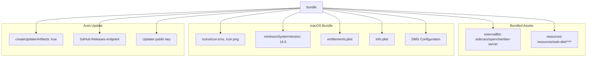

| Configuration | Details |
|---------------|---------|
| **External Binary** | `sidecars/openchamber-server` - the complete web server executable |
| **Bundled Resources** | `resources/web-dist/**/*` - all web application assets |
| **Icons** | `icon.icns` and `icon.png` at [packages/desktop/src-tauri/icons/]() |
| **macOS Minimum Version** | macOS 14.0 (Sonoma) |
| **Entitlements** | `entitlements.plist` - file system, network, and process permissions |
| **DMG Layout** | App at (180, 170), Applications folder at (480, 170), 660×400 window |
| **Updater Artifacts** | Generated for GitHub Releases integration |
| **Update Endpoint** | `https://github.com/btriapitsyn/openchamber/releases/latest/download/latest.json` |

The bundler includes the sidecar binary as an external executable that Tauri can spawn, and all web assets as resources that the sidecar serves at runtime.

**Sources:** [packages/desktop/src-tauri/tauri.conf.json:41-74]()

### Plugin Configuration

OpenChamber Desktop uses several Tauri plugins:

| Plugin | Purpose | Configuration |
|--------|---------|---------------|
| `tauri-plugin-updater` | Auto-update from GitHub Releases | Endpoint and public key configured |
| `tauri-plugin-notification` | Native system notifications | Default configuration |
| `tauri-plugin-process` | Process management utilities | Default configuration |
| `tauri-plugin-dialog` | Native file dialogs | Default configuration |
| `tauri-plugin-fs` | File system access | Default configuration |
| `tauri-plugin-shell` | Shell command execution | Default configuration |
| `tauri-plugin-log` | Logging framework | Default configuration |

**Sources:** [packages/desktop/src-tauri/tauri.conf.json:67-74](), [packages/desktop/src-tauri/Cargo.toml:42-52]()

### macOS Private API Access

```json
{
  "app": {
    "macOSPrivateApi": true
  }
}
```

The application enables `macOSPrivateApi` to access system-level features like window appearance customization and notification preferences. This requires special entitlements defined in `entitlements.plist`.

**Sources:** [packages/desktop/src-tauri/tauri.conf.json:36]()

## Rust Backend Configuration

The Rust backend is configured via [packages/desktop/src-tauri/Cargo.toml:1-33](). It defines the package metadata, binary configuration, and dependencies.

### Package Metadata

```toml
[package]
name = "openchamber-desktop"
version = "1.6.9"
edition = "2021"
publish = false
```

| Field | Value | Purpose |
|-------|-------|---------|
| `name` | `"openchamber-desktop"` | Crate name for Cargo |
| `version` | `"1.6.9"` | Synchronized with `tauri.conf.json` version |
| `edition` | `"2021"` | Rust edition for language features |
| `publish` | `false` | Prevents accidental publication to crates.io |

**Sources:** [packages/desktop/src-tauri/Cargo.toml:1-5]()

### Binary Configuration

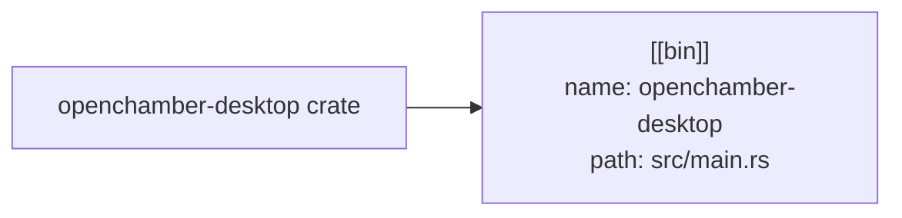

The package defines a single binary executable:

- **Binary:** `openchamber-desktop` at [packages/desktop/src-tauri/src/main.rs]()

**Sources:** [packages/desktop/src-tauri/Cargo.toml:7-9]()

### Feature Flags

```toml
[features]
default = []
devtools = ["tauri/devtools"]
```

| Feature | Dependencies | Purpose |
|---------|-------------|---------|
| `default` | None | Production build configuration |
| `devtools` | `tauri/devtools` | Enables Chrome DevTools in development |

The `devtools` feature is activated via `cargo tauri dev --features devtools` during development.

**Sources:** [packages/desktop/src-tauri/Cargo.toml:15-17]()

### Key Dependencies

```mermaid
graph TB
    Crate["openchamber-desktop"]
    
    subgraph "Tauri Framework"
        Tauri["tauri 2.9.4<br/>macos-private-api feature"]
        PluginDialog["tauri-plugin-dialog 2.4.2"]
        PluginLog["tauri-plugin-log 2.7.1"]
        PluginShell["tauri-plugin-shell 2.3.3"]
        PluginNotif["tauri-plugin-notification 2.3.3"]
        PluginUpdater["tauri-plugin-updater 2"]
    end
    
    subgraph "Async Runtime"
        Tokio["tokio 1.38<br/>rt-multi-thread, time"]
    end
    
    subgraph "HTTP & Networking"
        Reqwest["reqwest 0.12.4<br/>rustls-tls"]
        Url["url 2.5"]
    end
    
    subgraph "Serialization & Error Handling"
        Serde["serde 1.0.210<br/>derive"]
        SerdeJson["serde_json 1.0.143"]
        Anyhow["anyhow 1.0.86"]
        Base64["base64 0.22.1"]
    end
    
    subgraph "Logging"
        Log["log 0.4.28"]
    end
    
    Crate --> Tauri
    Crate --> PluginDialog
    Crate --> PluginLog
    Crate --> PluginShell
    Crate --> PluginNotif
    Crate --> PluginUpdater
    Crate --> Tokio
    Crate --> Reqwest
    Crate --> Url
    Crate --> Serde
    Crate --> SerdeJson
    Crate --> Anyhow
    Crate --> Base64
    Crate --> Log
```

**Core Dependencies:**

| Dependency | Version | Purpose |
|------------|---------|---------|
| `tauri` | `2.9.4` | Application framework with `macos-private-api` feature |
| `tokio` | `1.38` | Async runtime with multi-thread scheduler and time utilities |
| `reqwest` | `0.12.4` | HTTP client for sidecar health checks, uses rustls for TLS |
| `serde`, `serde_json` | `1.0.210`, `1.0.143` | Serialization for IPC and configuration |
| `anyhow` | `1.0.86` | Error handling and context propagation |
| `url` | `2.5` | URL parsing and manipulation |
| `base64` | `0.22.1` | Base64 encoding/decoding for data serialization |
| `log` | `0.4.28` | Logging facade |

**Tauri Plugins:**

| Plugin | Version | Purpose |
|--------|---------|---------|
| `tauri-plugin-dialog` | `2.4.2` | Native file and folder dialogs |
| `tauri-plugin-log` | `2.7.1` | Logging infrastructure |
| `tauri-plugin-shell` | `2.3.3` | Shell command execution for sidecar management |
| `tauri-plugin-notification` | `2.3.3` | Native system notifications |
| `tauri-plugin-updater` | `2` | Auto-update from GitHub Releases |

**Sources:** [packages/desktop/src-tauri/Cargo.toml:15-29]()

## Build Pipeline

The desktop application uses a multi-stage build process coordinated between npm/bun scripts, Node.js build scripts, and Cargo/Tauri CLI. The build process centers around preparing the web server sidecar and bundling it with the Tauri application.

### Development Workflow

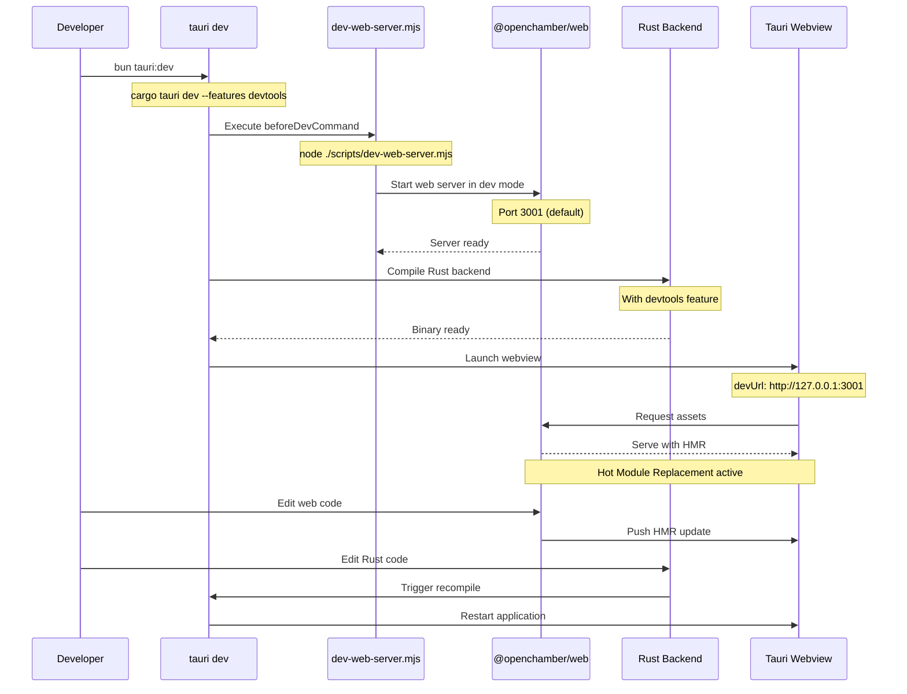

**Development Commands:**

| Command | Script | Purpose |
|---------|--------|---------|
| `bun tauri:dev` | `tauri dev --features devtools` | Launch Tauri in development mode |
| (beforeDevCommand) | `node ./scripts/dev-web-server.mjs` | Start web server in development mode |

**Development Flow:**
1. `tauri dev` executes `beforeDevCommand` from `tauri.conf.json`
2. `dev-web-server.mjs` starts the `@openchamber/web` server on port 3001
3. Rust backend compiles with `devtools` feature
4. Webview launches pointing to `devUrl` (`http://127.0.0.1:3001`)
5. Web server serves UI with HMR support
6. Changes to web code trigger HMR updates
7. Changes to Rust code require full application restart

**Sources:** [packages/desktop/package.json:13](), [packages/desktop/src-tauri/tauri.conf.json:6-11]()

### Production Build

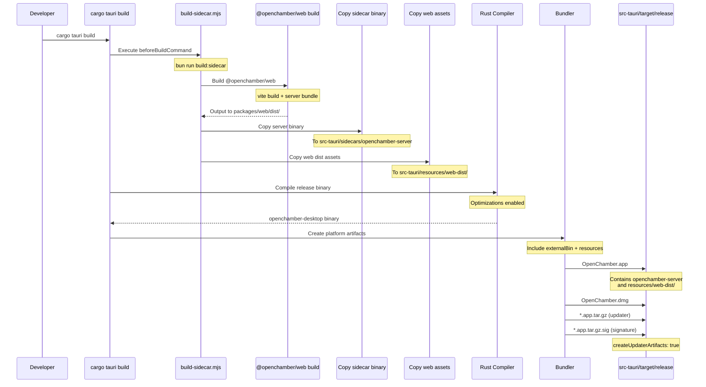

**Production Commands:**

| Command | Script | Purpose |
|---------|--------|---------|
| `bun run build:sidecar` | `node ./scripts/build-sidecar.mjs` | Build and bundle web server + assets |
| `bun tauri:build` | `tauri build` | Build Rust backend and create platform bundles |

**Build Stages:**
1. **Sidecar Preparation:** `build:sidecar` script executes
   - Builds `@openchamber/web` package (server + frontend)
   - Copies server binary to `src-tauri/sidecars/openchamber-server`
   - Copies web distribution to `src-tauri/resources/web-dist/`
2. **Backend Compilation:** Cargo compiles Rust in release mode
   - Binary: `src-tauri/target/release/openchamber-desktop`
   - Optimization level controlled by `Cargo.toml` profile
3. **Bundle Creation:** Tauri bundles all components
   - Includes `openchamber-server` as external binary
   - Includes `resources/web-dist/**/*` as bundled resources
   - macOS: `.app` bundle, `.dmg` installer
   - Updater artifacts: `.tar.gz` and `.tar.gz.sig` files

**Output Artifacts:**

| Artifact | Path | Purpose |
|----------|------|---------|
| `.app` | `src-tauri/target/release/bundle/macos/` | macOS application bundle (contains sidecar + resources) |
| `.dmg` | `src-tauri/target/release/bundle/dmg/` | macOS disk image installer |
| `.tar.gz` | `src-tauri/target/release/bundle/macos/` | Update package |
| `.tar.gz.sig` | `src-tauri/target/release/bundle/macos/` | Update signature |

**Bundled Structure:**

The `.app` bundle contains:
- `Contents/MacOS/openchamber-desktop` - Tauri executable
- `Contents/MacOS/sidecars/openchamber-server` - Web server binary
- `Contents/Resources/resources/web-dist/` - Complete web application

**Sources:** [packages/desktop/package.json:15-16](), [packages/desktop/src-tauri/tauri.conf.json:6-11,43-48,74]()

## No Direct Frontend Configuration

Unlike typical Tauri applications, the desktop package **does not include frontend source code or Vite configuration**. The user interface is provided entirely by the `@openchamber/web` package, which is bundled as a sidecar.

### Package Dependencies

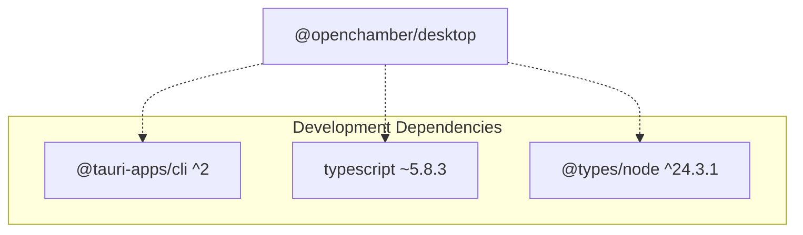

| Dependency | Version | Purpose |
|------------|---------|---------|
| `@tauri-apps/cli` | `^2` | Tauri build and development CLI |
| `typescript` | `~5.8.3` | Type checking for build scripts |
| `@types/node` | `^24.3.1` | Type definitions for Node.js in build scripts |

**No Runtime Dependencies:**

The desktop package has **no runtime dependencies** in `package.json`. All UI and frontend logic is provided by the sidecar:
- The sidecar binary (`openchamber-server`) from `@openchamber/web` serves the UI
- The sidecar resources (`resources/web-dist/`) contain all frontend assets
- The Tauri webview loads the UI from the sidecar's HTTP server

**Build Scripts:**

| Script | Purpose |
|--------|---------|
| `build:sidecar` | Builds `@openchamber/web` and copies binary + assets to Tauri directories |

**Sources:** [packages/desktop/package.json:20-25]()

## Version Synchronization

The application version must be synchronized across multiple files to ensure consistency:

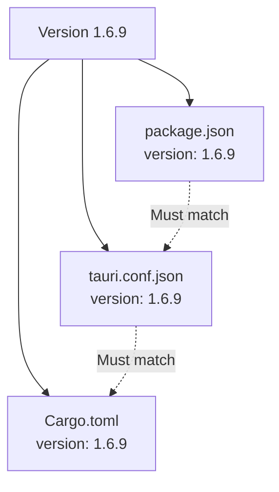

| File | Location | Field |
|------|----------|-------|
| `package.json` | [packages/desktop/package.json:3]() | `"version": "1.6.9"` |
| `tauri.conf.json` | [packages/desktop/src-tauri/tauri.conf.json:4]() | `"version": "1.6.9"` |
| `Cargo.toml` | [packages/desktop/src-tauri/Cargo.toml:3]() | `version = "1.6.9"` |

Version mismatches can cause build failures or incorrect version reporting in the auto-update system.

**Sources:** [packages/desktop/package.json:3](), [packages/desktop/src-tauri/tauri.conf.json:4](), [packages/desktop/src-tauri/Cargo.toml:3]()

## Integration Points

The desktop application integrates with other systems at several key boundaries:

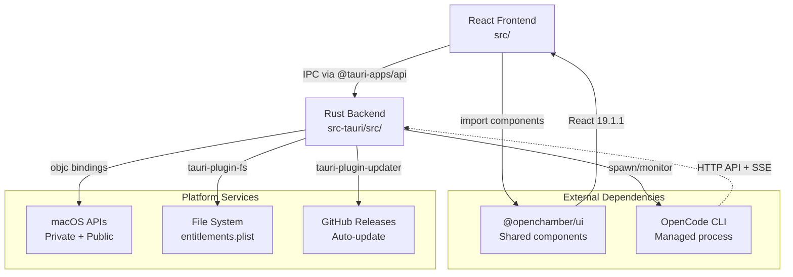

**Key Integration Mechanisms:**

| Integration | Direction | Mechanism |
|-------------|-----------|-----------|
| Frontend → UI Library | Import | ES modules, React components |
| Frontend → Backend | IPC | Tauri commands via `@tauri-apps/api` |
| Backend → OpenCode | Process | `tokio::process::Command` spawn |
| Backend → macOS | FFI | `objc`, `objc2` bindings for private APIs |
| Backend → Auto-Update | Network | `reqwest` + GitHub Releases API |

**Sources:** [packages/desktop/package.json:21-28](), [packages/desktop/src-tauri/Cargo.toml:19-52]()

---

