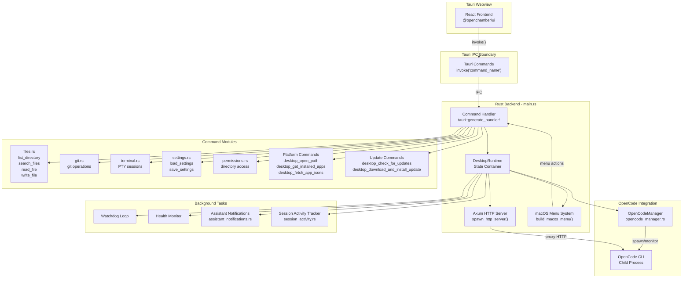
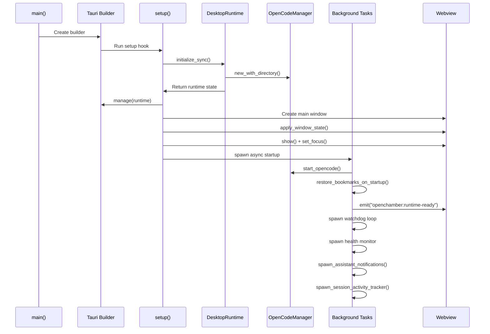
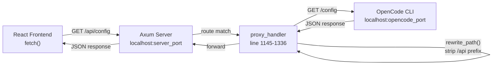
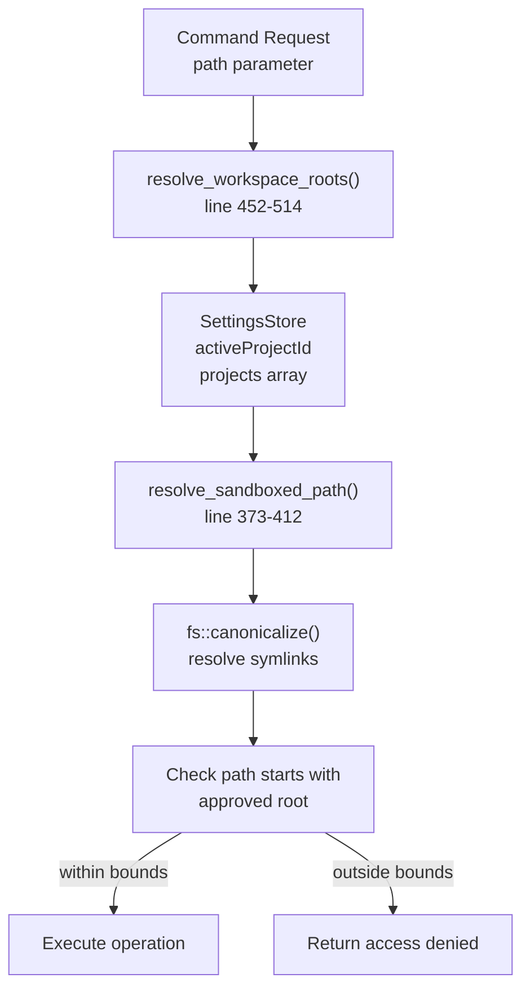
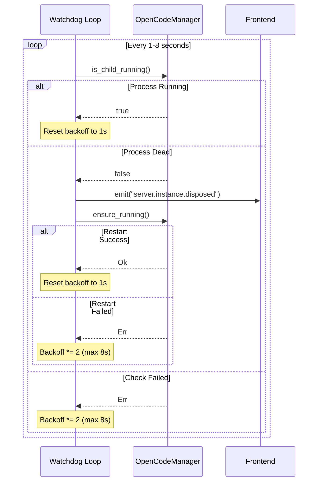

<!-- source: DeepWiki mcp.deepwiki.com · repo btriapitsyn/openchamber · page 4.2 Rust Backend · fetched 2026-10-26 -->

# Rust Backend

<details>
<summary>Relevant source files</summary>

The following files were used as context for generating this wiki page:

- [packages/desktop/src-tauri/src/main.rs](packages/desktop/src-tauri/src/main.rs)
- [packages/ui/src/App.tsx](packages/ui/src/App.tsx)
- [packages/ui/src/lib/api/types.ts](packages/ui/src/lib/api/types.ts)
- [packages/ui/src/lib/desktop.ts](packages/ui/src/lib/desktop.ts)
- [packages/ui/src/lib/persistence.ts](packages/ui/src/lib/persistence.ts)
- [packages/vscode/src/bridge.ts](packages/vscode/src/bridge.ts)
- [packages/web/server/index.js](packages/web/server/index.js)

</details>


## Purpose and Scope

This document details the Rust backend implementation of the OpenChamber desktop application, built using the Tauri framework. The backend provides native operating system integration, manages the OpenCode CLI process lifecycle, implements file system and Git operations, and exposes Tauri commands to the frontend webview. For information about the desktop application structure and build configuration, see [Application Structure](#4.1). For OpenCode process management details, see [OpenCode Process Management](#4.3). For platform-specific features like macOS integrations, see [Platform-Specific Features](#4.4).

The Rust backend serves as the bridge between the web-based UI (running in a Tauri webview) and native system capabilities, including spawning and monitoring external processes, accessing the file system with proper sandboxing, executing shell commands, and interfacing with the operating system.

---

## Architecture Overview

The desktop backend is organized around several core subsystems that work together to provide native capabilities to the frontend.

### Core Components

| Component | File | Purpose |
|-----------|------|---------|
| `DesktopRuntime` | [main.rs:150-213]() | Central state container managing all subsystems |
| `OpenCodeManager` | [opencode_manager.rs:32-506]() | Spawns and monitors OpenCode CLI process |
| `ServerState` | [main.rs:216-223]() | HTTP server state for proxying to OpenCode |
| `SettingsStore` | Referenced in main.rs | Persistent settings management |
| `TerminalState` | [main.rs:662]() | PTY session management |
| `WindowStateManager` | [main.rs:666]() | Window geometry persistence |

**Diagram: Desktop Backend Architecture**



Sources: [main.rs:131-376](), [main.rs:415-892](), [opencode_manager.rs:32-506]()

---

## Initialization and Startup

The desktop backend initializes in a specific sequence to ensure all subsystems are ready before the UI becomes interactive.

### Startup Sequence



Sources: [main.rs:626-826]()

### DesktopRuntime Initialization

The `DesktopRuntime` is constructed synchronously during Tauri's setup phase to ensure all state is available immediately.

**Key initialization steps:**

1. **Settings Store Creation**: [main.rs:160]()
   - Loads persisted settings from disk
   - Establishes default values

2. **OpenCodeManager Creation**: [main.rs:161]()
   - Detects OpenCode CLI binary location
   - Configures environment and working directory
   - Does not spawn process yet

3. **HTTP Server Spawn**: [main.rs:167-177]()
   - Picks unused port via `portpicker`
   - Creates Axum router with proxy middleware
   - Spawns server on background task

4. **Shutdown Coordination**: [main.rs:165]()
   - Creates broadcast channel for coordinated shutdown
   - All background tasks subscribe to this channel

Sources: [main.rs:159-185]()

---

## Tauri Command System

The Rust backend exposes functionality to the frontend through Tauri commands, which are Rust functions annotated with `#[tauri::command]` and registered in the command handler.

### Command Registration

All commands are registered in a single macro invocation:

```rust
.invoke_handler(tauri::generate_handler![
    desktop_server_info,
    desktop_restart_opencode,
    load_settings,
    save_settings,
    list_directory,
    search_files,
    create_directory,
    read_file,
    write_file,
    exec_commands,
    request_directory_access,
    // ... 50+ more commands
])
```

Sources: [main.rs:827-884]()

### Command Invocation Pattern

Frontend invokes commands using the Tauri API:

```typescript
// Frontend calls:
const result = await invoke('list_directory', { path: '/some/path' });
```

The Rust command receives typed parameters and can access Tauri-managed state:

```rust
#[tauri::command]
pub async fn list_directory(
    path: Option<String>,
    state: tauri::State<'_, DesktopRuntime>,
) -> Result<DirectoryListResult, String>
```

Sources: [commands/files.rs:136-215]()

### Command Categories

| Category | Commands | Module |
|----------|----------|--------|
| **File System** | `list_directory`, `search_files`, `create_directory`, `read_file`, `write_file` | [files.rs]() |
| **Command Execution** | `exec_commands` | [files.rs:725-828]() |
| **Git Operations** | `get_git_status`, `get_git_diff`, `create_git_commit`, `git_push`, `add_git_worktree`, etc. | [git.rs]() |
| **Settings** | `load_settings`, `save_settings`, `restart_opencode`, `desktop_set_auto_worktree_menu` | [main.rs:378-413]() |
| **Permissions** | `request_directory_access`, `start_accessing_directory`, `pick_directory` | [permissions.rs]() |
| **Terminal** | `create_terminal_session`, `send_terminal_input`, `resize_terminal`, `close_terminal` | [terminal.rs]() |
| **Diagnostics** | `fetch_desktop_logs` | [logs.rs]() |
| **Notifications** | `desktop_notify` | [main.rs:1016-1045]() |
| **Platform Integration** | `desktop_open_path`, `desktop_filter_installed_apps`, `desktop_get_installed_apps`, `desktop_fetch_app_icons` | [main.rs:415-644]() |
| **Updates** | `desktop_check_for_updates`, `desktop_download_and_install_update`, `desktop_restart` | [main.rs]() |

Sources: [main.rs:378-644](), [main.rs:1016-1045]()

---

## HTTP Server and Proxy Layer

The desktop backend runs an embedded Axum HTTP server to proxy API requests from the frontend to the OpenCode CLI process.

**Diagram: HTTP Request Flow**



Sources: [main.rs:1145-1336]()

### Server Initialization

The HTTP server is spawned during `DesktopRuntime::initialize_sync()`:

```rust
fn spawn_http_server(port: u16, state: ServerState, mut shutdown_rx: broadcast::Receiver<()>) {
    tauri::async_runtime::spawn(async move {
        let listener = TcpListener::bind(("127.0.0.1", port)).await.unwrap();
        
        let app = Router::new()
            .route("/api/*path", any(proxy_handler))
            .route("/health", get(health_handler))
            .route("/api/fs/list", get(fs_list_handler))
            .route("/api/fs/search", get(fs_search_handler))
            // ... more routes
            .layer(CorsLayer::permissive())
            .with_state(state);
        
        axum::serve(listener, app)
            .with_graceful_shutdown(async move {
                let _ = shutdown_rx.recv().await;
            })
            .await
            .unwrap();
    });
}
```

Sources: [main.rs:1066-1143]()

### Proxy Handler

The `proxy_handler` function forwards most API requests to OpenCode after path rewriting:

**Request Transformation:**

1. **Path Rewriting**: [main.rs:1171-1182]()
   - Incoming: `GET /api/session/abc123`
   - Rewritten: `GET /session/abc123` (via `opencode.rewrite_path()`)
   
2. **Header Forwarding**: [main.rs:1183-1195]()
   - Copies headers from incoming request
   - Removes hop-by-hop headers

3. **Body Handling**: [main.rs:1196-1208]()
   - Limits body size to 32MB
   - Converts to `reqwest::Body`

4. **Upstream Request**: [main.rs:1209-1220]()
   - Constructs URL using OpenCode port and API prefix
   - Sends request with timeout

5. **Response Streaming**: [main.rs:1221-1336]()
   - Forwards status code and headers
   - Streams body back to frontend

Sources: [main.rs:1145-1336]()

### Direct Handler Endpoints

Some operations bypass OpenCode and execute directly in Rust:

| Endpoint | Handler | Purpose |
|----------|---------|---------|
| `/health` | `health_handler` | Health check with OpenCode status |
| `/api/fs/list` | `fs_list_handler` | Directory listing with sandboxing |
| `/api/fs/search` | `fs_search_handler` | File search with fuzzy matching |
| `/api/fs/mkdir` | `fs_mkdir_handler` | Create directory |
| `/api/fs/home` | `fs_home_handler` | Get home directory |
| `/api/settings` | `settings_get_handler` | Load settings |
| `/api/settings` (POST) | `settings_post_handler` | Save settings |
| `/api/models-metadata` | `models_metadata_handler` | Fetch models.dev API with caching |

These handlers provide faster response times and tighter integration with native OS features.

Sources: [main.rs:1338-1923]()

---

## File System Operations

File system commands implement security sandboxing to restrict access to approved project directories.

### Security Model

**Diagram: File System Access Control**



Sources: [commands/files.rs:373-514]()

### Directory Listing

The `list_directory` command enumerates directory contents with metadata:

**Implementation Flow:**

1. **Resolve Workspace Roots**: [files.rs:140]()
   - Loads active project from settings
   - Collects all approved project paths

2. **Path Resolution**: [files.rs:141-143]()
   - Expands tilde (`~`) to home directory
   - Makes path absolute
   - Canonicalizes to resolve symlinks

3. **Boundary Check**: [files.rs:154-160]()
   - Verifies resolved path is within approved roots
   - Returns `OutsideWorkspace` error if violation detected

4. **Read Directory**: [files.rs:163-208]()
   - Iterates directory entries
   - Resolves symlinks to determine if directory
   - Collects metadata (size, modified time)

5. **Return Result**: [files.rs:210-214]()
   - Returns `DirectoryListResult` with normalized paths

Sources: [commands/files.rs:136-215]()

### File Search

The `search_files` command implements breadth-first traversal with fuzzy matching.

**Algorithm:**

1. **Collect Limit Calculation**: [files.rs:239-243]()
   - For empty query: collect `limit` files
   - For fuzzy match: collect `limit * 3` or 200 (whichever is larger)

2. **BFS Traversal**: [files.rs:246-320]()
   - Uses `VecDeque` as queue
   - Processes `FILE_SEARCH_MAX_CONCURRENCY` (5) directories concurrently
   - Skips excluded directories: `node_modules`, `.git`, `dist`, etc.

3. **Fuzzy Matching**: [files.rs:305-309]()
   - Calls `fuzzy_match_score()` for each file
   - Scores based on:
     - Substring match position (earlier is better)
     - Consecutive character matches (bonus)
     - Word boundary matches (bonus)
     - Path length (shorter is better)

4. **Sorting**: [files.rs:323-333]()
   - Sort by score descending
   - Tie-break by path length
   - Tie-break alphabetically

5. **Truncation**: [files.rs:335-340]()
   - Return top `limit` results

**Fuzzy Match Scoring:**

The scoring function balances multiple factors:

| Factor | Weight | Location |
|--------|--------|----------|
| Exact substring | +100 base | [files.rs:547-558]() |
| Match at start | +20 bonus | [files.rs:550]() |
| Match after separator | +15 bonus | [files.rs:553]() |
| Character match | +10 per char | [files.rs:590]() |
| Near start | +18 - index | [files.rs:591]() |
| Consecutive match | +12 | [files.rs:604]() |
| Word boundary | +10 or +12 | [files.rs:596-602]() |
| Shorter path | +24 - len/3 | [files.rs:611]() |
| Gap penalty | -gap (max 10) | [files.rs:592]() |

Sources: [commands/files.rs:222-345](), [commands/files.rs:534-614]()

### Command Execution

The `exec_commands` command executes shell commands with sandboxing:

**Implementation:**

1. **Resolve Working Directory**: [files.rs:740-743]()
   - Validates `cwd` is within workspace roots
   - Canonicalizes path

2. **Shell Detection**: [files.rs:753-759]()
   - Uses `$SHELL` environment variable
   - Defaults to `/bin/sh` on Unix, `cmd.exe` on Windows

3. **Sequential Execution**: [files.rs:765-820]()
   - Iterates commands array
   - Spawns each command in blocking task
   - Captures stdout/stderr
   - Records exit code

4. **Result Aggregation**: [files.rs:822-827]()
   - Returns all results
   - `success` field is true only if all commands succeeded

Sources: [commands/files.rs:725-828]()

---

## OpenCode Integration

The `OpenCodeManager` is responsible for spawning, monitoring, and communicating with the OpenCode CLI process. For detailed information on the lifecycle management, see [OpenCode Process Management](#4.3).

### Manager Structure

```rust
pub struct OpenCodeManager {
    binary: Option<String>,              // Path to opencode binary
    args: Vec<String>,                   // CLI arguments
    env: HashMap<String, String>,        // Environment variables
    working_dir: Arc<RwLock<PathBuf>>,   // Process working directory
    desired_port: u16,                   // Port (0 = random)
    child: Arc<Mutex<Option<Child>>>,    // Process handle
    port: Arc<RwLock<Option<u16>>>,      // Detected port
    api_prefix: Arc<RwLock<String>>,     // Detected API prefix
    is_ready: Arc<AtomicBool>,           // Ready state
    shutting_down: Arc<AtomicBool>,      // Shutdown flag
    http_client: Client,                 // For health checks
}
```

Sources: [opencode_manager.rs:32-44]()

### Binary Discovery

The manager attempts to locate the `opencode` binary in multiple locations:

**Discovery Order:**

1. **Environment Override**: [opencode_manager.rs:521-528]()
   - `$OPENCODE_BINARY` if set and file exists

2. **Shell Environment**: [opencode_manager.rs:532-541]()
   - Execute login shell to get environment
   - Check `$OPENCODE_BINARY` from shell

3. **PATH Search**: [opencode_manager.rs:543-551]()
   - Search each directory in augmented PATH
   - Look for `opencode` executable

4. **Fallback Location**: [opencode_manager.rs:553-562]()
   - Check `~/.opencode/bin/opencode`

5. **Not Found**: [opencode_manager.rs:564]()
   - App runs in limited mode without OpenCode

Sources: [opencode_manager.rs:516-566]()

### Process Spawning

The `spawn_process()` method configures and launches the OpenCode CLI:

**Steps:**

1. **Command Construction**: [opencode_manager.rs:278-290]()
   - Binary path from discovery
   - Args: `["serve", "--port", "{port}"]`
   - Optional `--config` if `$OPENCHAMBER_OPENCODE_CONFIG` set

2. **Environment Augmentation**: [opencode_manager.rs:288-290]()
   - Merge login shell PATH with current environment
   - Preserve all existing environment variables

3. **Process Spawn**: [opencode_manager.rs:292-301]()
   - Set working directory
   - Pipe stdout and stderr
   - `kill_on_drop(false)` to allow graceful shutdown

4. **Port Detection**: [opencode_manager.rs:304-306]()
   - If `desired_port > 0`, set immediately
   - Otherwise, wait for port in stdout logs

5. **Output Readers**: [opencode_manager.rs:311-323]()
   - Spawn background tasks for stdout/stderr
   - First line triggers "signal received" callback
   - Parse logs for port and API prefix

6. **First Signal Wait**: [opencode_manager.rs:326-335]()
   - Wait up to 750ms for first stdout/stderr line
   - Confirms process started successfully
   - Returns error if process exits immediately

Sources: [opencode_manager.rs:272-338]()

### Health Checking

Multiple mechanisms verify OpenCode is operational:

**Port Detection**: [opencode_manager.rs:384-396]()
- Parses stdout logs for `http://...:{port}` URLs
- Extracts port number and API prefix
- Timeout: 15 seconds

**Endpoint Polling**: [opencode_manager.rs:398-427]()
- Calls `/config` and `/agent` endpoints
- Retries every 400ms
- Timeout: 20 seconds
- Validates JSON response (not HTML)

**API Prefix Detection**: [opencode_manager.rs:191-224]()
- Tries candidates: `""` (root), `"/api"`
- First successful `/config` response wins
- Normalizes prefix (removes trailing slash)

Sources: [opencode_manager.rs:191-451]()

---

## Background Tasks

The desktop backend spawns several long-running background tasks to monitor system health and deliver real-time updates.

### Watchdog Loop

Monitors OpenCode process and restarts if it exits unexpectedly:



Sources: [main.rs:723-764]()

**Implementation Details:**

- **Shutdown Coordination**: [main.rs:730-732]()
  - Checks `opencode_manager().is_shutting_down()` before restart
  - Exits loop on shutdown signal

- **Exponential Backoff**: [main.rs:728, 761]()
  - Starts at 1 second
  - Doubles on each failure
  - Caps at 8 seconds

- **Event Emission**: [main.rs:742]()
  - Emits `server.instance.disposed` to notify frontend
  - Frontend can show reconnection UI

### Health Monitor

Periodically checks OpenCode health and emits status updates:

**Monitored Properties:**

| Property | Source | Event Trigger |
|----------|--------|---------------|
| `ok` | `opencode.is_ready()` | Status change |
| `port` | `opencode.current_port()` | Port change |
| `api_prefix` | `opencode.api_prefix()` | Prefix change |
| `cli_available` | `check_cli_exists()` | Availability change |

**Emission Logic**: [main.rs:798-811]()
- Compares current snapshot with previous
- Emits `openchamber:health-changed` if any field changed
- Initial snapshot always emits

**Wake Detection**: [main.rs:813-815]()
- If gap between ticks exceeds 15 seconds, emit `openchamber:wake`
- Indicates system sleep/resume
- Frontend can refresh data

Sources: [main.rs:766-820]()

### Assistant Notifications

Monitors OpenCode SSE events and displays native OS notifications when AI agents complete tasks:

**Connection Strategy:**

The notification system attempts three SSE endpoints in order:

1. **Global Events**: [assistant_notifications.rs:176-186]()
   - URL: `/global/event`
   - Receives all events across all projects
   - Preferred if available

2. **Root Events**: [assistant_notifications.rs:188-199]()
   - URL: `/event`
   - Receives events for unspecified directory
   - Fallback if global unavailable

3. **Directory-Scoped Events**: [assistant_notifications.rs:201-214]()
   - URL: `/event?directory={path}`
   - Receives events for specific project
   - Final fallback using active project from settings

**Event Filtering**: [assistant_notifications.rs:243-277]()

Only notifies when all conditions met:
- Event type is `message.updated`
- Message role is `assistant`
- Finish reason is `stop`
- Message ID not already notified (deduplication)

**Notification Conditions**: [assistant_notifications.rs:293-301]()

Shows notification only if:
- Window is not focused, OR
- Window is minimized

**Message Formatting**: [assistant_notifications.rs:289-292]()
- Title: `"{mode} agent is ready"`
- Body: `"{model} completed the task"`
- Uses `format_mode()` and `format_model_id()` for capitalization

Sources: [assistant_notifications.rs:33-312]()

### Session Activity Tracker

Tracks which sessions are currently active (executing prompts) and emits state changes to the frontend. Details not shown in provided files but referenced at [main.rs:823]().

---

## Platform-Specific Features

The Rust backend implements platform-specific integrations to provide native OS features. For detailed information on macOS-specific features, see [Platform-Specific Features](#4.4).

### macOS Integrations

**Menu System**: [main.rs:131-376]()
- Native macOS menu bar via `build_macos_menu()`
- Menu items with keyboard shortcuts
- Items include:
  - About, Check for Updates, Settings (Cmd+,)
  - Command Palette (Cmd+K), New Session, New Worktree
  - Tab shortcuts: Git (Cmd+G), Diff (Cmd+E), Terminal (Cmd+T)
  - Theme selection (Light, Dark, System)
  - Toggle sidebar (Cmd+L), Memory Debug (Cmd+Shift+D)
  - Diagnostics (Cmd+Shift+L), Help dialog (Cmd+.)
- Dynamic shortcut updates via `desktop_set_auto_worktree_menu` based on auto-worktree setting

**App Discovery and Icons**: [main.rs:464-892]()
- Discovers installed macOS applications via multiple methods:
  - Standard paths: `/Applications`, `/System/Applications`, `~/Applications`
  - Spotlight search using `mdfind` command
- Extracts app icons from `.app` bundles:
  - Reads `Info.plist` for `CFBundleIconFile`
  - Uses `mdls` command to query icon file
  - Converts `.icns` to PNG using `sips` command (32x32)
  - Encodes as base64 data URLs for frontend display
- Caches discovered apps to disk at `~/.config/openchamber/discovered-apps.json`
- Cache TTL: 24 hours
- Commands:
  - `desktop_filter_installed_apps`: Quick check if apps are installed
  - `desktop_get_installed_apps`: Full scan with icons, async refresh
  - `desktop_fetch_app_icons`: On-demand icon fetching

**Path Opening**: [main.rs:415-437]()
- `desktop_open_path` command opens files/directories in macOS applications
- Uses `open` command with optional `-a` flag to specify app
- Example: `open -a "Visual Studio Code" /path/to/file`

**Window Management**:
- Window vibrancy and traffic light positioning (implementation in truncated section)
- App nap prevention (implementation in truncated section)

Sources: [main.rs:131-376](), [main.rs:415-892]()

### Cross-Platform Abstractions

**Shell Detection**: [opencode_manager.rs:598-624]()
- macOS: Uses `dscl` to read user shell from directory service
- Linux: Reads `$SHELL` environment variable
- Windows: Returns `None`

**Shell Environment Loading**: [opencode_manager.rs:627-649]()
- Bash: Sources `~/.bashrc`, runs `-lic` mode
- Zsh: Runs `-lic` mode
- Nushell: Uses `-l -i -c` with special PATH syntax
- Exports `__PATH__` and `__OPENCODE_BINARY__` markers

Sources: [opencode_manager.rs:598-710]()

---

## Error Handling and Resilience

The Rust backend implements multiple layers of error handling to ensure robustness.

### Error Types

**File System Errors**: [files.rs:73-123]()

```rust
enum FsCommandError {
    NotFound,           // ENOENT
    AccessDenied,       // EPERM
    NotDirectory,       // Path exists but isn't directory
    OutsideWorkspace,   // Sandbox violation
    Other(String),      // All other errors
}
```

Each error type has context-specific messages:
- `to_list_message()`: For directory listing
- `to_search_message()`: For file search
- `to_create_message()`: For directory creation

**Command Result Pattern**: [files.rs:641-657]()

```rust
pub struct CommandResult {
    command: String,
    success: bool,
    exit_code: Option<i32>,
    stdout: Option<String>,
    stderr: Option<String>,
    error: Option<String>,
}
```

Allows frontend to handle partial failures gracefully.

### Graceful Degradation

**Missing CLI**: [opencode_manager.rs:516-566]()
- If OpenCode binary not found, log warning
- App continues in "limited mode"
- Frontend commands return appropriate errors
- No crash or panic

**Process Spawn Failure**:
- `ensure_running()` returns `Result<()>`
- Caller logs error but doesn't crash
- Watchdog will retry with backoff

**Health Check Timeout**: [opencode_manager.rs:398-427]()
- If endpoints don't respond within 20s, return error
- Process is killed and retry scheduled
- Error bubbles up to UI as "OpenCode not available"

**Platform Feature Fallbacks**: [main.rs:490-598]()
- macOS-specific commands return errors on other platforms
- Example: `desktop_filter_installed_apps` returns error on non-macOS
- Frontend checks platform before invoking platform-specific commands

Sources: [opencode_manager.rs:121-154](), [files.rs:73-133](), [main.rs:490-598]()

---

## Key Implementation Patterns

### Async/Await with Tokio

All I/O operations use Tokio async runtime:

```rust
#[tauri::command]
pub async fn list_directory(
    path: Option<String>,
    state: tauri::State<'_, DesktopRuntime>,
) -> Result<DirectoryListResult, String> {
    // Async filesystem operations
    let metadata = fs::metadata(&resolved_path).await?;
    let mut dir_entries = fs::read_dir(&resolved_path).await?;
    while let Some(entry) = dir_entries.next_entry().await? {
        // ...
    }
}
```

**Blocking Operations**: [files.rs:784-818]()

CPU-intensive or blocking operations run in dedicated thread pool:

```rust
let result = tokio::task::spawn_blocking(move || {
    Command::new(&shell_clone)
        .arg(shell_flag)
        .arg(&cmd_clone)
        .current_dir(&cwd_clone)
        .output()
}).await
```

Sources: [commands/files.rs:136-215](), [commands/files.rs:784-818]()

### State Management with Arc and RwLock

Shared state uses atomic reference counting and read-write locks:

```rust
pub struct OpenCodeManager {
    port: Arc<RwLock<Option<u16>>>,      // Multiple readers, single writer
    api_prefix: Arc<RwLock<String>>,     
    is_ready: Arc<AtomicBool>,           // Lock-free atomic operations
    shutting_down: Arc<AtomicBool>,
}
```

**Read Access**: [opencode_manager.rs:227-232]()
```rust
pub fn current_port(&self) -> Option<u16> {
    *self.port.read()  // Read lock, returns copy
}
```

**Write Access**: [opencode_manager.rs:372-373]()
```rust
*self.port.write() = Some(port_match);  // Write lock
```

Sources: [opencode_manager.rs:32-44](), [opencode_manager.rs:227-232]()

### Event Emission to Frontend

Tauri's event system broadcasts updates from Rust to JavaScript:

```rust
let _ = app_handle.emit("openchamber:health-changed", &snapshot);
```

**Common Events:**

| Event | Payload | Trigger |
|-------|---------|---------|
| `openchamber:runtime-ready` | `()` | Desktop runtime initialized |
| `openchamber:health-changed` | `HealthSnapshot` | OpenCode status changed |
| `openchamber:wake` | `()` | System resumed from sleep |
| `server.instance.disposed` | `()` | OpenCode process died |
| `openchamber:installed-apps-updated` | `Vec<InstalledAppInfo>` | App discovery refresh completed |
| `openchamber:menu-action` | `String` | Menu item clicked (action name) |
| `openchamber:check-for-updates` | `()` | User triggered update check |
| `openchamber:update-progress` | `UpdateProgress` | Update download progress |

**Menu Action Dispatch**: [main.rs:55-72]()

Menu items emit `openchamber:menu-action` event and dispatch JavaScript `CustomEvent` to focused window:

```rust
fn dispatch_menu_action<R: tauri::Runtime>(app: &tauri::AppHandle<R>, action: &str) {
    let _ = app.emit("openchamber:menu-action", action);
    
    let event = serde_json::to_string("openchamber:menu-action").unwrap();
    let detail = serde_json::to_string(action).unwrap();
    let script = format!("window.dispatchEvent(new CustomEvent({event}, {{ detail: {detail} }}));");
    eval_in_focused_window(app, &script);
}
```

Actions include: `"new-session"`, `"worktree-creator"`, `"settings"`, `"command-palette"`, etc.

Sources: [main.rs:55-72](), [main.rs:756-762]()

---

## Performance Considerations

### Concurrent File Search

File search uses controlled concurrency:

**Parameters**: [files.rs:14]()
- `FILE_SEARCH_MAX_CONCURRENCY = 5`: Max directories read simultaneously
- Balances speed vs. system load

**Batching**: [files.rs:253-258]()
```rust
while !queue.is_empty() && candidates.len() < collect_limit {
    for _ in 0..FILE_SEARCH_MAX_CONCURRENCY {
        let Some(dir) = queue.pop_front() else { break };
        // Read directory...
    }
}
```

Processes up to 5 directories per iteration, then yields.

### Models Metadata Caching

The `/api/models-metadata` endpoint caches responses from models.dev:

**Cache Structure**: [main.rs:225-229]()
```rust
struct ModelsMetadataCache {
    payload: Option<Value>,
    fetched_at: Option<Instant>,
}
```

**Cache Logic**: [main.rs:1895-1923]()
- TTL: 5 minutes
- Request timeout: 8 seconds
- Cache hit: Return immediately
- Cache miss: Fetch, cache, return

Sources: [main.rs:225-229](), [main.rs:1895-1923]()

### Path Normalization

All paths are normalized to use forward slashes for consistency:

```rust
fn normalize_path(path: &Path) -> String {
    path.to_string_lossy().replace('\\', "/")
}
```

This ensures Windows paths are consistent with Unix-style paths used in frontend.

Sources: [commands/files.rs:616-618]()

---

## Security Model

### Sandboxing

File operations are restricted to approved project directories:

**Approval Sources**: [files.rs:452-514]()
1. Active project from settings (`activeProjectId`)
2. All projects in settings (`projects` array)
3. Legacy `lastDirectory` setting

**Enforcement**: [files.rs:403-409]()
```rust
if !workspace_roots.is_empty()
    && !workspace_roots.iter().any(|root| canonicalized.starts_with(root))
{
    return Err(FsCommandError::OutsideWorkspace);
}
```

**Path Canonicalization**: [files.rs:399-401]()
- Resolves symlinks
- Converts to absolute path
- Prevents traversal attacks (e.g., `../../etc/passwd`)

Sources: [commands/files.rs:373-514]()

### macOS Security-Scoped Bookmarks

On macOS, the app uses security-scoped bookmarks to maintain persistent directory access across app launches:

**Restoration**: [main.rs:715-718]()
```rust
if let Err(e) = restore_bookmarks_on_startup(
    app_handle.state::<DesktopRuntime>().clone()
).await {
    warn!("Failed to restore bookmarks on startup: {}", e);
}
```

Details of bookmark creation and storage are in the permissions module (not shown in provided files).

Sources: [main.rs:715-718]()

---

## Summary

The Rust backend provides a robust foundation for the OpenChamber desktop application, implementing:

1. **Process Management**: Spawns and monitors OpenCode CLI with health checking and auto-restart
2. **HTTP Proxy**: Axum server proxies frontend requests to OpenCode with path rewriting
3. **File System**: Sandboxed operations with fuzzy search and parallel traversal
4. **Native Integration**: Platform-specific features via Tauri (menus, notifications, window effects)
5. **Background Tasks**: Watchdog, health monitor, and SSE event streaming
6. **Security**: Path sandboxing, canonicalization, and security-scoped bookmarks

The architecture balances performance (async I/O, concurrent operations) with safety (Rust type system, sandboxing) while maintaining a clean separation between frontend and backend concerns.

Sources: [main.rs:1-1923](), [opencode_manager.rs:1-711](), [commands/files.rs:1-829](), [assistant_notifications.rs:1-364]()

---

