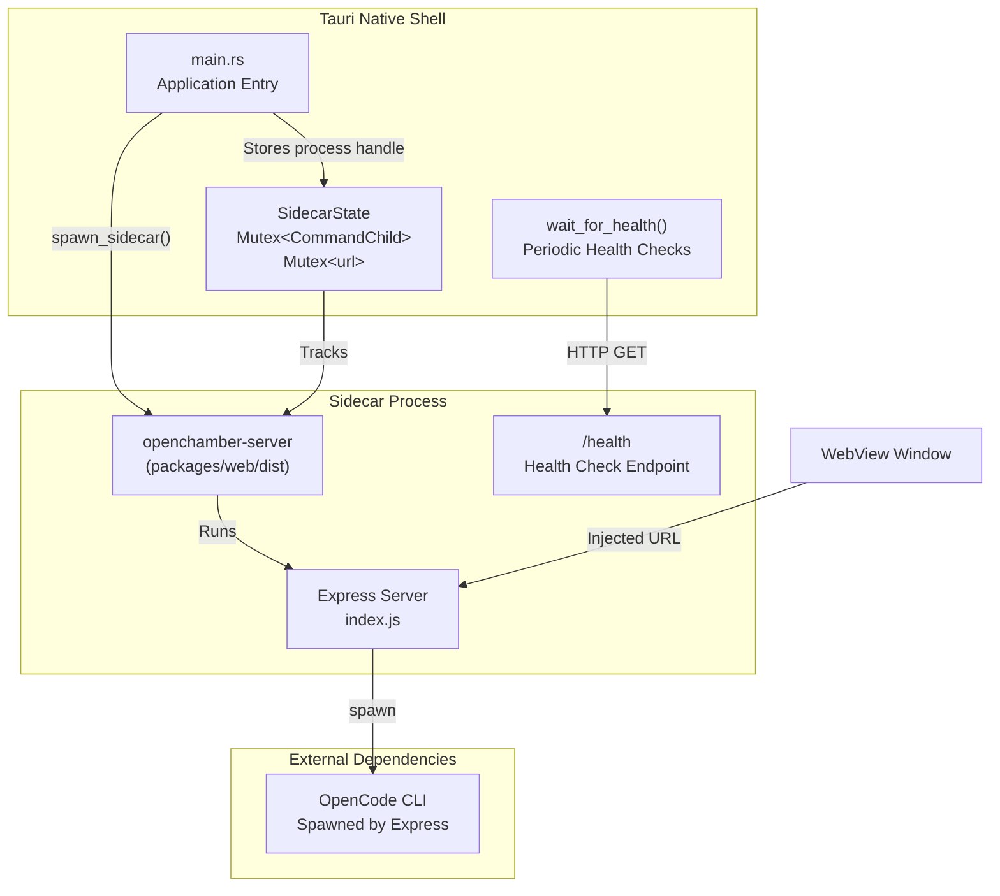
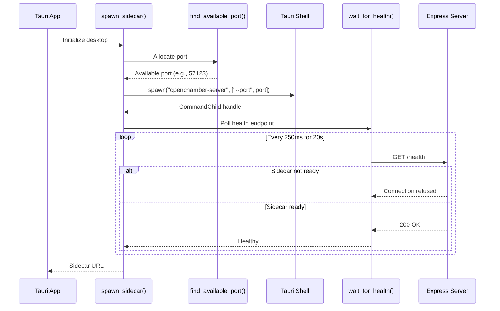
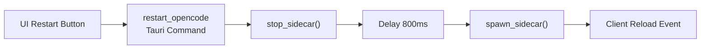
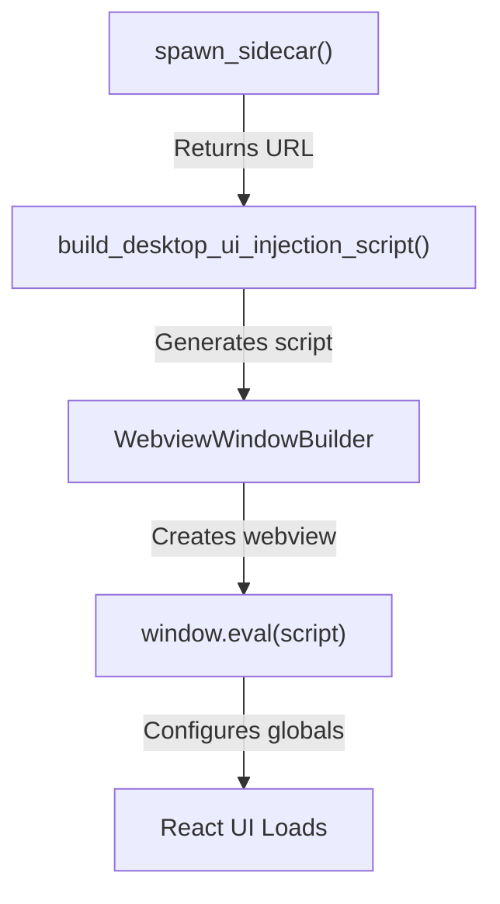
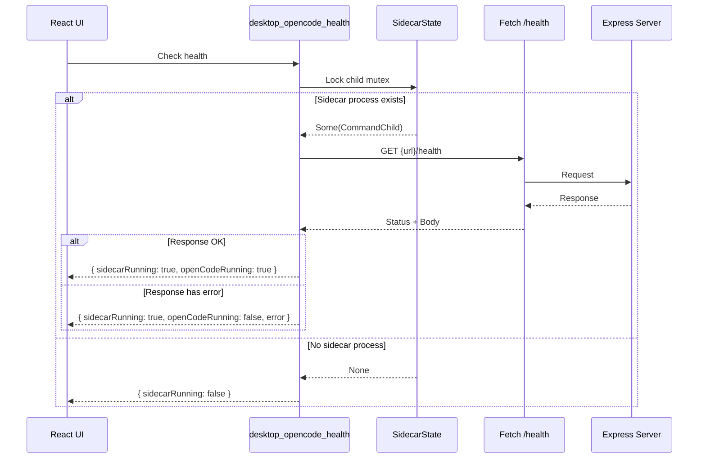

<!-- source: DeepWiki mcp.deepwiki.com · repo btriapitsyn/openchamber · page 4.3 Sidecar Process Management · fetched 2026-10-26 -->

# Sidecar Process Management

<details>
<summary>Relevant source files</summary>

The following files were used as context for generating this wiki page:

- [packages/desktop/src-tauri/src/main.rs](packages/desktop/src-tauri/src/main.rs)
- [packages/ui/src/App.tsx](packages/ui/src/App.tsx)
- [packages/ui/src/lib/api/types.ts](packages/ui/src/lib/api/types.ts)
- [packages/vscode/src/bridge.ts](packages/vscode/src/bridge.ts)
- [packages/web/server/index.js](packages/web/server/index.js)

</details>


This document explains how the OpenChamber desktop application spawns and manages the Express server as a sidecar process. The sidecar architecture enables the desktop app to bundle a complete web server and OpenCode integration into a standalone native application.

For information about the overall desktop application structure, see [Application Structure](#4.1). For details on Tauri commands and IPC mechanisms, see [Rust Backend](#4.2). For the Express server itself, see [Server Architecture](#5.1).

---

## Architecture Overview

The desktop application uses a **sidecar process pattern** where the Tauri Rust backend spawns the Express server (from `packages/web`) as a child process. This architecture allows the desktop app to:

- Bundle a complete backend server without requiring external dependencies
- Manage the server lifecycle programmatically
- Allocate ports dynamically to avoid conflicts
- Provide seamless integration between the native shell and web-based UI



**Sources:** [packages/desktop/src-tauri/src/main.rs:927-945](), [packages/desktop/src-tauri/src/main.rs:1178-1266]()

---

## Sidecar Binary Bundling

The sidecar binary is built from the web server package and bundled into the Tauri application during the build process. The binary name is defined as a constant and referenced in Tauri's configuration.

**Binary Identity:**
- Binary name: `"openchamber-server"` ([main.rs:927]())
- Source package: `packages/web/server/index.js`
- Bundled location: Resolved by Tauri's sidecar API at runtime

**Tauri Configuration:**
The sidecar is registered in the Tauri configuration file, which tells Tauri to include the binary and make it available via the shell API.

**Sources:** [packages/desktop/src-tauri/src/main.rs:927]()

---

## Process Lifecycle Management

### Spawning the Sidecar

The `spawn_sidecar` function orchestrates the complete startup sequence:



**Key Steps:**

1. **Port Allocation** ([main.rs:1178-1204]()): 
   - Reads user-configured port from settings (`desktopLocalPort`)
   - Falls back to `DEFAULT_DESKTOP_PORT` (57123) if not configured
   - Uses `TcpListener` to verify port availability
   - Stores allocated port back to settings for next run

2. **Process Spawning** ([main.rs:1206-1231]()): 
   - Uses `app.shell().sidecar("openchamber-server")` API
   - Passes `--port` argument with allocated port
   - Captures stdout/stderr for monitoring
   - Stores `CommandChild` handle in `SidecarState`

3. **Health Check Polling** ([main.rs:1233-1251]()): 
   - Calls `wait_for_health()` to verify startup
   - Waits up to 20 seconds with 250ms intervals
   - Returns sidecar URL on success

**Sources:** [packages/desktop/src-tauri/src/main.rs:1178-1266](), [packages/desktop/src-tauri/src/main.rs:941-945]()

---

### Health Check Protocol

The `wait_for_health` function implements a polling-based health check to ensure the sidecar is ready before the UI attempts to connect.

**Health Check Configuration:**
```rust
const HEALTH_TIMEOUT: Duration = Duration::from_secs(20);
const HEALTH_POLL_INTERVAL: Duration = Duration::from_millis(250);
```

**Health Check Logic** ([main.rs:1268-1299]()):
1. Constructs health URL: `http://127.0.0.1:{port}/health`
2. Attempts HTTP GET request with 5-second timeout
3. Retries every 250ms until success or 20-second timeout
4. Returns `Ok(())` on first successful response
5. Returns `Err` if timeout exceeded

**Health Endpoint Requirements:**
The Express server must implement a `/health` endpoint that returns HTTP 200 when ready. The endpoint should verify:
- Server is accepting connections
- OpenCode backend is available (if applicable)
- Database/storage is accessible

**Sources:** [packages/desktop/src-tauri/src/main.rs:929-930](), [packages/desktop/src-tauri/src/main.rs:1268-1299]()

---

### Stopping the Sidecar

The `stop_sidecar` function gracefully terminates the sidecar process during application shutdown or restart.

**Shutdown Sequence** ([main.rs:1301-1351]()):

| Step | Action | Timeout | Fallback |
|------|--------|---------|----------|
| 1 | Send `SIGTERM` signal | N/A | Continue to step 2 |
| 2 | Wait for graceful exit | 10 seconds | Force kill |
| 3 | Verify process terminated | N/A | Log warning |
| 4 | Clear state mutexes | N/A | N/A |

**State Cleanup:**
```rust
// Clear process handle
*state.child.lock().expect("sidecar child mutex") = None;

// Clear sidecar URL
*state.url.lock().expect("sidecar url mutex") = None;
```

**Graceful Shutdown:**
The function attempts to use `CommandChild::kill()` which sends SIGTERM on Unix and terminates the process tree on Windows. The `SHUTDOWN_TIMEOUT` (10 seconds) allows the Express server to:
- Flush logs and buffered data
- Close database connections
- Terminate child processes (e.g., OpenCode CLI)
- Clean up temporary files

**Sources:** [packages/desktop/src-tauri/src/main.rs:1301-1351](), [packages/desktop/src-tauri/src/main.rs:33]()

---

### Restart Command

The `restart_opencode` Tauri command provides a way for the UI to trigger a sidecar restart, useful for:
- Applying configuration changes
- Recovering from errors
- Clearing corrupted state

**Restart Implementation** ([main.rs:1353-1380]()):



**Restart Sequence:**
1. Acquire `SidecarState` from Tauri managed state
2. Call `stop_sidecar()` to terminate existing process
3. Wait 800ms (`CLIENT_RELOAD_DELAY_MS`) for cleanup
4. Call `spawn_sidecar()` to start new process
5. Emit `"openchamber:opencode-restarted"` event to UI
6. Return new sidecar URL to caller

**Client-Side Reload:**
The UI listens for the restart event and reloads the page or reconnects to the new sidecar URL, ensuring a seamless transition.

**Sources:** [packages/desktop/src-tauri/src/main.rs:1353-1380](), [packages/desktop/src-tauri/src/main.rs:36]()

---

## State Management

### SidecarState Structure

The `SidecarState` struct maintains the runtime state of the sidecar process using thread-safe mutexes:

```rust
#[derive(Default)]
struct SidecarState {
    child: Mutex<Option<CommandChild>>,
    url: Mutex<Option<String>>,
}
```

**State Fields:**

| Field | Type | Purpose |
|-------|------|---------|
| `child` | `Mutex<Option<CommandChild>>` | Process handle for sending signals and checking status |
| `url` | `Mutex<Option<String>>` | Base URL for HTTP communication (e.g., `http://127.0.0.1:57123`) |

**Thread Safety:**
Both fields use `Mutex` to allow safe access from multiple threads:
- Tauri commands (may be called from different threads)
- Event handlers and lifecycle hooks
- Health check polling loops

**Tauri Managed State:**
The state is registered with Tauri at application startup:
```rust
.manage(SidecarState::default())
```

This allows any Tauri command to access the state via dependency injection:
```rust
fn some_command(state: tauri::State<SidecarState>) -> Result<(), String> {
    let url = state.url.lock().expect("sidecar url mutex");
    // Use url...
}
```

**Sources:** [packages/desktop/src-tauri/src/main.rs:941-945]()

---

### Port Allocation and Persistence

Port allocation ensures the sidecar can bind to an available port and remembers that port across restarts.

**Port Selection Strategy** ([main.rs:1178-1204]()):

1. **Read from settings:**
   ```rust
   let stored_port = read_desktop_local_port_from_disk();
   ```
   Checks `~/.config/openchamber/settings.json` for `desktopLocalPort` field

2. **Validate availability:**
   ```rust
   if TcpListener::bind(("127.0.0.1", stored_port)).is_ok() {
       return stored_port;
   }
   ```
   Verifies port is not already in use

3. **Find alternative:**
   If stored port is unavailable, calls `find_available_port()` which tries ports starting from `DEFAULT_DESKTOP_PORT` (57123) until it finds one available

4. **Persist selection:**
   ```rust
   write_desktop_local_port_to_disk(chosen_port)?;
   ```
   Saves the chosen port for next application start

**Port Range:**
The system iterates through ports 57123-58123 (1000 ports) before giving up. This range avoids conflicts with common services while providing enough options for multiple instances.

**Sources:** [packages/desktop/src-tauri/src/main.rs:932](), [packages/desktop/src-tauri/src/main.rs:1062-1094](), [packages/desktop/src-tauri/src/main.rs:1178-1204]()

---

## Desktop UI Integration

### WebView Initialization

Once the sidecar is healthy, the desktop application creates a WebView window and injects initialization code to configure the UI.

**Initialization Script Injection** ([main.rs:1415-1621]()):

The `build_desktop_ui_injection_script` function generates JavaScript that:
1. Defines the base URL for the sidecar server
2. Configures `window.OPENCHAMBER_BASE_URL`
3. Overrides `fetch()` to route requests to the sidecar
4. Sets up desktop-specific runtime flags

**WebView Configuration:**



**Desktop Runtime Flags:**
The injected script sets `window.__OPENCHAMBER_RUNTIME__ = "desktop"` to inform the UI it's running in desktop mode, enabling desktop-specific features like:
- Tauri IPC for file system access
- Native window controls
- Desktop-only keyboard shortcuts

**Sources:** [packages/desktop/src-tauri/src/main.rs:1415-1621](), [packages/ui/src/lib/desktop.ts]()

---

## Health Check API

The desktop application provides a `desktop_opencode_health` Tauri command that the UI can invoke to check sidecar status.

**Command Implementation** ([main.rs:1382-1454]()):

```rust
#[tauri::command]
fn desktop_opencode_health(
    state: tauri::State<SidecarState>,
) -> Result<serde_json::Value, String>
```

**Response Structure:**

| Field | Type | Description |
|-------|------|-------------|
| `sidecarRunning` | `bool` | Whether sidecar process is alive |
| `sidecarUrl` | `string?` | Sidecar base URL if running |
| `openCodeRunning` | `bool` | Whether OpenCode backend is available |
| `lastOpenCodeError` | `string?` | Last error from OpenCode spawn attempts |

**Health Check Flow:**



**OpenCode Status Detection:**
The Express server's `/health` endpoint includes `openCodeRunning` and `lastOpenCodeError` fields that indicate whether the OpenCode backend successfully started. This allows the UI to distinguish between:
- Sidecar not running (need to spawn)
- Sidecar running but OpenCode failed (configuration issue)
- Both healthy (normal operation)

**Sources:** [packages/desktop/src-tauri/src/main.rs:1382-1454](), [packages/web/server/index.js:32]()

---

## Error Handling and Recovery

### Common Failure Modes

| Issue | Detection | Recovery |
|-------|-----------|----------|
| Port already in use | `TcpListener::bind()` fails | Try next available port |
| Sidecar spawn fails | `CommandChild` creation error | Show error dialog, retry |
| Health check timeout | No response after 20s | Kill process, show error |
| Sidecar crashes during runtime | Process handle becomes invalid | Auto-restart on next window open |
| OpenCode CLI not found | Health endpoint reports error | Show onboarding screen |

**Startup Error Handling** ([main.rs:1178-1266]()):

The `spawn_sidecar` function returns `Result<String, anyhow::Error>`, allowing the caller to:
- Display error messages to the user
- Attempt alternative ports
- Fall back to manual configuration
- Log errors for diagnostics

**Runtime Monitoring:**

The desktop app doesn't actively monitor the sidecar process after startup. Instead, it relies on:
- Health endpoint polling triggered by UI interactions
- Implicit failure detection when HTTP requests fail
- User-initiated restart command

**Onboarding Flow for Missing CLI:**

When the sidecar reports `lastOpenCodeError` indicating OpenCode CLI is not found, the UI displays an onboarding screen ([App.tsx:260-268]()) that guides users through:
1. Downloading the OpenCode CLI
2. Installing it to a location in PATH
3. Configuring the binary path in settings
4. Restarting the application

**Sources:** [packages/desktop/src-tauri/src/main.rs:1178-1266](), [packages/web/server/index.js:1382-1454](), [packages/ui/src/App.tsx:227-253]()

---

## Monitoring and Diagnostics

### Process Output Capture

The sidecar spawn captures stdout and stderr for debugging:

**Output Event Handlers** ([main.rs:1214-1229]()):
```rust
command.on_stdout(|line| {
    if !line.trim().is_empty() {
        log::info!("[sidecar stdout] {}", line);
    }
});

command.on_stderr(|line| {
    if !line.trim().is_empty() {
        log::warn!("[sidecar stderr] {}", line);
    }
});
```

**Log Destinations:**
- Tauri's logging system (visible in console during development)
- Application logs directory (for production debugging)
- Can be collected via diagnostics API

**Desktop Notification Integration:**

The Express server can trigger desktop notifications by printing special prefixes to stdout:
- `"[OpenChamberDesktopNotify]"` prefix ([main.rs:30]())
- Parsed by notification handlers in the main process
- Used for agent completion alerts and important events

**Sources:** [packages/desktop/src-tauri/src/main.rs:1214-1229](), [packages/desktop/src-tauri/src/main.rs:30](), [packages/web/server/index.js:928]()

---

## Security Considerations

### Localhost-Only Binding

The sidecar server binds exclusively to `127.0.0.1` to prevent network exposure:
- No external access possible
- Safe to run without authentication on localhost
- Port randomization adds minor security through obscurity

### Process Isolation

The sidecar runs as a separate process with:
- Independent memory space
- No access to Tauri's secure storage APIs
- Limited file system access based on user permissions

### IPC Security

Communication between Tauri and the sidecar uses:
- HTTP over localhost (no encryption needed)
- WebView CSP policies to prevent XSS
- Tauri's allowlist system for IPC commands

**Sources:** [packages/desktop/src-tauri/src/main.rs:1178-1204]()

---

